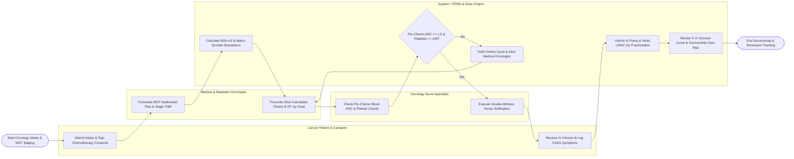

# Swimlane Diagram — Oncology Patient Management System

## Mermaid Code

## Flow Description | Mô tả luồng

| Lane | Actor / Subsystem | Role in Flow |
|------|-------------------|--------------|
| 1 | Cancer Patient & Caregiver | Attends oncology intake, signs chemotherapy procedural consents, receives IV chemotherapy infusions in chairs, logs home ESAS symptom scores, and tracks survivorship. |
| 2 | Oncology Nurse Specialist | Checks pre-chemo blood counts (ANC/Platelets), executes independent double-witness nurse verification (7 safety checks), operates IV pumps, and logs CTCAE toxicity grades. |
| 3 | System / OPMS & Dose Engine | Calculates Body Surface Area (BSA m²), checks organ safety dosing rules, matches somatic biomarkers to targeted drugs, unlocks IV pumps, and exports 5-year survival statistics. |
| 4 | Medical & Radiation Oncologist | Formulates Multidisciplinary Tumor Board (MDT) plans, stages TNM (AJCC 8th ed), prescribes BSA-calculated chemotherapy protocols (FOLFOX), and plans DICOM-RT Gray doses. |
