# Action Tree — Oncology Patient Management System

## Mermaid Code

```mermaid
graph TD
    Root["Oncology Patient Management System"]

    Root --> M1["Cancer Staging & MDT Tumor Board"]
    Root --> M2["Chemo Protocol & BSA Dose Engine"]
    Root --> M3["Infusion Suite & Double-Witness"]
    Root --> M4["Radiotherapy & LINAC Fractionation"]
    Root --> M5["Somatic Biomarkers & Precision Medicine"]
    Root --> M6["Toxicity CTCAE & Symptom Care"]
    Root --> M7["Survivorship & Remission Tracking"]
    Root --> M8["National Cancer Registry Analytics"]

    M1 --> A11["Record AJCC 8th Edition TNM Staging"]
    M1 --> A12["Evaluate ECOG Performance Status Grade"]
    M1 --> A13["Conduct Multidisciplinary Tumor Board MDT"]
    M1 --> A14["Formulate Multimodal Treatment Plan Consensus"]

    M2 --> A21["Select Standardized Chemotherapy Protocols"]
    M2 --> A22["Calculate BSA Mosteller & Calvert AUC Doses"]
    M2 --> A23["Apply Renal & Hepatic Dose Reduction Rules"]
    M2 --> A24["Order Compounded IV Chemotherapy Bags"]

    M3 --> A31["Schedule Outpatient Infusion Suite Chairs"]
    M3 --> A32["Execute Double-Witness Nurse Safety Checks"]
    M3 --> A33["Scan Chemotherapy IV Bag Barcode Labels"]
    M3 --> A34["Monitor IV Central Line Extravasation Risks"]

    M4 --> A41["Ingest DICOM-RT Target Volume & OAR Plans"]
    M4 --> A42["Track Daily LINAC Radiation Fractionation Gy"]
    M4 --> A43["Perform Image-Guided Radiotherapy IGRT CBCT"]
    M4 --> A44["Monitor Cumulative Organ-at-Risk OAR Limits"]

    M5 --> A51["Ingest NGS Somatic Biomarker Panel Mutations"]
    M5 --> A52["Record PD-L1 TPS Percent & HER2 IHC Status"]
    M5 --> A53["Match Targeted Kinase Inhibitors & Immunotherapy"]
    M5 --> A54["Track Drug Resistance Mutation Profiles"]

    M6 --> A61["Document NCI CTCAE v5.0 Toxicity Grades"]
    M6 --> A62["Monitor Pre-Chemo ANC & Platelet Lab Counts"]
    M6 --> A63["Capture ESAS Edmonton Symptom Pain Scores"]
    M6 --> A64["Log Anaphylaxis Emergency Interruption Events"]

    M7 --> A71["Generate Cancer Survivorship Care Plans"]
    M7 --> A72["Assess RECIST 1.1 PET-CT Tumor Response"]
    M7 --> A73["Schedule Post-Remission Surveillance Imaging"]
    M7 --> A74["Track Cancer Recurrence & Relapse Events"]

    M8 --> A81["Export National Cancer Registry Epidemiology"]
    M8 --> A82["Calculate 5-Year Overall Survival OS Percent"]
    M8 --> A83["Render Kaplan-Meier Survival Curves"]
    M8 --> A84["Audit Chemotherapy Quality Compliance Metrics"]
```

## Module Description | Mô tả Module

| # | Module | Description | Actions |
|---|--------|-------------|---------|
| 1 | Cancer Staging & MDT Tumor Board | Records AJCC 8th ed TNM staging, evaluates ECOG status (0-4), conducts Multidisciplinary Tumor Board (MDT) meetings, and formulates consensus plans. | Record AJCC 8th Edition TNM Staging, Evaluate ECOG Performance Status Grade, Conduct Multidisciplinary Tumor Board MDT, Formulate Multimodal Treatment Plan Consensus |
| 2 | Chemo Protocol & BSA Dose Engine | Selects standardized chemo protocols (FOLFOX, AC-T), calculates BSA/Calvert AUC doses, applies organ impairment dose reductions, and orders IV bags. | Select Standardized Chemotherapy Protocols, Calculate BSA Mosteller & Calvert AUC Doses, Apply Renal & Hepatic Dose Reduction Rules, Order Compounded IV Chemotherapy Bags |
| 3 | Infusion Suite & Double-Witness | Schedules outpatient infusion chairs, executes independent double-witness nurse verification (7 safety checks), scans IV barcodes, and monitors extravasation. | Schedule Outpatient Infusion Suite Chairs, Execute Double-Witness Nurse Safety Checks, Scan Chemotherapy IV Bag Barcode Labels, Monitor IV Central Line Extravasation Risks |
| 4 | Radiotherapy & LINAC Fractionation | Ingests DICOM-RT plans, tracks daily LINAC radiation fractions (Gy), performs IGRT position alignment (CBCT), and checks cumulative OAR dose limits. | Ingest DICOM-RT Target Volume & OAR Plans, Track Daily LINAC Radiation Fractionation Gy, Perform Image-Guided Radiotherapy IGRT CBCT, Monitor Cumulative Organ-at-Risk OAR Limits |
| 5 | Somatic Biomarkers & Precision Medicine | Ingests NGS somatic biomarker panels (EGFR, ALK, PD-L1 TPS %), matches targeted kinase inhibitors/immunotherapy, and tracks resistance mutations. | Ingest NGS Somatic Biomarker Panel Mutations, Record PD-L1 TPS Percent & HER2 IHC Status, Match Targeted Kinase Inhibitors & Immunotherapy, Track Drug Resistance Mutation Profiles |
| 6 | Toxicity CTCAE & Symptom Care | Documents NCI CTCAE v5.0 adverse events (Grade 1-5), monitors pre-chemo ANC/platelet counts, captures ESAS symptom scores, and handles emergency stops. | Document NCI CTCAE v5.0 Toxicity Grades, Monitor Pre-Chemo ANC & Platelet Lab Counts, Capture ESAS Edmonton Symptom Pain Scores, Log Anaphylaxis Emergency Interruption Events |
| 7 | Survivorship & Remission Tracking | Generates Survivorship Care Plans, evaluates RECIST 1.1 tumor response via PET-CT, schedules surveillance scans, and tracks cancer recurrence events. | Generate Cancer Survivorship Care Plans, Assess RECIST 1.1 PET-CT Tumor Response, Schedule Post-Remission Surveillance Imaging, Track Cancer Recurrence & Relapse Events |
| 8 | National Cancer Registry Analytics | Exports de-identified epidemiology data to National Cancer Registries, calculates 5-year Overall Survival (OS %), renders Kaplan-Meier curves, and audits quality. | Export National Cancer Registry Epidemiology, Calculate 5-Year Overall Survival OS Percent, Render Kaplan-Meier Survival Curves, Audit Chemotherapy Quality Compliance Metrics |
