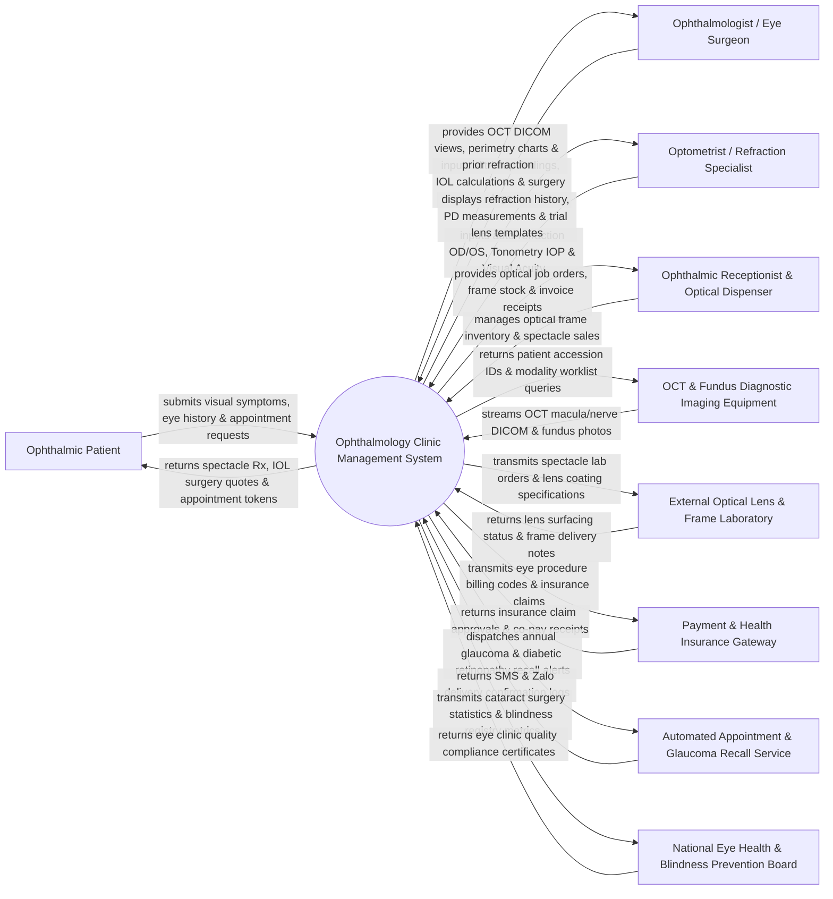

# Context Diagram — Ophthalmology Clinic Management System

## Mermaid Code

## Actor & Interaction Table | Bảng Actor & Tương tác

| # | Actor | Actor Type | Data Sent TO System | Data Received FROM System | Notes |
|---|-------|------------|---------------------|---------------------------|-------|
| 1 | Ophthalmic Patient | Primary | Visual symptom complaints (blurriness, floaters, eye pain), medical history, appointment bookings. | Spectacle prescriptions, contact lens parameters, IOL surgery cost quotes, appointment tokens. | Individual receiving eye exams, vision correction, glaucoma screening, or cataract surgery. |
| 2 | Ophthalmologist / Eye Surgeon | Primary | Slit-lamp biomicroscopy notes, retinal diagnosis, IOL power calculations, LASIK/cataract surgery records. | OCT DICOM scans, Visual Field perimetry charts, fundus photos, refraction history. | Medical doctor specialized in eye diseases, corneal/retinal diagnosis, and ophthalmic surgery. |
| 3 | Optometrist / Refraction Specialist | Primary | Visual Acuity (VA uncorrected/corrected), Auto-refraction OD/OS (Sphere, Cylinder, Axis), Tonometry IOP. | Patient prior glass prescriptions, Pupillary Distance (PD), trial lens template guides. | Eye care professional conducting vision testing, refraction, fitting contact lenses, and measuring IOP. |
| 4 | Ophthalmic Receptionist & Optical Dispenser | Primary | Patient check-in, optical frame/lens selection, spectacle job ordering, installment payments. | Optical shop inventory status, spectacle job order tracking, payment receipts. | Front-desk staff managing clinic scheduling, optical shop sales, and frame inventory. |
| 5 | OCT & Fundus Diagnostic Imaging Equipment | Supporting System | Optical Coherence Tomography (OCT) retinal/optic nerve DICOM scans, Fundus camera photographs. | Modality Worklist (MWL) queries, patient accession IDs, study indexing tokens. | Diagnostic imaging hardware (e.g., Zeiss CIRRUS, Topcon 3D OCT, Heidelberg SPECTRALIS) capturing eye scans. |
| 6 | External Optical Lens & Frame Laboratory | Supporting System | Lens surfacing completion status, progressive lens fitting verification, frame delivery notes. | Spectacle lens orders, progressive power specs, anti-reflective coating requirements. | Commercial optical lab surfacing custom prescription lenses, progressive lenses, and fitting frames. |
| 7 | Payment & Health Insurance Gateway | Supporting System | Payment authorization codes, insurance claim approvals (CPT eye codes), co-pay amounts. | Ophthalmology billing claims, surgical procedure invoice items, batch settlement files. | Payment processor and health insurance payer clearing ophthalmic exam and surgical claims. |
| 8 | Automated Appointment & Glaucoma Recall Service | Supporting System | Delivery confirmation receipts, SMS/Zalo message transmission logs, patient response tokens. | Annual glaucoma IOP check reminders, diabetic retinopathy screening alerts, post-op follow-up SMS. | Multi-channel messaging engine sending automated reminders for chronic eye disease follow-ups. |
| 9 | National Eye Health & Blindness Prevention Board | Regulatory | National blindness prevention guidelines, cataract surgical quality benchmarks, trachoma standards. | Cataract Surgical Rate (CSR) metrics, post-op vision outcome statistics, blindness registry reports. | Governmental health body monitoring eye health, cataract surgery outcomes, and blindness prevention. |

## System Boundary Description | Mô tả Phạm vi Hệ thống

The **Ophthalmology Clinic Management System (OCMS)** is a domain-specific ambulatory eye care software solution designed for ophthalmology clinics, eye hospitals, and optical centers. It digitizes visual acuity charting (Snellen, LogMAR), auto-refraction OD (right eye) / OS (left eye) measurement, Intraocular Pressure (IOP) tonometry, slit-lamp biomicroscopy documentation, Optical Coherence Tomography (OCT) DICOM imaging, fundus photography, IOL Master cataract surgery power calculations, optical shop spectacle dispensing, and chronic glaucoma recall tracking.

**Inside System Scope:**
- Visual Acuity (VA) recording (uncorrected, pinhole, best-corrected) for Right Eye (OD) and Left Eye (OS).
- Refraction measurement (Sphere, Cylinder, Axis, Add power, Pupillary Distance mm) and spectacle Rx issuance.
- Intraocular Pressure (IOP) tonometry logging (Goldmann, Non-Contact Applanation) with corneal thickness correction.
- Slit-lamp biomicroscopy charting (Anterior chamber, Cornea, Lens, Iris, Vitreous, Retina).
- DICOM integration with OCT scanners, Fundus Cameras, and Visual Field Perimetry machines.
- Cataract IOL Master power calculations (SRK/T, Barrett Universal II formulas) and intraocular lens selection.
- Optical shop inventory management, spectacle job order processing, and lens dispensing.
- Automated recall management for chronic Glaucoma and Diabetic Retinopathy patients.

**Outside System Scope:**
- Physical surfacing and edging of optical glass lenses in external labs (handled by lab machinery).
- Physical execution of phacoemulsification or LASIK laser ablation in the operating theater (handled by laser units).
- General non-ophthalmic medical surgeries and inpatient hospital billing (handled by HIS).
- Commercial financial banking ledger accounting (handled by general accounting software).
