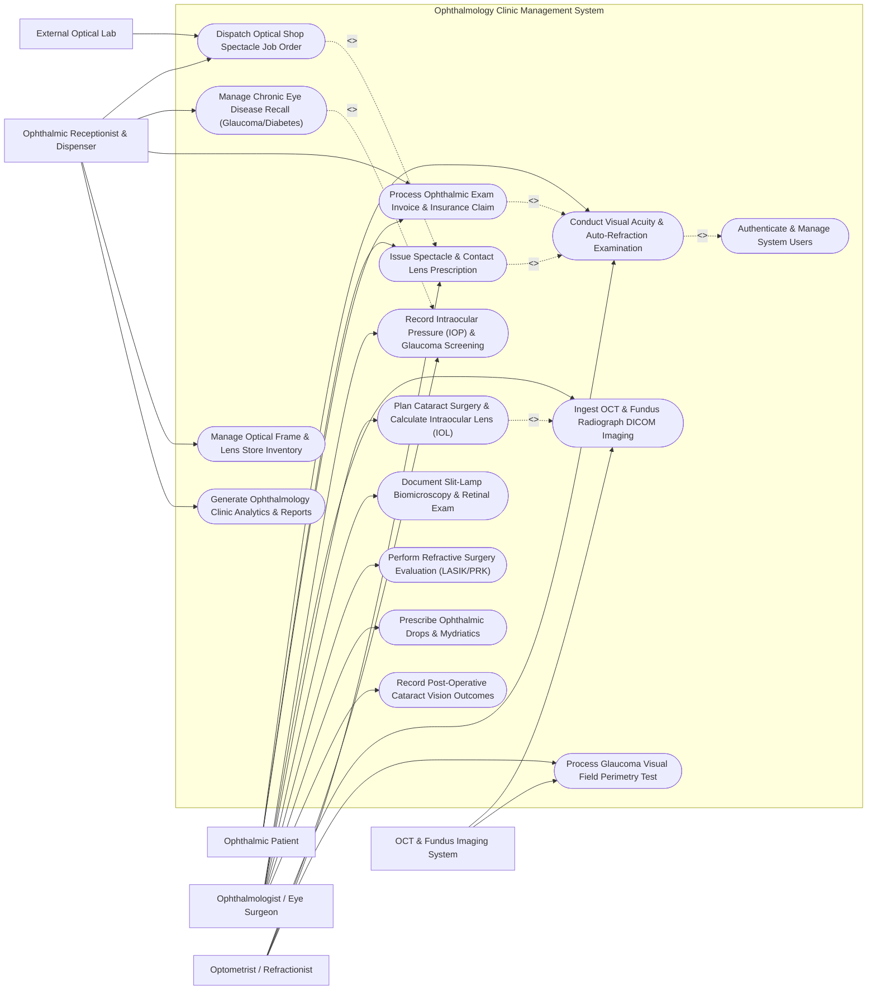

# Use Case Diagram — Ophthalmology Clinic Management System

## Mermaid Code

## Actor Table | Bảng Actor

| # | Actor | Actor Type | Role Description | Related Use Cases |
|---|-------|------------|------------------|-------------------|
| 1 | Ophthalmic Patient | Primary | Patient receiving vision testing, spectacle prescriptions, eye disease treatment, or cataract surgery. | UC01, UC03, UC10 |
| 2 | Optometrist / Refractionist | Primary | Vision care specialist performing visual acuity tests, auto-refraction OD/OS, IOP tonometry, and visual field perimetry. | UC01, UC02, UC03, UC08 |
| 3 | Ophthalmologist / Eye Surgeon | Primary | Medical eye doctor examining anterior/posterior eye segments, interpreting OCT scans, calculating IOL powers, and performing surgery. | UC02, UC04, UC05, UC06, UC11, UC12, UC14 |
| 4 | Ophthalmic Receptionist & Dispenser | Primary | Clinic receptionist managing optical shop sales, spectacle frame orders, patient recall notifications, and billing. | UC07, UC09, UC10, UC13, UC15 |
| 5 | External Optical Lab | Secondary / System | Commercial laboratory receiving optical job orders and surfacing custom prescription lenses. | UC07 |
| 6 | OCT & Fundus Imaging System | Secondary / System | Diagnostic imaging hardware capturing OCT macula/nerve DICOM scans and fundus photographs. | UC04, UC08 |

## Use Case Table | Bảng Use Case

| # | UC ID | Use Case Name | Primary Actor | Secondary Actor | Description | Priority |
|---|-------|---------------|---------------|-----------------|-------------|----------|
| 1 | UC01 | Conduct Visual Acuity & Auto-Refraction Examination | Optometrist / Refractionist | Ophthalmic Patient | Measure uncorrected/corrected Visual Acuity (Snellen/LogMAR) and capture auto-refraction (Sphere, Cylinder, Axis, PD). | High |
| 2 | UC02 | Record Intraocular Pressure (IOP) & Glaucoma Screening | Optometrist / Refractionist | Ophthalmologist | Measure IOP via Goldmann or Non-Contact Tonometry, log central corneal thickness (CCT), and calculate corrected IOP. | High |
| 3 | UC03 | Issue Spectacle & Contact Lens Prescription | Optometrist / Refractionist | Ophthalmic Patient | Generate official optical prescription specifying OD/OS Sphere, Cylinder, Axis, Add power, Prism, and Pupillary Distance. | High |
| 4 | UC04 | Ingest OCT & Fundus Radiograph DICOM Imaging | Ophthalmologist | OCT & Fundus Imaging System | Import 3D Optical Coherence Tomography (OCT) retinal nerve fiber layer (RNFL) scans and high-resolution fundus images. | High |
| 5 | UC05 | Plan Cataract Surgery & Calculate Intraocular Lens (IOL) | Ophthalmologist | None | Calculate IOL power choices (Monofocal, Toric, Multifocal) using biometry (Axial Length, K1/K2) and SRK/T / Barrett formulas. | High |
| 6 | UC06 | Document Slit-Lamp Biomicroscopy & Retinal Exam | Ophthalmologist | None | Record anatomical observations of cornea, iris, anterior chamber, crystalline lens, vitreous, and dilated fundus examination. | High |
| 7 | UC07 | Dispatch Optical Shop Spectacle Job Order | Ophthalmic Receptionist & Dispenser | External Optical Lab | Select spectacle frames, configure lens materials/coatings (Anti-reflective, Photochromic), and transmit lab job orders. | High |
| 8 | UC08 | Process Glaucoma Visual Field Perimetry Test | Optometrist / Refractionist | OCT & Fundus Imaging System | Ingest Humphrey Visual Field (HVF) perimetry reports, tracking Visual Field Index (VFI) and Mean Deviation (MD) loss. | High |
| 9 | UC09 | Manage Chronic Eye Disease Recall (Glaucoma/Diabetes) | Ophthalmic Receptionist & Dispenser | None | Auto-generate recall rosters for chronic glaucoma or diabetic retinopathy patients and send SMS/Zalo reminders. | Medium |
| 10 | UC10 | Process Ophthalmic Exam Invoice & Insurance Claim | Ophthalmic Receptionist & Dispenser | None | Itemize eye examination fees, diagnostic test charges (OCT/Perimetry), calculate insurance coverage, and issue invoices. | High |
| 11 | UC11 | Perform Refractive Surgery Evaluation (LASIK/PRK) | Ophthalmologist | None | Evaluate corneal topography, pachymetry map, flap thickness, and target ablation depth for LASIK/PRK candidate selection. | Medium |
| 12 | UC12 | Prescribe Ophthalmic Drops & Mydriatics | Ophthalmologist | None | Issue prescriptions for topical eye drops (Antibiotics, Steroids, Glaucoma Prostaglandins, Mydriatics) with eye side indicators. | High |
| 13 | UC13 | Manage Optical Frame & Lens Store Inventory | Ophthalmic Receptionist & Dispenser | None | Maintain inventory of optical frames, contact lens boxes, reorder points, and supplier purchase orders. | Medium |
| 14 | UC14 | Record Post-Operative Cataract Vision Outcomes | Ophthalmologist | None | Track Day 1, Week 1, and Month 1 post-op uncorrected visual acuity, IOP, IOL position, and Cataract Surgical Rate (CSR). | Medium |
| 15 | UC15 | Generate Ophthalmology Clinic Analytics & Reports | Ophthalmic Receptionist & Dispenser | None | Produce daily patient throughput, refraction conversion rates, optical shop revenue, and glaucoma recall rates. | Medium |
| 16 | UC16 | Authenticate & Manage System Users | All Users | None | Enforce secure login, role-based access control, and electronic charting signature audit logs. | High |

## Use Case Specification | Đặc tả Use Case

---

### UC01 — Conduct Visual Acuity & Auto-Refraction Examination

| Field | Detail |
|-------|--------|
| **UC ID** | UC01 |
| **Use Case Name** | Conduct Visual Acuity & Auto-Refraction Examination |
| **Actor(s)** | Primary: Optometrist / Refractionist   Secondary: Ophthalmic Patient |
| **Description** | Conducts standard ophthalmic pre-examination, measuring uncorrected visual acuity (UCVA), pinhole visual acuity, and best-corrected visual acuity (BCVA) for OD (Right Eye) and OS (Left Eye), and capturing auto-refraction parameters (Sphere, Cylinder, Axis, Pupillary Distance). |
| **Precondition** | 1. The patient is checked into the eye clinic exam room.   2. Auto-refractor hardware is connected to OCMS or available for manual input. |
| **Main Flow** | 1. The Optometrist opens the "Vision & Refraction Exam" module for the active patient.   2. The Optometrist tests Visual Acuity using an electronic Snellen or LogMAR chart at 6 meters / 20 feet.   3. The Optometrist inputs UCVA: OD (e.g., 20/60 or 6/18) and OS (e.g., 20/100 or 6/30). If reduced, Pinhole VA (PH) is tested and recorded.   4. The Optometrist captures measurements from the Auto-Refractor machine for OD (Right Eye) and OS (Left Eye): **OD**: Sphere (e.g., -2.50 D), Cylinder (e.g., -1.25 D), Axis (e.g., 175°); **OS**: Sphere (e.g., -3.00 D), Cylinder (e.g., -0.75 D), Axis (e.g., 180°).   5. The Optometrist measures Pupillary Distance (PD mm) for distance and near vision (e.g., 63/60 mm).   6. The Optometrist performs subjective trial lens refinement using the phoropter to determine Best-Corrected Visual Acuity (BCVA) (e.g., 20/20 OD, 20/20 OS).   7. The Optometrist saves the refraction record, which automatically populates the baseline data for the Ophthalmologist's exam and Spectacle Rx generation (UC03). |
| **Alternative Flow** | **AF1** — Pediatric Cycloplegic Refraction: For pediatric patients, the Optometrist records post-cycloplegic mydriatic refraction (using Cyclogyl/Atropine drops) to unmask latent hyperopia.   **AF2** — Low Vision Charting: For severe vision impairment (VA < 20/400), the Optometrist records Counting Fingers (CF), Hand Motion (HM), or Light Perception (LP) status. |
| **Exception Flow** | **EX1** — Sudden Vision Drop Warning: If UCVA has dropped by >= 3 Snellen lines compared to the last exam 6 months ago, the System flags a red "Sudden Visual Loss Alert" prompting urgent physician evaluation.   **EX2** — High Astigmatism Flag (`Cylinder > 3.00 D`): If cylinder power exceeds 3.00 D, the System flags potential Keratoconus or irregular astigmatism and suggests Corneal Topography. |
| **Postcondition** | Uncorrected, pinhole, and best-corrected visual acuity parameters are logged, auto-refraction parameters are saved for OD/OS, and data is ready for prescription issuance. |
| **Business Rule** | **BR1**: Visual Acuity must be recorded independently for both Right Eye (OD) and Left Eye (OS) prior to dilating drops administration.   **BR2**: Cylinder measurements must include an explicit Axis angle between 1° and 180°. |

---

### UC02 — Record Intraocular Pressure (IOP) & Glaucoma Screening

| Field | Detail |
|-------|--------|
| **UC ID** | UC02 |
| **Use Case Name** | Record Intraocular Pressure (IOP) & Glaucoma Screening |
| **Actor(s)** | Primary: Optometrist / Refractionist   Secondary: Ophthalmologist |
| **Description** | Measures intraocular pressure (IOP) using Goldmann Applanation Tonometry (GAT) or Non-Contact Tonometry (NCT), logs Central Corneal Thickness (CCT pachymetry in microns), and automatically calculates corneal-adjusted true IOP to screen for Glaucoma and Ocular Hypertension. |
| **Precondition** | 1. The patient is checked into the exam chair.   2. Tonometer hardware is calibrated and sterile. |
| **Main Flow** | 1. The Optometrist or Ophthalmologist opens the "Tonometry & Glaucoma Flowsheet".   2. The clinician selects the tonometry measurement method: Goldmann Applanation, Non-Contact Air-Puff, or Tono-Pen.   3. The clinician measures raw IOP for OD (Right Eye) and OS (Left Eye) in mmHg (e.g., OD: 24 mmHg, OS: 18 mmHg).   4. The clinician inputs Central Corneal Thickness (CCT) pachymetry values in micrometers (um) (e.g., OD CCT: 510 um, OS CCT: 550 um).   5. The System calculates Corneal-Adjusted Corrected IOP using Dresden/Ehlers correction formulas (thin cornea adjusts IOP upward; thick cornea adjusts downward).   6. The System evaluates corrected IOP against clinical thresholds (Normal: 10-21 mmHg; Elevated: > 21 mmHg).   7. The clinician clicks "Save Tonometry Log", and the System updates the patient's longitudinal IOP trend chart and flags Glaucoma Risk if corrected IOP > 21 mmHg. |
| **Alternative Flow** | **AF1** — Diurnal IOP Variation Charting: For glaucoma suspects, the clinician records a 24-hour diurnal IOP curve (8:00 AM, 12:00 PM, 4:00 PM, 8:00 PM) to detect peak pressure spikes.   **AF2** — Cup-to-Disc (C/D) Ratio Integration: The Ophthalmologist enters the optic nerve vertical Cup-to-Disc ratio (e.g., OD C/D: 0.6, OS C/D: 0.3), and the System correlates C/D asymmetry (> 0.2) with elevated IOP. |
| **Exception Flow** | **EX1** — Acute Glaucoma Crisis Alert (`IOP >= 30 mmHg`): If measured IOP is >= 30 mmHg, the System flashes an urgent red banner "ACUTE IOP SPIKE - RISK OF GLAUCOMA CRISIS" and alerts the Ophthalmologist for immediate pressure-lowering drops.   **EX2** — Post-LASIK Thin Cornea Warning: If the patient has a history of LASIK (thin CCT < 480 um), the System highlights that raw NCT readings significantly underestimate true intraocular pressure. |
| **Postcondition** | Raw and corneal-adjusted IOP values are logged for OD/OS, CCT pachymetry is recorded, longitudinal IOP trend graphs are updated, and glaucoma alerts are active. |
| **Business Rule** | **BR1**: Measured raw IOP values > 21 mmHg must trigger automated corneal thickness adjustment and prompt visual field perimetry screening (UC08).   **BR2**: Tonometry calibration records must be verified daily prior to patient testing. |

---

### UC03 — Issue Spectacle & Contact Lens Prescription

| Field | Detail |
|-------|--------|
| **UC ID** | UC03 |
| **Use Case Name** | Issue Spectacle & Contact Lens Prescription |
| **Actor(s)** | Primary: Optometrist / Refractionist   Secondary: Ophthalmic Patient |
| **Description** | Generates an official, legally valid optical prescription for spectacles (eyeglasses) or contact lenses based on finalized refraction findings, specifying OD/OS Sphere, Cylinder, Axis, Add power, Prism, Base Curve, and Pupillary Distance. |
| **Precondition** | 1. Best-corrected visual acuity and subjective trial lens refraction are completed.   2. The Optometrist is authenticated with prescription authorization privileges. |
| **Main Flow** | 1. The Optometrist opens the "Optical Prescription Generator" from the active exam.   2. The System populates finalized subjective refraction parameters into the prescription matrix: **OD (Right Eye)**: Sphere, Cylinder, Axis, Prism / Base; **OS (Left Eye)**: Sphere, Cylinder, Axis, Prism / Base; **Near Vision**: Reading ADD power (e.g., +2.00 D for presbyopia); **Distance & Near PD**: (e.g., 63/60 mm).   3. The Optometrist selects Lens Type recommendations: Single Vision, Bifocal, Progressive Addition Lens (PAL), Anti-Reflective Coating, High-Index 1.67, Photochromic (Transitions).   4. For Contact Lens prescriptions, the Optometrist specifies Contact Lens Brand, Base Curve (BC mm), Diameter (DIA mm), Replacement Schedule (Daily, Bi-weekly, Monthly), and Fitting Clearance.   5. The Optometrist sets Prescription Expiration Date (standard 12 or 24 months out) and signs the prescription electronically.   6. The System generates an official Optical Prescription document featuring a verifiable QR Code.   7. The System prints the paper prescription, sends a digital copy to the Patient's mobile app, and automatically transmits the prescription payload to the Optical Shop Dispensing queue (UC07). |
| **Alternative Flow** | **AF1** — Prism Prescription for Strabismus: The Optometrist adds Horizontal/Vertical Prism Diopters (e.g., 2.0 PD Base Out OD) for patients with double vision or strabismus.   **AF2** — Rigid Gas Permeable (RGP) / Scleral Lens Fitting: For keratoconus patients, the Optometrist documents custom RGP/Scleral lens Vault and Edge parameters. |
| **Exception Flow** | **EX1** — Unusually High Anisometropia Alert: If the sphere difference between OD and OS exceeds 3.00 D (Anisometropia), the System displays a warning regarding potential aniseikonia (image size disparity).   **EX2** — Missing Pupillary Distance (PD): If PD measurement is omitted, the System blocks prescription printing until PD mm is entered. |
| **Postcondition** | Official optical prescription (Spectacle or Contact Lens) is generated, electronically signed, issued to patient, and routed to the optical dispensing queue. |
| **Business Rule** | **BR1**: Spectacle prescriptions must include Pupillary Distance (PD in mm) and explicit Expiration Date.   **BR2**: Contact Lens prescriptions require a documented successful lens fitting assessment before final issuance. |

---

### UC04 — Ingest OCT & Fundus Radiograph DICOM Imaging

| Field | Detail |
|-------|--------|
| **UC ID** | UC04 |
| **Use Case Name** | Ingest OCT & Fundus Radiograph DICOM Imaging |
| **Actor(s)** | Primary: Ophthalmologist   Secondary: OCT & Fundus Imaging System |
| **Description** | Connects to diagnostic eye imaging hardware (Optical Coherence Tomography - OCT, Digital Fundus Camera, Fluorescein Angiography), ingests DICOM imaging studies, displays retinal layer thickness maps (RNFL, Macular Cube), and attaches scans to patient eye charts. |
| **Precondition** | 1. The patient has completed diagnostic imaging in the OCT/Fundus camera room.   2. The DICOM storage gateway (PACS) is connected to OCMS. |
| **Main Flow** | 1. The Ophthalmologist opens the "Ophthalmic Imaging Viewer" within the patient's chart.   2. The System queries the DICOM archive using the patient's Accession Number or Medical Record Number.   3. The System retrieves the imaging study: OCT Macular Thickness Map, Retinal Nerve Fiber Layer (RNFL) Ganglion Cell Analysis, or High-Resolution Color Fundus Photograph.   4. The System displays the multi-modality viewer: **OCT Cross-Section**: Visualizes 10 retinal layers (ILM to RPE), central foveal thickness (um), and macular edema fluids; **RNFL Map**: Displays green/yellow/red normative database comparison for optic nerve head atrophy; **Fundus Photo**: Displays optic disc, macula, and retinal blood vessels.   5. The Ophthalmologist applies digital measurement tools: Measuring neuroretinal rim thickness, drusen diameter, or intraretinal fluid pocket area.   6. The Ophthalmologist enters diagnostic findings (e.g., "OCT shows central diabetic macular edema with CFT 420 um and intraretinal cysts").   7. The System links the DICOM study to the patient's record and updates diagnostic tags (e.g., Diabetic Retinopathy, Age-Related Macular Degeneration - AMD, Glaucoma). |
| **Alternative Flow** | **AF1** — Fundus Fluorescein Angiography (FFA) Series: The System ingests a timed sequence of FFA images, tracking dye transit time (Arterial, Venous, Late phases) to identify microaneurysms or neovascularization.   **AF2** — Longitudinal OCT Progression Analysis: The Ophthalmologist launches "OCT Guided Progression Analysis (GPA)", comparing current RNFL thickness against baseline scans from 2 years ago to evaluate glaucoma progression. |
| **Exception Flow** | **EX1** — Low OCT Signal Quality Index (`Signal Strength < 5/10`): If the OCT scan quality is poor due to dense cataract media opacity, the System flags "Low Signal Strength - Interpret with Caution".   **EX2** — Unmatched DICOM Patient Metadata: If the DICOM header patient name has a typo compared to OCMS, the System prompts the technician to confirm identity before linking. |
| **Postcondition** | OCT cross-sections, RNFL thickness maps, and fundus DICOM images are attached to the chart, quantitative thickness metrics are logged, and physician interpretation is saved. |
| **Business Rule** | **BR1**: OCT macular thickness measurements > 300 um must prompt screening for Diabetic Macular Edema (DME) or Wet AMD.   **BR2**: Diagnostic DICOM images must be archived uncompressed in compliance with medical imaging standards. |

---

### UC05 — Plan Cataract Surgery & Calculate Intraocular Lens (IOL)

| Field | Detail |
|-------|--------|
| **UC ID** | UC05 |
| **Use Case Name** | Plan Cataract Surgery & Calculate Intraocular Lens (IOL) |
| **Actor(s)** | Primary: Ophthalmologist |
| **Description** | Handles surgical planning for cataract phacoemulsification, ingesting optical biometry parameters (Axial Length, Keratometry K1/K2, Anterior Chamber Depth), executing IOL power calculation formulas (SRK/T, Barrett Universal II, Hill-RBF), selecting artificial IOL implants (Monofocal, Toric, Multifocal), and generating surgical packages. |
| **Precondition** | 1. The patient is diagnosed with clinically significant cataract affecting vision.   2. Optical biometry measurements (e.g., IOLMaster 700 or Lenstar) are completed. |
| **Main Flow** | 1. The Ophthalmologist opens the "Cataract Surgical Planner & IOL Calculator" for the target patient.   2. The System ingests optical biometry data for target eye (OD or OS): Axial Length (AL mm, e.g., 23.50 mm), Keratometry K1/K2 (Diopters, e.g., K1: 43.25 D @ 180°, K2: 44.00 D @ 90°), Corneal Astigmatism (0.75 D @ 90°), Anterior Chamber Depth (ACD mm, e.g., 3.20 mm), White-to-White (WTW mm).   3. The Ophthalmologist inputs Target Post-Op Refraction (e.g., Emmetropia 0.00 D or Monovision -1.50 D).   4. The System runs multiple verified IOL Calculation Formulas in parallel: SRK/T, Hoffer Q, Holladay 1, Barrett Universal II, and Kane formula.   5. The System displays a ranked table of recommended IOL power options (e.g., +21.50 D yielding -0.12 D post-op; +22.00 D yielding -0.45 D post-op) across available clinic IOL inventory brands (e.g., Alcon AcrySof IQ, Johnson & Johnson Tecnis).   6. For astigmatic patients (> 1.00 D corneal astigmatism), the System evaluates Toric IOL calculation: Recommends Toric IOL model, required cylinder power, and precise steep axis alignment angle (e.g., Align Toric IOL at 95°).   7. The Ophthalmologist selects the final IOL power, lens model, and serial number, signs the surgical plan, and the System reserves the chosen IOL implant from surgical inventory and generates the Surgical Operating Room Package. |
| **Alternative Flow** | **AF1** — Post-LASIK / Refractive IOL Calculation: For patients with prior LASIK/PRK corneal surgery, the System switches to post-refractive formulas (Haigis-L, Shammas, Barrett True-K) to avoid post-op hyperopic surprise.   **AF2** — Premium Multifocal / Extended Depth of Focus (EDOF) Selection: The Ophthalmologist selects a Premium EDOF IOL, and the System generates an informed consent form detailing halo/glare visual phenomena. |
| **Exception Flow** | **EX1** — Extreme Axial Length Warning (`AL < 20mm` or `AL > 28mm`): For high hyperopic or high myopic eyes, the System flags "Extreme Axial Length" and automatically highlights specialized formulas (Hoffer Q for short eyes; Wang-Koch modified for long eyes).   **EX2** — Selected IOL Model Out of Stock: If the chosen +21.50 D Toric IOL is out of stock in surgical inventory, the System alerts the nurse to place an urgent supplier order. |
| **Postcondition** | Biometry parameters are saved, IOL power and model are selected, target refraction is recorded, chosen IOL is reserved, and surgical room package is printed. |
| **Business Rule** | **BR1**: IOL power calculations for eyes with prior corneal refractive surgery MUST use validated post-refractive formulas (Barrett True-K or Haigis-L).   **BR2**: Toric IOL surgical plans must specify exact steep axis alignment angle in degrees (1° to 180°). |
