# Conceptual ERD — Ophthalmology Clinic Management System

## Mermaid Code

```mermaid
erDiagram
    EYE_PATIENT {
        int patient_id PK
        string patient_code
        string full_name
        date date_of_birth
        string gender
        string phone_number
        string systemic_disease_notes
        datetime created_at
    }

    OPHTHALMIC_EXAM {
        int exam_id PK
        int patient_id FK
        int doctor_user_id FK
        string va_right_eye_od
        string va_left_eye_os
        string slit_lamp_notes
        datetime exam_datetime
    }

    REFRACTION_MEASUREMENT {
        int refraction_id PK
        int exam_id FK
        decimal od_sphere
        decimal od_cylinder
        int od_axis
        decimal os_sphere
        decimal os_cylinder
        int os_axis
        decimal pupillary_distance_mm
        datetime measured_at
    }

    TONOMETRY_IOP_LOG {
        int iop_id PK
        int exam_id FK
        decimal od_iop_mmhg
        decimal os_iop_mmhg
        string measurement_method
        int corneal_thickness_od
        int corneal_thickness_os
        datetime logged_at
    }

    OPTICAL_PRESCRIPTION {
        int prescription_id PK
        int patient_id FK
        int doctor_user_id FK
        string prescription_type
        decimal add_power
        decimal prism_diopters
        date expiry_date
        string prescription_status
    }

    OPHTHALMIC_IMAGING {
        int imaging_id PK
        int patient_id FK
        string modality_type
        string eye_side
        string dicom_study_uid
        int retinal_layer_thickness_um
        datetime captured_at
    }

    CATARACT_IOL_CALCULATION {
        int iol_id PK
        int patient_id FK
        int surgeon_user_id FK
        decimal axial_length_mm
        decimal keratometry_k1
        decimal keratometry_k2
        decimal target_refraction
        decimal recommended_iol_power
        datetime calculated_at
    }

    OPTICAL_DISPENSING_ORDER {
        int dispensing_id PK
        int prescription_id FK
        string frame_brand
        string lens_coating_type
        decimal total_price
        decimal deposit_paid
        string order_status
    }

    GLAUCOMA_PERIMETRY_STUDY {
        int perimetry_id PK
        int patient_id FK
        decimal visual_field_index_vfi
        decimal mean_deviation_md
        decimal pattern_standard_deviation_psd
        datetime tested_at
    }

    EYE_SURGERY_RECORD {
        int surgery_id PK
        int patient_id FK
        int surgeon_user_id FK
        string surgery_type
        string eye_side
        string iol_serial_number
        string post_op_vision
        date surgery_date
    }

    RETINAL_DIABETIC_SCREENING {
        int screening_id PK
        int patient_id FK
        string etdrs_severity_stage
        boolean macular_edema_flag
        boolean laser_treatment_recommended
        datetime screened_at
    }

    OPHTHALMIC_INVOICE {
        int invoice_id PK
        int patient_id FK
        decimal total_amount
        decimal insurance_covered
        decimal patient_paid
        string payment_status
        datetime issued_at
    }

    EYE_PATIENT ||--o{ OPHTHALMIC_EXAM : "undergoes"
    EYE_PATIENT ||--o{ OPTICAL_PRESCRIPTION : "receives"
    EYE_PATIENT ||--o{ OPHTHALMIC_IMAGING : "captures"
    EYE_PATIENT ||--o{ CATARACT_IOL_CALCULATION : "evaluated_for"
    EYE_PATIENT ||--o{ GLAUCOMA_PERIMETRY_STUDY : "tested_in"
    EYE_PATIENT ||--o{ EYE_SURGERY_RECORD : "undergoes_surgery"
    EYE_PATIENT ||--o{ RETINAL_DIABETIC_SCREENING : "screened_in"
    EYE_PATIENT ||--o{ OPHTHALMIC_INVOICE : "billed_in"
    OPHTHALMIC_EXAM ||--o{ REFRACTION_MEASUREMENT : "contains"
    OPHTHALMIC_EXAM ||--o{ TONOMETRY_IOP_LOG : "measures"
    OPTICAL_PRESCRIPTION ||--o{ OPTICAL_DISPENSING_ORDER : "dispenses"
```

## Entity Description Table | Bảng mô tả Entity

| # | Entity Name | Vietnamese Name | Description | Key Attributes | Main Relationships |
|---|-------------|-----------------|-------------|----------------|-------------------|
| 1 | EYE_PATIENT | Bệnh nhân Nhãn khoa | Master eye patient record storing patient code, demographics, systemic disease history (Diabetes, Hypertension), and creation date. | patient_id, patient_code, full_name, dob, gender, phone_number, systemic_disease_notes | Has many OPHTHALMIC_EXAM, OPTICAL_PRESCRIPTION, OPHTHALMIC_IMAGING, CATARACT_IOL_CALCULATION, etc. |
| 2 | OPHTHALMIC_EXAM | Khám Mắt Clinical Exam | Clinical examination record storing uncorrected visual acuity OD/OS, slit-lamp biomicroscopy notes, and exam timestamp. | exam_id, patient_id, doctor_user_id, va_right_eye_od, va_left_eye_os, slit_lamp_notes | Belongs to EYE_PATIENT; Has many REFRACTION_MEASUREMENT and TONOMETRY_IOP_LOG entities. |
| 3 | REFRACTION_MEASUREMENT | Đo Khúc xạ OD/OS | Objective and subjective refraction record storing OD/OS Sphere, Cylinder, Axis, and Pupillary Distance (PD mm). | refraction_id, exam_id, od_sphere, od_cylinder, od_axis, os_sphere, os_cylinder, os_axis, pupillary_distance_mm | Belongs to OPHTHALMIC_EXAM. |
| 4 | TONOMETRY_IOP_LOG | Đo Nhãn áp (IOP) | Intraocular pressure measurement log recording OD/OS raw IOP (mmHg), method (Goldmann/NCT), and corneal thickness (CCT um). | iop_id, exam_id, od_iop_mmhg, os_iop_mmhg, measurement_method, corneal_thickness_od/os | Belongs to OPHTHALMIC_EXAM. |
| 5 | OPTICAL_PRESCRIPTION | Đơn Kính Mắt (Spectacle Rx) | Official spectacle or contact lens prescription specifying ADD power, prism diopters, expiration date, and status. | prescription_id, patient_id, doctor_user_id, prescription_type, add_power, prism_diopters, expiry_date | Belongs to EYE_PATIENT; Has many OPTICAL_DISPENSING_ORDER entities. |
| 6 | OPHTHALMIC_IMAGING | Phim Chẩn đoán OCT / Fundus | Optical Coherence Tomography (OCT) or fundus camera DICOM imaging record tracking modality type, eye side, and DICOM study UID. | imaging_id, patient_id, modality_type, eye_side, dicom_study_uid, retinal_layer_thickness_um | Belongs to EYE_PATIENT. |
| 7 | CATARACT_IOL_CALCULATION | Tính Công suất Thủy tinh thể (IOL) | Cataract surgical biometry planning record calculating IOL power based on Axial Length, Keratometry K1/K2, and target refraction. | iol_id, patient_id, surgeon_user_id, axial_length_mm, keratometry_k1, keratometry_k2, recommended_iol_power | Belongs to EYE_PATIENT. |
| 8 | OPTICAL_DISPENSING_ORDER | Đơn Cắt Kính (Optical Shop) | Optical shop spectacle dispensing order tracking frame brand, lens coating type, total price, deposit, and order status. | dispensing_id, prescription_id, frame_brand, lens_coating_type, total_price, order_status | Belongs to OPTICAL_PRESCRIPTION. |
| 9 | GLAUCOMA_PERIMETRY_STUDY | Thị trường Perimetry | Humphrey Visual Field (HVF) perimetry study record tracking Visual Field Index (VFI %), Mean Deviation (MD dB), and Pattern SD. | perimetry_id, patient_id, visual_field_index_vfi, mean_deviation_md, pattern_standard_deviation_psd | Belongs to EYE_PATIENT. |
| 10 | EYE_SURGERY_RECORD | Hồ sơ Phẫu thuật Mắt | Ophthalmic surgical procedure record (Cataract Phaco, LASIK, Pterygium) tracking eye side, IOL serial number, and post-op vision. | surgery_id, patient_id, surgeon_user_id, surgery_type, eye_side, iol_serial_number, post_op_vision | Belongs to EYE_PATIENT. |
| 11 | RETINAL_DIABETIC_SCREENING | Sàng lọc Võng mạc Tiểu đường | Diabetic Retinopathy screening record documenting ETDRS disease stage (Non-Proliferative / Proliferative) and macular edema flags. | screening_id, patient_id, etdrs_severity_stage, macular_edema_flag, laser_treatment_recommended | Belongs to EYE_PATIENT. |
| 12 | OPHTHALMIC_INVOICE | Hóa đơn Nãn khoa | Clinical invoice itemizing exam fees, diagnostic imaging charges, optical sales, insurance coverage, and payment status. | invoice_id, patient_id, total_amount, insurance_covered, patient_paid, payment_status | Belongs to EYE_PATIENT. |

## Relationship Description | Mô tả Quan hệ

| # | From Entity | Cardinality | To Entity | Relationship Label | Business Explanation |
|---|-------------|-------------|-----------|-------------------|----------------------|
| 1 | EYE_PATIENT | one-to-many | OPHTHALMIC_EXAM | undergoes | One eye patient undergoes multiple clinical eye examinations over time. |
| 2 | EYE_PATIENT | one-to-many | OPTICAL_PRESCRIPTION | receives | One eye patient receives spectacle or contact lens prescriptions. |
| 3 | EYE_PATIENT | one-to-many | OPHTHALMIC_IMAGING | captures | One eye patient has OCT retinal scans or fundus DICOM images captured. |
| 4 | EYE_PATIENT | one-to-many | CATARACT_IOL_CALCULATION | evaluated_for | One eye patient is evaluated for cataract IOL power calculations prior to surgery. |
| 5 | EYE_PATIENT | one-to-many | GLAUCOMA_PERIMETRY_STUDY | tested_in | One eye patient is tested in visual field perimetry studies for glaucoma tracking. |
| 6 | EYE_PATIENT | one-to-many | EYE_SURGERY_RECORD | undergoes_surgery | One eye patient undergoes ophthalmic surgical procedures (Phaco, LASIK). |
| 7 | EYE_PATIENT | one-to-many | RETINAL_DIABETIC_SCREENING | screened_in | One diabetic eye patient undergoes periodic diabetic retinopathy retinal screenings. |
| 8 | EYE_PATIENT | one-to-many | OPHTHALMIC_INVOICE | billed_in | One eye patient is billed in clinical and optical store invoices. |
| 9 | OPHTHALMIC_EXAM | one-to-many | REFRACTION_MEASUREMENT | contains | One clinical eye exam contains objective and subjective refraction measurements. |
| 10 | OPHTHALMIC_EXAM | one-to-many | TONOMETRY_IOP_LOG | measures | One clinical eye exam measures intraocular pressure (IOP) and corneal thickness. |
| 11 | OPTICAL_PRESCRIPTION | one-to-many | OPTICAL_DISPENSING_ORDER | dispenses | One optical prescription dispenses custom spectacle or lens orders at the optical shop. |
