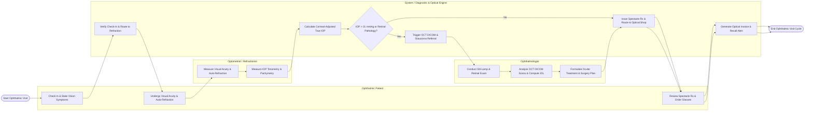

# Swimlane Diagram — Ophthalmology Clinic Management System

## Mermaid Code

## Flow Description | Mô tả luồng

| Lane | Actor / Subsystem | Role in Flow |
|------|-------------------|--------------|
| 1 | Ophthalmic Patient | Checks in at reception, states vision complaints, undergoes automated refraction testing, reviews optical prescriptions, and selects spectacle frames/lenses at the optical shop. |
| 2 | Optometrist / Refractionist | Measures uncorrected and best-corrected visual acuity (VA OD/OS), captures auto-refraction parameters (Sphere, Cylinder, Axis, PD), and logs Tonometry intraocular pressure (IOP). |
| 3 | System / Diagnostic & Optical Engine | Verifies patient check-in, auto-calculates corneal-adjusted true IOP, evaluates glaucoma threshold alerts, streams OCT DICOM image scans, issues optical prescriptions, and dispatches optical shop job orders. |
| 4 | Ophthalmologist | Conducts slit-lamp biomicroscopy exams, inspects OCT retinal layer thickness scans, evaluates perimetry charts, calculates IOL power for cataract surgery, and prescribes ocular medications. |
