# Action Tree — Ophthalmology Clinic Management System

## Mermaid Code

```mermaid
graph TD
    Root["Ophthalmology Clinic Management System"]

    Root --> M1["Visual Acuity & Refraction"]
    Root --> M2["Tonometry & Glaucoma Screening"]
    Root --> M3["Optical Prescription & Dispensing"]
    Root --> M4["OCT Imaging & Retinal DICOM"]
    Root --> M5["Cataract Surgery & IOL Calculation"]
    Root --> M6["Slit-Lamp & Ocular Exam"]
    Root --> M7["Chronic Eye Disease Recall"]
    Root --> M8["Optical Store & Clinic Billing"]

    M1 --> A11["Record Snellen LogMAR Visual Acuity"]
    M1 --> A12["Capture Auto-Refraction OD OS"]
    M1 --> A13["Measure Pupillary Distance PD"]
    M1 --> A14["Perform Cycloplegic Pediatric Test"]

    M2 --> A21["Measure Goldmann NCT Raw IOP"]
    M2 --> A22["Log Central Corneal Thickness CCT"]
    M2 --> A23["Auto-Compute Corneal-Adjusted IOP"]
    M2 --> A24["Ingest Visual Field Perimetry HVF"]

    M3 --> A31["Issue Spectacle Prescription Rx"]
    M3 --> A32["Specify Lens Coating & Index"]
    M3 --> A33["Fit Contact Lens BC & Diameter"]
    M3 --> A34["Dispatch Optical Lab Job Order"]

    M4 --> A41["Query PACS DICOM Imaging Archive"]
    M4 --> A42["Display OCT Retinal Layer Map"]
    M4 --> A43["Attach Color Fundus Photograph"]
    M4 --> A44["Analyze RNFL Ganglion Progression"]

    M5 --> A51["Ingest Optical Biometry Axial Length"]
    M5 --> A52["Execute SRK/T & Barrett II Formulas"]
    M5 --> A53["Select Toric IOL & Alignment Axis"]
    M5 --> A54["Generate Cataract Surgery Package"]

    M6 --> A61["Document Slit-Lamp Biomicroscopy"]
    M6 --> A62["Chart Dilated Fundus Examination"]
    M6 --> A63["Evaluate LASIK Corneal Topography"]
    M6 --> A64["Prescribe Ophthalmic Drops & Mydriatics"]

    M7 --> A71["Auto-Generate Glaucoma Recall List"]
    M7 --> A72["Dispatch Diabetic Retinopathy Reminders"]
    M7 --> A73["Monitor Post-Op Phaco Vision Outcomes"]
    M7 --> A74["Track Patient Appointment Retention"]

    M8 --> A81["Manage Frame & Contact Lens Stock"]
    M8 --> A82["Itemize Eye Exam CPT Billing Codes"]
    M8 --> A83["Submit Dental & Vision Insurance"]
    M8 --> A84["Export Cataract Surgical Rate CSR"]
```

## Module Description | Mô tả Module

| # | Module | Description | Actions |
|---|--------|-------------|---------|
| 1 | Visual Acuity & Refraction | Measures uncorrected and best-corrected visual acuity (Snellen/LogMAR), captures auto-refraction parameters (Sphere, Cylinder, Axis, PD), and cycloplegic refraction. | Record Snellen LogMAR Visual Acuity, Capture Auto-Refraction OD OS, Measure Pupillary Distance PD, Perform Cycloplegic Pediatric Test |
| 2 | Tonometry & Glaucoma Screening | Measures raw IOP via Goldmann/NCT, logs CCT corneal thickness, computes corneal-adjusted true IOP, and ingests visual field perimetry. | Measure Goldmann NCT Raw IOP, Log Central Corneal Thickness CCT, Auto-Compute Corneal-Adjusted IOP, Ingest Visual Field Perimetry HVF |
| 3 | Optical Prescription & Dispensing | Generates spectacle prescriptions, specifies lens coatings, fits contact lenses (BC/DIA), and dispatches job orders to optical labs. | Issue Spectacle Prescription Rx, Specify Lens Coating & Index, Fit Contact Lens BC & Diameter, Dispatch Optical Lab Job Order |
| 4 | OCT Imaging & Retinal DICOM | Connects to PACS to ingest 3D OCT scans, renders RNFL retinal thickness maps, attaches fundus photos, and tracks progression. | Query PACS DICOM Imaging Archive, Display OCT Retinal Layer Map, Attach Color Fundus Photograph, Analyze RNFL Ganglion Progression |
| 5 | Cataract Surgery & IOL Calculation | Ingests optical biometry (Axial Length, K1/K2), executes SRK/T and Barrett Universal II formulas, selects Toric/Multifocal IOLs, and plans surgery. | Ingest Optical Biometry Axial Length, Execute SRK/T & Barrett II Formulas, Select Toric IOL & Alignment Axis, Generate Cataract Surgery Package |
| 6 | Slit-Lamp & Ocular Exam | Documents anterior/posterior segment slit-lamp biomicroscopy, dilated fundus exam, LASIK corneal topography, and prescribes eye drops. | Document Slit-Lamp Biomicroscopy, Chart Dilated Fundus Examination, Evaluate LASIK Corneal Topography, Prescribe Ophthalmic Drops & Mydriatics |
| 7 | Chronic Eye Disease Recall | Auto-generates recall rosters for chronic glaucoma and diabetic retinopathy, dispatches SMS/Zalo reminders, and tracks post-op vision. | Auto-Generate Glaucoma Recall List, Dispatch Diabetic Retinopathy Reminders, Monitor Post-Op Phaco Vision Outcomes, Track Patient Appointment Retention |
| 8 | Optical Store & Clinic Billing | Manages optical shop frame inventory, itemizes CPT eye procedure billing codes, submits insurance claims, and exports Cataract Surgical Rates (CSR). | Manage Frame & Contact Lens Stock, Itemize Eye Exam CPT Billing Codes, Submit Dental & Vision Insurance, Export Cataract Surgical Rate CSR |
