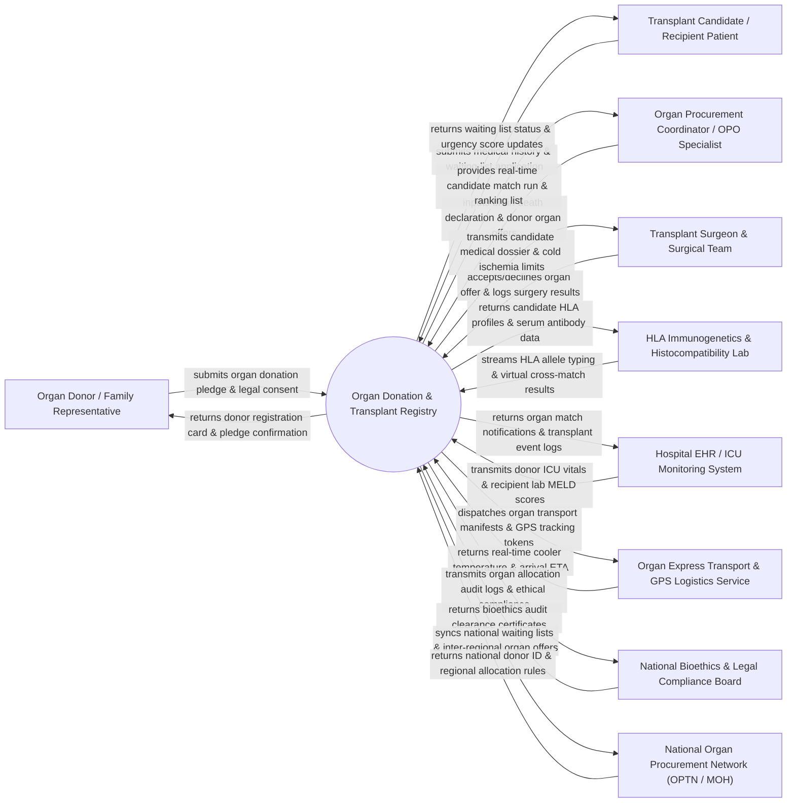

# Context Diagram — Organ Donation & Transplant Registry

## Mermaid Code

## Actor & Interaction Table | Bảng Actor & Tương tác

| # | Actor | Actor Type | Data Sent TO System | Data Received FROM System | Notes |
|---|-------|------------|---------------------|---------------------------|-------|
| 1 | Organ Donor / Family Representative | Primary | Digital donor pledge registration, organ selection (Kidney, Liver, Heart, Lung, Cornea), family consent forms. | Donor registration card, pledge confirmation ID, donor family appreciation token. | Living donor volunteering organ donation or next-of-kin authorizing deceased organ donation. |
| 2 | Transplant Candidate / Recipient Patient | Primary | Clinical history, contact details, waiting list application, health updates. | Waiting list position status, medical urgency score updates (MELD/CPRA), match notifications. | End-stage organ failure patient awaiting kidney, liver, heart, lung, or pancreas transplantation. |
| 3 | Organ Procurement Coordinator / OPO Specialist | Primary | Deceased donor brain death verification, donor organ viability assessment, organ offer details. | Ranked candidate match run lists, transplant center responses, organ allocation tokens. | Certified Organ Procurement Organization (OPO) coordinator managing donor evaluation and organ distribution. |
| 4 | Transplant Surgeon & Surgical Team | Primary | Organ offer acceptance/refusal decisions, surgical harvest timestamps, cold/warm ischemia times, graft outcome logs. | Recipient clinical dossiers, HLA cross-match results, organ courier tracking data. | Surgical specialist performing organ retrieval (harvesting) and recipient transplant surgery. |
| 5 | HLA Immunogenetics & Histocompatibility Lab | Supporting System | High-resolution HLA allele typing (HLA-A, B, C, DR, DQ), Panel Reactive Antibody (PRA/cPRA), physical cross-match results. | Candidate serum panel requests, virtual cross-match query results, donor tissue typing orders. | Specialized immunogenetics laboratory performing tissue matching and anti-HLA antibody testing. |
| 6 | Hospital EHR / ICU Monitoring System | Supporting System | Donor ICU hemodynamic stability data, lab blood chemistries, recipient MELD/PELD scores, inpatient admission data. | Automated organ match notifications, transplant surgery event records, post-transplant follow-up logs. | Enterprise hospital information system managing donor ICU care and recipient inpatient clinical charts. |
| 7 | Organ Express Transport & GPS Logistics Service | Supporting System | Organ preservation container temperature telemetry, GPS location coordinates, flight/courier arrival ETA. | Organ dispatch transport manifests, origin/destination hospital tokens, cold ischemia time limits. | Specialized medical courier service carrying organs in temperature-controlled perfusion containers. |
| 8 | National Bioethics & Legal Compliance Board | Regulatory | Organ donation legal regulations, brain death audit guidelines, anti-trafficking compliance standards. | Allocation algorithm audit trails, donor consent verification logs, equity distribution metrics. | Regulatory oversight committee auditing organ allocation fairness, bioethics, and legal compliance. |
| 9 | National Organ Procurement Network (OPTN / MOH) | Supporting System | National waiting list policies, inter-regional organ sharing rules, national organ registry schemas. | Cross-regional organ sharing dispatches, national graft survival statistics, national donor ID registries. | Governmental or federated national organ network (e.g., UNOS / OPTN in USA, National Organ Transplant Center in Vietnam). |

## System Boundary Description | Mô tả Phạm vi Hệ thống

The **Organ Donation & Transplant Registry** is a mission-critical, highly secure national clinical platform governing organ donation consent, living and deceased donor evaluation, HLA histocompatibility matching, waiting list management (MELD/PELD, cPRA, LAS, Status 1A/1B), automated organ allocation algorithms, organ transport logistics tracking, and long-term post-transplant graft survival monitoring. It enforces bioethical rules, legal consent verification, and anti-trafficking compliance.

**Inside System Scope:**
- Living and deceased donor registration, legal consent management, and brain death verification.
- Transplant candidate waiting list management and automated urgency scoring (MELD, PELD, cPRA, LAS).
- Integration with HLA histocompatibility labs for virtual and physical cross-matching.
- Automated, audit-traceable organ matching algorithms prioritizing urgency, HLA match, age, and geography.
- Organ offer dispatch, refusal reason logging, and acceptance workflow for transplant centers.
- Real-time GPS and cold ischemia time monitoring during organ transport.
- Post-transplant recipient outcome tracking and graft rejection monitoring.

**Outside System Scope:**
- Physical surgical execution of organ harvesting and implantation (performed by surgical teams).
- Physical maintenance of organ perfusion preservation machines (handled by biomedical engineers).
- General hospital financial billing and cashiering (handled by Hospital Billing / HIS).
- Physical police/legal investigation of illegal organ trafficking (handled by law enforcement).
