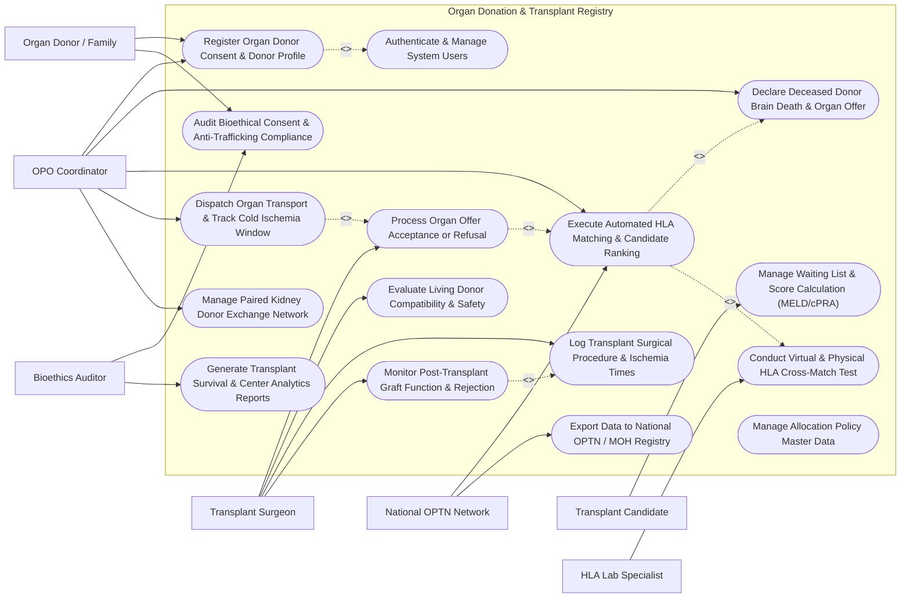

# Use Case Diagram — Organ Donation & Transplant Registry

## Mermaid Code

## Actor Table | Bảng Actor

| # | Actor | Actor Type | Role Description | Related Use Cases |
|---|-------|------------|------------------|-------------------|
| 1 | Organ Donor / Family | Primary | Living donor or legal next-of-kin pledging organs, authorizing consent, and providing medical history. | UC01, UC12 |
| 2 | Transplant Candidate | Primary | End-stage organ failure patient registered on the waiting list monitoring position and medical urgency. | UC02 |
| 3 | OPO Coordinator | Primary | Organ Procurement Organization specialist managing donor evaluation, brain death declarations, match runs, and logistics. | UC01, UC03, UC04, UC05, UC09 |
| 4 | Transplant Surgeon | Primary | Surgical team leader reviewing organ offers, evaluating anatomical fit, executing transplant surgery, and charting graft outcomes. | UC06, UC07, UC10, UC11 |
| 5 | HLA Lab Specialist | Primary | Histocompatibility laboratory technologist inputting donor/candidate HLA alleles, PRA scores, and cross-match test results. | UC08 |
| 6 | Bioethics Auditor | Primary | Legal and ethical compliance officer auditing organ allocation fairness, consent integrity, and anti-trafficking rules. | UC12, UC15 |
| 7 | National OPTN Network | Secondary / System | National organ transplantation network (e.g., UNOS / MOH) syncing national waiting lists and inter-regional allocation dispatches. | UC04, UC14 |

## Use Case Table | Bảng Use Case

| # | UC ID | Use Case Name | Primary Actor | Secondary Actor | Description | Priority |
|---|-------|---------------|---------------|-----------------|-------------|----------|
| 1 | UC01 | Register Organ Donor Consent & Donor Profile | Organ Donor / Family | OPO Coordinator | Register living donor or deceased donor profile, document legal consent forms, and record blood type and medical history. | High |
| 2 | UC02 | Manage Waiting List & Score Calculation (MELD/cPRA) | Transplant Candidate | None | Maintain organ waiting lists, auto-calculate medical urgency scores (MELD/PELD for liver, cPRA for kidney, LAS for lung). | High |
| 3 | UC03 | Declare Deceased Donor Brain Death & Organ Offer | OPO Coordinator | None | Log official brain death neurological certification, donor ICU stability data, and trigger available organ offers. | High |
| 4 | UC04 | Execute Automated HLA Matching & Candidate Ranking | OPO Coordinator | National OPTN Network | Run automated, audit-traceable organ matching algorithm to rank waiting list candidates based on urgency, HLA, age, and geography. | High |
| 5 | UC05 | Dispatch Organ Transport & Track Cold Ischemia Window | OPO Coordinator | None | Issue organ transport manifests, track real-time container temperature and GPS location, and monitor cold ischemia countdown. | High |
| 6 | UC06 | Process Organ Offer Acceptance or Refusal | Transplant Surgeon | OPO Coordinator | Receive organ match offer, review donor medical dossier, and submit formal acceptance or refusal with clinical justification. | High |
| 7 | UC07 | Evaluate Living Donor Compatibility & Safety | Transplant Surgeon | None | Conduct comprehensive living donor evaluation (kidney/liver lobe), assessing anatomical suitability and long-term donor safety. | High |
| 8 | UC08 | Conduct Virtual & Physical HLA Cross-Match Test | HLA Lab Specialist | None | Perform virtual CDC cross-match and physical T-cell/B-cell anti-donor HLA antibody compatibility testing. | High |
| 9 | UC09 | Manage Paired Kidney Donor Exchange Network | OPO Coordinator | None | Run paired kidney exchange algorithms matching incompatible donor-recipient pairs across a multi-center registry network. | Medium |
| 10 | UC10 | Log Transplant Surgical Procedure & Ischemia Times | Transplant Surgeon | None | Record organ retrieval (harvest) time, cold ischemia duration, warm ischemia duration, vascular anastomosis, and reperfusion. | High |
| 11 | UC11 | Monitor Post-Transplant Graft Function & Rejection | Transplant Surgeon | None | Track post-op graft function (creatinine, bilirubin, EF), immunosuppressant blood levels (Tacrolimus), and acute rejection episodes. | High |
| 12 | UC12 | Audit Bioethical Consent & Anti-Trafficking Compliance | Bioethics Auditor | Organ Donor / Family | Verify legal next-of-kin consent integrity, confirm zero financial coercion, and audit compliance with national organ laws. | High |
| 13 | UC13 | Manage Allocation Policy Master Data | Bioethics Auditor | None | Configure national organ allocation point algorithms, regional distance radiuses, and pediatric priority rules. | Medium |
| 14 | UC14 | Export Data to National OPTN / MOH Registry | OPO Coordinator | National OPTN Network | Synchronize organ allocation events, donor records, and recipient outcomes with national government registries. | High |
| 15 | UC15 | Generate Transplant Survival & Center Analytics Reports | Bioethics Auditor | None | Produce 1-year/5-year graft survival curves, center volume analytics, waiting list mortality rates, and organ discard metrics. | Medium |
| 16 | UC16 | Authenticate & Manage System Users | All Users | None | Enforce high-security multi-factor authentication, role-based access controls, and immutable cryptographic audit trails. | High |

## Use Case Specification | Đặc tả Use Case

---

### UC01 — Register Organ Donor Consent & Donor Profile

| Field | Detail |
|-------|--------|
| **UC ID** | UC01 |
| **Use Case Name** | Register Organ Donor Consent & Donor Profile |
| **Actor(s)** | Primary: Organ Donor / Family   Secondary: OPO Coordinator |
| **Description** | Registers a new living or deceased organ donor in the national registry, captures donor blood type, medical/social history, infectious disease screening (HIV, HBV, HCV, Syphilis), specific donated organs, and verifies legally binding consent documents. |
| **Precondition** | 1. The OPO Coordinator or donor is authenticated in the registry portal.   2. Official donor identification (National ID / Passport) is available. |
| **Main Flow** | 1. The OPO Coordinator opens "New Donor Registration" and selects Donor Type (Living Donor or Deceased Brain-Dead Donor).   2. The System queries the National Identity Database to populate donor demographics (Full Name, Date of Birth, Gender, Citizen ID).   3. The Coordinator selects designated donated organs: Kidneys, Liver, Heart, Lungs, Pancreas, Intestines, Corneas, Tissue.   4. The Coordinator uploads legal consent documentation: Living Donor Self-Pledge Consent or Deceased Donor Next-of-Kin Signed Authorization Form.   5. The Coordinator inputs medical baseline data: ABO/Rh Blood Type, Height, Weight, Cause of Death (if deceased), and Infectious Disease Screening results (HIV, HBsAg, Anti-HCV, RPR).   6. The System generates a unique National Donor Registration ID (e.g., DNR-2026-0918) and issues a digital donor card or pledge verification token.   7. The System logs the donor profile into the active procurement database, ready for HLA tissue typing and organ offer generation. |
| **Alternative Flow** | **AF1** — Online Citizen Organ Pledge: A citizen accesses the national public portal, completes a digital organ donor pledge using electronic Citizen ID (VNeID), and the System issues a digital Organ Donor Badge.   **AF2** — Living Kidney Donor Evaluation: For living kidney donors, the System creates a "Living Donor Candidate Profile" linked to a specific recipient, initiating comprehensive medical/psychological screening. |
| **Exception Flow** | **EX1** — Infectious Disease Positive Hard Block: If infectious screening returns positive for HIV or active Hepatitis B/C, the System flags the donor profile with high-risk infectious markers, restricting organ allocation to specialized matched-recipient protocols.   **EX2** — Family Consent Refusal for Registered Pledger: If a deceased donor had pledged online but the immediate legal family refuses permission, the System logs a "Legal Family Override Dispute" and alerts the Bioethics Auditor for legal review. |
| **Postcondition** | Donor profile is registered with unique Donor ID, legal consent is uploaded and verified, ABO/infectious markers are recorded, and donor is eligible for match runs. |
| **Business Rule** | **BR1**: Deceased organ donation requires dual verified consent: valid donor pledge on record OR written legal authorization from first-degree next-of-kin.   **BR2**: ABO blood typing must be performed twice independently from separate blood draws before donor registration can be finalized. |

---

### UC02 — Manage Waiting List & Score Calculation (MELD/cPRA)

| Field | Detail |
|-------|--------|
| **UC ID** | UC02 |
| **Use Case Name** | Manage Waiting List & Score Calculation (MELD/cPRA) |
| **Actor(s)** | Primary: Transplant Candidate |
| **Description** | Maintains active organ-specific waiting lists (Kidney, Liver, Heart, Lung), automatically calculating and updating medical urgency scores (MELD/PELD for liver, cPRA for highly sensitized kidney candidates, LAS for lung) based on lab chemistry updates. |
| **Precondition** | 1. The recipient is registered in the registry with an active organ failure diagnosis.   2. Relevant laboratory chemistry panels (Bilirubin, Creatinine, INR, Sodium, HLA antibodies) are uploaded. |
| **Main Flow** | 1. The Transplant Candidate's clinical team accesses the "Waiting List Management" module and selects the required organ list (e.g., National Liver Waiting List).   2. The System retrieves the recipient's baseline data: ABO blood group, age, pediatric status, active hospital location, and HLA tissue typing profile.   3. For Liver candidates, the System prompts for current laboratory values: Serum Bilirubin (mg/dL), Serum Creatinine (mg/dL), International Normalized Ratio (INR), and Serum Sodium (mEq/L).   4. The System computes the MELD-Na (Model for End-Stage Liver Disease) score: `MELD = 9.57 x ln(Creatinine) + 3.78 x ln(Bilirubin) + 11.2 x ln(INR) + 6.43` (adjusted for Sodium).   5. For Highly Sensitized Kidney candidates, the System calculates Calculated Panel Reactive Antibody (cPRA %) based on anti-HLA antibody specificity.   6. The System assigns the candidate's active waiting list status tier (e.g., Status 1A/1B for urgent Heart/Liver, or MELD Score 35).   7. The System updates the candidate's position on the national waiting list and schedules mandatory periodic lab re-certification timers (e.g., MELD > 25 requires weekly lab updates). |
| **Alternative Flow** | **AF1** — Pediatric PELD Score Calculation: For candidates under 12 years old requiring liver transplant, the System automatically applies the Pediatric End-Stage Liver Disease (PELD) formula evaluating Albumin, Bilirubin, INR, Growth Failure, and Age < 1 year.   **AF2** — Temporary Inactive Status (Status 7): If a candidate develops an acute infection, the clinical team sets status to "Status 7 (Temporarily Inactive)", pausing match run eligibility while preserving accrued waiting time. |
| **Exception Flow** | **EX1** — MELD Recertification Expiration: If required weekly lab values are not updated before the expiration deadline, the System automatically downgrades the candidate's MELD score to baseline (MELD 6) and alerts the clinical coordinator.   **EX2** — Exception Points Request (e.g., Hepatocellular Carcinoma - HCC): The clinical team submits a MELD Exception Request for liver cancer, which the System routes to the Regional Review Board for score elevation approval. |
| **Postcondition** | Candidate waiting list entry is active, medical urgency score (MELD/cPRA) is calculated, status tier is assigned, and candidate is ready for automated match runs. |
| **Business Rule** | **BR1**: MELD scores >= 25 must be re-certified with fresh laboratory blood draws every 7 calendar days to maintain active high-urgency ranking.   **BR2**: Candidates with cPRA >= 98% (highly sensitized) are automatically granted priority allocation points for compatible kidney offers. |

---

### UC03 — Declare Deceased Donor Brain Death & Organ Offer

| Field | Detail |
|-------|--------|
| **UC ID** | UC03 |
| **Use Case Name** | Declare Deceased Donor Brain Death & Organ Offer |
| **Actor(s)** | Primary: OPO Coordinator |
| **Description** | Logs the formal legal and neurological brain death certification for a deceased donor, captures donor ICU hemodynamic stability data, registers available donor organs, and initiates the automated organ offer allocation process. |
| **Precondition** | 1. The donor is admitted in an ICU on mechanical ventilation.   2. Neurological brain death examinations have been completed by qualified physicians independent of the transplant team. |
| **Main Flow** | 1. The OPO Coordinator opens the "Brain Death & Organ Offer" module for the target donor.   2. The Coordinator inputs the dual neurological brain death exam records: Exam 1 timestamp, Exam 2 timestamp (separated by required interval, e.g., 6 hours), Apnea Test results (PaCO2 >= 60 mmHg), and Neurologist/Intensivist signatures.   3. The System verifies that neither examining physician is a member of the organ procurement or transplant teams.   4. The Coordinator enters donor ICU hemodynamic parameters: Inotropic support rates (Norepinephrine, Dopamine), Mean Arterial Pressure (MAP), Urine Output (mL/hr), Arterial Blood Gas values, and Echocardiogram EF %.   5. The Coordinator selects organs confirmed viable for donation (e.g., Left Kidney, Right Kidney, Whole Liver, Heart).   6. The System generates an official "Deceased Organ Offer Package" containing donor blood type, age, cause of death, anatomical measurements, infectious disease panel, and HLA typing results.   7. The Coordinator clicks "Initiate Match Run", and the System triggers the automated candidate ranking algorithm (UC04). |
| **Alternative Flow** | **AF1** — Donation after Circulatory Death (DCD): If the donor does not meet brain death criteria but life support is withdrawn, the Coordinator selects "DCD Protocol", tracking warm ischemia time from withdrawal of life support to cardiac arrest and organ perfusion.   **AF2** — Split-Liver Donation Option: For a high-quality adult donor liver, the System evaluates anatomical criteria for splitting the liver into Left Lateral Segment (for pediatric recipient) and Right Lobe (for adult recipient). |
| **Exception Flow** | **EX1** — Unconfirmed Brain Death Apnea Test: If the Apnea test result is incomplete or inconclusive, the System blocks brain death certification and prompts for confirmatory cerebral angiography or EEG testing logs.   **EX2** — Hemodynamic Collapse During Evaluation: If donor cardiac arrest occurs during evaluation, the System flashes a "Donor Hemodynamic Arrest Alert" and prompts immediate conversion to DCD or emergency harvest protocols. |
| **Postcondition** | Neurological brain death certification is legally logged, donor organ offer package is created, and automated candidate match runs are launched. |
| **Business Rule** | **BR1**: Brain death certification requires two independent clinical neurological examinations performed by certified physicians who have no affiliation with the organ recipient or transplant surgical team.   **BR2**: Brain death declaration timestamp establishes the baseline for organ preservation planning and cold ischemia time monitoring. |

---

### UC04 — Execute Automated HLA Matching & Candidate Ranking

| Field | Detail |
|-------|--------|
| **UC ID** | UC04 |
| **Use Case Name** | Execute Automated HLA Matching & Candidate Ranking |
| **Actor(s)** | Primary: OPO Coordinator   Secondary: National OPTN Network |
| **Description** | Executes the automated, deterministic organ allocation algorithm to evaluate all active waiting list candidates against a donor organ offer, scoring compatibility (ABO blood group, HLA allele matching, virtual cross-match), medical urgency (MELD/cPRA), geographical proximity, and waiting time to produce an audit-traceable candidate rank list. |
| **Precondition** | 1. A verified Donor Organ Offer Package (UC03) with ABO blood type and HLA typing is active.   2. Active candidate waiting lists are updated in the system. |
| **Main Flow** | 1. The OPO Coordinator selects an active donor organ (e.g., Donor DNR-9812 Left Kidney) and initiates "Execute Match Run".   2. The System queries all active candidates on the national waiting list for that specific organ type.   3. The System applies Hard Filter Rules: ABO Blood Group Compatibility (Identical or Compatible), Body Size / Weight Match (within acceptable % ratio), and Active Status (Status 1 / Active).   4. For each candidate passing hard filters, the System performs Virtual Cross-Match: Compares candidate anti-HLA donor-specific antibodies (DSA) against donor HLA-A, B, C, DR, DQ alleles. If donor-specific antibodies are present (Unacceptable Antigens), the candidate is flagged as "Positive Virtual Cross-Match - High Rejection Risk".   5. The System calculates total Allocation Score for each candidate combining: **Medical Urgency Points** (MELD/PELD or Status 1A), **HLA Match Points** (Zero-mismatch / 6-antigen match priority), **Sensitization Points** (cPRA >= 98%), **Pediatric Priority Points**, **Geographical Proximity Points** (Local OPO zone vs Regional vs National), and **Accrued Waiting Time Points**.   6. The System sorts candidates in descending order of total score to produce the official deterministic "Ranked Match List" (Rank 1, Rank 2, Rank 3...).   7. The System logs the exact match run algorithm version, execution timestamp, and candidate ranking parameters into an immutable audit trail.   8. The System automatically dispatches the Organ Match Offer to the transplant center of the Rank 1 candidate. |
| **Alternative Flow** | **AF1** — Zero-Antigen Mismatch National Priority: If a candidate on the national list has a 0-antigen HLA mismatch (perfect tissue match) with the donor kidney, the System automatically elevates that candidate to Rank 1 regardless of local geography.   **AF2** — Regional / National Allocation Expansion: If all local zone candidates decline the organ offer, the System automatically expands the match run radius to Regional and National candidate pools. |
| **Exception Flow** | **EX1** — Positive Physical Cross-Match Overturn: If physical T-cell cross-match test (UC08) comes back positive after match run dispatch, the System automatically bypasses Rank 1 and routes the offer to Rank 2.   **EX2** — Match Algorithm Rule Change: If allocation policy rules change, the System maintains backwards-compatible algorithm versioning so past match runs can be audited accurately. |
| **Postcondition** | A deterministic, audit-traceable candidate rank list is generated, and organ match offers are transmitted sequentially to candidate transplant centers. |
| **Business Rule** | **BR1**: Organ allocation algorithms must be 100% deterministic and audit-traceable; manual intervention to alter candidate rank order is strictly prohibited without documented bioethical emergency waiver.   **BR2**: Perfect 0-antigen HLA-A, B, DR mismatched kidneys must be offered nationally to 0-mismatch candidates before local non-matched allocation. |

---

### UC05 — Dispatch Organ Transport & Track Cold Ischemia Window

| Field | Detail |
|-------|--------|
| **UC ID** | UC05 |
| **Use Case Name** | Dispatch Organ Transport & Track Cold Ischemia Window |
| **Actor(s)** | Primary: OPO Coordinator |
| **Description** | Generates organ transport manifests, assigns specialized medical couriers, and continuously tracks real-time GPS location, preservation container temperature, and remaining Maximum Allowable Cold Ischemia Time (CIT) from harvest to recipient implantation. |
| **Precondition** | 1. A transplant center has accepted an organ match offer (UC06).   2. The organ harvest surgical time is confirmed by the retrieval team. |
| **Main Flow** | 1. The OPO Coordinator opens "Organ Transport Dispatch" and selects the accepted organ (e.g., Donor DNR-9812 Heart).   2. The System retrieves organ-specific Maximum Cold Ischemia Limits: Heart (4-6 hours), Lung (4-8 hours), Liver (8-12 hours), Kidney (24-36 hours).   3. The Coordinator enters donor harvest completion time (Cross-Clamp / Cold Perfusion Start Time) and pairs the transport container's IoT Smart Cooler ID.   4. The System issues a digital "Organ Transport Manifest" specifying donor ID, organ type, origin hospital, destination transplant center, courier team, and emergency contact details.   5. The smart cooler streams continuous IoT telemetry: Internal Temperature (°C), GPS Coordinates, Ambient Pressure, and Battery Status.   6. The System calculates and displays the active "Cold Ischemia Countdown Window" on the transplant surgeon's dashboard and mobile app: `Remaining CIT = Max CIT Limit - Elapsed CIT`.   7. Upon arrival at the recipient hospital operating room, the surgical nurse scans the container QR code, confirming arrival timestamp.   8. The System logs total elapsed cold ischemia time (e.g., 3 hours 45 minutes for Heart) and archives the transport telemetry log into the transplant surgery record. |
| **Alternative Flow** | **AF1** — Hypothermic Machine Perfusion (HMP) Tracking: For high-risk kidneys or livers transported on continuous machine perfusion pumps, the System streams real-time pump flow rate (mL/min), resistance, and pressure metrics alongside temperature.   **AF2** — Emergency Flight Route Adjustment: If weather delays air transport, the System recalculates transit ETA, alerts the transplant surgeon of projected cold ischemia extension, and suggests alternate flight/ground routes. |
| **Exception Flow** | **EX1** — Cold Storage Temperature Excursion Alert (`Temp > 8°C`): If internal cooler temperature exceeds 8°C during transit, the System flashes a red "Thermal Excursion Alert" to both courier and receiving surgeon.   **EX2** — Impending Cold Ischemia Limit Breach (`CIT Remaining < 60 mins`): If transit delays push remaining CIT below 60 minutes, the System triggers an urgent alert, urging immediate recipient operating room preparation. |
| **Postcondition** | Organ transport manifest is verified, IoT temperature and GPS tracking are logged, cold ischemia window is monitored, and arrival is registered at recipient operating room. |
| **Business Rule** | **BR1**: Cold ischemia time calculations start precisely at the moment of donor aortic cross-clamping and in situ cold preservation flushing.   **BR2**: Transport of donor hearts exceeding 6 hours of cold ischemia time requires explicit written acceptance from the operating transplant surgeon prior to implantation. |
