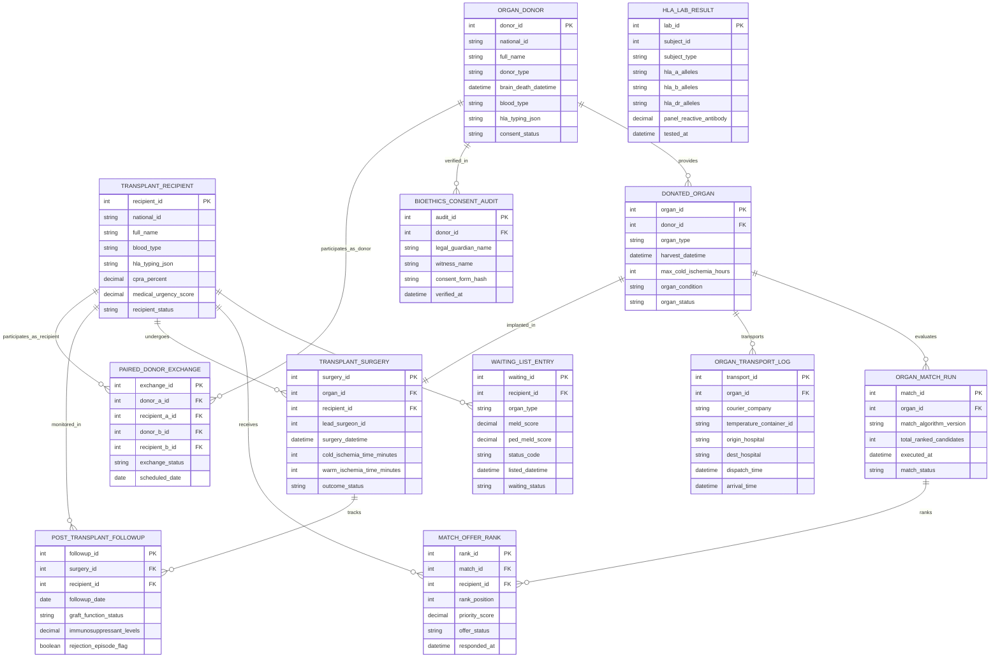

# Conceptual ERD — Organ Donation & Transplant Registry

## Mermaid Code

## Entity Description Table | Bảng mô tả Entity

| # | Entity Name | Vietnamese Name | Description | Key Attributes | Main Relationships |
|---|-------------|-----------------|-------------|----------------|-------------------|
| 1 | ORGAN_DONOR | Người Hiến tạng Master | Organ donor record storing national ID, donor type (Living / Deceased), brain death datetime, blood group, and consent status. | donor_id, national_id, full_name, donor_type, brain_death_datetime, blood_type, consent_status | Has many DONATED_ORGAN, BIOETHICS_CONSENT_AUDIT, and PAIRED_DONOR_EXCHANGE entities. |
| 2 | TRANSPLANT_RECIPIENT | Bệnh nhân Chờ Ghép | End-stage organ failure patient profile storing blood group, HLA typing, cPRA %, and medical urgency score. | recipient_id, national_id, full_name, blood_type, cpra_percent, medical_urgency_score, recipient_status | Has many WAITING_LIST_ENTRY, MATCH_OFFER_RANK, TRANSPLANT_SURGERY, and POST_TRANSPLANT_FOLLOWUP. |
| 3 | WAITING_LIST_ENTRY | Danh sách Chờ Ghép | Organ-specific waiting list entry tracking MELD/PELD/LAS scores, status codes (Status 1A/1B), and listing timestamps. | waiting_id, recipient_id, organ_type, meld_score, status_code, listed_datetime, waiting_status | Belongs to TRANSPLANT_RECIPIENT. |
| 4 | DONATED_ORGAN | Tạng Hiến Viable | Individual donated organ record (Kidney, Liver, Heart, Lung) tracking harvest time, cold ischemia limits, and condition. | organ_id, donor_id, organ_type, harvest_datetime, max_cold_ischemia_hours, organ_status | Belongs to ORGAN_DONOR; Has many ORGAN_MATCH_RUN and ORGAN_TRANSPORT_LOG; Has one TRANSPLANT_SURGERY. |
| 5 | HLA_LAB_RESULT | Kết quả Xét nghiệm HLA | Histocompatibility laboratory result storing HLA-A, B, C, DR, DQ allele typing and Panel Reactive Antibodies (PRA). | lab_id, subject_id, subject_type, hla_a_alleles, hla_b_alleles, panel_reactive_antibody, tested_at | Standalone lab entity linked to donor or recipient subjects. |
| 6 | ORGAN_MATCH_RUN | Chạy Thuật toán Ghép Tạng | Deterministic match run execution instance recording organ ID, algorithm version, ranked candidates, and match status. | match_id, organ_id, match_algorithm_version, total_ranked_candidates, executed_at, match_status | Belongs to DONATED_ORGAN; Has many MATCH_OFFER_RANK entities. |
| 7 | MATCH_OFFER_RANK | Thứ tự Ưu tiên Ghép | Ranked list entry mapping candidates to a match run with rank positions, priority scores, and offer acceptance responses. | rank_id, match_id, recipient_id, rank_position, priority_score, offer_status, responded_at | Belongs to ORGAN_MATCH_RUN and TRANSPLANT_RECIPIENT. |
| 8 | ORGAN_TRANSPORT_LOG | Nhật ký Vận chuyển Tạng | Transport dispatch log tracking courier company, container temperature ID, origin/dest hospitals, and GPS timing. | transport_id, organ_id, courier_company, temperature_container_id, dispatch_time, arrival_time | Belongs to DONATED_ORGAN. |
| 9 | TRANSPLANT_SURGERY | Phẫu thuật Ghép Tạng | Surgical operation record logging lead surgeon ID, harvest time, cold ischemia minutes, warm ischemia minutes, and outcome. | surgery_id, organ_id, recipient_id, lead_surgeon_id, cold_ischemia_time_minutes, outcome_status | Belongs to DONATED_ORGAN and TRANSPLANT_RECIPIENT; Has many POST_TRANSPLANT_FOLLOWUP entities. |
| 10 | POST_TRANSPLANT_FOLLOWUP | Theo dõi Sau Ghép Tạng | Longitudinal follow-up record monitoring graft function status, immunosuppressant blood levels (Tacrolimus), and rejection. | followup_id, surgery_id, recipient_id, followup_date, graft_function_status, rejection_episode_flag | Belongs to TRANSPLANT_SURGERY and TRANSPLANT_RECIPIENT. |
| 11 | BIOETHICS_CONSENT_AUDIT | Kiểm toán Hiến tạng | Legal compliance audit record verifying donor next-of-kin legal guardian names, witnesses, and cryptographic form hashes. | audit_id, donor_id, legal_guardian_name, witness_name, consent_form_hash, verified_at | Belongs to ORGAN_DONOR. |
| 12 | PAIRED_DONOR_EXCHANGE | Ghép Tạng Chéo (Paired Exchange) | Paired kidney donor exchange record mapping multi-center incompatible donor-recipient pairs for crossover transplantation. | exchange_id, donor_a_id, recipient_a_id, donor_b_id, recipient_b_id, exchange_status | Belongs to ORGAN_DONOR and TRANSPLANT_RECIPIENT. |

## Relationship Description | Mô tả Quan hệ

| # | From Entity | Cardinality | To Entity | Relationship Label | Business Explanation |
|---|-------------|-------------|-----------|-------------------|----------------------|
| 1 | ORGAN_DONOR | one-to-many | DONATED_ORGAN | provides | One donor provides one or more viable donated organs (Kidneys, Liver, Heart, Lungs). |
| 2 | ORGAN_DONOR | one-to-many | BIOETHICS_CONSENT_AUDIT | verified_in | One donor undergoes legal and bioethical consent verification auditing. |
| 3 | TRANSPLANT_RECIPIENT | one-to-many | WAITING_LIST_ENTRY | listed_in | One recipient is listed on organ-specific waiting lists (Kidney, Liver, Heart). |
| 4 | TRANSPLANT_RECIPIENT | one-to-many | MATCH_OFFER_RANK | receives | One recipient receives ranked organ match offers over time. |
| 5 | TRANSPLANT_RECIPIENT | one-to-many | TRANSPLANT_SURGERY | undergoes | One recipient undergoes transplant surgical procedures. |
| 6 | TRANSPLANT_RECIPIENT | one-to-many | POST_TRANSPLANT_FOLLOWUP | monitored_in | One transplant recipient is monitored in long-term graft survival follow-up sessions. |
| 7 | DONATED_ORGAN | one-to-many | ORGAN_MATCH_RUN | evaluates | One donated organ evaluates candidates via automated match run executions. |
| 8 | DONATED_ORGAN | one-to-many | ORGAN_TRANSPORT_LOG | transports | One donated organ is transported under temperature and GPS tracking logs. |
| 9 | DONATED_ORGAN | one-to-one | TRANSPLANT_SURGERY | implanted_in | One donated organ is implanted into exactly one matched recipient during surgery. |
| 10 | ORGAN_MATCH_RUN | one-to-many | MATCH_OFFER_RANK | ranks | One organ match run ranks candidates in deterministic priority order. |
| 11 | TRANSPLANT_SURGERY | one-to-many | POST_TRANSPLANT_FOLLOWUP | tracks | One transplant surgery is tracked by periodic post-op graft follow-up entries. |
| 12 | ORGAN_DONOR | one-to-many | PAIRED_DONOR_EXCHANGE | participates_as_donor | One living donor can participate in paired kidney donor exchange programs. |
| 13 | TRANSPLANT_RECIPIENT | one-to-many | PAIRED_DONOR_EXCHANGE | participates_as_recipient | One recipient can participate in paired kidney donor exchange programs. |
