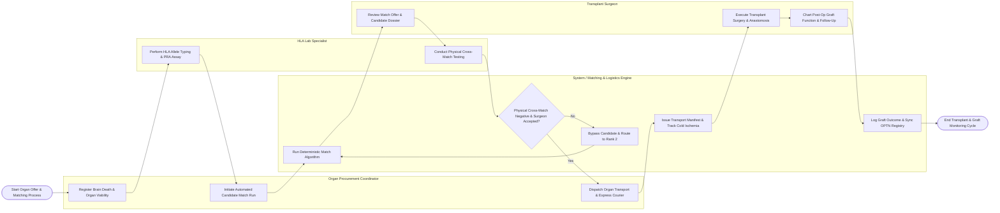

# Swimlane Diagram — Organ Donation & Transplant Registry

## Mermaid Code

## Flow Description | Mô tả luồng

| Lane | Actor / Subsystem | Role in Flow |
|------|-------------------|--------------|
| 1 | Organ Procurement Coordinator | Logs deceased donor brain death certification, registers donated organ viability, executes automated match runs, and coordinates organ courier transport. |
| 2 | HLA Lab Specialist | Performs high-resolution HLA allele typing (A, B, DR), Panel Reactive Antibody (PRA) assays, and conducts physical T-cell/B-cell cross-matching between donor and candidate. |
| 3 | System / Matching & Logistics Engine | Runs deterministic organ allocation algorithms (evaluating blood group, MELD/cPRA score, HLA match, geography), issues transport manifests, tracks GPS/temperature cold ischemia windows, and syncs national registries. |
| 4 | Transplant Surgeon | Reviews organ match offers, evaluates donor medical dossiers, accepts or declines offers, performs organ retrieval and implantation surgery, and tracks long-term graft survival. |
