# Action Tree — Organ Donation & Transplant Registry

## Mermaid Code

```mermaid
graph TD
    Root["Organ Donation & Transplant Registry"]

    Root --> M1["Donor Registration & Consent"]
    Root --> M2["Waiting List & Urgency Scoring"]
    Root --> M3["Brain Death & Organ Procurement"]
    Root --> M4["HLA Lab & Cross-Matching"]
    Root --> M5["Automated Organ Allocation"]
    Root --> M6["Logistics & Cold Ischemia"]
    Root --> M7["Transplant Surgery & Outcomes"]
    Root --> M8["Bioethics Audit & OPTN Sync"]

    M1 --> A11["Register Living & Deceased Donor Profile"]
    M1 --> A12["Verify Legal Family Consent Forms"]
    M1 --> A13["Record Infectious Screening Panel"]
    M1 --> A14["Issue Digital Organ Donor Pledge Badge"]

    M2 --> A21["Calculate MELD & PELD Urgency Scores"]
    M2 --> A22["Compute cPRA Sensitization Percent"]
    M2 --> A23["Assign Status 1A/1B Priority Tiers"]
    M2 --> A24["Re-Certify Periodic Laboratory Values"]

    M3 --> A31["Log Neurological Brain Death Exams"]
    M3 --> A32["Capture Donor ICU Hemodynamics"]
    M3 --> A33["Confirm Anatomical Organ Viability"]
    M3 --> A34["Initiate Deceased Organ Offer Package"]

    M4 --> A41["Perform HLA-A B DR Allele Typing"]
    M4 --> A42["Screen Unacceptable HLA Antigens"]
    M4 --> A43["Execute Virtual Cross-Match Filter"]
    M4 --> A44["Conduct Physical T-Cell Cross-Match"]

    M5 --> A51["Run Deterministic Match Algorithm"]
    M5 --> A52["Prioritize 0-Antigen Mismatch Candidates"]
    M5 --> A53["Dispatch Sequential Match Offers"]
    M5 --> A54["Log Offer Acceptance or Refusal Reason"]

    M6 --> A61["Issue Organ Transport Dispatch Manifest"]
    M6 --> A62["Pair IoT Smart Cooler GPS & Temp ID"]
    M6 --> A63["Track Cold Ischemia Countdown Window"]
    M6 --> A64["Register Destination Hospital Arrival"]

    M7 --> A71["Record Harvest & Implantation Times"]
    M7 --> A72["Log Cold & Warm Ischemia Minutes"]
    M7 --> A73["Track Post-Op Immunosuppressant Levels"]
    M7 --> A74["Document Graft Rejection Episodes"]

    M8 --> A81["Audit Consent & Anti-Trafficking Rules"]
    M8 --> A82["Sync Data to National OPTN Portal"]
    M8 --> A83["Calculate 1-Year Graft Survival Rates"]
    M8 --> A84["Export Center Performance Analytics"]
```

## Module Description | Mô tả Module

| # | Module | Description | Actions |
|---|--------|-------------|---------|
| 1 | Donor Registration & Consent | Registers living and deceased donor profiles, verifies legal family consent documentation, records infectious screening, and issues pledge badges. | Register Living & Deceased Donor Profile, Verify Legal Family Consent Forms, Record Infectious Screening Panel, Issue Digital Organ Donor Pledge Badge |
| 2 | Waiting List & Urgency Scoring | Maintains organ waiting lists, auto-calculates MELD/PELD and cPRA scores, assigns status priority tiers, and manages lab re-certifications. | Calculate MELD & PELD Urgency Scores, Compute cPRA Sensitization Percent, Assign Status 1A/1B Priority Tiers, Re-Certify Periodic Laboratory Values |
| 3 | Brain Death & Organ Procurement | Logs legal brain death certifications, captures donor ICU hemodynamic stability parameters, and generates organ offer packages. | Log Neurological Brain Death Exams, Capture Donor ICU Hemodynamics, Confirm Anatomical Organ Viability, Initiate Deceased Organ Offer Package |
| 4 | HLA Lab & Cross-Matching | Inputs high-resolution HLA allele typing, screens unacceptable antigens, performs virtual cross-matching, and conducts physical T-cell tests. | Perform HLA-A B DR Allele Typing, Screen Unacceptable HLA Antigens, Execute Virtual Cross-Match Filter, Conduct Physical T-Cell Cross-Match |
| 5 | Automated Organ Allocation | Executes deterministic organ allocation algorithms, prioritizes 0-mismatch candidates, dispatches sequential offers, and logs refusal reasons. | Run Deterministic Match Algorithm, Prioritize 0-Antigen Mismatch Candidates, Dispatch Sequential Match Offers, Log Offer Acceptance or Refusal Reason |
| 6 | Logistics & Cold Ischemia | Generates transport dispatches, pairs IoT cooler sensors, tracks GPS location and temperature, and monitors cold ischemia countdowns. | Issue Organ Transport Dispatch Manifest, Pair IoT Smart Cooler GPS & Temp ID, Track Cold Ischemia Countdown Window, Register Destination Hospital Arrival |
| 7 | Transplant Surgery & Outcomes | Records surgical harvest and anastomosis times, logs cold/warm ischemia minutes, tracks Tacrolimus levels, and charts graft outcomes. | Record Harvest & Implantation Times, Log Cold & Warm Ischemia Minutes, Track Post-Op Immunosuppressant Levels, Document Graft Rejection Episodes |
| 8 | Bioethics Audit & OPTN Sync | Audits legal consent integrity, verifies zero financial coercion, synchronizes national OPTN registries, and exports 1-year graft survival analytics. | Audit Consent & Anti-Trafficking Rules, Sync Data to National OPTN Portal, Calculate 1-Year Graft Survival Rates, Export Center Performance Analytics |
