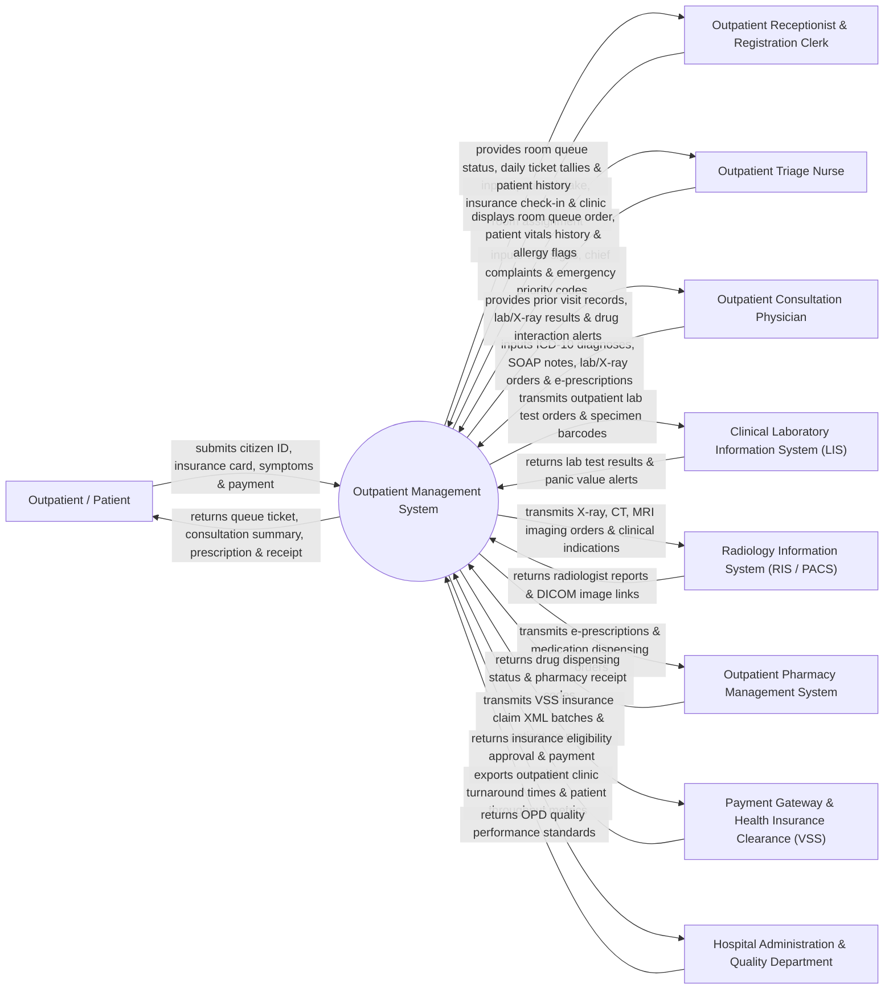

# Context Diagram — Outpatient Management System

## Mermaid Code

## Actor & Interaction Table | Bảng Actor & Tương tác

| # | Actor | Actor Type | Data Sent TO System | Data Received FROM System | Notes |
|---|-------|------------|---------------------|---------------------------|-------|
| 1 | Outpatient / Patient | Primary | Citizen ID card, social health insurance card (VSS), symptom chief complaints, consultation payment. | Queue ticket number, clinic room directions, consultation summary, e-prescription, payment receipt. | Individual seeking ambulatory medical consultation, diagnostic tests, or medication prescription. |
| 2 | Outpatient Receptionist & Registration Clerk | Primary | Patient demographics, insurance registration, preferred specialist selection, queue overrides. | Clinic room availability matrix, daily queue ticket tallies, patient visit history. | Front-desk staff managing outpatient intake, queue tickets, and clinic room assignments. |
| 3 | Outpatient Triage Nurse | Primary | Baseline vital signs (BP, HR, Temp, SpO2, Weight), chief complaint summary, emergency priority category. | Room queue order, patient vitals history, allergy warnings, chronic condition flags. | Registered nurse evaluating patient vital stability and sorting patients into clinic queues. |
| 4 | Outpatient Consultation Physician | Primary | Clinical SOAP notes (Subjective, Objective, Assessment, Plan), ICD-10 diagnosis codes, lab/X-ray orders, e-Rx. | Patient prior EHR history, lab result panels, radiology DICOM views, drug interaction alerts. | Specialist or general physician conducting outpatient consultation and prescribing treatments. |
| 5 | Clinical Laboratory Information System (LIS) | Supporting System | Laboratory blood/urine test results, abnormal panic value alerts, lab completion status. | Outpatient lab order requests, specimen barcode IDs, clinical diagnostic indications. | Enterprise laboratory system processing outpatient blood, urine, and pathology tests. |
| 6 | Radiology Information System (RIS / PACS) | Supporting System | Radiologist diagnostic reports, DICOM imaging study URLs (X-Ray, CT, MRI, Ultrasound). | Outpatient radiology order requests, clinical indications, accession numbers. | Diagnostic imaging system acquiring digital X-rays and imaging reports for outpatient clinics. |
| 7 | Outpatient Pharmacy Management System | Supporting System | Medication dispensing status (Dispensed / Out-of-Stock), pharmacy receipt codes, patient counseling notes. | Electronic prescriptions (e-Rx), drug dosage, frequency, quantity, patient allergy profiles. | Hospital outpatient pharmacy processing and dispensing prescribed medications. |
| 8 | Payment Gateway & Health Insurance Clearance (VSS) | Supporting System | Insurance coverage clearance (VSS card validation), co-pay calculations, bank payment approvals. | Electronic insurance claim XML batches, itemized fee breakdowns, patient copay receipts. | Financial clearinghouse and Vietnam Social Security (VSS) clearing health insurance coverage. |
| 9 | Hospital Administration & Quality Department | Regulatory | Outpatient service level benchmarks, target waiting time limits, clinic capacity standards. | OPD patient turnaround times, doctor consultation volume analytics, patient waiting time metrics. | Hospital executive management monitoring outpatient service quality and clinic efficiency. |

## System Boundary Description | Mô tả Phạm vi Hệ thống

The **Outpatient Management System (OPD System)** is a core clinical software platform designed for hospital outpatient departments, polyclinics, and specialist consultation centers. It digitizes outpatient intake and self-kiosk registration, nursing triage vital signs logging, physician SOAP clinical charting, ICD-10 coding, diagnostic lab/radiology ordering, e-prescribing, health insurance co-pay cashiering, follow-up appointment scheduling, and inpatient admission referral.

**Inside System Scope:**
- Outpatient intake, self-service kiosk check-in, and automated queue number generation.
- Nursing clinical triage, baseline vital signs logging, and emergency priority sorting.
- Physician consultation charting (SOAP format: Subjective, Objective, Assessment, Plan) and ICD-10 coding.
- Outpatient electronic ordering (CPOE) for laboratory tests, X-rays, CT/MRI, and procedures.
- Electronic prescribing (e-Rx) with automated allergy and drug-drug interaction screening.
- Outpatient cashiering, co-pay calculation, and Vietnam Social Security (VSS) insurance claim XML generation.
- Outpatient follow-up visit scheduling, chronic disease recall, and inpatient admission referrals.

**Outside System Scope:**
- Physical laboratory analyzer execution inside the lab (handled by LIS and lab hardware).
- Physical X-ray image acquisition by radiology machines (handled by RIS/PACS hardware).
- Inpatient hospital ward nursing care and bed management (handled by Inpatient System / HIS).
- Commercial corporate financial general ledger accounting (handled by enterprise ERP).
