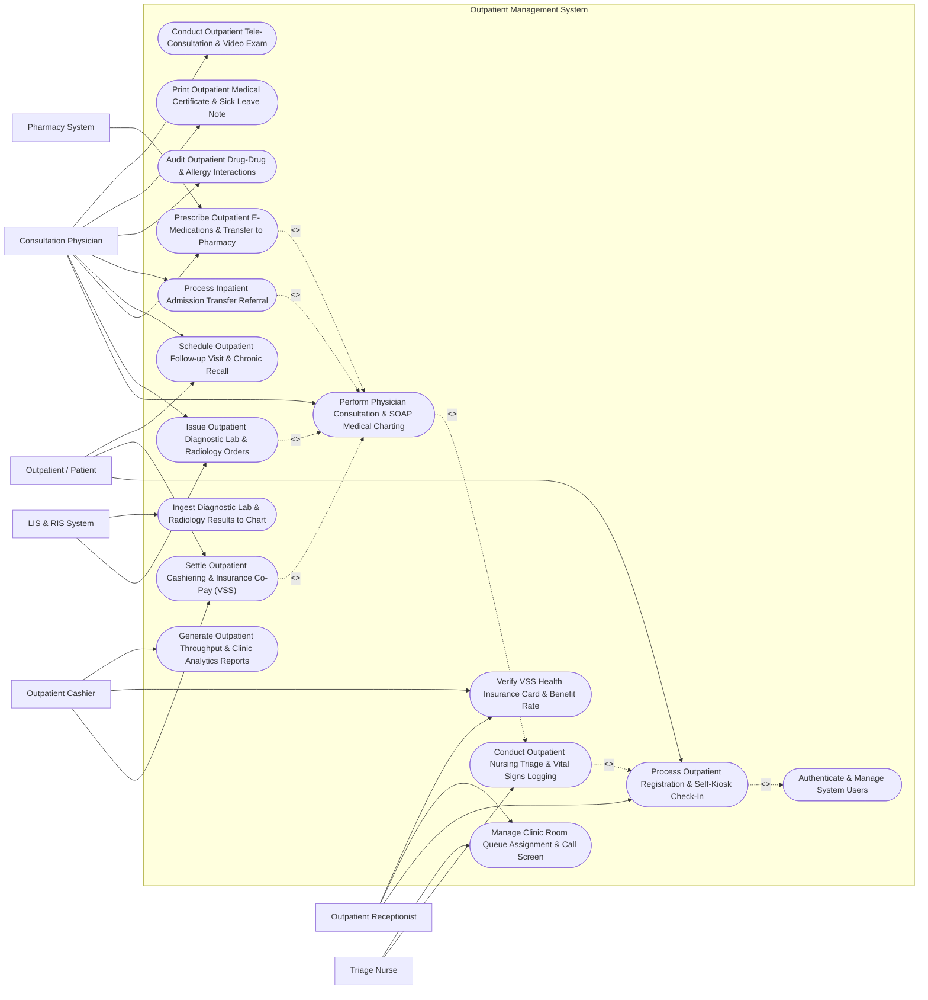

# Use Case Diagram — Outpatient Management System

## Mermaid Code

## Actor Table | Bảng Actor

| # | Actor | Actor Type | Role Description | Related Use Cases |
|---|-------|------------|------------------|-------------------|
| 1 | Outpatient / Patient | Primary | Patient checking in at kiosk, paying co-pays, receiving consultations, and scheduling follow-up visits. | UC01, UC06, UC07 |
| 2 | Outpatient Receptionist | Primary | Reception staff registering new patients, scanning VSS insurance cards, and assigning clinic room queue numbers. | UC01, UC09, UC10 |
| 3 | Triage Nurse | Primary | Clinical nurse measuring baseline vital signs, recording chief complaints, and sorting queue order. | UC02, UC09 |
| 4 | Consultation Physician | Primary | Specialist or GP conducting outpatient examinations, charting SOAP notes, ordering tests, and e-prescribing. | UC03, UC04, UC05, UC07, UC08, UC11, UC12, UC13 |
| 5 | Outpatient Cashier | Primary | Cashier processing outpatient consultation fees, collecting copays, and printing tax/insurance receipts. | UC06, UC10, UC15 |
| 6 | Pharmacy System | Secondary / System | External outpatient pharmacy receiving e-prescriptions and returning dispensing status codes. | UC05 |
| 7 | LIS & RIS System | Secondary / System | Laboratory and Radiology systems receiving diagnostic order feeds and returning diagnostic test results. | UC04, UC14 |

## Use Case Table | Bảng Use Case

| # | UC ID | Use Case Name | Primary Actor | Secondary Actor | Description | Priority |
|---|-------|---------------|---------------|-----------------|-------------|----------|
| 1 | UC01 | Process Outpatient Registration & Self-Kiosk Check-In | Outpatient Receptionist | Outpatient / Patient | Intake patient demographics or scan Citizen ID / VSS insurance card at self-kiosk, issuing a queue ticket. | High |
| 2 | UC02 | Conduct Outpatient Nursing Triage & Vital Signs Logging | Triage Nurse | None | Record baseline vitals (BP, HR, Temp, SpO2, Weight), capture chief complaint, and assign triage priority. | High |
| 3 | UC03 | Perform Physician Consultation & SOAP Medical Charting | Consultation Physician | None | Conduct clinical examination, document SOAP notes (Subjective, Objective, Assessment, Plan), and code ICD-10 diagnoses. | High |
| 4 | UC04 | Issue Outpatient Diagnostic Lab & Radiology Orders | Consultation Physician | LIS & RIS System | Order outpatient laboratory blood/urine tests, X-rays, CT/MRI scans, or ECGs, routing orders to LIS/RIS. | High |
| 5 | UC05 | Prescribe Outpatient E-Medications & Transfer to Pharmacy | Consultation Physician | Pharmacy System | Generate electronic prescriptions (e-Rx) with dosage/frequency, screening drug interactions, and transferring to pharmacy. | High |
| 6 | UC06 | Settle Outpatient Cashiering & Insurance Co-Pay (VSS) | Outpatient Cashier | Outpatient / Patient | Calculate total consultation and test fees, deduct VSS insurance benefit percentage, collect copay, and print receipts. | High |
| 7 | UC07 | Schedule Outpatient Follow-up Visit & Chronic Recall | Consultation Physician | Outpatient / Patient | Schedule follow-up appointment date for chronic disease monitoring (Hypertension, Diabetes) and send SMS reminders. | Medium |
| 8 | UC08 | Process Inpatient Admission Transfer Referral | Consultation Physician | None | Issue inpatient admission order when an outpatient requires immediate hospital ward admission, transferring medical chart. | High |
| 9 | UC09 | Manage Clinic Room Queue Assignment & Call Screen | Outpatient Receptionist | Triage Nurse | Manage clinic room patient queues (Room 101-115), call next queue number on room TV screens, and handle priority skips. | High |
| 10 | UC10 | Verify VSS Health Insurance Card & Benefit Rate | Outpatient Receptionist | Outpatient Cashier | Query Vietnam Social Security (VSS) gateway to verify insurance card validity, primary clinic referral, and benefit rate (80%/95%/100%). | High |
| 11 | UC11 | Audit Outpatient Drug-Drug & Allergy Interactions | Consultation Physician | None | Screen prescribed e-medications against patient allergy history and concurrent active drugs to prevent adverse reactions. | High |
| 12 | UC12 | Print Outpatient Medical Certificate & Sick Leave Note | Consultation Physician | None | Issue official medical certificate, sick leave authorization (BHXH format), or fitness-for-work certificates. | Medium |
| 13 | UC13 | Conduct Outpatient Tele-Consultation & Video Exam | Consultation Physician | None | Conduct remote video consultation for follow-up patients, viewing shared vitals and issuing e-prescriptions. | Medium |
| 14 | UC14 | Ingest Diagnostic Lab & Radiology Results to Chart | Consultation Physician | LIS & RIS System | Automatically stream completed lab result panels and radiology DICOM reports into the active consultation screen. | High |
| 15 | UC15 | Generate Outpatient Throughput & Clinic Analytics Reports | Outpatient Cashier | None | Produce daily consultation volume by specialty, average patient waiting time, VSS claim totals, and clinic revenue. | Medium |
| 16 | UC16 | Authenticate & Manage System Users | All Users | None | Enforce secure role-based login (Receptionist, Nurse, Doctor, Cashier), patient data privacy, and audit logging. | High |

## Use Case Specification | Đặc tả Use Case

---

### UC01 — Process Outpatient Registration & Self-Kiosk Check-In

| Field | Detail |
|-------|--------|
| **UC ID** | UC01 |
| **Use Case Name** | Process Outpatient Registration & Self-Kiosk Check-In |
| **Actor(s)** | Primary: Outpatient Receptionist   Secondary: Outpatient / Patient |
| **Description** | Processes patient intake at the reception desk or self-service kiosk, scanning national Citizen ID card (CCCD) or VSS insurance card, verifying patient demographics, selecting target clinic specialty, and issuing a color-coded Queue Ticket. |
| **Precondition** | 1. The registration kiosk or receptionist terminal is connected to OPD System.   2. The patient arrives at the outpatient department. |
| **Main Flow** | 1. The Patient approaches the Self-Service Kiosk or Reception Desk and inserts/scans their Citizen ID Card (CCCD) or VSS Health Insurance QR Code.   2. The System reads card data and queries the Master Patient Index (MPI): Full Name, Date of Birth, Gender, Citizen ID Number, VSS Insurance Card Number, and Address.   3. If new patient, the System auto-populates demographics and creates a new Outpatient Master Record (e.g., PAT-2026-08192).   4. The System prompts for **Visit Selection**:   &nbsp;&nbsp;&nbsp;&nbsp;- Select Clinic Specialty: Internal Medicine, Cardiology, Pediatrics, ENT, Dermatology   &nbsp;&nbsp;&nbsp;&nbsp;- Select Preferred Doctor (Optional).   5. The System verifies VSS Insurance Eligibility (UC10) and primary clinic referral letter status.   6. The System generates an active Outpatient Visit Record (e.g., VIS-2026-99182) and issues a printed/digital **Queue Ticket**:   &nbsp;&nbsp;&nbsp;&nbsp;- **Queue Number**: A-042 (General Medicine)   &nbsp;&nbsp;&nbsp;&nbsp;- **Target Clinic Room**: Room 104 (1st Floor)   &nbsp;&nbsp;&nbsp;&nbsp;- **Estimated Wait Time**: 15 Minutes.   7. The System routes the patient into the Triage Nurse Queue (UC02) and updates Room 104 TV Call Display. |
| **Alternative Flow** | **AF1** — Pre-Booked Appointment QR Check-In: Patient scanned an online pre-booked appointment QR code from mobile app; the System validates booking and issues an "Express Priority Queue Ticket".   **AF2** — Emergency Walk-In Triage Override: If patient exhibits acute distress at reception, the Receptionist clicks "Emergency Triage", issuing an immediate Priority 1 Queue Ticket bypassing standard queues. |
| **Exception Flow** | **EX1** — VSS Insurance Card Expired / Invalid: If VSS query returns "Card Expired" or "Invalid Referral", the System alerts "Insurance Invalid - Register as Fee-Paying Outpatient" and prompts cashier co-pay.   **EX2** — Clinic Room Daily Capacity Reached: If Room 104 has reached its maximum 80-patient daily capacity limit, the System suggests transferring registration to Room 105 or booking for tomorrow. |
| **Postcondition** | Outpatient Visit Record is created, VSS eligibility is checked, Queue Ticket with target clinic room number is printed, and patient is queued for nursing triage. |
| **Business Rule** | **BR1**: Patients holding valid VSS health insurance cards with correct referral letters MUST be assigned insured benefit coverage rates (80%, 95%, 100%).   **BR2**: Self-kiosk check-in processing time from card scan to queue ticket printing MUST NOT exceed 30 seconds per patient. |

---

### UC02 — Conduct Outpatient Nursing Triage & Vital Signs Logging

| Field | Detail |
|-------|--------|
| **UC ID** | UC02 |
| **Use Case Name** | Conduct Outpatient Nursing Triage & Vital Signs Logging |
| **Actor(s)** | Primary: Triage Nurse |
| **Description** | Conducts pre-consultation nursing triage in the OPD triage room, measuring baseline vital signs (BP, Heart Rate, Temperature, SpO2, Weight, BMI), logging chief complaint summary, and assigning clinical priority tags before physician consultation. |
| **Precondition** | 1. The patient has checked in and holds an active Queue Ticket (UC01).   2. The Triage Nurse is authenticated in the OPD Triage module. |
| **Main Flow** | 1. The Triage Nurse calls Queue Ticket A-042 into the Triage Room.   2. The Nurse scans the Queue Ticket barcode to open the active Visit Record (VIS-2026-99182).   3. The Nurse measures and inputs **Baseline Vital Signs**:   &nbsp;&nbsp;&nbsp;&nbsp;- **Blood Pressure**: Systolic 135 mmHg / Diastolic 85 mmHg   &nbsp;&nbsp;&nbsp;&nbsp;- **Heart Rate**: 78 bpm   &nbsp;&nbsp;&nbsp;&nbsp;- **Body Temperature**: 37.2 °C   &nbsp;&nbsp;&nbsp;&nbsp;- **SpO2**: 98% on room air   &nbsp;&nbsp;&nbsp;&nbsp;- **Weight & Height**: 68 kg / 168 cm (Auto-calculates BMI 24.1 kg/m²).   4. The Nurse records Chief Complaint Summary (e.g., "Patient reports 3-day history of dry cough and mild fever").   5. The Nurse logs known Food/Drug Allergies (e.g., Penicillin Allergy).   6. The System evaluates Vital Signs against Triage Alert Thresholds: Normal Range -> Assigns **Priority 3 (Routine Consultation)**.   7. The Nurse signs the triage entry, and the System transfers the patient into the Doctor's Consultation Room Queue (Room 104), displaying Queue Ticket A-042 on the Doctor's waiting screen. |
| **Alternative Flow** | **AF1** — High Blood Pressure / Fever Priority Upgrade: If BP is measured at 185/110 mmHg (Hypertensive Crisis), the System flags "CRITICAL VITAL BREACH", upgrades priority to **Priority 1 (Urgent Doctor Consultation)**, and sounds an alert.   **AF2** — Pediatric Triage Adjustment: For pediatric patients (< 12 years), the System prompts for Pediatric Vitals (Head Circumference, Pediatric Temp) and calculates pediatric body surface area (BSA). |
| **Exception Flow** | **EX1** — Acute Cardiac / Respiratory Collapse in Triage Room: If patient collapses in triage with SpO2 < 85% or severe chest pain, the Nurse clicks "RED CODE EMERGENCY", bypassing consultation and wheeling patient directly to ER.   **EX2** — Omitted Vital Sign Validation Warning: If the Nurse attempts to save triage without recording Blood Pressure, the System prompts "BP Measurement Required for Adult Consultation". |
| **Postcondition** | Baseline vitals and chief complaint are logged into Visit Record, allergy alerts are flagged, triage priority is assigned, and patient is queued in Doctor's room. |
| **Business Rule** | **BR1**: Adult Blood Pressure, Heart Rate, Temperature, and SpO2 MUST be recorded for 100% of outpatient consultations prior to physician examination.   **BR2**: Patients with Systolic BP >= 180 mmHg or Temp >= 39.5°C MUST be automatically escalated to Priority 1 urgent doctor examination. |

---

### UC03 — Perform Physician Consultation & SOAP Medical Charting

| Field | Detail |
|-------|--------|
| **UC ID** | UC03 |
| **Use Case Name** | Perform Physician Consultation & SOAP Medical Charting |
| **Actor(s)** | Primary: Consultation Physician |
| **Description** | Facilitates the outpatient physician consultation, enabling the doctor to review patient vitals/history, conduct physical examination, document clinical findings using standardized SOAP format (Subjective, Objective, Assessment, Plan), code primary and secondary ICD-10 diagnoses, and initiate diagnostic or prescribing plans. |
| **Precondition** | 1. The patient has completed nursing triage (UC02) and is waiting in the doctor's room queue.   2. The Physician is authenticated in the OPD Clinical Consultation Module. |
| **Main Flow** | 1. The Doctor clicks "Call Next Patient" (Queue Ticket A-042), and the System updates the Room 104 TV Call Display screen to "A-042 -> Room 104".   2. The Doctor opens the active consultation workspace for patient VIS-2026-99182.   3. The System displays Summary Dashboard: Baseline Vitals (BP 135/85, HR 78, Temp 37.2°C), Allergy Warnings (Penicillin), and Prior EHR Visit History.   4. The Doctor documents clinical findings using **SOAP Formatting**:   &nbsp;&nbsp;&nbsp;&nbsp;- **S (Subjective)**: Patient reports 3 days of dry cough, low-grade fever, mild fatigue. No dyspnea.   &nbsp;&nbsp;&nbsp;&nbsp;- **O (Objective)**: Throat mildly hyperemic. Lungs: Clear bilateral breath sounds, no rales/rhonchi. Heart: Regular S1/S2.   &nbsp;&nbsp;&nbsp;&nbsp;- **A (Assessment / Diagnosis)**: Primary ICD-10 Code `J06.9 (Acute Upper Respiratory Tract Infection, Unspecified)`.   &nbsp;&nbsp;&nbsp;&nbsp;- **P (Plan)**: Symptomatic medical therapy, fluid intake, 5-day sick leave note.   5. The Doctor issues Diagnostic Orders (UC04) or E-Prescription (UC05) as needed.   6. The Doctor selects Consultation Status: "Consultation Complete - Proceed to Cashier / Pharmacy".   7. The Doctor electronically signs the consultation chart, locking the medical record. |
| **Alternative Flow** | **AF1** — Chronic Disease Management Charting: For diabetic or hypertensive follow-up patients, the Doctor reviews 3-month HbA1c / BP trend graphs, updates chronic care plans, and sets follow-up recall (UC07).   **AF2** — Inpatient Admission Decision: If physical exam reveals severe lobar pneumonia, the Doctor selects "Refer for Inpatient Admission" (UC08), converting the outpatient record into an inpatient admission request. |
| **Exception Flow** | **EX1** — Missing Primary ICD-10 Diagnosis Error: If the Doctor attempts to sign off the consultation without selecting a primary ICD-10 diagnosis code, the System blocks sign-off and flashes "Primary ICD-10 Required".   **EX2** — Unsaved Clinical Note Auto-Recovery: If power/network disconnects during charting, the System auto-recovers draft SOAP text from local encrypted browser cache upon re-login. |
| **Postcondition** | SOAP clinical notes are documented, primary ICD-10 diagnosis is coded, medical chart is electronically signed and locked, and patient is routed to cashier/pharmacy. |
| **Business Rule** | **BR1**: Every completed outpatient consultation MUST include at least one valid 4-character ICD-10 diagnosis code for insurance clearance and clinical audit.   **BR2**: Signed clinical consultation charts cannot be modified; amendments must be recorded as timestamped addendums. |

---

### UC04 — Issue Outpatient Diagnostic Lab & Radiology Orders

| Field | Detail |
|-------|--------|
| **UC ID** | UC04 |
| **Use Case Name** | Issue Outpatient Diagnostic Lab & Radiology Orders |
| **Actor(s)** | Primary: Consultation Physician   Secondary: LIS & RIS System |
| **Description** | Handles Computerized Provider Order Entry (CPOE) for outpatient diagnostic laboratory blood/urine panels, electrocardiograms (ECG), X-rays, Ultrasound, CT, or MRI scans, linking clinical indications, routing electronic order feeds to LIS/RIS systems, and ingesting completed test results into the patient's chart. |
| **Precondition** | 1. An active consultation session (UC03) is in progress.   2. Laboratory (LIS) and Radiology (RIS/PACS) integration gateways are active. |
| **Main Flow** | 1. The Doctor selects "Order Diagnostic Tests" within the patient's active consultation chart.   2. The Doctor searches the test catalog and selects required items:   &nbsp;&nbsp;&nbsp;&nbsp;- **Lab Panel**: Complete Blood Count (CBC), C-Reactive Protein (CRP), Fasting Blood Glucose   &nbsp;&nbsp;&nbsp;&nbsp;- **Radiology**: Chest X-Ray PA View (CPT 71046)   &nbsp;&nbsp;&nbsp;&nbsp;- **Clinical Indication**: "3-day cough, rule out pneumonia".   3. The System verifies VSS insurance coverage for ordered CPT test codes.   4. The Doctor signs the electronic order set.   5. The System transmits real-time electronic order feeds: Lab orders to LIS; Radiology orders to RIS/PACS.   6. The System generates printed Specimen Barcode Tags for phlebotomy and Radiology Order Slips for the patient.   7. The Patient proceeds to Cashier (UC06) and Lab/X-Ray rooms.   8. Upon test completion, LIS/RIS transmit lab result values and DICOM report links back to OPD System (UC14), triggering an "Unread Diagnostic Result Alert" on the Doctor's dashboard. |
| **Alternative Flow** | **AF1** — Urgent STAT Order Flag: For a patient with severe chest pain, the Doctor flags orders as "STAT / Emergency", elevating LIS/RIS processing priority to 15-minute turnaround.   **AF2** — Standing Protocol Order Sets: The Doctor selects a pre-configured order set (e.g., "Fever of Unknown Origin Panel"), auto-populating CBC, Dengue NS1, Malaria Smear, and Urine Analysis in one click. |
| **Exception Flow** | **EX1** — Duplicate Test Order Warning: If the Doctor orders a HbA1c test for a patient who already had an HbA1c test completed 2 days ago, the System alerts "Duplicate Test Warning within 30 Days" requiring override justification.   **EX2** — Pregnancy Contraindication for X-Ray: If the Doctor orders a Pelvic CT scan for a female patient of childbearing age without pregnancy status checked, the System flags "Pregnancy Screening Required Before Radiation Exposure". |
| **Postcondition** | Diagnostic lab and radiology orders are signed, order feeds are transmitted to LIS/RIS, specimen barcode slips are generated, and result ingestion listeners are activated. |
| **Business Rule** | **BR1**: Radiation-emitting radiology orders (X-Ray, CT) for female patients aged 12-55 MUST require documented pregnancy status verification prior to order transmission.   **BR2**: Diagnostic test orders must specify a clinical indication or ICD-10 code to justify medical necessity for insurance reimbursement. |

---

### UC05 — Prescribe Outpatient E-Medications & Transfer to Pharmacy

| Field | Detail |
|-------|--------|
| **UC ID** | UC05 |
| **Use Case Name** | Prescribe Outpatient E-Medications & Transfer to Pharmacy |
| **Actor(s)** | Primary: Consultation Physician   Secondary: Pharmacy System |
| **Description** | Generates electronic prescriptions (e-Rx) for outpatient medications, executing real-time drug allergy and drug-drug interaction screening, calculating dosage, frequency, and total dispense quantities, and transmitting approved e-prescriptions directly to the outpatient hospital pharmacy dispensing queue. |
| **Precondition** | 1. An active consultation session (UC03) with diagnosed ICD-10 condition is open.   2. Hospital pharmacy drug formulary database is active. |
| **Main Flow** | 1. The Doctor opens the "E-Prescribing Module" from the active consultation.   2. The Doctor searches the hospital formulary and selects medications:   &nbsp;&nbsp;&nbsp;&nbsp;- **Drug 1**: Amoxicillin 500mg Capsule — 1 cap PO TID (every 8 hrs) x 5 days (Qty: 15 caps)   &nbsp;&nbsp;&nbsp;&nbsp;- **Drug 2**: Paracetamol 500mg Tablet — 1 tab PO PRN for fever > 38.5°C x 3 days (Qty: 10 tabs)   &nbsp;&nbsp;&nbsp;&nbsp;- **Drug 3**: Acetylcysteine 200mg Sachet — 1 sachet PO BID x 5 days (Qty: 10 sachets).   3. The System executes **Safety Screening** (UC11):   &nbsp;&nbsp;&nbsp;&nbsp;- **Allergy Check**: Compares drugs against Penicillin allergy profile -> PASS   &nbsp;&nbsp;&nbsp;&nbsp;- **Drug-Drug Interaction**: Amoxicillin + Paracetamol + Acetylcysteine -> No Major Interactions   &nbsp;&nbsp;&nbsp;&nbsp;- **Duplicate Therapy Check**: No overlapping active ingredients.   4. The System verifies VSS Health Insurance Formulary Coverage (e.g., Amoxicillin 100% covered under VSS list).   5. The Doctor inputs Patient Administration Instructions: "Take Amoxicillin after meals. Finish full 5-day course."   6. The Doctor signs the e-prescription with an electronic signature.   7. The System dispatches the e-prescription payload directly to the Outpatient Pharmacy System dispensing queue and generates an e-Rx barcode on the consultation receipt. |
| **Alternative Flow** | **AF1** — Controlled Substance / Narcotic E-Prescribing: For chronic pain management (Tramadol / Codeine), the System enforces 21 CFR Part 11 / MOH Narcotic Prescribing Rules: Requires Doctor Digital Certificate Sign-off and limits max supply to 7 days.   **AF2** — Out-of-Stock Drug Substitution: If the hospital pharmacy is out of Amoxicillin 500mg capsules, the System suggests formulary substitute *Cefuroxime 250mg* or alerts the Doctor to write an external retail pharmacy prescription. |
| **Exception Flow** | **EX1** — Severe Drug Allergy Conflict Hard Block: If the Doctor prescribes *Augmentin* (Amoxicillin/Clavulanate) to a patient with documented Penicillin Anaphylaxis, the System blocks prescription sign-off with a red "FATAL ALLERGY CONFLICT".   **EX2** — Pediatric Dose Exceeding Maximum Cap: If the Doctor prescribes Paracetamol 1000mg per dose for a 12kg child (exceeding 15mg/kg max dose), the System flags "Pediatric Overdose Warning". |
| **Postcondition** | Electronic prescription (e-Rx) is validated for safety, digitally signed by physician, transmitted to pharmacy queue, and printed on patient consultation summary. |
| **Business Rule** | **BR1**: All prescribed medications MUST undergo automated real-time screening against patient documented drug allergies and active concurrent drugs prior to e-Rx signature.   **BR2**: Outpatient prescriptions covered under VSS health insurance must strictly comply with national MOH insurance drug formulary coverage lists and maximum day-supply caps (max 30 days for chronic diseases). |
