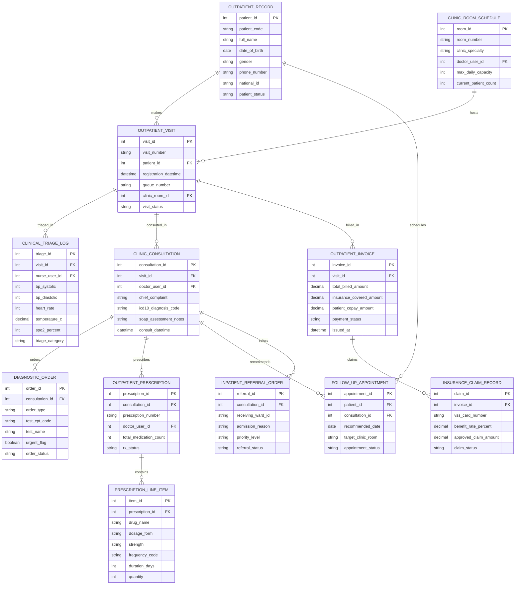

# Conceptual ERD — Outpatient Management System

## Mermaid Code

## Entity Description Table | Bảng mô tả Entity

| # | Entity Name | Vietnamese Name | Description | Key Attributes | Main Relationships |
|---|-------------|-----------------|-------------|----------------|-------------------|
| 1 | OUTPATIENT_RECORD | Bệnh nhân Ngoại trú Master | Master outpatient profile storing patient code, full name, DOB, gender, phone, Citizen ID, and status. | patient_id, patient_code, full_name, dob, gender, phone_number, national_id, patient_status | Has many OUTPATIENT_VISIT and FOLLOW_UP_APPOINTMENT entities. |
| 2 | OUTPATIENT_VISIT | Lượt Khám Ngoại trú (Visit) | Specific outpatient visit record tracking visit number, registration datetime, queue number, clinic room ID, and status. | visit_id, visit_number, patient_id, registration_datetime, queue_number, clinic_room_id, visit_status | Belongs to OUTPATIENT_RECORD and CLINIC_ROOM_SCHEDULE; Has TRIAGE_LOG, CONSULTATION, INVOICE. |
| 3 | CLINICAL_TRIAGE_LOG | Nhật ký Phân loại Sàng lọc | Nursing triage log recording nurse ID, blood pressure (systolic/diastolic), heart rate, temperature, SpO2 %, and triage category. | triage_id, visit_id, nurse_user_id, bp_systolic, bp_diastolic, heart_rate, temperature_c, triage_category | Belongs to OUTPATIENT_VISIT. |
| 4 | CLINIC_CONSULTATION | Phỏng khám Bác sĩ (Consultation) | Physician consultation record logging doctor ID, chief complaint, primary ICD-10 diagnosis, SOAP notes, and consult datetime. | consultation_id, visit_id, doctor_user_id, chief_complaint, icd10_diagnosis_code, soap_assessment_notes | Belongs to OUTPATIENT_VISIT; Has DIAGNOSTIC_ORDER, PRESCRIPTION, REFERRAL_ORDER, etc. |
| 5 | DIAGNOSTIC_ORDER | Y lệnh Cận lâm sàng (Lab/X-Ray) | Diagnostic lab and radiology CPOE order tracking order type (Lab, X-Ray, CT), CPT code, test name, urgent flag, and status. | order_id, consultation_id, order_type, test_cpt_code, test_name, urgent_flag, order_status | Belongs to CLINIC_CONSULTATION. |
| 6 | OUTPATIENT_PRESCRIPTION | Đơn thuốc Ngoại trú (e-Rx) | Electronic prescription master record tracking prescription number, prescribing doctor ID, total medication count, and rx status. | prescription_id, consultation_id, prescription_number, doctor_user_id, total_medication_count, rx_status | Belongs to CLINIC_CONSULTATION; Has many PRESCRIPTION_LINE_ITEM entities. |
| 7 | PRESCRIPTION_LINE_ITEM | Chi tiết Thuốc Đơn hàng | Individual prescribed medication line item storing drug name, dosage form, strength, frequency code, duration days, and quantity. | item_id, prescription_id, drug_name, dosage_form, strength, frequency_code, duration_days, quantity | Belongs to OUTPATIENT_PRESCRIPTION. |
| 8 | OUTPATIENT_INVOICE | Hóa đơn Viện phí Ngoại trú | Outpatient billing invoice tracking total billed amount, insurance covered amount, patient copay amount, payment status, and issued timestamp. | invoice_id, visit_id, total_billed_amount, insurance_covered_amount, patient_copay_amount, payment_status | Belongs to OUTPATIENT_VISIT; Has INSURANCE_CLAIM_RECORD. |
| 9 | INSURANCE_CLAIM_RECORD | Hồ sơ Giám định BHYT (VSS) | Health insurance (VSS) claim record tracking VSS card number, benefit rate %, approved claim amount, and claim clearance status. | claim_id, invoice_id, vss_card_number, benefit_rate_percent, approved_claim_amount, claim_status | Belongs to OUTPATIENT_INVOICE. |
| 10 | FOLLOW_UP_APPOINTMENT | Lịch Hẹn Khám lại | Outpatient follow-up appointment record tracking recommended date, target clinic room, and appointment status. | appointment_id, patient_id, consultation_id, recommended_date, target_clinic_room, appointment_status | Belongs to OUTPATIENT_RECORD and CLINIC_CONSULTATION. |
| 11 | INPATIENT_REFERRAL_ORDER | Giấy Chuyển Nhập viện | Inpatient admission referral order tracking receiving hospital ward ID, admission reason, priority level, and referral status. | referral_id, consultation_id, receiving_ward_id, admission_reason, priority_level, referral_status | Belongs to CLINIC_CONSULTATION. |
| 12 | CLINIC_ROOM_SCHEDULE | Lịch Phòng khám Specialist | Clinic room master schedule tracking room number, specialty, attending doctor ID, max daily capacity, and current patient count. | room_id, room_number, clinic_specialty, doctor_user_id, max_daily_capacity, current_patient_count | Has many OUTPATIENT_VISIT entities. |

## Relationship Description | Mô tả Quan hệ

| # | From Entity | Cardinality | To Entity | Relationship Label | Business Explanation |
|---|-------------|-------------|-----------|-------------------|----------------------|
| 1 | OUTPATIENT_RECORD | one-to-many | OUTPATIENT_VISIT | makes | One outpatient record makes multiple ambulatory visit episodes over time. |
| 2 | OUTPATIENT_RECORD | one-to-many | FOLLOW_UP_APPOINTMENT | schedules | One outpatient record schedules future follow-up clinic appointments. |
| 3 | CLINIC_ROOM_SCHEDULE | one-to-many | OUTPATIENT_VISIT | hosts | One clinic room schedule hosts multiple patient visit queues daily. |
| 4 | OUTPATIENT_VISIT | one-to-one | CLINICAL_TRIAGE_LOG | triaged_in | One outpatient visit is triaged in baseline nursing vital signs. |
| 5 | OUTPATIENT_VISIT | one-to-one | CLINIC_CONSULTATION | consulted_in | One outpatient visit undergoes a physician examination and SOAP charting. |
| 6 | OUTPATIENT_VISIT | one-to-one | OUTPATIENT_INVOICE | billed_in | One outpatient visit is billed in an itemized financial invoice. |
| 7 | CLINIC_CONSULTATION | one-to-many | DIAGNOSTIC_ORDER | orders | One consultation orders diagnostic lab tests and radiology imaging scans. |
| 8 | CLINIC_CONSULTATION | one-to-many | OUTPATIENT_PRESCRIPTION | prescribes | One consultation prescribes electronic medication prescriptions (e-Rx). |
| 9 | CLINIC_CONSULTATION | one-to-many | FOLLOW_UP_APPOINTMENT | recommends | One consultation recommends a future follow-up appointment for chronic care. |
| 10 | CLINIC_CONSULTATION | one-to-one | INPATIENT_REFERRAL_ORDER | refers | One consultation refers an acutely ill outpatient for inpatient hospital admission. |
| 11 | OUTPATIENT_PRESCRIPTION | one-to-many | PRESCRIPTION_LINE_ITEM | contains | One prescription contains multiple individual medication line items. |
| 12 | OUTPATIENT_INVOICE | one-to-one | INSURANCE_CLAIM_RECORD | claims | One outpatient invoice generates a social health insurance (VSS) claim. |
