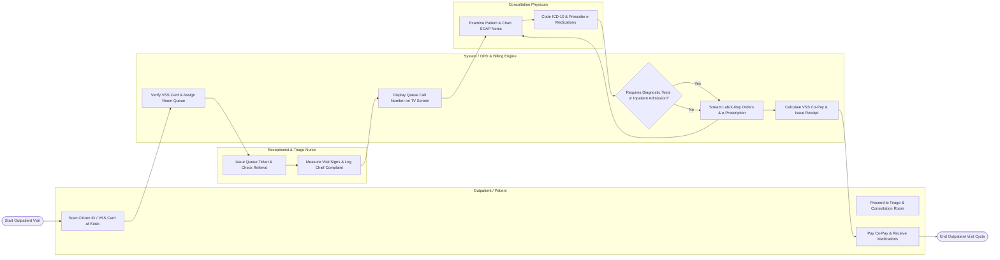

# Swimlane Diagram — Outpatient Management System

## Mermaid Code

## Flow Description | Mô tả luồng

| Lane | Actor / Subsystem | Role in Flow |
|------|-------------------|--------------|
| 1 | Outpatient / Patient | Scans Citizen ID or VSS insurance card at self-kiosk, receives queue ticket, proceeds to triage and doctor consultation rooms, pays co-pays, and collects dispensed medications. |
| 2 | Receptionist & Triage Nurse | Verifies primary clinic referral letters, issues queue tickets, measures baseline vital signs (BP, HR, Temp, SpO2, Weight), logs chief complaints, and sorts queue priorities. |
| 3 | System / OPD & Billing Engine | Validates VSS insurance coverage rates, displays queue call numbers on clinic room TV screens, routes CPOE diagnostic test orders to LIS/RIS, calculates co-pays, and generates VSS claims. |
| 4 | Consultation Physician | Calls next patient into room, conducts physical examination, documents clinical SOAP notes, codes primary ICD-10 diagnoses, orders lab/radiology tests, and writes e-prescriptions. |
