# Action Tree — Outpatient Management System

## Mermaid Code

```mermaid
graph TD
    Root["Outpatient Management System"]

    Root --> M1["Registration & Self-Kiosk Intake"]
    Root --> M2["Nursing Triage & Vital Signs"]
    Root --> M3["Physician Consultation & SOAP"]
    Root --> M4["Diagnostic Test CPOE & Results"]
    Root --> M5["Electronic Prescribing & Safety"]
    Root --> M6["VSS Insurance & Cashiering"]
    Root --> M7["Queue Management & TV Call"]
    Root --> M8["Follow-Up & Inpatient Referral"]

    M1 --> A11["Scan Citizen ID & VSS Card QR Code"]
    M1 --> A12["Create Master Outpatient Record MPI"]
    M1 --> A13["Select Clinic Specialty & Doctor"]
    M1 --> A14["Print Color-Coded OPD Queue Ticket"]

    M2 --> A21["Measure BP Heart Rate Temp SpO2 Weight"]
    M2 --> A22["Log Chief Complaint & Known Allergies"]
    M2 --> A23["Evaluate High Vital Breach Risk Alerts"]
    M2 --> A24["Assign Emergency Priority 1 Triage Tag"]

    M3 --> A31["Review Baseline Vitals & Prior EHR History"]
    M3 --> A32["Document Clinical SOAP Medical Notes"]
    M3 --> A33["Code Primary & Secondary ICD-10 Diagnoses"]
    M3 --> A34["Electronically Sign Consultation Chart"]

    M4 --> A41["Order Outpatient Laboratory Blood Panels"]
    M4 --> A42["Order Radiology X-Ray CT MRI Scans"]
    M4 --> A43["Transmit CPOE Order Feeds to LIS RIS"]
    M4 --> A44["Ingest Lab Values & DICOM Image Links"]

    M5 --> A51["Build E-Prescription Medication List"]
    M5 --> A52["Execute Real-Time Drug Allergy Screening"]
    M5 --> A53["Screen Drug-Drug Interaction Warnings"]
    M5 --> A54["Transfer E-Rx Payload to OPD Pharmacy"]

    M6 --> A61["Query VSS Gateway for Benefit Clearance"]
    M6 --> A62["Calculate Billed Services & Co-Pay Rates"]
    M6 --> A63["Process Cash Credit Bank Card Payments"]
    M6 --> A64["Generate Official VSS Insurance Claim XML"]

    M7 --> A71["Manage Specialist Clinic Room Queues"]
    M7 --> A72["Trigger Room TV Screen Number Calls"]
    M7 --> A73["Process Express Priority Queue Skips"]
    M7 --> A74["Track Room Daily Patient Capacity Limits"]

    M8 --> A81["Schedule Chronic Disease Follow-Up Visit"]
    M8 --> A82["Dispatch Automated SMS Recall Reminders"]
    M8 --> A83["Issue Inpatient Ward Admission Order"]
    M8 --> A84["Print Official Medical & Sick Leave Certificate"]
```

## Module Description | Mô tả Module

| # | Module | Description | Actions |
|---|--------|-------------|---------|
| 1 | Registration & Self-Kiosk Intake | Scans Citizen ID/VSS QR cards at self-kiosks, creates master outpatient records, selects clinic specialties, and prints queue tickets. | Scan Citizen ID & VSS Card QR Code, Create Master Outpatient Record MPI, Select Clinic Specialty & Doctor, Print Color-Coded OPD Queue Ticket |
| 2 | Nursing Triage & Vital Signs | Measures baseline vitals (BP, HR, Temp, SpO2, Weight), logs chief complaints, evaluates vital alerts, and assigns triage priority codes. | Measure BP Heart Rate Temp SpO2 Weight, Log Chief Complaint & Known Allergies, Evaluate High Vital Breach Risk Alerts, Assign Emergency Priority 1 Triage Tag |
| 3 | Physician Consultation & SOAP | Facilitates examination charting using SOAP format, displays prior EHR history, codes ICD-10 diagnoses, and electronically signs charts. | Review Baseline Vitals & Prior EHR History, Document Clinical SOAP Medical Notes, Code Primary & Secondary ICD-10 Diagnoses, Electronically Sign Consultation Chart |
| 4 | Diagnostic Test CPOE & Results | Orders lab blood/urine panels and radiology X-rays/CT/MRI, transmits CPOE order feeds to LIS/RIS, and ingests completed diagnostic results. | Order Outpatient Laboratory Blood Panels, Order Radiology X-Ray CT MRI Scans, Transmit CPOE Order Feeds to LIS RIS, Ingest Lab Values & DICOM Image Links |
| 5 | Electronic Prescribing & Safety | Generates e-prescriptions, executes real-time drug allergy and drug-drug interaction screening, and transfers e-Rx payloads to the pharmacy. | Build E-Prescription Medication List, Execute Real-Time Drug Allergy Screening, Screen Drug-Drug Interaction Warnings, Transfer E-Rx Payload to OPD Pharmacy |
| 6 | VSS Insurance & Cashiering | Queries VSS insurance gateways, calculates co-pay amounts, processes cash/card payments, and generates VSS XML insurance claim files. | Query VSS Gateway for Benefit Clearance, Calculate Billed Services & Co-Pay Rates, Process Cash Credit Bank Card Payments, Generate Official VSS Insurance Claim XML |
| 7 | Queue Management & TV Call | Manages clinic room queues, triggers TV screen call announcements, handles priority queue skips, and tracks daily room capacity limits. | Manage Specialist Clinic Room Queues, Trigger Room TV Screen Number Calls, Process Express Priority Queue Skips, Track Room Daily Patient Capacity Limits |
| 8 | Follow-Up & Inpatient Referral | Schedules chronic disease follow-up appointments, dispatches SMS reminders, issues inpatient admission referrals, and prints medical certificates. | Schedule Chronic Disease Follow-Up Visit, Dispatch Automated SMS Recall Reminders, Issue Inpatient Ward Admission Order, Print Official Medical & Sick Leave Certificate |
