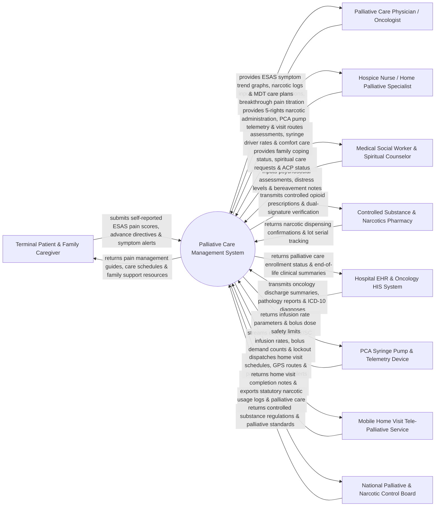

# Context Diagram — Palliative Care Management System

## Mermaid Code

## Actor & Interaction Table | Bảng Actor & Tương tác

| # | Actor | Actor Type | Data Sent TO System | Data Received FROM System | Notes |
|---|-------|------------|---------------------|---------------------------|-------|
| 1 | Terminal Patient & Family Caregiver | Primary | Self-reported ESAS pain/symptom scores, Advance Care Directives (ACP), breakthrough pain alerts. | Personalized pain management schedules, caregiver support guides, emergency nurse contact details. | Patient with advanced/terminal illness receiving palliative or hospice care, and family caregivers. |
| 2 | Palliative Care Physician / Oncologist | Primary | Opioid prescriptions (Morphine, Fentanyl, Oxycodone), breakthrough pain orders, Advance Directives / DNR sign-offs. | ESAS symptom trend charts, narcotic administration logs, multidisciplinary care team notes. | Specialized physician managing terminal pain, symptom control, and end-of-life care planning. |
| 3 | Hospice Nurse / Home Palliative Specialist | Primary | Bedside ESAS symptom evaluations, syringe driver pump rate settings, comfort protocol notes, home vitals. | Dual-signature narcotic verification, PCA pump telemetry alerts, home visit route maps. | Nurse providing inpatient hospice care or conducting home palliative visits. |
| 4 | Medical Social Worker & Spiritual Counselor | Primary | Psychosocial distress evaluations, family coping assessments, spiritual counseling notes, ACP documentation. | Patient spiritual preferences, family bereavement tracking, social support service referrals. | Allied healthcare professional supporting emotional, social, financial, and spiritual needs. |
| 5 | Controlled Substance & Narcotics Pharmacy | Supporting System | Narcotic drug dispensing confirmations, batch lot numbers, controlled substance stock logs. | Verified electronic opioid prescriptions, dual-nurse verification tokens, narcotic audit logs. | Specialized hospital or retail pharmacy dispensing Schedule II controlled opioids under strict legal audit. |
| 6 | Hospital EHR & Oncology HIS System | Supporting System | Oncology diagnosis records (ICD-10), pathology reports, chemotherapy history, outpatient referral notes. | Palliative care enrollment status, advance directive flags, terminal clinical summaries. | Enterprise hospital information system linking primary oncology care with palliative services. |
| 7 | Mobile Home Visit Tele-Palliative Service | Supporting System | Nurse GPS check-in timestamps, mobile home visit notes, offline symptom assessment logs. | Home visit dispatch schedules, patient address maps, emergency triage alerts. | Mobile field software supporting community-based home palliative care teams. |
| 8 | PCA Syringe Pump & Telemetry Device | Supporting System | Continuous IV/Subcutaneous infusion rates, patient-controlled bolus demand counts, lockout alerts. | Programmed infusion rate limits, lockout interval parameters, maximum 4-hour dose caps. | Infusion pump hardware delivering continuous or patient-controlled analgesia for severe pain. |
| 9 | National Palliative & Narcotic Control Board | Regulatory | Controlled narcotic regulations, mandatory Schedule II prescribing limits, palliative quality guidelines. | Statutory narcotic consumption reports, pain control success metrics, ACP completion rates. | Government regulatory body overseeing controlled opioid usage and palliative care standards. |

## System Boundary Description | Mô tả Phạm vi Hệ thống

The **Palliative Care Management System (PCMS)** is a specialized clinical healthcare platform engineered for palliative care departments, hospice units, oncology centers, and home palliative care organizations. It manages holistic symptom assessment (Edmonton Symptom Assessment System - ESAS), opioid analgesic titration and syringe driver monitoring, Advance Care Planning (ACP) and Do Not Resuscitate (DNR) directives, Multidisciplinary Team (MDT) care coordination, end-of-life comfort protocols, and post-demise family bereavement support.

**Inside System Scope:**
- Edmonton Symptom Assessment System (ESAS) score tracking (Pain, Nausea, Fatigue, Anxiety, Dyspnea).
- Opioid narcotic prescribing, breakthrough dose calculation, PCA syringe driver pump telemetry.
- Advance Care Planning (ACP), Advance Directives, and DNR / MOLST legally binding document registry.
- Multidisciplinary Team (MDT) care plan formulation across physical, psychological, social, and spiritual domains.
- Home palliative visit scheduling, GPS route navigation, and mobile offline charting.
- End-of-life comfort care protocols (secretions management, terminal agitation, skin care).
- Family caregiver support tracking and structured post-demise bereavement follow-up.
- Statutory controlled narcotic inventory auditing and regulatory reporting.

**Outside System Scope:**
- Curative chemotherapy, radiotherapy, or curative surgical tumor resection (handled by Oncology HIS).
- Physical manufacturing and synthesis of pharmaceutical opioids (handled by pharma manufacturers).
- General non-palliative adult acute trauma care (handled by Emergency System).
- Legal estate probate and civil will distribution (handled by legal attorneys).
