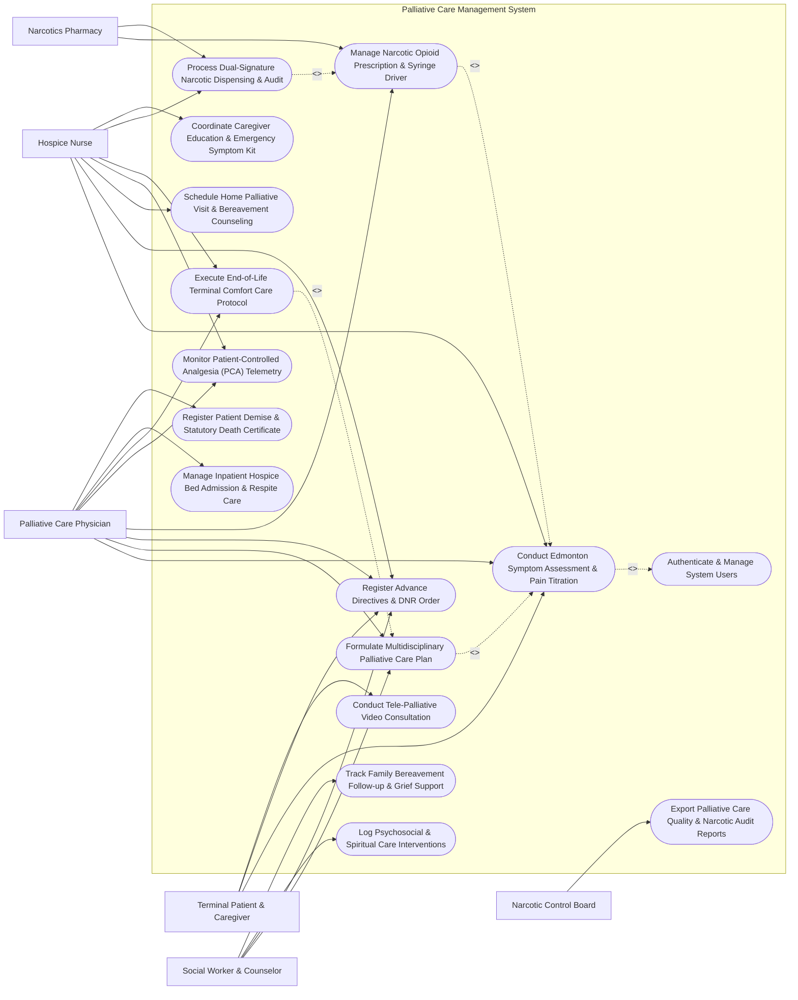

# Use Case Diagram — Palliative Care Management System

## Mermaid Code

## Actor Table | Bảng Actor

| # | Actor | Actor Type | Role Description | Related Use Cases |
|---|-------|------------|------------------|-------------------|
| 1 | Terminal Patient & Caregiver | Primary | Patient or family caregiver submitting self-reported pain scores, registering ACP directives, and accessing tele-palliative care. | UC01, UC03, UC12 |
| 2 | Palliative Care Physician | Primary | Specialist physician leading ESAS symptom titration, formulating care plans, signing DNR orders, and prescribing opioids. | UC01, UC02, UC03, UC04, UC06, UC07, UC10, UC13 |
| 3 | Hospice Nurse | Primary | Registered nurse performing bedside ESAS checks, managing PCA syringe drivers, conducting home visits, and verifying narcotics. | UC01, UC03, UC05, UC06, UC07, UC09, UC11 |
| 4 | Social Worker & Counselor | Primary | Allied health professional documenting psychosocial distress, facilitating Advance Care Planning (ACP), and leading grief support. | UC02, UC03, UC08, UC14 |
| 5 | Narcotics Pharmacy | Secondary / System | Controlled substance pharmacy dispensing Schedule II opioids under dual-signature electronic sign-off. | UC04, UC09 |
| 6 | Narcotic Control Board | Secondary / Regulatory | Government health authority auditing controlled narcotic consumption and palliative care quality metrics. | UC15 |

## Use Case Table | Bảng Use Case

| # | UC ID | Use Case Name | Primary Actor | Secondary Actor | Description | Priority |
|---|-------|---------------|---------------|-----------------|-------------|----------|
| 1 | UC01 | Conduct Edmonton Symptom Assessment & Pain Titration | Palliative Care Physician | Hospice Nurse | Assess 9 core symptoms on ESAS 0-10 scale (Pain, Fatigue, Nausea, Depression, Anxiety, Drowsiness, Appetite, Well-being, Dyspnea). | High |
| 2 | UC02 | Formulate Multidisciplinary Palliative Care Plan | Palliative Care Physician | Social Worker & Counselor | Develop holistic care plans addressing physical symptom control, psychological support, social needs, and spiritual goals. | High |
| 3 | UC03 | Register Advance Directives & DNR Order | Palliative Care Physician | Social Worker & Counselor | Record legally binding Advance Care Planning (ACP) documents, designated surrogate decision maker, CPR preferences, and DNR orders. | High |
| 4 | UC04 | Manage Narcotic Opioid Prescription & Syringe Driver | Palliative Care Physician | Narcotics Pharmacy | Calculate 24-hour oral morphine equivalent (OME) doses, prescribe continuous SC/IV opioid syringe drivers, and breakthrough doses. | High |
| 5 | UC05 | Schedule Home Palliative Visit & Bereavement Counseling | Hospice Nurse | None | Schedule community home palliative visits, optimize GPS travel routes, document bedside nursing care, and offer family support. | High |
| 6 | UC06 | Monitor Patient-Controlled Analgesia (PCA) Telemetry | Hospice Nurse | Palliative Care Physician | Ingest connected PCA syringe driver telemetry (infusion rate mL/hr, lockout interval, bolus demand counts), adjusting dose limits. | High |
| 7 | UC07 | Execute End-of-Life Terminal Comfort Care Protocol | Hospice Nurse | Palliative Care Physician | Activate terminal comfort care protocols (subcutaneous hyoscine for secretions, midazolam for agitation, mouth care, positioning). | High |
| 8 | UC08 | Log Psychosocial & Spiritual Care Interventions | Social Worker & Counselor | None | Record NCCN distress thermometer scores, document spiritual/existential counseling sessions, and track family coping mechanisms. | Medium |
| 9 | UC09 | Process Dual-Signature Narcotic Dispensing & Audit | Hospice Nurse | Narcotics Pharmacy | Execute mandatory dual-nurse barcode scanning and electronic co-signatures for controlled Schedule II opioid dispensing. | High |
| 10 | UC10 | Manage Inpatient Hospice Bed Admission & Respite Care | Palliative Care Physician | None | Manage specialized inpatient hospice bed admissions for acute pain crises, symptom stabilization, or family caregiver respite care. | High |
| 11 | UC11 | Coordinate Caregiver Education & Emergency Symptom Kit | Hospice Nurse | None | Educate family caregivers on subcut injection administration, emergency breakthrough symptom kits ("Just in Case" box), and call triggers. | Medium |
| 12 | UC12 | Conduct Tele-Palliative Video Consultation | Terminal Patient & Caregiver | Palliative Care Physician | Conduct remote video consultation for homebound patients, reviewing ESAS symptom charts and adjusting subcutaneous medication doses. | Medium |
| 13 | UC13 | Register Patient Demise & Statutory Death Certificate | Palliative Care Physician | None | Document clinical death timestamp, cause of death, notify care team, and generate official statutory death certificate data. | High |
| 14 | UC14 | Track Family Bereavement Follow-up & Grief Support | Social Worker & Counselor | None | Maintain structured family bereavement contact logs at 1 month, 3 months, 6 months, and 1 year post-demise, offering grief counseling. | Medium |
| 15 | UC15 | Export Palliative Care Quality & Narcotic Audit Reports | Narcotic Control Board | None | Generate reports on ESAS pain control success rates, ACP completion %, Schedule II opioid consumption logs, and hospital metrics. | Medium |
| 16 | UC16 | Authenticate & Manage System Users | All Users | None | Enforce multi-factor authentication, role-based access control, and 21 CFR Part 11 / MOH narcotic audit trails. | High |

## Use Case Specification | Đặc tả Use Case

---

### UC01 — Conduct Edmonton Symptom Assessment & Pain Titration

| Field | Detail |
|-------|--------|
| **UC ID** | UC01 |
| **Use Case Name** | Conduct Edmonton Symptom Assessment & Pain Titration |
| **Actor(s)** | Primary: Palliative Care Physician   Secondary: Hospice Nurse |
| **Description** | Conducts standardized symptom evaluation using the Edmonton Symptom Assessment System (ESAS-r), rating 9 core physical and psychological symptoms on a 0-10 visual analogue scale, calculating total symptom distress score, and titrating analgesic medication dosages. |
| **Precondition** | 1. The patient is enrolled in the Palliative Care Program.   2. The Physician/Nurse is authenticated in PCMS. |
| **Main Flow** | 1. The Nurse or Physician opens "New ESAS Assessment" for the patient.   2. The clinician assesses 9 core symptoms rated from 0 (No Symptom) to 10 (Worst Possible):   &nbsp;&nbsp;&nbsp;&nbsp;- **Pain**: 7 / 10 (Severe Pain)   &nbsp;&nbsp;&nbsp;&nbsp;- **Tiredness (Lack of energy)**: 6 / 10   &nbsp;&nbsp;&nbsp;&nbsp;- **Drowsiness**: 3 / 10   &nbsp;&nbsp;&nbsp;&nbsp;- **Nausea**: 2 / 10   &nbsp;&nbsp;&nbsp;&nbsp;- **Lack of Appetite**: 5 / 10   &nbsp;&nbsp;&nbsp;&nbsp;- **Shortness of Breath (Dyspnea)**: 4 / 10   &nbsp;&nbsp;&nbsp;&nbsp;- **Depression**: 3 / 10   &nbsp;&nbsp;&nbsp;&nbsp;- **Anxiety**: 5 / 10   &nbsp;&nbsp;&nbsp;&nbsp;- **Best Feeling of Well-Being**: 6 / 10.   3. The System sums the **Total ESAS Distress Score** (e.g., 41 / 90).   4. The System plots the scores on a longitudinal **ESAS Symptom Radar Chart** comparing against baseline 7 days prior.   5. Because Pain is >= 7 (Severe), the Physician initiates **Opioid Analgesic Titration**:   &nbsp;&nbsp;&nbsp;&nbsp;- Calculates current 24-hour Oral Morphine Equivalent (OME = 60 mg/day)   &nbsp;&nbsp;&nbsp;&nbsp;- Increases base opioid dose by 30-50% -> New Target OME = 90 mg/day   &nbsp;&nbsp;&nbsp;&nbsp;- Calculates Breakthrough Pain Dose (10-15% of daily total = 10 mg Oral Morphine Q4H PRN).   6. The Physician updates the Opioid Prescription (UC04), and the System sets a 24-hour Pain Re-Assessment Reminder. |
| **Alternative Flow** | **AF1** — Patient Self-Assessment via Mobile App: The patient or family caregiver inputs ESAS scores directly on the mobile app; scores >= 7 trigger an automated notification to the palliative nurse.   **AF2** — Non-Verbal / Palliative Performance Scale (PPS) Assessment: For non-verbal end-stage patients, the clinician uses the Critical Care Pain Observation Tool (CPOT) or Abbey Pain Scale combined with PPS physical performance %. |
| **Exception Flow** | **EX1** — Uncontrolled Pain Crisis (Pain = 10/10): If pain score is 10/10 with breakthrough failure, the System flashes "ACUTE PAIN CRISIS - IMMEDIATE SC PUMP EVALUATION REQUIRED".   **EX2** — Severe Opioid Toxicity Warning (Drowsiness >= 8 + Respiratory Rate < 10): If ESAS drowsiness is 8/10 with bradypnea, the System alerts "Possible Opioid Toxicity - Hold Opioid & Prepare Naloxone". |
| **Postcondition** | ESAS 9-symptom scores and total distress score are recorded, radar charts are updated, opioid titration is calculated, and follow-up is scheduled. |
| **Business Rule** | **BR1**: ESAS Pain scores >= 7/10 MUST trigger a clinical medication review and breakthrough analgesic order within 2 hours.   **BR2**: Breakthrough pain doses must be calculated at 10% to 15% of the total 24-hour Oral Morphine Equivalent (OME) dose. |

---

### UC02 — Formulate Multidisciplinary Palliative Care Plan

| Field | Detail |
|-------|--------|
| **UC ID** | UC02 |
| **Use Case Name** | Formulate Multidisciplinary Palliative Care Plan |
| **Actor(s)** | Primary: Palliative Care Physician   Secondary: Social Worker & Counselor |
| **Description** | Establishes a comprehensive, holistic Multidisciplinary Team (MDT) Palliative Care Plan integrating physical symptom management, psychological support, social welfare assistance, and spiritual care goals aligned with patient and family values. |
| **Precondition** | 1. Baseline ESAS assessment (UC01) and clinical diagnosis are established.   2. Multidisciplinary care team members are assigned. |
| **Main Flow** | 1. The Lead Palliative Physician opens "New Multidisciplinary Care Plan" for the patient.   2. The Physician defines **Primary Goal of Care**: Maintenance of Comfort & Quality of Life at Home.   3. The Care Team documents 4 Core Domains:   &nbsp;&nbsp;&nbsp;&nbsp;- **Physical Domain (Physician/Nurse)**: Control cancer pain (Target ESAS Pain < 3), manage constipation with senna/docusate, continuous SC Fentanyl patch.   &nbsp;&nbsp;&nbsp;&nbsp;- **Psychological Domain (Counselor)**: Supportive psychotherapy for illness adjustment, anxiety reduction techniques.   &nbsp;&nbsp;&nbsp;&nbsp;- **Social Domain (Social Worker)**: Assist family with home care funding, coordinate respite care, organize equipment (hospital bed, oxygen concentrator).   &nbsp;&nbsp;&nbsp;&nbsp;- **Spiritual Domain (Chaplain/Spiritual Care)**: Provide spiritual support per patient faith (Buddhist / Catholic prayer requests).   4. The Team schedules Review Milestones (e.g., Weekly MDT Case Review).   5. All MDT team members (Physician, Nurse, Social Worker, Chaplain) electronically co-sign the plan.   6. The System publishes the MDT Care Plan to the mobile home care app and patient portal. |
| **Alternative Flow** | **AF1** — Pediatric Palliative Care Plan: For pediatric oncology patients, the MDT plan incorporates play therapy, specialized pediatric pain scales (Wong-Baker FACES), and school support.   **AF2** — Transition to Hospice Care: When curative treatment is discontinued, the MDT updates care goals from "Disease Modifying" to "Exclusive Comfort / Hospice Care". |
| **Exception Flow** | **EX1** — Family Care Goal Conflict: If patient desires home comfort care but family demands aggressive ICU intervention, the System flags "Goals of Care Conflict - Schedule Family Ethics Conference".   **EX2** — Unassigned MDT Core Domain Warning: If spiritual or social domains are left blank, the System prompts "Incomplete MDT Care Plan - All 4 Domains Required". |
| **Postcondition** | Multidisciplinary Care Plan covering physical, psychological, social, and spiritual domains is established, co-signed by MDT members, and active. |
| **Business Rule** | **BR1**: Palliative care plans MUST address all 4 WHO holistic domains (Physical, Psychological, Social, Spiritual) with documented team sign-offs.   **BR2**: Care plans must be formally re-evaluated by the MDT team every 14 days or immediately upon acute clinical deterioration. |

---

### UC03 — Register Advance Directives & Do Not Resuscitate (DNR) Order

| Field | Detail |
|-------|--------|
| **UC ID** | UC03 |
| **Use Case Name** | Register Advance Directives & Do Not Resuscitate (DNR) Order |
| **Actor(s)** | Primary: Palliative Care Physician   Secondary: Social Worker & Counselor |
| **Description** | Registers legally binding Advance Care Planning (ACP) documents, including Living Wills, Medical Orders for Life-Sustaining Treatment (MOLST / POLST), designated Healthcare Proxy / Surrogate Decision Maker, CPR preferences, and formal Do Not Resuscitate (DNR) orders. |
| **Precondition** | 1. The patient (or legal surrogate) has participated in documented Advance Care Planning discussions.   2. The Physician is authorized to sign DNR / MOLST clinical orders. |
| **Main Flow** | 1. The Physician or Social Worker opens "Advance Care Planning (ACP) Registry".   2. The Clinician records **Healthcare Proxy / Designated Surrogate**: Name (Spouse), Contact Phone, Relationship, Legal Power of Attorney Document attached.   3. The Clinician documents **Life-Sustaining Treatment Preferences**:   &nbsp;&nbsp;&nbsp;&nbsp;- **Cardiopulmonary Resuscitation (CPR)**: Do Not Attempt Resuscitation (DNAR / DNR)   &nbsp;&nbsp;&nbsp;&nbsp;- **Mechanical Ventilation / Intubation**: Do Not Intubate (DNI)   &nbsp;&nbsp;&nbsp;&nbsp;- **Artificial Nutrition & Hydration**: Trial of IV fluids allowed, no long-term PEG tube   &nbsp;&nbsp;&nbsp;&nbsp;- **Antibiotics**: Comfort-focused antibiotics only.   4. The Clinician attaches scanned legal documents: Signed Living Will and Official Ministry MOLST Form.   5. The Physician reviews legal criteria and signs the official **Clinical DNR Order** (Order ID: `DNR-2026-00412`).   6. The System flashes a high-visibility **"ACTIVE DNR / DNI DIRECTIVE" Banner** across all patient EHR banners, emergency screens, and hospital bed boards.   7. The System exports a printable Emergency Resuscitation Directive Card for the patient's home. |
| **Alternative Flow** | **AF1** — Surrogate Decision Maker Authorization: If the patient lacks decision-making capacity (advanced dementia), the legal Surrogate executes the ACP document based on known patient prior wishes.   **AF2** — ACP Directive Revocation / Modification: The patient decides to modify DNI preference to allow short-term NIV mask ventilation; the Physician updates the ACP record and logs "Directive Modified by Patient". |
| **Exception Flow** | **EX1** — Invalid / Missing Legal Witness Signature: If the uploaded Living Will lacks mandatory 2-witness legal signatures, the System flags "Document Unverified - Pending Legal Verification".   **EX2** — Family Dispute Against Signed Living Will: If family disputes a valid DNR, the System flags "ACP Dispute - Contact Bioethics Committee" while keeping DNR active per patient's prior written wish. |
| **Postcondition** | ACP preferences and DNR orders are legally recorded, scanned documents are archived, and prominent DNR/DNI alerts are active across all system modules. |
| **Business Rule** | **BR1**: DNR and DNI clinical orders MUST be signed by a licensed attending physician and supported by verified legal ACP documentation or surrogate consent.   **BR2**: Active DNR directives must display a prominent, un-dismissable red banner across all electronic chart views for instant recognition. |

---

### UC04 — Manage Narcotic Opioid Prescription & Syringe Driver

| Field | Detail |
|-------|--------|
| **UC ID** | UC04 |
| **Use Case Name** | Manage Narcotic Opioid Prescription & Syringe Driver |
| **Actor(s)** | Primary: Palliative Care Physician   Secondary: Narcotics Pharmacy |
| **Description** | Calculates 24-hour Oral Morphine Equivalent (OME) dosages, prescribes continuous subcutaneous or intravenous opioid infusions via Syringe Driver / PCA pumps (Morphine, Fentanyl, Hydromorphone), defines breakthrough bolus parameters, and enforces Schedule II narcotic security compliance. |
| **Precondition** | 1. Severe pain is documented on ESAS score (UC01).   2. The Physician holds active Schedule II Controlled Substance Prescribing License. |
| **Main Flow** | 1. The Physician opens "Narcotic & Opioid Prescribing Engine".   2. The System fetches current pain medication history: *Oral Morphine 30mg Q4H (Total 180 mg/day)*.   3. Due to swallowing difficulty, the Physician selects **Subcutaneous Syringe Driver Conversion**:   &nbsp;&nbsp;&nbsp;&nbsp;- System applies Conversion Ratio (Oral Morphine to Subcut Morphine = 2 : 1)   &nbsp;&nbsp;&nbsp;&nbsp;- Target Subcut Morphine = 90 mg / 24 hours.   4. The Physician configures **Syringe Driver Infusion Parameters**:   &nbsp;&nbsp;&nbsp;&nbsp;- **Infusion Solution**: Morphine Sulfate 90 mg + Midazolam 10 mg (for agitation) in 24 mL Normal Saline   &nbsp;&nbsp;&nbsp;&nbsp;- **Infusion Rate**: 1.0 mL / hour continuous SC   &nbsp;&nbsp;&nbsp;&nbsp;- **Breakthrough Bolus Dose**: Subcut Morphine 5 mg Q2H PRN (Max 6 boluses / 24 hrs).   5. The System checks **Narcotic Safety Limits**: Verifies total OME does not exceed 300% single-step jump -> PASS.   6. The Physician signs the prescription using a Digital Certificate (PKI) per Schedule II narcotic law.   7. The System dispatches the Narcotic Order to Narcotics Pharmacy (UC09) and generates a Syringe Driver Programming Ticket. |
| **Alternative Flow** | **AF1** — Transdermal Fentanyl Patch Conversion: The Physician converts oral morphine to Transdermal Fentanyl Patch (OME 120 mg -> Fentanyl 50 mcg/hr patch applied every 72 hours), adding oral breakthrough morphine for first 12 hours.   **AF2** — Renal Failure Opioid Rotation (Fentanyl / Methadone): For patients with CKD Stage 5 (eGFR < 15), the System blocks Morphine (due to toxic M3G/M6G metabolite accumulation) and recommends Subcutaneous Fentanyl or Methadone. |
| **Exception Flow** | **EX1** — Morphine Metabolite Neurotoxicity Warning: If patient develops myoclonus or hallucinations on high-dose morphine, the System flashes "Opioid Neurotoxicity Alert - Recommend Rotation to Hydromorphone".   **EX2** — Prescribing License Expiration Hard Block: If the Physician's narcotic control license has expired, the System blocks e-prescribing sign-off. |
| **Postcondition** | Opioid conversion and syringe driver infusion parameters are calculated, Schedule II PKI digital signature is executed, and order is sent to pharmacy. |
| **Business Rule** | **BR1**: Morphine formulations MUST be avoided in patients with severe renal impairment (eGFR < 30 mL/min); Fentanyl or Hydromorphone shall be recommended.   **BR2**: All Schedule II controlled opioid orders require mandatory PKI digital signature by an authorized physician per national drug control law. |

---

### UC05 — Schedule Home Palliative Visit & Bereavement Counseling

| Field | Detail |
|-------|--------|
| **UC ID** | UC05 |
| **Use Case Name** | Schedule Home Palliative Visit & Bereavement Counseling |
| **Actor(s)** | Primary: Hospice Nurse |
| **Description** | Schedules and dispatches community home palliative care visits for bedbound terminal patients, optimizing nurse GPS travel routes, providing offline mobile charting for home ESAS checks and subcutaneous injections, and scheduling post-demise family bereavement counseling. |
| **Precondition** | 1. The patient is enrolled in the Home Palliative Care Program.   2. The Hospice Nurse has a mobile tablet with GPS navigation. |
| **Main Flow** | 1. The Home Care Coordinator opens "Community Visit Scheduling".   2. The System queries homebound patients requiring routine or urgent visits based on ESAS risk scores.   3. The Coordinator assigns 5 home visits to Hospice Nurse Team Alpha for the day.   4. The System runs **GPS Route Optimization**: Calculates the shortest travel path across 5 patient home addresses, minimizing travel time.   5. Nurse Alpha arrives at Patient's Home (Address: 142 Ward 5), opens mobile app offline mode, and scans patient QR code.   6. Nurse Alpha conducts **Home Clinical Care**:   &nbsp;&nbsp;&nbsp;&nbsp;- Performs ESAS score check (Pain 2/10, Dyspnea 3/10)   &nbsp;&nbsp;&nbsp;&nbsp;- Recharges SC Syringe Driver (Morphine 90mg / 24 hrs)   &nbsp;&nbsp;&nbsp;&nbsp;- Inspects pressure ulcer dressing and changes wound dressing   &nbsp;&nbsp;&nbsp;&nbsp;- Provides caregiver education on SC breakthrough bolus injection (UC11).   7. Nurse Alpha syncs mobile notes when network reconnects, updating central EHR.   8. Upon patient demise, the System automatically schedules **Family Bereavement Follow-Up Visits** at 1 Month, 3 Months, 6 Months, and 12 Months (UC14). |
| **Alternative Flow** | **AF1** — Emergency Night Home Dispatch: Caregiver reports acute breakthrough pain crisis at 02:00 AM; the Night On-Call Nurse dispatches immediately with an Emergency Symptom Kit.   **AF2** — Virtual Tele-Palliative Home Check: If physical visit is not required, the Nurse conducts a Tele-Palliative Video Call (UC12) to inspect wound healing and check syringe driver levels. |
| **Exception Flow** | **EX1** — Home Visit Safety Hazard Warning: If the home address is flagged for past security or aggressive animal hazards, the System alerts "Dual-Staff Escort Mandatory".   **EX2** — Unscheduled Patient Demise Upon Nurse Arrival: If Nurse arrives and finds patient deceased, the Nurse initiates Terminal Care Protocol (UC13) and contacts the palliative physician. |
| **Postcondition** | Home visit is completed and synced, SC syringe driver and wound care are logged, and family bereavement follow-up is scheduled. |
| **Business Rule** | **BR1**: Home palliative patients on continuous SC syringe drivers MUST receive a minimum of one in-person specialist nursing visit every 48-72 hours.   **BR2**: Following patient demise, structured family bereavement follow-up outreach MUST be initiated within 30 days. |
