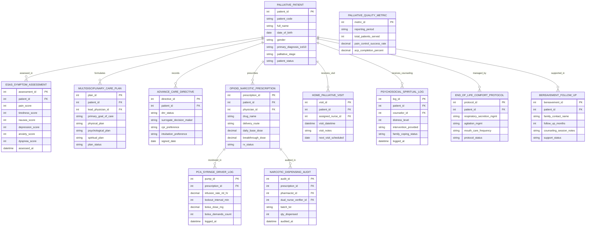

# Conceptual ERD — Palliative Care Management System

## Mermaid Code

## Entity Description Table | Bảng mô tả Entity

| # | Entity Name | Vietnamese Name | Description | Key Attributes | Main Relationships |
|---|-------------|-----------------|-------------|----------------|-------------------|
| 1 | PALLIATIVE_PATIENT | Bệnh nhân Giảm nhẹ Master | Master palliative care patient profile storing patient code, full name, DOB, primary oncology diagnosis ICD-10, palliative stage, and status. | patient_id, patient_code, full_name, dob, gender, primary_diagnosis_icd10, palliative_stage, patient_status | Has ESAS_ASSESSMENT, CARE_PLAN, ADVANCE_DIRECTIVE, PRESCRIPTION, HOME_VISIT, etc. |
| 2 | ESAS_SYMPTOM_ASSESSMENT | Đánh giá Triệu chứng ESAS | Edmonton Symptom Assessment System (ESAS-r) score record tracking 9 core symptoms (0-10 scale) and assessment timestamp. | assessment_id, patient_id, pain_score, tiredness_score, nausea_score, depression_score, dyspnea_score, assessed_at | Belongs to PALLIATIVE_PATIENT. |
| 3 | MULTIDISCIPLINARY_CARE_PLAN | Kế hoạch Chăm sóc Đa ngành | Holistic care plan master recording lead physician ID, primary goal of care, physical, psychological, social, and spiritual plans. | plan_id, patient_id, lead_physician_id, primary_goal_of_care, physical_plan, psychological_plan, spiritual_plan | Belongs to PALLIATIVE_PATIENT. |
| 4 | ADVANCE_CARE_DIRECTIVE | Chỉ thị Chăm sóc Trước (ACP/DNR) | Advance Care Planning (ACP) and DNR directive record tracking surrogate decision maker, CPR/intubation preferences, and signed date. | directive_id, patient_id, dnr_status, surrogate_decision_maker, cpr_preference, intubation_preference, signed_date | Belongs to PALLIATIVE_PATIENT. |
| 5 | OPIOID_NARCOTIC_PRESCRIPTION | Đơn thuốc Giảm đau Gây nghiện | Schedule II controlled opioid prescription tracking drug name, route (SC/IV), 24-hour OME base dose, breakthrough dose, and status. | prescription_id, patient_id, physician_id, drug_name, delivery_route, daily_base_dose, breakthrough_dose, rx_status | Belongs to PALLIATIVE_PATIENT; Has PCA_SYRINGE_DRIVER_LOG and NARCOTIC_DISPENSING_AUDIT. |
| 6 | PCA_SYRINGE_DRIVER_LOG | Nhật ký Bơm Tiêm Điện PCA | Patient-Controlled Analgesia (PCA) syringe driver telemetry log recording infusion rate mL/hr, lockout interval, bolus dose, and demand counts. | pump_id, prescription_id, infusion_rate_ml_hr, lockout_interval_min, bolus_dose_mg, bolus_demands_count, logged_at | Belongs to OPIOID_NARCOTIC_PRESCRIPTION. |
| 7 | HOME_PALLIATIVE_VISIT | Chuyến Thăm khám Tại nhà | Community home palliative care visit record tracking assigned nurse ID, visit datetime, clinical bedside notes, and next visit date. | visit_id, patient_id, assigned_nurse_id, visit_datetime, visit_notes, next_visit_scheduled | Belongs to PALLIATIVE_PATIENT. |
| 8 | PSYCHOSOCIAL_SPIRITUAL_LOG | Nhật ký Tâm lý & Tâm linh | Psychosocial and spiritual counseling record logging counselor ID, distress thermometer level, intervention provided, and family coping. | log_id, patient_id, counselor_id, distress_level, intervention_provided, family_coping_status, logged_at | Belongs to PALLIATIVE_PATIENT. |
| 9 | NARCOTIC_DISPENSING_AUDIT | Kiếm kê Thuốc Thuốc phiện | Schedule II narcotic audit log recording pharmacist ID, dual-nurse verifier ID, batch lot number, quantity dispensed, and audit timestamp. | audit_id, prescription_id, pharmacist_id, dual_nurse_verifier_id, batch_lot, qty_dispensed, audited_at | Belongs to OPIOID_NARCOTIC_PRESCRIPTION. |
| 10 | END_OF_LIFE_COMFORT_PROTOCOL | Phác đồ Chăm sóc Chặng cuối | Terminal end-of-life comfort protocol record tracking respiratory secretion management, agitation management, mouth care, and protocol status. | protocol_id, patient_id, respiratory_secretion_mgmt, agitation_mgmt, mouth_care_frequency, protocol_status | Belongs to PALLIATIVE_PATIENT. |
| 11 | BEREAVEMENT_FOLLOW_UP | Theo dõi Tắm tư vấn Tang quyến | Post-demise family bereavement follow-up record tracking family contact name, follow-up milestone (1, 3, 6, 12 months), and grief support notes. | bereavement_id, patient_id, family_contact_name, follow_up_months, counseling_session_notes, support_status | Belongs to PALLIATIVE_PATIENT. |
| 12 | PALLIATIVE_QUALITY_METRIC | Báo cáo Chất lượng Giam nhẹ | Quality performance metric record tracking reporting period, total patients served, ESAS pain control success rate %, and ACP completion %. | metric_id, reporting_period, total_patients_served, pain_control_success_rate, acp_completion_percent | Standalone audit metric summary entity. |

## Relationship Description | Mô tả Quan hệ

| # | From Entity | Cardinality | To Entity | Relationship Label | Business Explanation |
|---|-------------|-------------|-----------|-------------------|----------------------|
| 1 | PALLIATIVE_PATIENT | one-to-many | ESAS_SYMPTOM_ASSESSMENT | assessed_in | One palliative patient undergoes multiple longitudinal ESAS symptom evaluations. |
| 2 | PALLIATIVE_PATIENT | one-to-many | MULTIDISCIPLINARY_CARE_PLAN | formulates | One palliative patient has multidisciplinary care plans formulated across 4 domains. |
| 3 | PALLIATIVE_PATIENT | one-to-one | ADVANCE_CARE_DIRECTIVE | records | One palliative patient records advance care planning (ACP) and DNR directives. |
| 4 | PALLIATIVE_PATIENT | one-to-many | OPIOID_NARCOTIC_PRESCRIPTION | prescribes | One palliative patient is prescribed controlled opioid analgesic regimens. |
| 5 | PALLIATIVE_PATIENT | one-to-many | HOME_PALLIATIVE_VISIT | receives_visit | One homebound palliative patient receives home palliative care visits. |
| 6 | PALLIATIVE_PATIENT | one-to-many | PSYCHOSOCIAL_SPIRITUAL_LOG | receives_counseling | One palliative patient receives psychosocial and spiritual counseling sessions. |
| 7 | PALLIATIVE_PATIENT | one-to-one | END_OF_LIFE_COMFORT_PROTOCOL | managed_by | One terminal patient is managed by an end-of-life comfort care protocol. |
| 8 | PALLIATIVE_PATIENT | one-to-many | BEREAVEMENT_FOLLOW_UP | supported_in | One deceased patient's family is supported in post-demise bereavement follow-up. |
| 9 | OPIOID_NARCOTIC_PRESCRIPTION | one-to-many | PCA_SYRINGE_DRIVER_LOG | monitored_in | One continuous opioid order is monitored in PCA syringe driver telemetry logs. |
| 10 | OPIOID_NARCOTIC_PRESCRIPTION | one-to-many | NARCOTIC_DISPENSING_AUDIT | audited_in | One controlled opioid prescription is audited in dual-signature pharmacy logs. |
