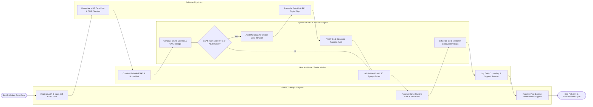

# Swimlane Diagram — Palliative Care Management System

## Mermaid Code

## Flow Description | Mô tả luồng

| Lane | Actor / Subsystem | Role in Flow |
|------|-------------------|--------------|
| 1 | Patient / Family Caregiver | Enrolls in palliative care, registers Advance Care Planning (ACP) preferences, submits self-reported ESAS pain scores, receives home care, and accesses family bereavement support. |
| 2 | Hospice Nurse / Social Worker | Conducts bedside ESAS symptom checks, administers subcutaneous opioid syringe drivers, logs dual-signature narcotic audits, and provides family grief counseling. |
| 3 | System / ESAS & Narcotic Engine | Calculates Total ESAS Distress scores, computes Oral Morphine Equivalent (OME) dosages, screens narcotic safety thresholds, alerts physicians for severe pain, and schedules bereavement logs. |
| 4 | Palliative Physician | Formulates multidisciplinary care plans across 4 WHO domains, signs legally binding DNR/MOLST directives, titrates opioid analgesics, and executes PKI digital signatures. |
