# Action Tree — Palliative Care Management System

## Mermaid Code

```mermaid
graph TD
    Root["Palliative Care Management System"]

    Root --> M1["ESAS Assessment & Pain Titration"]
    Root --> M2["Multidisciplinary Care Planning"]
    Root --> M3["Advance Directives & DNR"]
    Root --> M4["Opioid Prescribing & Syringe Driver"]
    Root --> M5["Home Palliative Visits"]
    Root --> M6["End-of-Life Comfort Protocols"]
    Root --> M7["Psychosocial & Spiritual Care"]
    Root --> M8["Bereavement & Regulatory Audit"]

    M1 --> A11["Rate 9 Core ESAS Symptoms 0 to 10 Scale"]
    M1 --> A12["Compute Total ESAS Distress Score"]
    M1 --> A13["Render Longitudinal Symptom Radar Chart"]
    M1 --> A14["Calculate Oral Morphine Equivalent OME"]

    M2 --> A21["Define Primary Goals of Care"]
    M2 --> A22["Integrate 4 WHO Holistic Domains"]
    M2 --> A23["Schedule Fortnightly MDT Case Reviews"]
    M2 --> A24["Publish MDT Plan to Mobile App"]

    M3 --> A31["Record Healthcare Proxy & Surrogate"]
    M3 --> A32["Register DNR DNI Clinical Orders"]
    M3 --> A33["Attach Scanned Living Will & MOLST"]
    M3 --> A34["Display Prominent Active DNR Banner"]

    M4 --> A41["Calculate Continuous SC Infusion Rates"]
    M4 --> A42["Configure Breakthrough Bolus Dose Caps"]
    M4 --> A43["Execute Schedule II PKI Digital Signature"]
    M4 --> A44["Monitor PCA Syringe Driver Telemetry"]

    M5 --> A51["Assign Community Home Visit Schedules"]
    M5 --> A52["Optimize Nurse GPS Route Navigation"]
    M5 --> A53["Perform Mobile Offline Bedside Charting"]
    M5 --> A54["Issue Emergency Breakthrough Symptom Kits"]

    M6 --> A61["Activate Terminal Secretions Protocol"]
    M6 --> A62["Administer Subcutaneous Midazolam Sedation"]
    M6 --> A63["Execute Mouth Care & Positioning Protocols"]
    M6 --> A64["Register Clinical Demise & Death Certificate"]

    M7 --> A71["Measure NCCN Distress Thermometer Score"]
    M7 --> A72["Log Spiritual Chaplain Counseling Sessions"]
    M7 --> A73["Evaluate Family Caregiver Coping Status"]
    M7 --> A74["Provide Dignity Therapy Interventions"]

    M8 --> A81["Execute Dual Nurse Narcotic Dispensing Audit"]
    M8 --> A82["Schedule 1 3 6 12-Month Bereavement Logs"]
    M8 --> A83["Export Statutory Schedule II Opioid Reports"]
    M8 --> A84["Calculate ESAS Pain Control Success %"]
```

## Module Description | Mô tả Module

| # | Module | Description | Actions |
|---|--------|-------------|---------|
| 1 | ESAS Assessment & Pain Titration | Rates 9 core symptoms on ESAS 0-10 scale, calculates total distress scores, renders radar charts, and computes Oral Morphine Equivalent (OME). | Rate 9 Core ESAS Symptoms 0 to 10 Scale, Compute Total ESAS Distress Score, Render Longitudinal Symptom Radar Chart, Calculate Oral Morphine Equivalent OME |
| 2 | Multidisciplinary Care Planning | Defines goals of care, integrates 4 WHO holistic domains (physical, psychological, social, spiritual), schedules MDT reviews, and publishes care plans. | Define Primary Goals of Care, Integrate 4 WHO Holistic Domains, Schedule Fortnightly MDT Case Reviews, Publish MDT Plan to Mobile App |
| 3 | Advance Directives & DNR | Records surrogate decision makers, registers legally binding DNR/DNI orders, attaches scanned MOLST forms, and displays prominent DNR banners. | Record Healthcare Proxy & Surrogate, Register DNR DNI Clinical Orders, Attach Scanned Living Will & MOLST, Display Prominent Active DNR Banner |
| 4 | Opioid Prescribing & Syringe Driver | Calculates continuous subcutaneous infusion rates, configures breakthrough bolus caps, executes PKI digital signatures, and monitors PCA telemetry. | Calculate Continuous SC Infusion Rates, Configure Breakthrough Bolus Dose Caps, Execute Schedule II PKI Digital Signature, Monitor PCA Syringe Driver Telemetry |
| 5 | Home Palliative Visits | Assigns community visit schedules, optimizes nurse GPS routes, performs mobile offline charting, and issues emergency symptom kits. | Assign Community Home Visit Schedules, Optimize Nurse GPS Route Navigation, Perform Mobile Offline Bedside Charting, Issue Emergency Breakthrough Symptom Kits |
| 6 | End-of-Life Comfort Protocols | Activates terminal secretions protocols (hyoscine), administers SC midazolam sedation, executes mouth care, and registers clinical demise. | Activate Terminal Secretions Protocol, Administer Subcutaneous Midazolam Sedation, Execute Mouth Care & Positioning Protocols, Register Clinical Demise & Death Certificate |
| 7 | Psychosocial & Spiritual Care | Measures NCCN distress thermometer scores, logs chaplain counseling sessions, evaluates caregiver coping, and provides dignity therapy. | Measure NCCN Distress Thermometer Score, Log Spiritual Chaplain Counseling Sessions, Evaluate Family Caregiver Coping Status, Provide Dignity Therapy Interventions |
| 8 | Bereavement & Regulatory Audit | Executes dual-nurse narcotic audits, schedules 1-12 month family bereavement outreach logs, and exports statutory opioid reporting. | Execute Dual Nurse Narcotic Dispensing Audit, Schedule 1 3 6 12-Month Bereavement Logs, Export Statutory Schedule II Opioid Reports, Calculate ESAS Pain Control Success % |
