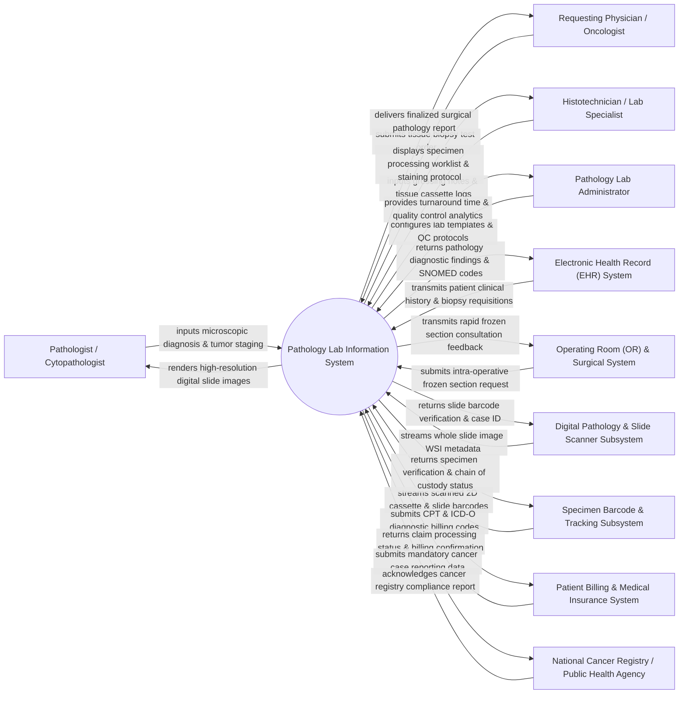

# Context Diagram — Pathology Lab Information System

## Mermaid Code

## Actor & Interaction Table | Bảng Actor & Tương tác

| # | Actor | Actor Type | Data Sent TO System | Data Received FROM System | Notes |
|---|-------|------------|---------------------|---------------------------|-------|
| 1 | Pathologist / Cytopathologist | Primary | Microscopic findings, diagnostic summaries, ICD-O codes, TNM cancer staging, digital report signatures, second-opinion consultation requests. | Digital whole slide images (WSI), clinical history summaries, prior pathology case history, gross photography, special stain results. | Certified medical doctor evaluating tissue biopsies, cytology smears, and surgical resections to provide definitive diagnoses. |
| 2 | Histotechnician / Lab Specialist | Primary | Specimen accessioning data, gross dissection descriptions, tissue block counts, microtome sectioning logs, staining protocol executions. | Daily tissue processing worklists, slide printing barcode payloads, embedding protocols, special stain orders (IHC/FISH). | Medical laboratory technician responsible for grossing, tissue embedding, sectioning, and slide staining. |
| 3 | Requesting Physician / Oncologist | Primary | Biopsy test requisitions, clinical history notes, surgical site origin, pre-operative clinical impression, urgent review requests. | Verified pathology diagnostic reports, frozen section consultation results, cancer biomarker summaries, addendum notifications. | Attending surgeon, oncologist, or internist ordering pathology tissue evaluations for patient diagnosis and treatment planning. |
| 4 | Pathology Lab Administrator | Primary | Quality control policies, turnaround time (TAT) target SLAs, lab user permissions, diagnostic report template configurations. | Lab performance dashboards, TAT bottleneck reports, peer-review discordance metrics, CAP/CLIA accreditation compliance logs. | Administrative role managing pathology laboratory operations, quality management, and regulatory compliance. |
| 5 | Electronic Health Record (EHR) System | Supporting | Patient demographics, master patient index (MPI), clinical notes, past lab results, surgical encounter records. | Finalized diagnostic pathology reports, structured SNOMED CT diagnosis codes, critical cancer alerts. | Central hospital EHR integrated via HL7 ORM (Order Entry) and ORU (Observation Result) messaging protocols. |
| 6 | Operating Room (OR) & Surgical System | Supporting | Urgent intra-operative frozen section requisitions, surgical room extension numbers, specimen time-out confirmations. | Immediate intra-operative diagnostic feedback payload (e.g., surgical margin status clear/positive) within 20 minutes. | Surgical suite software managing real-time intra-operative consultations while patient is under anesthesia. |
| 7 | Digital Pathology & Slide Scanner Subsystem | Supporting | Whole Slide Image (WSI) metadata, high-resolution SVS/TIFF image files, slide scanning completion status. | Slide barcode validation, target scanner case folder paths, image resolution and compression profiles. | High-throughput digital slide scanner digitizing glass microscope slides into high-resolution images. |
| 8 | Specimen Barcode & Tracking Subsystem | Supporting | Scanned 2D matrix cassette barcodes, slide label scans, physical storage rack location updates. | Specimen identity verification, chain of custody confirmation, misidentification alerts. | Barcode printers, 2D data-matrix scanners, and tracking portals preventing specimen mix-ups across processing steps. |
| 9 | Patient Billing & Medical Insurance System | Supporting | Fee schedule tariffs, insurance eligibility confirmations, billing authorization status. | Itemized CPT procedure codes, ICD-O diagnostic codes, special stain billing lines, pathologist professional fee records. | Hospital billing engine generating invoices for technical and professional pathology components. |
| 10 | National Cancer Registry / Public Health Agency | Supporting / Regulatory | Mandated cancer reporting data standards, AJCC TNM staging guidelines, compliance receipts. | Structured cancer incidence notifications, tumor histology codes, stage distribution statistics, patient demographic data. | Public health government registry collecting mandatory malignant tumor data for epidemiological tracking. |

## System Boundary Description | Mô tả Phạm vi Hệ thống

The **Pathology Lab Information System (PLIS)** is a specialized diagnostic software platform designed to manage the entire lifecycle of anatomical pathology, surgical pathology, cytopathology, and digital slide management.

**Inside System Scope:**
- Electronic specimen accessioning, 2D barcode tracking, and chain of custody validation from tissue receipt to slide archive.
- Gross dissection logging, cassette printing, tissue block tracking, microtome sectioning, and routine/special stain (IHC, FISH) protocols.
- Intra-operative frozen section consultation management providing rapid diagnosis during active surgical procedures.
- Digital pathology integration ingesting Whole Slide Images (WSI), enabling virtual microscope zooming, annotation, and remote consultations.
- Diagnostic report generation with structured synoptic reporting, ICD-O tumor coding, AJCC TNM cancer staging, electronic signatures, and automated cancer registry reporting.

**Outside System Scope:**
- Physical tissue fixation in formalin, paraffin embedding, and manual microtome cutting (performed physically by Histotechnicians).
- Physical optical scanning hardware operation and laser diode alignment (handled by standalone Slide Scanner hardware).
- Financial ledger posting and patient credit card processing (delegated to Patient Billing Systems).
- Direct delivery of clinical treatment or chemotherapy (managed by Oncology EHR Systems).
