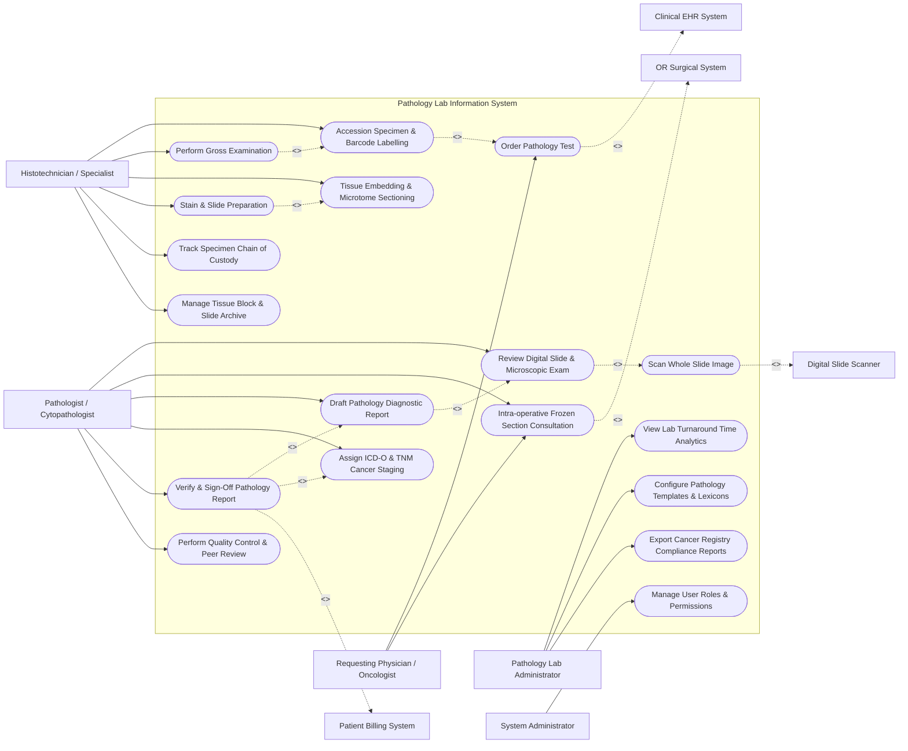

# Use Case Diagram — Pathology Lab Information System

## Mermaid Code

## Actor Table | Bảng Actor

| # | Actor | Actor Type | Role Description | Related Use Cases |
|---|-------|------------|------------------|-------------------|
| 1 | Requesting Physician / Oncologist | Primary | Surgeon or oncologist submitting tissue biopsy requisitions and receiving diagnostic pathology findings. | UC01, UC08 |
| 2 | Histotechnician / Specialist | Primary | Laboratory technician accessioning specimens, logging gross dissection, embedding tissue, cutting sections, and staining slides. | UC02, UC03, UC04, UC05, UC12, UC13 |
| 3 | Pathologist / Cytopathologist | Primary | Certified physician conducting microscopic evaluations, reviewing digital slides, diagnosing diseases, and signing diagnostic reports. | UC07, UC08, UC09, UC10, UC11, UC14 |
| 4 | Pathology Lab Administrator | Primary | Operations manager monitoring lab turnaround times (TAT), configuring synoptic report templates, and managing quality compliance. | UC15, UC17, UC18 |
| 5 | System Administrator | Primary | IT administrative user managing system user roles, access rights, and security configurations. | UC16 |
| 6 | Clinical EHR System | System (Secondary) | Central hospital EHR sending test orders and receiving finalized pathology reports via HL7. | UC01 |
| 7 | OR Surgical System | System (Secondary) | Operating room software requesting rapid intra-operative frozen section biopsy consultations. | UC08 |
| 8 | Digital Slide Scanner | System (Secondary) | Hardware scanner digitizing glass slides into whole slide images (WSI) for digital pathology review. | UC06 |
| 9 | Patient Billing System | System (Secondary) | Hospital revenue system receiving CPT procedure and professional billing codes upon report sign-off. | UC11 |

## Use Case Table | Bảng Use Case

| # | UC ID | Use Case Name | Primary Actor | Secondary Actor | Description | Priority |
|---|-------|---------------|---------------|-----------------|-------------|----------|
| 1 | UC01 | Order Pathology Test | Requesting Physician | Clinical EHR | Submits electronic requisition for surgical pathology, biopsy, or cytology evaluation. | High |
| 2 | UC02 | Accession Specimen & Barcode Labelling | Histotechnician | None | Receives tissue specimen containers, validates order, assigns unique accession number, and prints 2D barcodes. | High |
| 3 | UC03 | Perform Gross Examination | Histotechnician | None | Logs physical specimen dimensions, weight, appearance, and cuts representative tissue fragments into cassettes. | High |
| 4 | UC04 | Tissue Embedding & Microtome Sectioning | Histotechnician | None | Processes tissue cassettes through paraffin embedding, creates paraffin blocks, and cuts microtome sections. | High |
| 5 | UC05 | Stain & Slide Preparation | Histotechnician | None | Stains microscope slides (H&E, IHC, FISH) and applies glass coverslips for pathologist review. | High |
| 6 | UC06 | Scan Whole Slide Image | Histotechnician | Digital Scanner | Digitizes glass slides using high-resolution whole slide scanners and links images to accession ID. | Medium |
| 7 | UC07 | Review Digital Slide & Microscopic Exam | Pathologist | Digital Scanner | Renders digital slides, performs microscopic diagnosis, measures tumor margins, and records findings. | High |
| 8 | UC08 | Intra-operative Frozen Section Consultation | Pathologist | OR System | Conducts rapid 20-minute intra-operative frozen section examination and delivers immediate verbal/digital surgical advice. | Critical |
| 9 | UC09 | Draft Pathology Diagnostic Report | Pathologist | None | Compiles synoptic diagnostic reports containing gross description, microscopic diagnosis, and clinical comments. | High |
| 10 | UC10 | Assign ICD-O & TNM Cancer Staging | Pathologist | None | Assigns standardized ICD-O-3 topography/morphology codes and AJCC TNM anatomical cancer staging. | High |
| 11 | UC11 | Verify & Sign-Off Pathology Report | Pathologist | Patient Billing | Electronically signs final pathology report, locks case, dispatches results to EHR, and sends billing codes. | High |
| 12 | UC12 | Track Specimen Chain of Custody | Histotechnician | None | Logs physical location of containers, cassettes, and slides across processing stations to prevent mix-ups. | High |
| 13 | UC13 | Manage Tissue Block & Slide Archive | Histotechnician | None | Manages physical storage archive locations for paraffin tissue blocks and glass slides per legal retention rules. | Medium |
| 14 | UC14 | Perform Quality Control & Peer Review | Pathologist | None | Executes random peer-review case audits, tracks diagnostic concordance, and logs quality control (QC) metrics. | Medium |
| 15 | UC15 | View Lab Turnaround Time Analytics | Lab Admin | None | Monitors turnaround time (TAT) metrics from specimen receipt to report sign-off against target SLAs. | Medium |
| 16 | UC16 | Manage User Roles & Permissions | Admin | None | Configures user accounts, RBAC security roles, and electronic signature authorization levels. | High |
| 17 | UC17 | Configure Pathology Templates & Lexicons | Lab Admin | None | Configures CAP-compliant synoptic reporting templates, diagnostic lexicons, and standard macro texts. | Medium |
| 18 | UC18 | Export Cancer Registry Compliance Reports | Lab Admin | None | Generates and exports mandatory cancer registry case notifications to state and national health agencies. | Medium |

## Use Case Specification | Đặc tả Use Case

---

### UC02 — Accession Specimen & Barcode Labelling

| Field | Detail |
|-------|--------|
| **UC ID** | UC02 |
| **Use Case Name** | Accession Specimen & Barcode Labelling |
| **Actor(s)** | Primary: Histotechnician / Lab Specialist   Secondary: None |
| **Description** | Ingests incoming tissue specimen containers into the pathology lab, verifies specimen integrity against order requisitions, generates a unique Accession ID, and prints 2D barcode labels. |
| **Precondition** | 1. Pathology test order exists in the system (UC01).   2. Physical specimen container is received at pathology receiving window. |
| **Main Flow** | 1. Histotechnician scans order barcode or selects patient requisition on receiving screen.   2. System displays order details, specimen origin site, container count, and clinical history.   3. Histotechnician verifies physical container labels match order patient name and medical record number (MRN).   4. Histotechnician inspects container fixative (e.g., 10% neutral buffered formalin) and container seal integrity.   5. System generates a unique Accession ID (e.g., `SP-2026-008912`) following lab numbering convention.   6. System prints 2D Data-Matrix barcode labels for physical containers and specimen tracking log.   7. Histotechnician affixes barcode label to container, scans label to confirm alignment, and updates status to `ACCESSIONED`. |
| **Alternative Flow** | **AF1** — Unscheduled / Emergency Walk-In Specimen: Specimen arrives without prior electronic order; Histotechnician creates manual accession order, enters surgeon name and patient demographics, prints temporary accession labels, and flags order for post-hoc physician order link. |
| **Exception Flow** | **EX1** — Mislabeled / Unlabeled Specimen: Physical container label does not match EHR order MRN; System blocks accessioning, places specimen in `HOLD - SPECIMEN MISMATCH` status, and triggers urgent notification to OR/Surgeon for specimen identification verification.   **EX2** — Leaking / Damaged Container: Container fixative leaked during transport; Histotechnician selects "Specimen Compromised", logs condition notes, takes digital photo, and alerts Pathologist to evaluate tissue preservation. |
| **Postcondition** | Specimen is accessioned, unique Accession ID is assigned, 2D barcode labels are printed/affixed, and case is queued for gross examination (UC03). |
| **Business Rule** | **BR1**: Every specimen container must be assigned a unique Accession ID within 15 minutes of physical lab receipt.   **BR2**: Unlabeled or mislabeled tissue specimens must never be accessioned without formal written physician reconciliation. |

---

### UC03 — Perform Gross Examination

| Field | Detail |
|-------|--------|
| **UC ID** | UC03 |
| **Use Case Name** | Perform Gross Examination |
| **Actor(s)** | Primary: Histotechnician / Lab Specialist, Pathologist |
| **Description** | Logs physical gross examination measurements, organ orientation, color, texture, and cuts representative tissue sections into plastic cassette blocks for histology processing. |
| **Precondition** | 1. Specimen is accessioned with status `ACCESSIONED` (UC02).   2. Grossing station camera and barcode cassette printer are calibrated. |
| **Main Flow** | 1. Histotechnician or Pathologist scans container 2D barcode at grossing station.   2. System loads accession record, clinical history, and specimen origin site details.   3. User performs physical gross inspection, measures specimen dimensions (length, width, weight), and dictates or types gross description text.   4. User captures digital macroscopic photographs using grossing station camera; System automatically attaches photos to accession record.   5. User selects tissue sectioning strategy (e.g., resection margins, tumor core) and specifies number of tissue blocks to prepare.   6. System generates block IDs (e.g., `SP-2026-008912-A1`, `A2`) and commands cassette printer to print 2D barcoded tissue cassettes.   7. User places sectioned tissue fragments into printed cassettes, closes lids, and clicks "Complete Grossing".   8. System updates specimen status to `GROSSING_COMPLETE` and queues cassettes for tissue embedding. |
| **Alternative Flow** | **AF1** — Voice Dictation Grossing: User dictates gross descriptions hands-free using integrated speech-to-text pathology microphone; System transcribes text in real time into gross description field. |
| **Exception Flow** | **EX1** — Additional Special Processing Required: User determines specimen requires decalcification (bone tissue) or overnight fixation before sectioning; User selects "Hold for Decalcification", System updates cassette status to `SPECIAL_PROCESSING_HOLD`, and schedules follow-up alert. |
| **Postcondition** | Gross description and photos are recorded, barcoded tissue cassettes are created, and case is advanced to tissue embedding. |
| **Business Rule** | **BR1**: Tissue cassette IDs must maintain strict parent-child relational hierarchy linked to primary Accession ID. |

---

### UC08 — Intra-operative Frozen Section Consultation

| Field | Detail |
|-------|--------|
| **UC ID** | UC08 |
| **Use Case Name** | Intra-operative Frozen Section Consultation |
| **Actor(s)** | Primary: Pathologist / Cytopathologist   Secondary: Requesting Physician / Oncologist, OR Surgical System |
| **Description** | Executes rapid, high-priority intra-operative frozen section biopsy evaluation during active surgery, providing verbal and digital margin/diagnosis feedback to the operating surgeon within 20 minutes. |
| **Precondition** | 1. Operating Room notifies pathology lab of incoming frozen section request.   2. Patient is currently under anesthesia on operating table. |
| **Main Flow** | 1. Specimen arrives at pathology frozen section station via pneumatic tube or courier; System automatically flags case as `STAT - FROZEN SECTION`.   2. Pathologist and Histotechnician immediately accession specimen, perform rapid gross inspection, and select target tissue fragment.   3. Histotechnician freezes tissue using cryostat (-20°C), cuts microtome section (4-6 microns), mounts on slide, and performs rapid H&E staining within 8 minutes.   4. Pathologist reviews frozen slide under microscope (or digital scanner) and formulates immediate diagnostic impression (e.g., "Surgical Margin Positive for Carcinoma" or "Benign Nodular Hyperplasia").   5. Pathologist calls Operating Room via direct intercom/phone, dictates preliminary diagnosis to operating surgeon, and records surgeon confirmation name.   6. Pathologist enters frozen section preliminary report into PLIS and clicks "Broadcast Frozen Result".   7. System dispatches frozen section report payload to OR Surgical System and updates case status to `FROZEN_SECTION_COMPLETED`. |
| **Alternative Flow** | **AF1** — Tele-Pathology Remote Frozen Section: Pathologist is off-site; Histotechnician scans frozen section slide on digital scanner (UC06), Pathologist accesses WSI stream remotely, reviews slide via secure portal, and calls OR surgeon. |
| **Exception Flow** | **EX1** — Frozen Section Turnaround SLA Exceeded (> 20 Mins): Technical issues delay freezing; System triggers visual red SLA timer warning on lab monitors, logs delay reason code, and alerts Lab Director.   **EX2** — Deferred to Permanent Sections: Frozen section tissue is inconclusive or too friable; Pathologist notifies surgeon "Deferred to Permanent Paraffin Sections", logs deferral code, and routes tissue to routine histology. |
| **Postcondition** | Preliminary frozen section diagnosis is delivered to OR surgeon, communication log is timestamped, and tissue is processed for permanent paraffin confirmation. |
| **Business Rule** | **BR1**: Frozen section consultation turnaround time must not exceed 20 minutes from specimen receipt to surgeon notification, in compliance with CAP standards. |

---

### UC11 — Verify & Sign-Off Pathology Report

| Field | Detail |
|-------|--------|
| **UC ID** | UC11 |
| **Use Case Name** | Verify & Sign-Off Pathology Report |
| **Actor(s)** | Primary: Pathologist / Cytopathologist   Secondary: Patient Billing System, Clinical EHR System |
| **Description** | Reviews complete pathology case file (gross description, microscopic findings, digital slides, special stains), verifies synoptic report data, applies digital signature, and releases final diagnostic report. |
| **Precondition** | 1. Draft pathology report is complete (UC09).   2. Pathologist possesses valid digital signing certificate and credentials. |
| **Main Flow** | 1. Pathologist opens "Cases Pending Final Sign-Off" queue and selects target case.   2. System presents complete case compilation: patient demographics, clinical history, gross photos, digital slides, diagnostic text, ICD-O codes, and AJCC cancer staging (UC10).   3. Pathologist reviews all report sections for diagnostic accuracy, formatting, and CAP synoptic compliance.   4. Pathologist enters digital signature PIN / password.   5. System validates credentials, embeds cryptographic digital signature, locks report from further editing, and changes case status to `FINAL_SIGNED`.   6. System generates HL7 ORU result message and dispatches final pathology report to Clinical EHR System.   7. System transmits itemized CPT procedure billing codes and ICD-O codes to Patient Billing System. |
| **Alternative Flow** | **AF1** — Report Addendum / Amendment: Pathologist receives additional IHC stain results after final sign-off; Pathologist selects "Create Addendum", enters supplemental findings, applies digital signature, and System releases amended report `FINAL_AMENDED` to EHR. |
| **Exception Flow** | **EX1** — Mandatory Synoptic Field Missing: Pathologist attempts sign-off on cancer case without completing mandatory CAP synoptic tumor depth field; System displays validation error "Required CAP Synoptic Field Missing: Tumor Depth (mm)" and blocks sign-off until field is completed.   **EX2** — Critical Cancer Diagnosis Alert: Final diagnosis identifies unsuspected aggressive malignancy; System prompts Pathologist to flag report as `CRITICAL_ALERT`, triggering automated urgent SMS notification to ordering physician. |
| **Postcondition** | Pathology report is cryptographically signed and locked, EHR receives final report, billing codes are transmitted, and case is closed. |
| **Business Rule** | **BR1**: Once signed, a pathology report cannot be modified directly; any changes must be recorded as a timestamped Addendum or Amendment. |

---

### UC12 — Track Specimen Chain of Custody

| Field | Detail |
|-------|--------|
| **UC ID** | UC12 |
| **Use Case Name** | Track Specimen Chain of Custody |
| **Actor(s)** | Primary: Histotechnician / Lab Specialist   Secondary: None |
| **Description** | Logs and tracks the continuous physical movement and custody transfers of specimen containers, tissue blocks, and microscope slides across all processing stations to ensure 100% positive identity verification. |
| **Precondition** | 1. Specimen container, cassette, or slide possesses a valid 2D Data-Matrix barcode label. |
| **Main Flow** | 1. Histotechnician at any processing workstation (Receiving, Grossing, Embedding, Microtome, Staining, Pathologist Desk, Archive) scans location barcode.   2. Histotechnician scans 2D barcode on specimen container, tissue cassette, or glass slide.   3. System validates scanned item ID against active lab worklist.   4. System records timestamp, current processing station ID, handler User ID, and movement status in `SPECIMEN_CHAIN_OF_CUSTODY` log.   5. System displays green checkmark confirmation "Item Verified at Station: Embedding-02". |
| **Alternative Flow** | **AF1** — Batch Transfer Verification: Histotechnician loads 50 slide racks into automated stainer; Technician scans rack barcode, System verifies all 50 slides belong to active staining batch, and updates chain of custody for all slides simultaneously. |
| **Exception Flow** | **EX1** — Specimen Mismatch / Wrong Station Warning: Technician scans cassette at staining station out of sequence; System sounds audible error alarm "WRONG WORKFLOW SEQUENCE - Microtome Sectioning Not Recorded" and blocks processing log until resolved.   **EX2** — Missing Item Alert: Case is assigned to Pathologist desk but slide barcode is not scanned within expected timeframe; System flags case as `SPECIMEN_LOCATION_UNKNOWN` and alerts lab supervisor to initiate physical search. |
| **Postcondition** | Chain of custody log is updated with exact timestamp, user ID, and physical location, maintaining complete audit traceability. |
| **Business Rule** | **BR1**: 100% of physical transfers between processing stations must be validated via barcode scan to maintain CLIA chain-of-custody compliance. |
