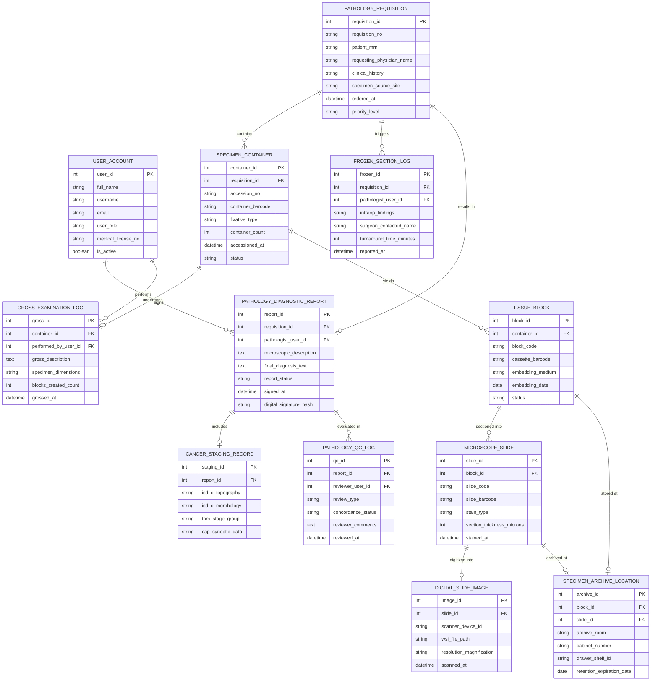

# Conceptual ERD — Pathology Lab Information System

## Mermaid Code

## Entity Description Table | Bảng mô tả Entity

| # | Entity Name | Vietnamese Name | Description | Key Attributes | Main Relationships |
|---|-------------|-----------------|-------------|----------------|-------------------|
| 1 | USER_ACCOUNT | Tài khoản Nguời dùng | Credentials and RBAC access roles for pathologists, histotechnicians, and lab managers. | `user_id`, `username`, `user_role`, `medical_license_no` | Signs `PATHOLOGY_DIAGNOSTIC_REPORT`, performs `GROSS_EXAMINATION_LOG`. |
| 2 | PATHOLOGY_REQUISITION | Phếu Yêu cầu Giải phẫu | Electronic lab order detailing patient clinical history, ordering physician, and biopsy site. | `requisition_id`, `requisition_no`, `patient_mrn`, `specimen_source_site`, `priority_level` | Contains `SPECIMEN_CONTAINER`, results in `PATHOLOGY_DIAGNOSTIC_REPORT`. |
| 3 | SPECIMEN_CONTAINER | Lọ Mẫu Bệnh phẩm | Physical specimen container received at lab, assigned unique accession number and 2D barcode. | `container_id`, `requisition_id`, `accession_no`, `container_barcode`, `fixative_type` | Belongs to `PATHOLOGY_REQUISITION`, yields `TISSUE_BLOCK`. |
| 4 | GROSS_EXAMINATION_LOG | Nhật ký Khám Đại thể | Macroscopic examination details, physical measurements, and tissue cassette sectioning notes. | `gross_id`, `container_id`, `gross_description`, `specimen_dimensions`, `blocks_created_count` | Belongs to `SPECIMEN_CONTAINER`. |
| 5 | TISSUE_BLOCK | Khối Nến Bệnh phẩm | Paraffin-embedded tissue block cassette created during grossing for histology sectioning. | `block_id`, `container_id`, `block_code`, `cassette_barcode`, `embedding_medium` | Belongs to `SPECIMEN_CONTAINER`, sectioned into `MICROSCOPE_SLIDE`. |
| 6 | MICROSCOPE_SLIDE | Lam Kính Hiển vi | Glass microscope slide prepared with tissue sections, stained (H&E/IHC), and coverslipped. | `slide_id`, `block_id`, `slide_code`, `slide_barcode`, `stain_type` | Belongs to `TISSUE_BLOCK`, digitized into `DIGITAL_SLIDE_IMAGE`. |
| 7 | DIGITAL_SLIDE_IMAGE | Ảnh Lam Kính Số (WSI) | High-resolution whole slide image digitized by scanner for digital pathology review. | `image_id`, `slide_id`, `scanner_device_id`, `wsi_file_path`, `resolution_magnification` | Belongs to `MICROSCOPE_SLIDE`. |
| 8 | FROZEN_SECTION_LOG | Nhật ký Cắt Lạnh Cấp cứu | Rapid intra-operative frozen section biopsy results delivered verbally and digitally to OR. | `frozen_id`, `requisition_id`, `pathologist_user_id`, `intraop_findings`, `turnaround_time_minutes` | Belongs to `PATHOLOGY_REQUISITION`. |
| 9 | PATHOLOGY_DIAGNOSTIC_REPORT | Báo cáo Chẩn đoán Giải phẫu | Final diagnostic pathology report containing gross/microscopic findings and digital signature. | `report_id`, `requisition_id`, `pathologist_user_id`, `microscopic_description`, `final_diagnosis_text` | Belongs to `PATHOLOGY_REQUISITION`, includes `CANCER_STAGING_RECORD`. |
| 10 | CANCER_STAGING_RECORD | Hồ sơ Phân đoạn Ung thư | Structured ICD-O-3 tumor classification, CAP synoptic data, and AJCC TNM anatomical staging. | `staging_id`, `report_id`, `icd_o_topography`, `icd_o_morphology`, `tnm_stage_group` | Belongs to `PATHOLOGY_DIAGNOSTIC_REPORT`. |
| 11 | SPECIMEN_ARCHIVE_LOCATION | Vị trí Lưu trữ Mẫu | Physical archive room, cabinet, and shelf storage assignment for blocks and glass slides. | `archive_id`, `block_id`, `slide_id`, `archive_room`, `cabinet_number`, `retention_expiration_date` | Stores `TISSUE_BLOCK` and `MICROSCOPE_SLIDE`. |
| 12 | PATHOLOGY_QC_LOG | Nhật ký Kiểm soát Chất lượng | Peer-review case audit findings, diagnostic concordance tracking, and quality control logs. | `qc_id`, `report_id`, `reviewer_user_id`, `review_type`, `concordance_status` | Evaluates `PATHOLOGY_DIAGNOSTIC_REPORT`. |

## Relationship Description | Mô tả Quan hệ

| # | From Entity | Cardinality | To Entity | Label | Business Explanation |
|---|-------------|-------------|-----------|-------|----------------------|
| 1 | PATHOLOGY_REQUISITION | 1 to 1..N | SPECIMEN_CONTAINER | contains | A pathology requisition contains one or more physical specimen containers. |
| 2 | SPECIMEN_CONTAINER | 1 to 0..1 | GROSS_EXAMINATION_LOG | undergoes | A specimen container undergoes a macroscopic gross examination. |
| 3 | SPECIMEN_CONTAINER | 1 to 1..N | TISSUE_BLOCK | yields | A specimen container yields one or more paraffin tissue blocks during grossing. |
| 4 | TISSUE_BLOCK | 1 to 1..N | MICROSCOPE_SLIDE | sectioned into | A tissue block is cut via microtome into one or more glass microscope slides. |
| 5 | MICROSCOPE_SLIDE | 1 to 0..1 | DIGITAL_SLIDE_IMAGE | digitized into | A glass slide can be scanned and digitized into a whole slide image (WSI). |
| 6 | PATHOLOGY_REQUISITION | 1 to 0..N | FROZEN_SECTION_LOG | triggers | An urgent surgical requisition can trigger intra-operative frozen section logs. |
| 7 | PATHOLOGY_REQUISITION | 1 to 0..1 | PATHOLOGY_DIAGNOSTIC_REPORT | results in | A pathology requisition results in a finalized diagnostic pathology report. |
| 8 | PATHOLOGY_DIAGNOSTIC_REPORT | 1 to 0..1 | CANCER_STAGING_RECORD | includes | A malignant pathology report includes a structured cancer staging record. |
| 9 | TISSUE_BLOCK | 1 to 0..1 | SPECIMEN_ARCHIVE_LOCATION | stored at | A tissue block is assigned to a physical archive location for long-term storage. |
| 10 | MICROSCOPE_SLIDE | 1 to 0..1 | SPECIMEN_ARCHIVE_LOCATION | archived at | A glass slide is archived in physical slide cabinets per retention rules. |
| 11 | PATHOLOGY_DIAGNOSTIC_REPORT | 1 to 0..N | PATHOLOGY_QC_LOG | evaluated in | A signed pathology report can be evaluated in quality control peer reviews. |
| 12 | USER_ACCOUNT | 1 to 0..N | PATHOLOGY_DIAGNOSTIC_REPORT | signs | A pathologist user account signs and certifies final pathology diagnostic reports. |
