# Swimlane Diagram — Pathology Lab Information System

## Mermaid Code

```mermaid
flowchart LR
    Start(["Start Biopsy Ordering"])

    subgraph Lane_Physician["Requesting Physician / Oncologist"]
        P1["Submit Biopsy Test Order & Clinical Notes"]
        P2["Receive Final Pathology Diagnostic Report"]
        P3["Formulate Patient Oncology Treatment Plan"]
    end

    subgraph Lane_Histotech["Histotechnician / Specialist"]
        H1["Accession Specimen Container & Print 2D Barcode"]
        H2["Perform Gross Dissection & Cut Tissue Cassettes"]
        H3["Process Paraffin Embedding & Microtome Sectioning"]
        H4["Stain Slides & Load into Digital Scanner"]
    end

    subgraph Lane_System["Pathology System"]
        S1["Verify Specimen Order & Assign Accession ID"]
        S2["Log Chain of Custody & Print Cassette Barcodes"]
        S3["Ingest Whole Slide Image & Link to Accession ID"]
        S4["Validate CAP Synoptic Fields & Sign-off Credentials"]
        S5["Dispatch HL7 Report & Send Billing CPT Codes"]
    end

    subgraph Lane_Pathologist["Pathologist / Cytopathologist"]
        PATH1["Review Gross Photos & Whole Slide Images"]
        PATH2{"Is Additional Special Stain Needed?"}
        PATH3["Order IHC / Molecular Biomarker Stains"]
        PATH4["Formulate Microscopic Diagnosis & TNM Staging"]
        PATH5["Apply Digital Signature & Release Report"]
    end

    Finish(["End Pathology Diagnostic Cycle"])

    Start --> P1 --> S1 --> H1 --> S2 --> H2 --> H3 --> H4 --> S3 --> PATH1 --> PATH2
    PATH2 -->|"Yes"| PATH3 --> H4
    PATH2 -->|"No"| PATH4 --> S4 --> PATH5 --> S5 --> P2 --> P3 --> Finish
```

## Flow Description | Mô tả luồng

| Lane | Actor | Role in Flow |
|------|-------|-------------|
| 1 | Requesting Physician | Submits electronic biopsy test orders with clinical history, receives finalized pathology reports, and formulates clinical oncology treatment plans. |
| 2 | Histotechnician | Accessions physical specimen containers, prints 2D barcodes, logs gross dissection notes, embeds tissue in paraffin blocks, cuts microtome sections, stains slides, and digitizes slides. |
| 3 | Pathology System | Validates specimen requisitions, generates Accession IDs, tracks chain of custody barcodes, ingests high-resolution digital slide images, enforces CAP synoptic reporting fields, dispatches signed reports to EHR, and sends billing codes. |
| 4 | Pathologist | Evaluates gross photos and digital slides, orders additional immunohistochemistry (IHC) or molecular stains if required, formulates microscopic diagnosis, assigns TNM cancer staging, applies cryptographic digital signatures, and signs off cases. |
