# Action Tree — Pathology Lab Information System

## Mermaid Code

```mermaid
graph TD
    Root["Pathology Lab Information System"]

    Root --> M1["Requisition & Accessioning"]
    Root --> M2["Grossing & Specimen Processing"]
    Root --> M3["Histology & Digital Pathology"]
    Root --> M4["Diagnostic Evaluation & Reporting"]
    Root --> M5["Specimen Archiving & Quality Control"]
    Root --> M6["Analytics & Regulatory Compliance"]

    M1 --> A11["Receive & Ingest Biopsy Orders"]
    M1 --> A12["Accession Specimen & Assign Accession ID"]
    M1 --> A13["Print 2D Data-Matrix Barcode Labels"]
    M1 --> A14["Verify Specimen Container Fixative Integrity"]

    M2 --> A21["Log Gross Examination Measurements"]
    M2 --> A22["Capture Gross Macroscopic Digital Photos"]
    M2 --> A23["Print Barcoded Plastic Tissue Cassettes"]
    M2 --> A24["Conduct Intra-Operative Frozen Sections"]

    M3 --> A31["Process Paraffin Tissue Block Embedding"]
    M3 --> A32["Execute Microtome Tissue Sectioning"]
    M3 --> A33["Perform H&E, IHC & FISH Special Staining"]
    M3 --> A34["Scan Whole Slide Images (WSI)"]

    M4 --> A41["Review Digital Microscope Slides"]
    M4 --> A42["Draft Synoptic Pathology Diagnostic Reports"]
    M4 --> A43["Assign ICD-O-3 Codes & AJCC TNM Staging"]
    M4 --> A44["Apply Cryptographic Digital Report Signatures"]

    M5 --> A51["Track Physical Chain of Custody Scans"]
    M5 --> A52["Manage Paraffin Block Archive Storage"]
    M5 --> A53["Manage Glass Slide Archive Storage"]
    M5 --> A54["Perform Peer-Review Quality Control Audits"]

    M6 --> A61["View Lab Turnaround Time (TAT) Analytics"]
    M6 --> A62["Export Mandatory National Cancer Registry Reports"]
    M6 --> A63["Transmit CPT & Professional Billing Codes"]
    M6 --> A64["Manage Pathology Templates & Lexicons"]
```

## Module Description | Mô tả Module

| # | Module | Description | Actions |
|---|--------|-------------|---------|
| 1 | Requisition & Accessioning | Handles incoming biopsy test order ingests, patient verification, unique Accession ID generation, 2D barcode printing, and fixative container validation. | Ingest Biopsy Orders, Accession Specimen, Print Barcode Labels, Verify Container Fixative. |
| 2 | Grossing & Specimen Processing | Logs physical gross examination, specimen measurements, macro photography, barcoded tissue cassette creation, and intra-operative frozen sectioning. | Log Gross Measurements, Capture Gross Photos, Print Tissue Cassettes, Conduct Frozen Sections. |
| 3 | Histology & Digital Pathology | Manages paraffin embedding, microtome sectioning, routine H&E and special IHC/FISH staining, and whole slide image (WSI) scanning. | Process Block Embedding, Execute Microtome Sectioning, Perform Special Staining, Scan Digital Slides. |
| 4 | Diagnostic Evaluation & Reporting | Enables pathologists to evaluate digital slides, draft CAP synoptic reports, assign ICD-O & TNM cancer staging, and apply digital signatures. | Review Digital Slides, Draft Synoptic Reports, Assign ICD-O & TNM Staging, Apply Digital Signatures. |
| 5 | Specimen Archiving & Quality Control | Logs 100% chain of custody barcode transfers, manages long-term block/slide physical archive cabinets, and conducts peer-review QC audits. | Track Chain of Custody, Manage Block Storage Archive, Manage Slide Storage Archive, Perform Peer-Review QC. |
| 6 | Analytics & Regulatory Compliance | Monitors lab turnaround time (TAT) SLAs, exports mandatory cancer registry reports, transmits billing codes, and configures diagnostic lexicons. | View TAT Analytics, Export Cancer Registry Reports, Transmit Billing Codes, Manage Pathology Templates. |
