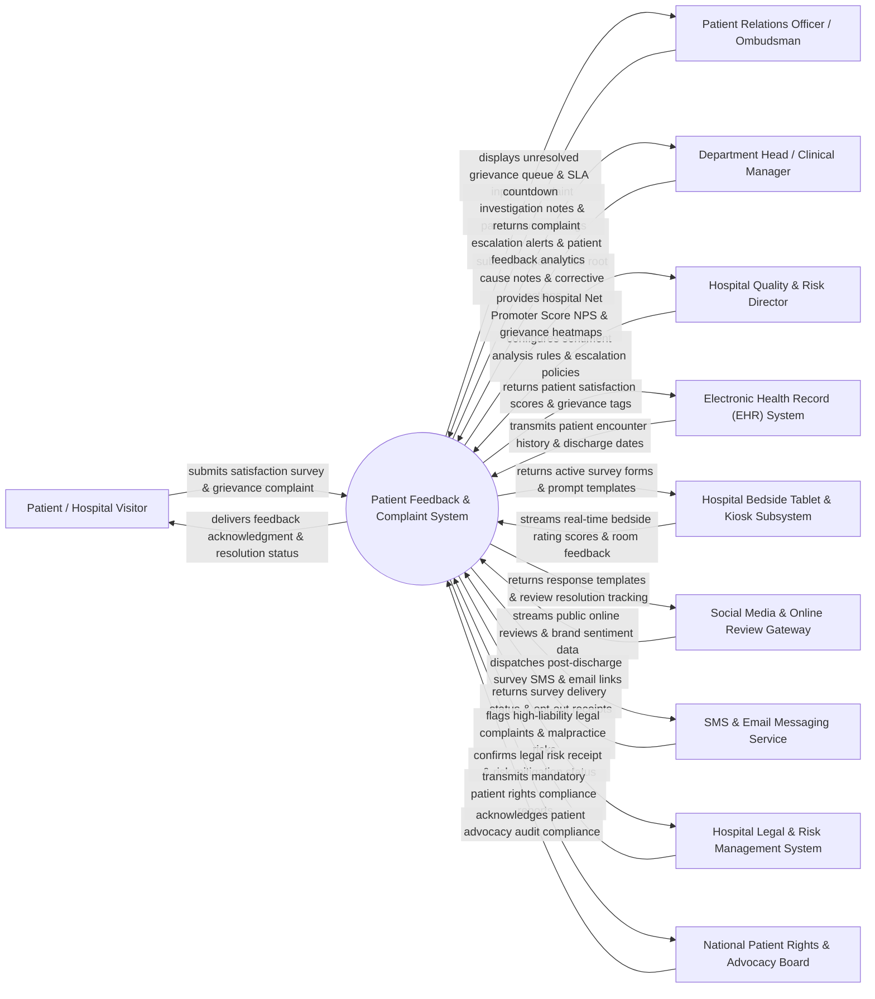

# Context Diagram — Patient Feedback & Complaint System

## Mermaid Code

## Actor & Interaction Table | Bảng Actor & Tương tác

| # | Actor | Actor Type | Data Sent TO System | Data Received FROM System | Notes |
|---|-------|------------|---------------------|---------------------------|-------|
| 1 | Patient / Hospital Visitor | Primary | Hospital experience ratings (1-5 stars), Net Promoter Score (NPS), written complaint details, staff compliments, service grievances. | Instant complaint receipt confirmations, feedback resolution status updates, post-discharge survey links. | Inpatient, outpatient, or family member sharing hospital experience feedback or lodging formal complaints. |
| 2 | Patient Relations Officer / Ombudsman | Primary | Complaint intake notes, patient phone interview logs, investigation findings, resolution letters, goodwill compensation approvals. | Active grievance queue, resolution SLA countdown timers, patient encounter history, sentiment analysis flags. | Patient advocate investigating formal grievances, conducting patient outreach, and negotiating resolutions. |
| 3 | Department Head / Clinical Manager | Primary | Root cause analysis notes, staff coaching records, departmental corrective action plans (CAP), service improvement logs. | Departmental complaint summaries, staff compliment notifications, overdue grievance resolution alerts. | Clinical or operational manager resolving complaints originating within their specific department or ward. |
| 4 | Hospital Quality & Risk Director | Primary | Feedback classification rules, escalation threshold parameters, patient rights policies, quality survey templates. | Hospital-wide NPS trends, grievance heatmaps, sentiment score analytics, high-liability malpractice alert summaries. | Hospital executive analyzing patient experience metrics and mitigating clinical liability risks. |
| 5 | Electronic Health Record (EHR) System | Supporting | Patient discharge timestamps, attending physician names, ward location history, encounter IDs. | Patient satisfaction survey links, grievance history tags, patient communication preference flags. | Central hospital EHR supplying encounter data to trigger automated post-discharge survey dispatches. |
| 6 | Hospital Bedside Tablet & Kiosk Subsystem | Supporting | Inpatient bedside survey responses, meal quality ratings, nurse responsiveness scores, room cleanliness flags. | Survey forms, interactive feedback rating UI, instant manager call-request triggers. | Bedside interactive tablets and lobby feedback kiosks capturing real-time inpatient feedback. |
| 7 | SMS & Email Messaging Service | Supporting | Delivery status codes, SMS delivery receipts, email open rates, survey opt-out requests. | Automated post-discharge survey links, SMS feedback prompts, complaint resolution notifications. | Cloud messaging provider dispatching post-visit satisfaction surveys and resolution notifications. |
| 8 | Social Media & Online Review Gateway | Supporting | Public Google Review ratings, social media mentions, brand sentiment feeds, online public review text. | Sentiment analysis flags, public response templates, review resolution tracking links. | Data aggregator scraping public online reviews and social media mentions of hospital services. |
| 9 | Hospital Legal & Risk Management System | Supporting | Legal claim risk assessments, malpractice inquiry tags, attorney communication logs. | High-liability complaint alerts, severe safety incident flags, patient grievance documentation packets. | Legal software receiving alerts when patient complaints involve potential medical malpractice or legal action. |
| 10 | National Patient Rights & Advocacy Board | Supporting / Regulatory | Mandated patient rights standards, grievance reporting guidelines, compliance audit receipts. | Annual patient complaint statistics, patient rights resolution rates, regulatory compliance reports. | Government or independent advocacy body enforcing patient rights laws and grievance handling compliance. |

## System Boundary Description | Mô tả Phạm vi Hệ thống

The **Patient Feedback & Complaint System (PFCS)** is an enterprise patient experience and grievance management platform designed to capture real-time patient feedback, automate post-discharge surveys, track formal complaint resolutions, analyze sentiment, and ensure compliance with patient rights regulations.

**Inside System Scope:**
- Multi-channel feedback ingestion (bedside tablets, lobby kiosks, post-discharge SMS/Email, online public reviews).
- Automated Natural Language Processing (NLP) sentiment analysis and topic categorization (Clinical Quality, Staff Behavior, Wait Times, Billing, Cleanliness).
- Formal grievance handling workflows, SLA countdown timers, ombudsman investigation notes, and resolution letters.
- Escalation pathways for high-liability legal or safety complaints to Legal and Quality Risk Management teams.
- Net Promoter Score (NPS) calculation, departmental complaint heatmaps, and regulatory patient rights compliance reporting.

**Outside System Scope:**
- Direct financial disbursement of legal malpractice settlements (managed by Hospital Legal & Accounting Systems).
- Direct psychological counseling or clinical treatment of aggrieved patients (handled by Clinical Care Teams).
- Direct content moderation on third-party public platforms like Google Reviews (handled by Google/social platforms).
