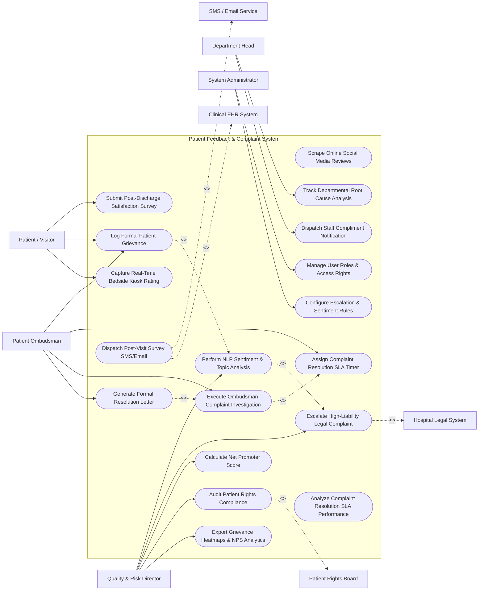

# Use Case Diagram — Patient Feedback & Complaint System

## Mermaid Code

## Actor Table | Bảng Actor

| # | Actor | Actor Type | Role Description | Related Use Cases |
|---|-------|------------|------------------|-------------------|
| 1 | Patient / Visitor | Primary | Patient or family member submitting ratings, satisfaction surveys, or formal grievances. | UC01, UC02, UC03 |
| 2 | Patient Ombudsman | Primary | Patient relations officer investigating formal complaints, contacting patients, and drafting resolution letters. | UC02, UC06, UC10, UC11 |
| 3 | Department Head | Primary | Manager performing root cause analysis on complaints and commending staff for positive feedback. | UC07, UC09 |
| 4 | Quality & Risk Director | Primary | Executive analyzing NPS scores, sentiment trends, patient rights compliance, and escalating legal risks. | UC05, UC08, UC12, UC13, UC15 |
| 5 | System Administrator | Primary | IT administrator configuring user security roles, escalation rule sets, and sentiment dictionary parameters. | UC16, UC17 |
| 6 | Clinical EHR System | System (Secondary) | Hospital EHR supplying patient discharge events to trigger automated survey dispatches. | UC14 |
| 7 | SMS / Email Service | System (Secondary) | Cloud messaging provider dispatching survey links and resolution notifications to patients. | UC14 |
| 8 | Hospital Legal System | System (Secondary) | Legal risk software receiving alerts when complaints involve potential medical malpractice. | UC08 |
| 9 | Patient Rights Board | System (Secondary) | External advocacy body receiving mandatory patient rights resolution compliance reports. | UC13 |

## Use Case Table | Bảng Use Case

| # | UC ID | Use Case Name | Primary Actor | Secondary Actor | Description | Priority |
|---|-------|---------------|---------------|-----------------|-------------|----------|
| 1 | UC01 | Submit Post-Discharge Satisfaction Survey | Patient | Messaging | Captures post-visit satisfaction survey ratings, NPS scores, and qualitative comments. | High |
| 2 | UC02 | Log Formal Patient Grievance | Patient | Ombudsman | Ingests and registers formal written or verbal patient grievances requiring investigation. | High |
| 3 | UC03 | Capture Real-Time Bedside Kiosk Rating | Patient | None | Collects real-time 1-5 star ratings and quick feedback on inpatient bedside tablets and kiosks. | Medium |
| 4 | UC04 | Scrape Online Social Media Reviews | System | None | Ingests public Google Reviews and social media mentions of hospital departments for sentiment tracking. | Medium |
| 5 | UC05 | Perform NLP Sentiment & Topic Analysis | Quality Director | System | Parses feedback text using Natural Language Processing (NLP) to categorize sentiment and themes. | High |
| 6 | UC06 | Assign Complaint Resolution SLA Timer | Ombudsman | None | Applies resolution SLA countdown timers (e.g., 7-day resolution window) based on grievance severity. | High |
| 7 | UC07 | Track Departmental Root Cause Analysis | Dept Head | None | Guides department heads through Root Cause Analysis (RCA) and corrective actions for valid complaints. | High |
| 8 | UC08 | Escalate High-Liability Legal Complaint | Quality Director | Legal System | Detects malpractice keywords and automatically escalates high-risk complaints to Hospital Legal. | Critical |
| 9 | UC09 | Dispatch Staff Compliment Notification | Dept Head | None | Isolates positive patient comments praising specific staff and sends recognition awards. | Medium |
| 10 | UC10 | Execute Ombudsman Complaint Investigation | Ombudsman | None | Records patient interview notes, clinical chart reviews, staff statements, and investigation findings. | High |
| 11 | UC11 | Generate Formal Resolution Letter | Ombudsman | None | Auto-generates formal complaint resolution response letters sent to patient upon case closure. | High |
| 12 | UC12 | Calculate Net Promoter Score | Quality Director | None | Computes hospital Net Promoter Score (NPS = % Promoters - % Detractors) across departments. | High |
| 13 | UC13 | Audit Patient Rights Compliance | Quality Director | Rights Board | Audits compliance with statutory patient rights (right to privacy, informed consent, grievance review). | High |
| 14 | UC14 | Dispatch Post-Visit Survey SMS/Email | System | Messaging / EHR | Dispatches automated post-discharge survey links via SMS/Email 48 hours after patient discharge. | High |
| 15 | UC15 | Export Grievance Heatmaps & NPS Analytics | Quality Director | None | Renders interactive department complaint heatmaps, NPS trends, and sentiment distribution charts. | Medium |
| 16 | UC16 | Manage User Roles & Access Rights | Admin | None | Configures user accounts, ombudsman access permissions, and confidential complaint security tiers. | High |
| 17 | UC17 | Configure Escalation & Sentiment Rules | Admin | Quality Director | Configures NLP sentiment dictionaries, high-liability keywords, and automated SLA escalation triggers. | High |
| 18 | UC18 | Analyze Complaint Resolution SLA Performance | System | None | Computes average resolution times, SLA breach rates, and ombudsman case throughput statistics. | Medium |

## Use Case Specification | Đặc tả Use Case

---

### UC02 — Log Formal Patient Grievance

| Field | Detail |
|-------|--------|
| **UC ID** | UC02 |
| **Use Case Name** | Log Formal Patient Grievance |
| **Actor(s)** | Primary: Patient / Visitor, Patient Ombudsman   Secondary: None |
| **Description** | Ingests, registers, and categorizes a formal written or verbal patient grievance, assigning a unique Case Tracking Number and initializing the resolution workflow. |
| **Precondition** | 1. Patient or family member submits a formal grievance via web portal, letter, or phone call to Ombudsman. |
| **Main Flow** | 1. Ombudsman opens "New Grievance Intake" screen in PFCS.   2. Ombudsman inputs Complainant Details (Patient Name, MRN, Relationship, Contact Phone, Email).   3. Ombudsman selects Encounter Type (Inpatient, Outpatient Clinic, ED, Surgical Center) and Date of Incident.   4. Ombudsman selects primary Complaint Categories (e.g., Clinical Quality of Care, Staff Communication, Wait Times, Billing Discrepancy).   5. Ombudsman inputs detailed narrative text of the patient's grievance.   6. System automatically executes NLP Sentiment & Topic Analysis (UC05) to tag sentiment severity.   7. System assigns a unique Case Tracking Number (e.g., `GRV-2026-00412`) and sets resolution SLA countdown timer (UC06).   8. System sends instant SMS/Email complaint receipt acknowledgment to patient with tracking number. |
| **Alternative Flow** | **AF1** — Direct Patient Web Portal Submission: Patient logs grievance directly via hospital website portal; System pre-populates intake fields, generates tracking number, and dispatches task to Ombudsman intake queue. |
| **Exception Flow** | **EX1** — Anonymous Grievance: Patient submits complaint anonymously; System logs case under `ANONYMOUS_PATIENT`, suppresses SMS/Email acknowledgment, but proceeds with internal investigation. |
| **Postcondition** | Formal grievance is registered, tracking number is assigned, SLA timer is initialized, and receipt confirmation is delivered. |
| **Business Rule** | **BR1**: All formal patient grievances must receive a written acknowledgment of receipt within 24 hours of intake per CMS/Joint Commission guidelines. |

---

### UC05 — Perform NLP Sentiment & Topic Analysis

| Field | Detail |
|-------|--------|
| **UC ID** | UC05 |
| **Use Case Name** | Perform NLP Sentiment & Topic Analysis |
| **Actor(s)** | Primary: Quality & Risk Director   Secondary: System |
| **Description** | Processes unstructured patient feedback text using Natural Language Processing (NLP) algorithms to score sentiment polarity (Positive, Neutral, Negative) and categorize complaint topics. |
| **Precondition** | 1. Unstructured text feedback is ingested via survey (UC01), grievance (UC02), or social review (UC04). |
| **Main Flow** | 1. System NLP engine ingests raw text feedback payload.   2. System applies tokenization, lemmatization, and medical sentiment lexicon matching algorithms.   3. System calculates Sentiment Polarity Score (-1.0 Extremely Negative to +1.0 Extremely Positive).   4. System categorizes text into primary and secondary Topic Clusters (e.g., "Doctor Communication", "Nurse Responsiveness", "Facility Cleanliness", "Billing Confusion").   5. System extracts key entity tags (e.g., Department Name, Physician Name, Ward Number).   6. System evaluates text for high-liability threat keywords (e.g., "Malpractice", "Lawyer", "Negligence", "Attributing Harm").   7. System updates feedback database record with sentiment score, topic tags, and threat flags.   8. If threat keywords are detected, System triggers UC08 (Escalate High-Liability Legal Complaint). |
| **Alternative Flow** | **AF1** — Multi-Lingual NLP Processing: Text is submitted in Spanish or Vietnamese; System automatically detects language, translates text, and processes sentiment scoring using localized dictionaries. |
| **Exception Flow** | **EX1** — Ambiguous / Sarcastic Sentiment: Text contains heavy sarcasm ("Great job waiting 5 hours for a 2-minute doctor visit"); System NLP flags low-confidence sentiment score and queues text for manual quality review. |
| **Postcondition** | Sentiment polarity score is calculated, topic clusters are assigned, and threat flags are evaluated. |
| **Business Rule** | **BR1**: Negative sentiment scores (< -0.5) must automatically flag feedback for priority review by department managers. |

---

### UC08 — Escalate High-Liability Legal Complaint

| Field | Detail |
|-------|--------|
| **UC ID** | UC08 |
| **Use Case Name** | Escalate High-Liability Legal Complaint |
| **Actor(s)** | Primary: Quality & Risk Director   Secondary: Hospital Legal System |
| **Description** | Identifies grievances involving allegations of severe clinical harm, medical error, death, or legal representation, and automatically escalates case files to Legal Risk Management. |
| **Precondition** | 1. Grievance text contains high-liability keywords or severe safety incident flags (UC05). |
| **Main Flow** | 1. System NLP engine detects high-liability threat keywords (e.g., "attorney", "malpractice suit", "wrong-site surgery", "permanent disability", "wrongful death").   2. System immediately transitions case risk tier to `HIGH_LEGAL_LIABILITY`.   3. System flags case with red warning badge on Quality Director and Ombudsman dashboards.   4. System packages complete grievance documentation file (patient narrative, encounter ID, attending staff names, medical records link).   5. System dispatches secure encrypted alert payload to Hospital Legal & Risk Management System.   6. System sends high-priority SMS/email alert to Chief Legal Officer and Quality Director.   7. System locks public communication features on case, requiring Legal approval for any external written patient response. |
| **Alternative Flow** | **AF1** — Sentinel Event Correlation: Grievance is linked to an active Sentinel Event Root Cause Analysis (RCA); System cross-references incident logs and notifies Legal of matching claims. |
| **Exception Flow** | **EX1** — False Positive Keyword Escalation: Patient mentions "My son is a lawyer" in benign context; Quality Director reviews case, clears legal threat flag, and downgrades case to standard grievance queue. |
| **Postcondition** | Case is escalated to Legal Risk Management, high-liability alert is logged, and external communications require legal approval. |
| **Business Rule** | **BR1**: High-liability legal complaints must be dispatched to Hospital Legal Risk Management within 60 minutes of detection. |

---

### UC10 — Execute Ombudsman Complaint Investigation

| Field | Detail |
|-------|--------|
| **UC ID** | UC08 / UC10 |
| **Use Case Name** | Execute Ombudsman Complaint Investigation |
| **Actor(s)** | Primary: Patient Ombudsman   Secondary: None |
| **Description** | Facilitates the thorough investigation of a registered patient grievance, capturing patient interview notes, clinical chart reviews, staff statements, and resolution outcomes. |
| **Precondition** | 1. Formal grievance is registered and assigned to Ombudsman (UC02). |
| **Main Flow** | 1. Ombudsman opens target grievance case file from active investigation queue.   2. Ombudsman reviews patient narrative, encounter history, and medical records in connected EHR.   3. Ombudsman contacts complainant by telephone or in person, conducts structured interview, and logs detailed notes.   4. Ombudsman interviews attending clinical staff and department head, recording staff statements and explanations.   5. Ombudsman reviews departmental Root Cause Analysis (RCA) input (UC07).   6. Ombudsman formulates resolution determination:   &nbsp;&nbsp;&nbsp;&nbsp; a. Grievance Substantiated / Valid -> Recommend apology, fee adjustment, or policy change.   &nbsp;&nbsp;&nbsp;&nbsp; b. Grievance Unsubstantiated -> Provide clinical explanation and care clarification.   7. Ombudsman logs investigation summary, selects resolution outcome code, and proceeds to generate formal resolution letter (UC11). |
| **Alternative Flow** | **AF1** — Goodwill Service Recovery Approval: Ombudsman determines minor service failure occurred (e.g., 3-hour ED wait); Ombudsman approves $50 cafeteria/parking voucher goodwill service recovery credit, logging expenditure. |
| **Exception Flow** | **EX1** — Uncooperative Staff Member: Staff member fails to provide statement within 5 days; Ombudsman escalates task to Department Head and Quality Director to enforce compliance. |
| **Postcondition** | Investigation notes are documented, resolution determination is finalized, and case moves to formal resolution letter generation. |
| **Business Rule** | **BR1**: Ombudsman investigation notes and staff interviews must be archived securely with restricted access to maintain confidentiality. |

---

### UC12 — Calculate Net Promoter Score (NPS)

| Field | Detail |
|-------|--------|
| **UC ID** | UC12 |
| **Use Case Name** | Calculate Net Promoter Score (NPS) |
| **Actor(s)** | Primary: Quality & Risk Director   Secondary: None |
| **Description** | Aggregates post-discharge survey ratings on the standard 0-10 likelihood-to-recommend question to compute Net Promoter Scores (NPS) across hospital wards, specialties, and physicians. |
| **Precondition** | 1. Post-discharge satisfaction survey responses are collected (UC01). |
| **Main Flow** | 1. System analytics engine fetches all survey responses containing the standard question: "How likely are you to recommend our hospital to family and friends? (0-10 scale)".   2. System categorizes respondents into 3 NPS Groups:   &nbsp;&nbsp;&nbsp;&nbsp; a. Promoters: Score 9 - 10 (Enthusiastic loyal patients).   &nbsp;&nbsp;&nbsp;&nbsp; b. Passives: Score 7 - 8 (Satisfied but unenthusiastic patients).   &nbsp;&nbsp;&nbsp;&nbsp; c. Detractors: Score 0 - 6 (Unhappy patients who can damage brand reputation).   3. System calculates Net Promoter Score formula:   &nbsp;&nbsp;&nbsp;&nbsp; `NPS = (% Promoters) - (% Detractors)`. (Score ranges from -100 to +100).   4. System computes overall hospital NPS and breakdown NPS by ward, clinical specialty, and attending physician.   5. System renders longitudinal NPS trend line graphs comparing current month score against target benchmarks.   6. System highlights top-performing departments and flags low-NPS units requiring quality intervention. |
| **Alternative Flow** | **AF1** — Inpatient vs Outpatient NPS Breakdown: User filters NPS calculations separately for Inpatient Wards vs Ambulatory Surgical Clinics vs Emergency Department. |
| **Exception Flow** | **EX1** — Insufficient Survey Sample Size: Department receives < 10 survey responses in a month; System displays warning "Sample Size Too Small (N < 10) - Score Statistically Unreliable" and suppresses ranking. |
| **Postcondition** | Hospital and departmental NPS scores are calculated, visual trend graphs are rendered, and executive dashboards are refreshed. |
| **Business Rule** | **BR1**: Net Promoter Score (NPS) must be calculated strictly using standard NCQA / Press Ganey survey scoring parameters. |
