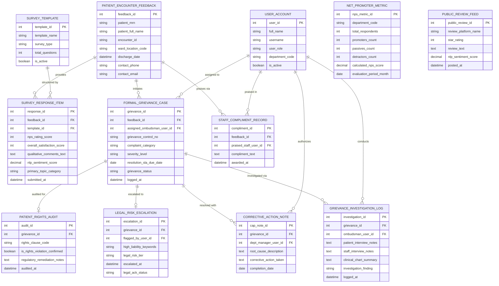

# Conceptual ERD — Patient Feedback & Complaint System

## Mermaid Code

## Entity Description Table | Bảng mô tả Entity

| # | Entity Name | Vietnamese Name | Description | Key Attributes | Main Relationships |
|---|-------------|-----------------|-------------|----------------|-------------------|
| 1 | USER_ACCOUNT | Tài khoản Nguời dùng | Credentials and access roles for ombudsmen, department heads, quality directors, and staff. | `user_id`, `username`, `user_role`, `department_code` | Assigned `FORMAL_GRIEVANCE_CASE`, conducts `GRIEVANCE_INVESTIGATION_LOG`, praised in `STAFF_COMPLIMENT_RECORD`. |
| 2 | PATIENT_ENCOUNTER_FEEDBACK | Hồ sơ Phản hồi Bệnh nhân | Master feedback header linking patient MRN, encounter ID, ward location, and contact information. | `feedback_id`, `patient_mrn`, `encounter_id`, `ward_location_code`, `discharge_date` | Provides `SURVEY_RESPONSE_ITEM`, initiates `FORMAL_GRIEVANCE_CASE`, praises via `STAFF_COMPLIMENT_RECORD`. |
| 3 | SURVEY_TEMPLATE | Mẫu Khảo sát Chất lượng | Configurable survey template rules detailing question items and rating scale types. | `template_id`, `template_name`, `survey_type`, `total_questions`, `is_active` | Structures `SURVEY_RESPONSE_ITEM`. |
| 4 | SURVEY_RESPONSE_ITEM | Mục Trả lời Khảo sát | Individual survey responses, NPS ratings (0-10), qualitative comments, and NLP sentiment scores. | `response_id`, `feedback_id`, `template_id`, `nps_rating_score`, `nlp_sentiment_score`, `primary_topic_category` | Belongs to `PATIENT_ENCOUNTER_FEEDBACK` and `SURVEY_TEMPLATE`. |
| 5 | FORMAL_GRIEVANCE_CASE | Hồ sơ Khiếu nại Chính thức | Formal patient grievance records detailing control number, category, severity, and SLA due date. | `grievance_id`, `feedback_id`, `assigned_ombudsman_user_id`, `grievance_control_no`, `resolution_sla_due_date` | Belongs to `PATIENT_ENCOUNTER_FEEDBACK`, investigated via `GRIEVANCE_INVESTIGATION_LOG`, escalated to `LEGAL_RISK_ESCALATION`. |
| 6 | GRIEVANCE_INVESTIGATION_LOG | Nhật ký Điều tra Khiếu nại | Ombudsman investigation records capturing patient/staff interview notes and clinical chart summaries. | `investigation_id`, `grievance_id`, `ombudsman_user_id`, `patient_interview_notes`, `investigation_finding` | Belongs to `FORMAL_GRIEVANCE_CASE`, conducted by `USER_ACCOUNT`. |
| 7 | CORRECTIVE_ACTION_NOTE | Ghi chú Hành động Khắc phục | Departmental Root Cause Analysis (RCA) and corrective actions executed by department heads. | `cap_note_id`, `grievance_id`, `dept_manager_user_id`, `root_cause_description`, `corrective_action_taken` | Belongs to `FORMAL_GRIEVANCE_CASE`, authorized by `USER_ACCOUNT`. |
| 8 | LEGAL_RISK_ESCALATION | Escalate Rủi ro Pháp lý | High-liability legal escalation records flagging malpractice keywords and risk management alerts. | `escalation_id`, `grievance_id`, `flagged_by_user_id`, `high_liability_keywords`, `legal_risk_tier` | Belongs to `FORMAL_GRIEVANCE_CASE`. |
| 9 | STAFF_COMPLIMENT_RECORD | Hồ sơ Khen ngợi Nhân viên | Positive patient feedback records recognizing specific hospital staff members for exemplary service. | `compliment_id`, `feedback_id`, `praised_staff_user_id`, `compliment_text`, `awarded_at` | Relates `PATIENT_ENCOUNTER_FEEDBACK` and `USER_ACCOUNT`. |
| 10 | NET_PROMOTER_METRIC | Chỉ số Net Promoter Score (NPS) | Aggregated monthly Net Promoter Score metrics (% Promoters - % Detractors) computed by department. | `nps_metric_id`, `department_code`, `total_respondents`, `promoters_count`, `calculated_nps_score` | Standalone analytical entity. |
| 11 | PATIENT_RIGHTS_AUDIT | Kiểm toán Quyền Bệnh nhân | Regulatory audit entries verifying compliance with statutory patient rights laws and grievance handling. | `audit_id`, `grievance_id`, `rights_clause_code`, `is_rights_violation_confirmed` | Belongs to `FORMAL_GRIEVANCE_CASE`. |
| 12 | PUBLIC_REVIEW_FEED | Dữ liệu Đánh giá Trực tuyến | Scraped public Google Reviews and social media sentiment entries tracking brand reputation. | `public_review_id`, `review_platform_name`, `star_rating`, `review_text`, `nlp_sentiment_score` | Standalone market intelligence entity. |

## Relationship Description | Mô tả Quan hệ

| # | From Entity | Cardinality | To Entity | Label | Business Explanation |
|---|-------------|-------------|-----------|-------|----------------------|
| 1 | PATIENT_ENCOUNTER_FEEDBACK | 1 to 0..N | SURVEY_RESPONSE_ITEM | provides | A patient encounter feedback record provides survey response items. |
| 2 | PATIENT_ENCOUNTER_FEEDBACK | 1 to 0..N | FORMAL_GRIEVANCE_CASE | initiates | A patient encounter feedback record initiates formal grievance cases. |
| 3 | PATIENT_ENCOUNTER_FEEDBACK | 1 to 0..N | STAFF_COMPLIMENT_RECORD | praises via | A patient encounter feedback record praises staff via compliment records. |
| 4 | SURVEY_TEMPLATE | 1 to 0..N | SURVEY_RESPONSE_ITEM | structured by | A survey template structures survey response items. |
| 5 | FORMAL_GRIEVANCE_CASE | 1 to 0..N | GRIEVANCE_INVESTIGATION_LOG | investigated via | A formal grievance case is investigated via ombudsman investigation logs. |
| 6 | FORMAL_GRIEVANCE_CASE | 1 to 0..N | CORRECTIVE_ACTION_NOTE | resolved with | A formal grievance case is resolved with departmental corrective action notes. |
| 7 | FORMAL_GRIEVANCE_CASE | 1 to 0..1 | LEGAL_RISK_ESCALATION | escalated to | A formal grievance case is escalated to legal risk escalation records if high-liability. |
| 8 | FORMAL_GRIEVANCE_CASE | 1 to 0..1 | PATIENT_RIGHTS_AUDIT | audited for | A formal grievance case is audited for statutory patient rights compliance. |
| 9 | USER_ACCOUNT | 1 to 0..N | FORMAL_GRIEVANCE_CASE | assigned to | An ombudsman user account is assigned to investigate formal grievances. |
| 10 | USER_ACCOUNT | 1 to 0..N | GRIEVANCE_INVESTIGATION_LOG | conducts | An ombudsman user account conducts investigation logs. |
| 11 | USER_ACCOUNT | 1 to 0..N | CORRECTIVE_ACTION_NOTE | authorizes | A department manager user account authorizes corrective action notes. |
| 12 | USER_ACCOUNT | 1 to 0..N | STAFF_COMPLIMENT_RECORD | praised in | A staff user account is praised in staff compliment records. |
