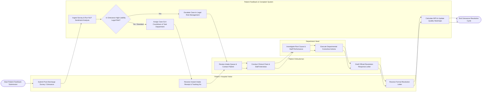

# Swimlane Diagram — Patient Feedback & Complaint System

## Mermaid Code

## Flow Description | Mô tả luồng

| Lane | Actor | Role in Flow |
|------|-------|-------------|
| 1 | Patient / Hospital Visitor | Submits post-discharge surveys or formal grievances, receives instant intake receipt confirmations with tracking numbers, and receives final resolution letters. |
| 2 | Patient Ombudsman | Reviews intake queues, conducts patient phone interviews, reviews clinical charts, interviews staff, and drafts official resolution response letters. |
| 3 | Patient Feedback & Complaint System | Ingests feedback data, executes NLP sentiment analysis, evaluates legal liability threat keywords, escalates high-risk cases to Legal, manages SLA countdowns, and calculates NPS metrics. |
| 4 | Department Head | Investigates root causes of departmental complaints, conducts staff coaching, executes corrective actions, and submits remediation evidence. |
