# Action Tree — Patient Feedback & Complaint System

## Mermaid Code

```mermaid
graph TD
    Root["Patient Feedback & Complaint System"]

    Root --> M1["Multi-Channel Feedback Ingestion"]
    Root --> M2["NLP Sentiment & Topic Classification"]
    Root --> M3["Formal Grievance & SLA Workflow"]
    Root --> M4["Ombudsman Investigation & Service Recovery"]
    Root --> M5["Net Promoter Score (NPS) & Quality Analytics"]
    Root --> M6["Legal Escalation & Regulatory Compliance"]

    M1 --> A11["Dispatch Post-Discharge Survey SMS & Email Links"]
    M1 --> A12["Capture Inpatient Bedside Kiosk Rating Scores"]
    M1 --> A13["Ingest Public Google Reviews & Social Media Feeds"]
    M1 --> A14["Register Formal Written & Phone Grievance Intake"]

    M2 --> A21["Calculate Sentiment Polarity Scores (-1.0 to +1.0)"]
    M2 --> A22["Categorize Feedback into Clinical & Service Topics"]
    M2 --> A23["Extract Staff & Physician Name Entity Tags"]
    M2 --> A24["Detect High-Liability Malpractice Threat Keywords"]

    M3 --> A31["Assign Grievance Control Numbers & SLA Timers"]
    M3 --> A32["Dispatch Instant SMS/Email Intake Confirmations"]
    M3 --> A33["Task Department Heads with Root Cause Analysis"]
    M3 --> A34["Track Overdue Resolution SLA Escalation Warnings"]

    M4 --> A41["Record Patient Phone & In-Person Interview Notes"]
    M4 --> A42["Review Clinical Chart History in Connected EHR"]
    M4 --> A43["Approve Goodwill Service Recovery Vouchers"]
    M4 --> A44["Generate Formal Complaint Resolution Letters"]

    M5 --> A51["Calculate Hospital Net Promoter Score (NPS)"]
    M5 --> A52["Breakdown NPS by Ward, Specialty & Physician"]
    M5 --> A53["Render Departmental Complaint Heatmap Charts"]
    M5 --> A54["Dispatch Positive Staff Compliment Awards"]

    M6 --> A61["Escalate High-Liability Cases to Hospital Legal"]
    M6 --> A62["Lock External Communications on Legal Cases"]
    M6 --> A63["Audit Statutory Patient Rights Compliance"]
    M6 --> A64["Export Mandatory Patient Rights Board Reports"]
```

## Module Description | Mô tả Module

| # | Module | Description | Actions |
|---|--------|-------------|---------|
| 1 | Multi-Channel Feedback Ingestion | Dispatches post-discharge survey links (SMS/Email), captures bedside kiosk ratings, scrapes public reviews, and registers formal grievances. | Dispatch Survey Links, Capture Kiosk Ratings, Ingest Public Reviews, Register Formal Grievances. |
| 2 | NLP Sentiment & Topic Classification | Calculates sentiment polarity scores, categorizes feedback topics, extracts staff entity tags, and detects malpractice threat keywords. | Calculate Sentiment Polarity, Categorize Feedback Topics, Extract Staff Entity Tags, Detect Malpractice Keywords. |
| 3 | Formal Grievance & SLA Workflow | Assigns grievance tracking numbers, initializes SLA timers, dispatches intake confirmations, tasks department heads, and tracks SLA breaches. | Assign Control Numbers & SLAs, Dispatch Intake Confirmations, Task Department Heads, Track Overdue SLA Warnings. |
| 4 | Ombudsman Investigation & Service Recovery | Records patient/staff interview notes, reviews EHR clinical charts, approves goodwill service recovery credits, and generates resolution letters. | Record Interview Notes, Review EHR Clinical Charts, Approve Goodwill Vouchers, Generate Resolution Letters. |
| 5 | Net Promoter Score (NPS) & Quality Analytics | Computes hospital-wide Net Promoter Scores (NPS), breaks down NPS by department/physician, renders complaint heatmaps, and awards staff compliments. | Calculate Hospital NPS, Breakdown NPS by Department, Render Complaint Heatmaps, Dispatch Staff Compliments. |
| 6 | Legal Escalation & Regulatory Compliance | Escalates high-liability complaints to Legal, restricts external communications on legal cases, audits patient rights, and exports compliance reports. | Escalate Cases to Legal, Lock External Communications, Audit Patient Rights Compliance, Export Regulatory Reports. |
