# Context Diagram — Patient Queue Management System

## Mermaid Code

```mermaid
flowchart LR
    OutpatientVisitor["Outpatient / Visitor"]
    ConsultationDoctor["Consultation Doctor / Clinic Nurse"]
    KioskClerk["Kiosk Receptionist & Queue Clerk"]
    CashierPharmacist["Outpatient Cashier & Pharmacist"]
    HospitalHIS["Hospital HIS / Outpatient EMR System"]
    SelfServiceKiosk["Self-Service Queue Kiosk & Ticket Printer Hardware"]
    CentralTVDisplay["Central Waiting TV Display & Audio PA System"]
    MobileMessagingGateway["Mobile Messaging Gateway (Zalo / SMS / App)"]
    HospitalQualityDirectorate["Hospital Quality & Patient Experience Directorate"]

    System(("Patient Queue Management System"))

    OutpatientVisitor -->|"scans Citizen ID CCCD, VSS card or mobile QR to check in"| System
    System -->|"returns printed queue ticket, room direction & live countdown"| OutpatientVisitor

    ConsultationDoctor -->|"inputs call next patient, recall ticket, transfer queue & skip no-show"| System
    System -->|"displays room patient queue list, priority tags & wait duration"| ConsultationDoctor

    KioskClerk -->|"inputs manual ticket override, VIP queue insert & priority re-class"| System
    System -->|"provides room queue status, service counter loads & ticket tallies"| KioskClerk

    CashierPharmacist -->|"inputs call next ticket for payment / drug dispensing"| System
    System -->|"provides billing / pharmacy queue lists & patient receipt numbers"| CashierPharmacist

    HospitalHIS -->|"transmits appointment bookings, patient registration & consultation orders"| System
    System -->|"returns ticket call timestamps, consultation arrival logs & wait time data"| HospitalHIS

    System -->|"dispatches ticket print payloads & barcode commands"| SelfServiceKiosk
    SelfServiceKiosk -->|"returns kiosk hardware status & paper roll telemetry"| System

    System -->|"transmits real-time TV call screen updates & synthesized voice audio"| CentralTVDisplay
    CentralTVDisplay -->|"returns display screen status & audio playback logs"| System

    System -->|"dispatches Zalo / SMS notifications when 3 patients remain in queue"| MobileMessagingGateway
    MobileMessagingGateway -->|"returns message delivery status reports"| System

    System -->|"exports average wait times, patient throughput & bottleneck analytics"| HospitalQualityDirectorate
    HospitalQualityDirectorate -->|"returns target wait time benchmarks & queue service standards"| System
```

## Actor & Interaction Table | Bảng Actor & Tương tác

| # | Actor | Actor Type | Data Sent TO System | Data Received FROM System | Notes |
|---|-------|------------|---------------------|---------------------------|-------|
| 1 | Outpatient / Visitor | Primary | Citizen ID (CCCD) QR scan, VSS health insurance card, pre-booked appointment QR code. | Printed queue ticket, clinic room location, live smartphone queue position countdown. | Patient or family member entering hospital to receive consultation, lab tests, or pharmacy. |
| 2 | Consultation Doctor / Clinic Nurse | Primary | "Call Next", "Re-Call", "Skip No-Show", "Transfer Queue to Lab/X-Ray" terminal button clicks. | Active patient name, queue ticket number, priority tier, wait time duration counter. | Healthcare provider in clinic room or diagnostic counter calling patients from queue. |
| 3 | Kiosk Receptionist & Queue Clerk | Primary | Manual ticket generation, express queue override for disabled/elderly, ticket re-activation. | Real-time queue counters, room service loads, total tickets issued per department. | Receptionist assisting patients at kiosks or managing queue priority overrides. |
| 4 | Outpatient Cashier & Pharmacist | Primary | "Call Next Payment", "Call Next Drug Dispensing" terminal commands. | Cashier/Pharmacy queue list, patient invoice numbers, drug dispensing ticket numbers. | Hospital staff managing payment cashiering or outpatient pharmacy dispensing queues. |
| 5 | Hospital HIS / Outpatient EMR System | Supporting System | Pre-booked appointment slots, patient demographics, consultation order transfers to lab/radiology. | Ticket check-in timestamps, consultation start/end timestamps, patient wait time metrics. | Enterprise hospital information system managing outpatient registrations and clinical charts. |
| 6 | Self-Service Queue Kiosk & Ticket Printer Hardware | Supporting System | Touch-screen selections, physical card reader scans, paper low/out printer telemetry. | Ticket printing commands, ticket layout data, barcode print instructions. | Interactive touch-screen kiosk hardware dispensing thermal paper queue tickets. |
| 7 | Central Waiting TV Display & Audio PA System | Supporting System | Display panel heartbeat status, audio system playback confirmations. | Real-time screen update feeds (Ticket # -> Room #), synthesized multi-lingual voice audio calls. | Public TV monitors and PA speakers broadcasting ticket calls in hospital waiting halls. |
| 8 | Mobile Messaging Gateway (Zalo / SMS / App) | Supporting System | Message delivery status receipts, patient reply interaction tokens. | Automated Zalo / SMS queue alerts ("Your turn is coming up in 3 patients"). | Messaging gateway sending real-time queue position notifications to patient smartphones. |
| 9 | Hospital Quality & Patient Experience Directorate | Regulatory | Target maximum waiting time limits (e.g., < 30 mins), queue service standards. | Average wait time by department, room bottleneck reports, patient no-show rate analytics. | Executive committee monitoring hospital waiting times and patient satisfaction metrics. |

## System Boundary Description | Mô tả Phạm vi Hệ thống

The **Patient Queue Management System (PQMS)** is an enterprise clinical workflow and queue optimization platform operating across hospital outpatient waiting halls, consultation clinics, diagnostic laboratories, radiology centers, payment counters, and pharmacies. It automates ticket issuance via touch-screen kiosks (Citizen ID CCCD, VSS card, pre-booked appointment QR), evaluates multi-tier priority rules (Emergency, Elderly >= 75, Pregnant, Disabled, Online Pre-booked), drives doctor room call terminals, updates central TV display monitors and text-to-speech audio voice callouts, dispatches Zalo/SMS mobile queue tracking alerts, and analyzes bottleneck wait times.

**Inside System Scope:**
- Multi-channel queue ticket issuance (Self-service kiosk, reception desk, mobile app check-in).
- Priority rule evaluation engine (Priority 1 Emergency, Priority 2 Elderly/Pregnant, Priority 3 Online Appt, Priority 4 Standard).
- Doctor and nurse room call software terminals ("Call Next", "Recall", "Skip No-Show", "Transfer Queue").
- Multi-stage queue routing (Reception -> Triage -> Doctor Consultation -> Lab Blood Draw -> Cashier -> Pharmacy).
- Central waiting hall TV display matrix rendering and synthesized multi-lingual voice callouts.
- Mobile queue tracking portal, Zalo Official Account integration, and SMS countdown alerts.
- Ticket no-show handling, temporary hold, and ticket re-activation workflows.
- Queue wait time analytics, room service time benchmarks, and bottleneck heatmaps.

**Outside System Scope:**
- Clinical diagnosis and medical treatment charting inside doctor rooms (handled by EMR / Outpatient System).
- Physical printing of cash payment receipts or prescription labels (handled by Cashier / HIS).
- Physical maintenance of TV hardware monitors or PA speakers (handled by IT / Facilities).
- Commercial corporate financial general ledger accounting (handled by enterprise ERP).
