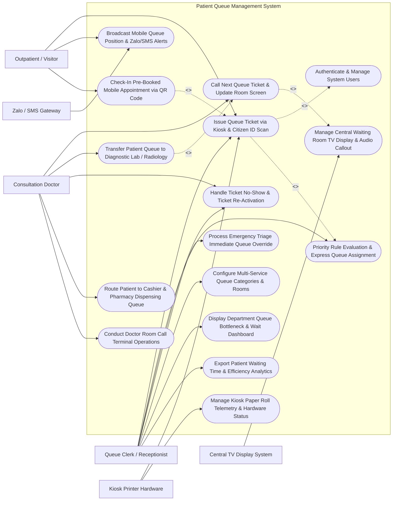

# Use Case Diagram — Patient Queue Management System

## Mermaid Code

## Actor Table | Bảng Actor

| # | Actor | Actor Type | Role Description | Related Use Cases |
|---|-------|------------|------------------|-------------------|
| 1 | Outpatient / Visitor | Primary | Patient scanning Citizen ID (CCCD) at kiosks, monitoring live queue position on smartphones, and checking in. | UC01, UC05, UC08 |
| 2 | Consultation Doctor | Primary | Physician calling next patient ticket, transferring queues to lab/X-ray, marking no-shows, and managing room terminals. | UC02, UC03, UC07, UC09, UC13 |
| 3 | Queue Clerk / Receptionist | Primary | Reception staff managing ticket overrides, priority express tickets, room category mappings, and wait analytics. | UC01, UC04, UC07, UC10, UC11, UC14, UC15 |
| 4 | Central TV Display System | Secondary / System | Public waiting hall TV monitors rendering real-time ticket call matrices and synthesized voice callouts. | UC06 |
| 5 | Zalo / SMS Gateway | Secondary / System | Mobile messaging gateway sending real-time queue position countdown alerts to patient smartphones. | UC05 |
| 6 | Kiosk Printer Hardware | Secondary / System | Self-service touch-screen kiosk hardware dispensing thermal paper queue tickets and monitoring paper rolls. | UC01, UC12 |

## Use Case Table | Bảng Use Case

| # | UC ID | Use Case Name | Primary Actor | Secondary Actor | Description | Priority |
|---|-------|---------------|---------------|-----------------|-------------|----------|
| 1 | UC01 | Issue Queue Ticket via Kiosk & Citizen ID Scan | Outpatient / Visitor | Kiosk Printer Hardware | Scan Citizen ID card (CCCD) or VSS card at self-service kiosk, evaluate priority rules, and print thermal queue ticket. | High |
| 2 | UC02 | Call Next Queue Ticket & Update Room Screen | Consultation Doctor | Central TV Display System | Trigger "Call Next" on room terminal, updating room door display, central TV waiting screen, and broadcasting audio voice. | High |
| 3 | UC03 | Transfer Patient Queue to Diagnostic Lab / Radiology | Consultation Doctor | None | Transfer completed consultation patient directly into Blood Draw Lab or Radiology X-Ray queue without re-registration. | High |
| 4 | UC04 | Priority Rule Evaluation & Express Queue Assignment | Queue Clerk / Receptionist | None | Evaluate priority criteria (Elderly >= 75 yrs, Pregnant, Disabled, Children < 6 yrs, VIP) and assign express priority queue tiers. | High |
| 5 | UC05 | Broadcast Mobile Queue Position & Zalo/SMS Alerts | Outpatient / Visitor | Zalo / SMS Gateway | Dispatch automated Zalo / SMS notifications when patient queue position is 3 patients away, enabling remote waiting. | High |
| 6 | UC06 | Manage Central Waiting Room TV Display & Audio Callout | Central TV Display System | None | Render multi-screen waiting hall TV displays (Ticket # -> Room # matrix) and synthesize voice audio callouts in Vietnamese/English. | High |
| 7 | UC07 | Handle Ticket No-Show & Ticket Re-Activation | Consultation Doctor | Queue Clerk / Receptionist | Mark non-responsive tickets after 3 calls as "No-Show", holding ticket for 30 minutes, and allowing clerk re-activation upon return. | High |
| 8 | UC08 | Check-In Pre-Booked Mobile Appointment via QR Code | Outpatient / Visitor | None | Scan pre-booked online appointment QR code from hospital app at kiosk, verifying slot and issuing express ticket. | High |
| 9 | UC09 | Route Patient to Cashier & Pharmacy Dispensing Queue | Consultation Doctor | None | Auto-route completed consultation patient to Payment Cashier queue and Outpatient Pharmacy dispensing queue. | High |
| 10 | UC10 | Process Emergency Triage Immediate Queue Override | Queue Clerk / Receptionist | None | Instantly override queue order for acute emergency patients, routing ticket straight to Room 1 (Resuscitation) bypassing queue. | High |
| 11 | UC11 | Configure Multi-Service Queue Categories & Rooms | Queue Clerk / Receptionist | None | Define queue service categories (General Medicine, Pediatrics, ENT, Lab), room prefix letters (A, B, C), and doctor room assignments. | Medium |
| 12 | UC12 | Manage Kiosk Paper Roll Telemetry & Hardware Status | Kiosk Printer Hardware | None | Monitor kiosk hardware health, touch-screen responsiveness, and trigger "Paper Roll Low (< 10%)" alerts to maintenance staff. | Medium |
| 13 | UC13 | Conduct Doctor Room Call Terminal Operations | Consultation Doctor | None | Execute room call terminal commands ("Call Next", "Re-Call", "Pause Queue for Lunch", "Transfer Room") from doctor's desktop app. | High |
| 14 | UC14 | Display Department Queue Bottleneck & Wait Dashboard | Queue Clerk / Receptionist | None | Display real-time department queue dashboard showing average wait times per room, active queue length, and room service rates. | Medium |
| 15 | UC15 | Export Patient Waiting Time & Efficiency Analytics | Queue Clerk / Receptionist | None | Generate statutory hospital quality reports: average wait time by service counter, doctor throughput rate, and peak hour trends. | Medium |
| 16 | UC16 | Authenticate & Manage System Users | All Users | None | Enforce secure role-based login (Doctor, Nurse, Receptionist, Admin), terminal IP locking, and audit log tracking. | High |

## Use Case Specification | Đặc tả Use Case

---

### UC01 — Issue Queue Ticket via Kiosk & Citizen ID Scan

| Field | Detail |
|-------|--------|
| **UC ID** | UC01 |
| **Use Case Name** | Issue Queue Ticket via Kiosk & Citizen ID Scan |
| **Actor(s)** | Primary: Outpatient / Visitor   Secondary: Kiosk Printer Hardware |
| **Description** | Processes queue check-in at a self-service touch-screen kiosk, scanning the patient's national Citizen ID Card (CCCD) or VSS Insurance Card QR code, querying HIS for active registrations, evaluating priority rules (UC04), and printing a thermal queue ticket. |
| **Precondition** | 1. The self-service queue kiosk is powered on and connected to PQMS.   2. Thermal paper roll is loaded in the printer. |
| **Main Flow** | 1. The Patient approaches the Self-Service Kiosk touch-screen.   2. The Patient scans the QR Code on their Citizen ID Card (CCCD) or VSS Health Insurance Card under the optical scanner.   3. The System reads card data and queries HIS: Full Name (e.g., Le Van H), Citizen ID Number (034075001234), Date of Birth (Jan 10, 1948 - Age 78), VSS Card Number.   4. The System evaluates **Priority Rules** (UC04): Age 78 >= 75 Years -> Assigns **Priority Tier 2 (Express Elderly Queue)**.   5. The System prompts for **Service Selection**:   &nbsp;&nbsp;&nbsp;&nbsp;- [x] General Internal Medicine Consultation   &nbsp;&nbsp;&nbsp;&nbsp;- [ ] Pediatrics Consultation   &nbsp;&nbsp;&nbsp;&nbsp;- [ ] Blood Draw Laboratory.   6. The System assigns Queue Ticket Number `A-012` (Prefix A = Internal Med, 012 = Ticket Sequence).   7. The System dispatches print command to the Thermal Printer.   8. The Kiosk prints thermal **Queue Ticket**:   &nbsp;&nbsp;&nbsp;&nbsp;- **Hospital Name**: General Hospital District 1   &nbsp;&nbsp;&nbsp;&nbsp;- **Queue Ticket**: `A-012` (Express Priority)   &nbsp;&nbsp;&nbsp;&nbsp;- **Patient Name**: LE VAN H*** (Masked)   &nbsp;&nbsp;&nbsp;&nbsp;- **Target Zone**: Room 104 (1st Floor)   &nbsp;&nbsp;&nbsp;&nbsp;- **Current Wait**: 2 Patients Ahead (Estimated 10 Mins)   &nbsp;&nbsp;&nbsp;&nbsp;- **QR Code**: Smartphone Live Tracking QR Code.   9. The System registers Ticket `A-012` into the Room 104 Active Queue. |
| **Alternative Flow** | **AF1** — Manual Touch-Screen Registration (No Card): Patient selects "Manual Entry" on touch-screen, types phone number, and selects service category to issue a standard Ticket `A-045`.   **AF2** — Pre-Booked Appointment QR Fast Check-In: Patient scans pre-booked mobile appointment QR code (UC08); the System validates booking slot and issues an "Express Appointment Ticket `AP-008`". |
| **Exception Flow** | **EX1** — Printer Paper Out / Hardware Jam: If thermal paper runs out during printing, the Kiosk screen flashes "Paper Low — Please Scan QR Code on Screen to Save Digital Ticket" and alerts maintenance (UC12).   **EX2** — HIS System Offline / Timeout: If HIS query times out, the Kiosk issues a "Fallback Offline Ticket `OFF-012`" and logs local ticket data for reconciliation upon reconnect. |
| **Postcondition** | Queue ticket is generated with unique number, priority tier is assigned, thermal ticket is printed, and ticket is queued in target room. |
| **Business Rule** | **BR1**: Patients aged >= 75 years, pregnant women, disabled individuals, and children < 6 years MUST be automatically assigned Express Priority queue status upon card scan.   **BR2**: Kiosk ticket printing processing time from card scan to paper ticket ejection MUST NOT exceed 5 seconds per transaction. |

---

### UC02 — Call Next Queue Ticket & Update Room Screen

| Field | Detail |
|-------|--------|
| **UC ID** | UC02 |
| **Use Case Name** | Call Next Queue Ticket & Update Room Screen |
| **Actor(s)** | Primary: Consultation Doctor   Secondary: Central TV Display System |
| **Description** | Enables the doctor or clinic nurse to trigger "Call Next Patient" from their desktop call terminal, updating the room door LED/LCD display, central waiting hall TV monitors, broadcasting multi-lingual synthesized audio voice callouts, and starting the consultation timer. |
| **Precondition** | 1. The doctor is logged into the Doctor Room Call Terminal app in Room 104.   2. Active patient tickets exist in the Room 104 queue. |
| **Main Flow** | 1. The Doctor finishes the current consultation and clicks **"CALL NEXT PATIENT"** on the room terminal software.   2. The System queries the Room 104 Active Queue, selecting the highest-priority ticket according to queue rules (Express Priority `A-012` over Standard `A-045`).   3. The System updates Ticket `A-012` status from *Waiting* to *Called / In-Consultation*.   4. The System dispatches real-time update payloads:   &nbsp;&nbsp;&nbsp;&nbsp;- **Room 104 Door LCD Display**: Updates display to `NOW SERVING: A-012 (Le Van H***)`   &nbsp;&nbsp;&nbsp;&nbsp;- **Central Waiting Hall TV Monitors** (UC06): Updates Ticket Matrix to highlight `A-012 -> Room 104` in flashing green   &nbsp;&nbsp;&nbsp;&nbsp;- **Synthesized Voice Audio PA System**: Broadcasts audio callout: *"Mời bệnh nhân số A-012 vào phòng 104" (Now calling ticket A-012 to Room 104)*.   5. The System sends a Zalo / SMS Notification to the patient's smartphone (UC05): *"It is your turn! Please enter Room 104."*   6. The System starts the **Room 104 Consultation Timer** (measuring doctor service duration).   7. Patient `A-012` enters Room 104, and the Doctor commences consultation. |
| **Alternative Flow** | **AF1** — Re-Call Non-Responsive Patient: Patient does not enter after 1 minute; the Doctor clicks **"RE-CALL"**, re-broadcasting the audio voice callout and flashing the room LED display.   **AF2** — Specific Ticket Direct Call: Doctor selects a specific patient ticket (e.g., returned lab patient `A-005`) from the room queue list and clicks "Call Selected Ticket". |
| **Exception Flow** | **EX1** — Queue Empty Alert: If the Doctor clicks "Call Next" when room queue is empty (0 tickets), the System displays "Queue Empty — Waiting for New Registrations".   **EX2** — Audio System Mute / Failure: If central audio PA system fails, the System displays an amber "Audio Offline — Visual Screen Active" indicator on doctor terminal. |
| **Postcondition** | Ticket status is updated to Called, room door display and central TV monitors are updated, audio voice is broadcast, and consultation timer is running. |
| **Business Rule** | **BR1**: Express Priority tickets (Priority 1 & 2) MUST be called before standard priority tickets regardless of check-in timestamp order.   **BR2**: Calling a ticket MUST update all 3 output channels (Room Door Display, Central TV Matrix, Audio Voice Callout) simultaneously within 1 second. |

---

### UC03 — Transfer Patient Queue to Diagnostic Lab / Radiology

| Field | Detail |
|-------|--------|
| **UC ID** | UC03 |
| **Use Case Name** | Transfer Patient Queue to Diagnostic Lab / Radiology |
| **Actor(s)** | Primary: Consultation Doctor |
| **Description** | Transfers a patient who has completed their initial consultation directly into downstream service queues (Blood Draw Laboratory, Radiology X-Ray/CT, EKG, or Cashier) without requiring the patient to re-register at front-desk kiosks, preserving their priority status. |
| **Precondition** | 1. The Doctor is conducting consultation for Ticket `A-012` in Room 104.   2. The Doctor orders diagnostic lab tests or X-rays in HIS. |
| **Main Flow** | 1. The Doctor completes initial examination for Patient `A-012` and orders Blood CBC and Chest X-Ray.   2. The Doctor clicks **"TRANSFER PATIENT QUEUE"** on the room terminal software.   3. The System displays downstream target service destinations based on ordered CPOE items:   &nbsp;&nbsp;&nbsp;&nbsp;- Destination 1: **Blood Draw Laboratory (Zone B - Room 201)**   &nbsp;&nbsp;&nbsp;&nbsp;- Destination 2: **Chest X-Ray Room (Zone C - Room 302)**.   4. The Doctor selects Destination 1 (Blood Draw Lab) as immediate next stop.   5. The System generates Linked Transfer Ticket `L-012` (Prefix L = Lab, linked to original Ticket A-012).   6. The System transfers Patient `A-012` from Room 104 queue directly into **Room 201 (Blood Draw) Active Queue**, preserving Express Priority status.   7. The System updates the Patient's Mobile Smartphone App (UC05): *"Consultation complete. Please proceed to Zone B - Room 201 (Blood Draw Lab). Ticket L-012 is 1 patient away."*   8. Doctor Room 104 terminal clears Patient `A-012` and prompts for "Call Next Patient" (UC02). |
| **Alternative Flow** | **AF1** — Multi-Stage Sequential Queue Routing: The System auto-routes patient through a multi-stage sequence: Step 1: Cashier -> Step 2: Blood Draw -> Step 3: X-Ray -> Step 4: Return to Doctor Room 104.   **AF2** — Return to Doctor Room Post-Lab Queue: After lab tests are completed, the Lab Tech clicks "Transfer Back to Doctor", placing patient in Doctor Room 104's "Returned Results Priority Queue". |
| **Exception Flow** | **EX1** — Diagnostic Department Closed Alert: If the Doctor attempts to transfer a patient to X-Ray at 17:30 PM after X-Ray department operating hours, the System alerts "Department Closed — Route to Emergency X-Ray".   **EX2** — HIS Order Unsigned Warning: If the Doctor attempts queue transfer before electronically signing lab orders, the System prompts "Sign Lab Orders in HIS First". |
| **Postcondition** | Patient is transferred to target lab/radiology queue, priority status is preserved, mobile app navigation instructions are updated, and doctor terminal clears case. |
| **Business Rule** | **BR1**: Patients transferred from consultation rooms to diagnostic labs/radiology MUST NOT be forced to re-ticket at kiosks.   **BR2**: Patients returning to the doctor's room after completing lab/X-ray tests MUST be placed in an expedited "Returned Results Priority Queue" ahead of new first-visit patients. |

---

### UC04 — Priority Rule Evaluation & Express Queue Assignment

| Field | Detail |
|-------|--------|
| **UC ID** | UC04 |
| **Use Case Name** | Priority Rule Evaluation & Express Queue Assignment |
| **Actor(s)** | Primary: Queue Clerk / Receptionist |
| **Description** | Evaluates incoming patient demographics, age, medical condition, VSS insurance card status, and pre-booked online appointments against configurable multi-tier priority rules, assigning express priority queue tiers (Priority 1 to 4) to ensure vulnerable and acute patients receive expedited care. |
| **Precondition** | 1. Patient checks in at kiosk (UC01) or reception desk.   2. Priority rule configuration matrix is active in PQMS. |
| **Main Flow** | 1. A patient checks in at the kiosk or reception desk.   2. The **Priority Rule Engine** ingests patient parameters from card scan or clerk entry:   &nbsp;&nbsp;&nbsp;&nbsp;- Patient Age (82 Years)   &nbsp;&nbsp;&nbsp;&nbsp;- Pregnancy / Disability Status   &nbsp;&nbsp;&nbsp;&nbsp;- Pre-Booked Mobile Appointment Status   &nbsp;&nbsp;&nbsp;&nbsp;- Emergency Triage Code (if evaluated by nurse).   3. The Engine evaluates rules against **Priority Tier Matrix**:   &nbsp;&nbsp;&nbsp;&nbsp;- **Priority 1 (Emergency - Red)**: Acute Resuscitation / Severe Distress -> Immediate Queue Bypass (UC10)   &nbsp;&nbsp;&nbsp;&nbsp;- **Priority 2 (Express Vulnerable - Orange)**: Elderly >= 75 yrs, Children < 6 yrs, Pregnant women, Wheelchair disabled -> Express Priority   &nbsp;&nbsp;&nbsp;&nbsp;- **Priority 3 (Pre-Booked Appointment - Blue)**: Online Appt Holders within ±15 min window -> Scheduled Slot Priority   &nbsp;&nbsp;&nbsp;&nbsp;- **Priority 4 (Standard Walk-In - Green)**: General Walk-In Patients -> FIFO Order.   4. Patient (Age 82) triggers Rule #2: `Age >= 75` -> Assigned **Priority Tier 2 (Express)**.   5. The System tags Ticket `A-012` with "Express Priority" flag and inserts it at the front of the Room 104 queue (behind existing Priority 1 & 2 tickets, ahead of all Priority 3 & 4 tickets).   6. The Kiosk prints ticket `A-012` with "EXPRESS PRIORITY" badge. |
| **Alternative Flow** | **AF1** — Manual Receptionist Priority Override: The Receptionist notices a walk-in patient with severe dizziness; the Receptionist clicks "Manual Priority Override", upgrading ticket from Priority 4 to Priority 2.   **AF2** — VIP / Veteran Priority Rule Match: The System detects a Revolutionary War Veteran (Card Code CC/CK); the System applies Rule #2B, assigning Express Priority. |
| **Exception Flow** | **EX1** — Priority Queue Flooding Alert: If Express Priority (Tier 2) tickets exceed 60% of total queue length causing Standard (Tier 4) wait times to exceed 90 mins, the System alerts the Queue Clerk to open an extra "Dedicated Express Clinic Room".   **EX2** — Expired Pre-Booked Slot Window (> 30 Mins Late): An online appointment holder arrives 45 mins late; the System demotes appointment ticket from Priority 3 to Standard Priority 4. |
| **Postcondition** | Patient priority tier (1-4) is computed, queue insertion position is calculated, and ticket is printed with priority tag. |
| **Business Rule** | **BR1**: Elderly patients (>= 75 yrs), children under 6, pregnant women, and severely disabled individuals MUST be automatically assigned Tier 2 Express Priority status.   **BR2**: Manual priority overrides executed by reception staff MUST require a mandatory reason code entry for quality auditing. |

---

### UC05 — Broadcast Mobile Queue Position & Zalo/SMS Alerts

| Field | Detail |
|-------|--------|
| **UC ID** | UC05 |
| **Use Case Name** | Broadcast Mobile Queue Position & Zalo/SMS Alerts |
| **Actor(s)** | Primary: Outpatient / Visitor   Secondary: Zalo / SMS Gateway |
| **Description** | Broadcasts live smartphone queue position updates, estimated wait time countdowns, and automated Zalo / SMS push notifications to patients, alerting them when their turn is approaching (e.g., 3 patients away) so they can wait comfortably in hospital cafeterias or outdoor gardens. |
| **Precondition** | 1. The patient has scanned the QR code on their printed ticket using their smartphone or checked in via mobile app.   2. Zalo Official Account / SMS Gateway service is active. |
| **Main Flow** | 1. The Patient scans the QR Code on Ticket `A-045` using their smartphone camera or Zalo app.   2. The smartphone opens the **Live Mobile Queue Portal** displaying:   &nbsp;&nbsp;&nbsp;&nbsp;- **Hospital Name**: General Hospital District 1   &nbsp;&nbsp;&nbsp;&nbsp;- **Your Ticket**: `A-045` (Standard Priority)   &nbsp;&nbsp;&nbsp;&nbsp;- **Assigned Room**: Room 104 (1st Floor)   &nbsp;&nbsp;&nbsp;&nbsp;- **Current Ticket Being Served**: `A-032`   &nbsp;&nbsp;&nbsp;&nbsp;- **Patients Ahead of You**: 13 Patients   &nbsp;&nbsp;&nbsp;&nbsp;- **Estimated Wait Time**: 42 Minutes.   3. The Patient leaves the crowded waiting hall to sit in the hospital garden.   4. As Doctor Room 104 calls tickets, the System updates live queue position on the mobile portal.   5. When Room 104 calls Ticket `A-041` (3 patients remaining ahead of `A-045`), the System triggers an automated **Zalo / SMS Push Notification**:   &nbsp;&nbsp;&nbsp;&nbsp;- *"Notice from Hospital: Your Ticket A-045 is 3 patients away! Please return to Room 104 waiting area immediately."*   6. The Patient receives the push notification, returns to Room 104, and arrives just as Ticket `A-045` is called (UC02). |
| **Alternative Flow** | **AF1** — Mobile App Check-In without Printed Ticket: Patient checks in via hospital mobile app 500m from hospital; the App issues digital Ticket `A-048` and navigates patient directly to Room 104.   **AF2** — SMS Alert for Non-Smartphone Users: For patients without smartphones, the Receptionist inputs their mobile number at kiosk; the System sends a standard SMS when 3 patients remain. |
| **Exception Flow** | **EX1** — Zalo Notification Failure / Fallback to SMS: If Zalo push message delivery fails (user has no Zalo account), the System automatically falls back to sending a traditional SMS message.   **EX2** — Fast Queue Acceleration Alert: If 5 patients no-show rapidly causing wait time to drop from 30 mins to 3 mins instantly, the System sends an urgent "QUEUE ACCELERATED — RETURN NOW" alert. |
| **Postcondition** | Live queue position is displayed on mobile portal, Zalo/SMS proximity alert is delivered, and patient arrives at room on time. |
| **Business Rule** | **BR1**: Automated mobile proximity notifications MUST be dispatched when 3 patients remain ahead in the target queue.   **BR2**: Mobile queue tracking portals MUST update live patient queue position every 10 seconds without requiring manual browser refresh. |
