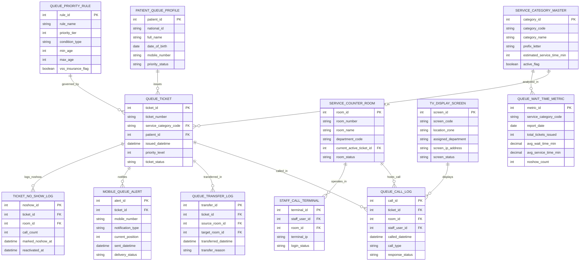

# Conceptual ERD — Patient Queue Management System

## Mermaid Code

## Entity Description Table | Bảng mô tả Entity

| # | Entity Name | Vietnamese Name | Description | Key Attributes | Main Relationships |
|---|-------------|-----------------|-------------|----------------|-------------------|
| 1 | QUEUE_TICKET | Số Thứ tự (Ticket Master) | Master queue ticket record storing unique ticket number (e.g., A-012), service category code, patient ID, issued datetime, priority level (1-4), and status. | ticket_id, ticket_number, service_category_code, patient_id, issued_datetime, priority_level, ticket_status | Belongs to PATIENT_PROFILE, SERVICE_CATEGORY, PRIORITY_RULE; Has CALL_LOG, TRANSFER_LOG, MOBILE_ALERT, NO_SHOW_LOG. |
| 2 | SERVICE_COUNTER_ROOM | Phòng / Bàn Phục vụ (Room) | Service counter or consultation room record tracking room number, room name, department code, current active ticket ID, and status. | room_id, room_number, room_name, department_code, current_active_ticket_id, room_status | Has QUEUE_CALL_LOG and STAFF_CALL_TERMINAL. |
| 3 | SERVICE_CATEGORY_MASTER | Danh mục Dịch vụ Hàng đợi | Master service category definition (General Medicine, Pediatrics, Blood Draw, X-Ray) tracking prefix letter, estimated service time, and status. | category_id, category_code, category_name, prefix_letter, estimated_service_time_min, active_flag | Has QUEUE_TICKET and QUEUE_WAIT_TIME_METRIC. |
| 4 | QUEUE_PRIORITY_RULE | Quy tắc Ưu tiên Hàng đợi | Configurable queue priority rule definition tracking rule name, priority tier (1-4), condition type (Age, Disability, Appt), min/max age, and VSS flag. | rule_id, rule_name, priority_tier, condition_type, min_age, max_age, vss_insurance_flag | Governs QUEUE_TICKET entities. |
| 5 | QUEUE_CALL_LOG | Nhật ký Gọi số (Call Log) | Real-time queue ticket call record tracking ticket ID, room ID, staff user ID, called datetime, call type (First Call, Recall), and response status. | call_id, ticket_id, room_id, staff_user_id, called_datetime, call_type, response_status | Belongs to QUEUE_TICKET, SERVICE_COUNTER_ROOM, and TV_DISPLAY_SCREEN. |
| 6 | QUEUE_TRANSFER_LOG | Nhật ký Chuyển Hàng đợi | Queue transfer record tracking ticket ID, source room ID, target room ID, transferred datetime, and transfer reason (Lab, X-Ray, Cashier). | transfer_id, ticket_id, source_room_id, target_room_id, transferred_datetime, transfer_reason | Belongs to QUEUE_TICKET. |
| 7 | TV_DISPLAY_SCREEN | Màn hình TV Sảnh chờ | Central waiting hall TV display monitor record tracking screen code, location zone, assigned department, screen IP address, and status. | screen_id, screen_code, location_zone, assigned_department, screen_ip_address, screen_status | Displays QUEUE_CALL_LOG. |
| 8 | PATIENT_QUEUE_PROFILE | Hồ sơ Bệnh nhân Hàng đợi | Patient demographic queue profile tracking national Citizen ID (CCCD), full name, DOB, mobile number, and priority status. | patient_id, national_id, full_name, date_of_birth, mobile_number, priority_status | Has many QUEUE_TICKET entities. |
| 9 | MOBILE_QUEUE_ALERT | Thông báo Mobile (Zalo/SMS) | Mobile queue notification log tracking ticket ID, mobile number, notification type (Zalo, SMS), current queue position, sent time, and status. | alert_id, ticket_id, mobile_number, notification_type, current_position, sent_datetime, delivery_status | Belongs to QUEUE_TICKET. |
| 10 | TICKET_NO_SHOW_LOG | Nhật ký Qua lượt (No-Show Log) | Non-responsive ticket log tracking ticket ID, room ID, call count (3 calls), marked no-show timestamp, and reactivated timestamp. | noshow_id, ticket_id, room_id, call_count, marked_noshow_at, reactivated_at | Belongs to QUEUE_TICKET. |
| 11 | STAFF_CALL_TERMINAL | Bàn Gọi số Bác sĩ / Y tế | Staff desktop/tablet call terminal session record tracking staff user ID, room ID, terminal IP address, and login status. | terminal_id, staff_user_id, room_id, terminal_ip, login_status | Operates in SERVICE_COUNTER_ROOM. |
| 12 | QUEUE_WAIT_TIME_METRIC | Báo cáo Thời gian Chờ | Aggregated queue performance metric store tracking service category code, report date, total tickets issued, avg wait time min, avg service time min, and no-shows. | metric_id, service_category_code, report_date, total_tickets_issued, avg_wait_time_min, avg_service_time_min, noshow_count | Belongs to SERVICE_CATEGORY_MASTER. |

## Relationship Description | Mô tả Quan hệ

| # | From Entity | Cardinality | To Entity | Relationship Label | Business Explanation |
|---|-------------|-------------|-----------|-------------------|----------------------|
| 1 | PATIENT_QUEUE_PROFILE | one-to-many | QUEUE_TICKET | issues | One patient profile issues multiple queue tickets over different hospital visits. |
| 2 | SERVICE_CATEGORY_MASTER | one-to-many | QUEUE_TICKET | categorized_in | One service category (e.g., Internal Med) categorizes multiple queue tickets. |
| 3 | QUEUE_PRIORITY_RULE | one-to-many | QUEUE_TICKET | governed_by | One priority rule governs priority level assignment for queue tickets. |
| 4 | QUEUE_TICKET | one-to-many | QUEUE_CALL_LOG | called_in | One queue ticket can be called multiple times (First call, Recall) in call logs. |
| 5 | QUEUE_TICKET | one-to-many | QUEUE_TRANSFER_LOG | transferred_in | One queue ticket can be transferred sequentially across multiple service rooms. |
| 6 | QUEUE_TICKET | one-to-many | MOBILE_QUEUE_ALERT | notifies | One queue ticket dispatches Zalo/SMS mobile proximity notifications. |
| 7 | QUEUE_TICKET | one-to-many | TICKET_NO_SHOW_LOG | logs_noshow | One queue ticket logs no-show events if non-responsive after 3 calls. |
| 8 | SERVICE_COUNTER_ROOM | one-to-many | QUEUE_CALL_LOG | hosts_call | One service counter room hosts daily ticket calls by doctors/nurses. |
| 9 | SERVICE_COUNTER_ROOM | one-to-many | STAFF_CALL_TERMINAL | operates_in | One service counter room is operated via staff call terminals. |
| 10 | TV_DISPLAY_SCREEN | one-to-many | QUEUE_CALL_LOG | displays | Central TV display screens render live ticket call logs for waiting patients. |
| 11 | SERVICE_CATEGORY_MASTER | one-to-many | QUEUE_WAIT_TIME_METRIC | analyzed_in | One service category is analyzed for daily average wait time performance metrics. |
