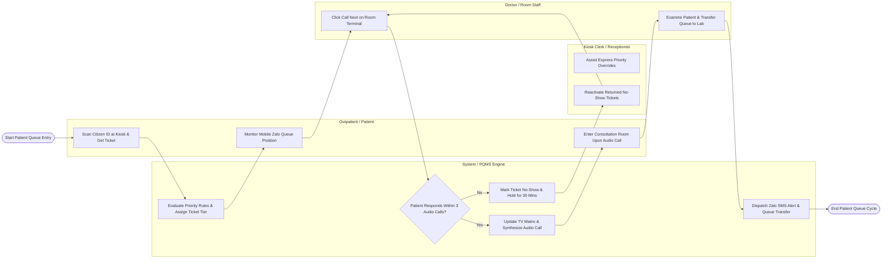

# Swimlane Diagram — Patient Queue Management System

## Mermaid Code

## Flow Description | Mô tả luồng

| Lane | Actor / Subsystem | Role in Flow |
|------|-------------------|--------------|
| 1 | Outpatient / Patient | Scans Citizen ID (CCCD) or VSS insurance card at kiosk to receive a queue ticket, monitors live queue countdown on smartphone, and enters room upon audio callout. |
| 2 | Kiosk Clerk / Receptionist | Assists walk-in patients, manages express priority overrides for vulnerable patients (elderly, disabled), and reactivates returned no-show tickets. |
| 3 | System / PQMS Engine | Evaluates priority rules (Priority 1-4), updates central TV display matrix, synthesizes multi-lingual voice audio calls, dispatches Zalo/SMS proximity alerts, and logs no-shows. |
| 4 | Doctor / Room Staff | Triggers "Call Next Patient" from room call software terminal, conducts clinical examination, and transfers patient queue to diagnostic labs/radiology or cashier. |
