# Action Tree — Patient Queue Management System

## Mermaid Code

```mermaid
graph TD
    Root["Patient Queue Management System"]

    Root --> M1["Kiosk Ticket & Citizen ID Check-In"]
    Root --> M2["Priority Engine & Express Queue"]
    Root --> M3["Doctor Room Call Terminal"]
    Root --> M4["Central TV Display & Audio Callout"]
    Root --> M5["Mobile Portal & Zalo SMS Alerts"]
    Root --> M6["Multi-Stage Queue Transfer"]
    Root --> M7["No-Show & Ticket Re-Activation"]
    Root --> M8["Wait Time & Bottleneck Analytics"]

    M1 --> A11["Scan Citizen ID CCCD & VSS Insurance QR"]
    M1 --> A12["Check-In Pre-Booked Appointment QR Code"]
    M1 --> A13["Select Service Category & Department"]
    M1 --> A14["Print Thermal Queue Ticket with Barcode"]

    M2 --> A21["Evaluate Priority Rules Tier 1 to 4"]
    M2 --> A22["Assign Express Priority to Elderly & Pregnant"]
    M2 --> A23["Execute Manual Receptionist Priority Override"]
    M2 --> A24["Insert Emergency Triage Direct Queue Bypass"]

    M3 --> A31["Trigger Call Next Patient on Room Terminal"]
    M3 --> A32["Execute Re-Call Audio Voice Callout"]
    M3 --> A33["Pause Room Queue for Doctor Break"]
    M3 --> A34["Direct Call Selected Lab Returned Ticket"]

    M4 --> A41["Update Central Waiting TV Matrix Screens"]
    M4 --> A42["Synthesize Multi-Lingual Audio Voice Calls"]
    M4 --> A43["Render Room Door LCD Screen Ticket Info"]
    M4 --> A44["Configure Waiting Hall Zone TV Screen Maps"]

    M5 --> A51["Render Live Mobile Queue Position Portal"]
    M5 --> A52["Dispatch Zalo Proximity Notification"]
    M5 --> A53["Send SMS Alert When 3 Patients Remain"]
    M5 --> A54["Broadcast Fast Queue Acceleration Warning"]

    M6 --> A61["Transfer Consultation Patient to Blood Lab"]
    M6 --> A62["Route Patient to Radiology X-Ray Queue"]
    M6 --> A63["Auto-Route Completed Patient to Cashier"]
    M6 --> A64["Queue Patient for Pharmacy Drug Dispensing"]

    M7 --> A71["Log Non-Responsive Ticket After 3 Calls"]
    M7 --> A72["Mark Ticket Status as Temporary No-Show"]
    M7 --> A73["Reactivate Returned No-Show at Front Desk"]
    M7 --> A74["Auto-Purge Unclaimed Tickets After 60 Mins"]

    M8 --> A81["Measure Average Wait Time per Department"]
    M8 --> A82["Track Doctor Service Time Duration Metric"]
    M8 --> A83["Identify Real-Time Bottleneck Waiting Rooms"]
    M8 --> A84["Export Hospital Patient Throughput Analytics"]
```

## Module Description | Mô tả Module

| # | Module | Description | Actions |
|---|--------|-------------|---------|
| 1 | Kiosk Ticket & Citizen ID Check-In | Processes queue check-in via self-service kiosks, scanning Citizen ID (CCCD), VSS cards, or pre-booked appointment QR codes to print tickets. | Scan Citizen ID CCCD & VSS Insurance QR, Check-In Pre-Booked Appointment QR Code, Select Service Category & Department, Print Thermal Queue Ticket with Barcode |
| 2 | Priority Engine & Express Queue | Evaluates priority rules (Priority 1-4), assigns express status to vulnerable groups (elderly, pregnant), handles manual overrides, and emergency bypasses. | Evaluate Priority Rules Tier 1 to 4, Assign Express Priority to Elderly & Pregnant, Execute Manual Receptionist Priority Override, Insert Emergency Triage Direct Queue Bypass |
| 3 | Doctor Room Call Terminal | Enables clinicians to trigger "Call Next", "Re-Call", direct-call returned lab tickets, or pause queues on desktop/tablet call software terminals. | Trigger Call Next Patient on Room Terminal, Execute Re-Call Audio Voice Callout, Pause Room Queue for Doctor Break, Direct Call Selected Lab Returned Ticket |
| 4 | Central TV Display & Audio Callout | Updates waiting hall TV display screens (Ticket # -> Room #), synthesizes multi-lingual voice audio calls, and manages room door LCD panels. | Update Central Waiting TV Matrix Screens, Synthesize Multi-Lingual Audio Voice Calls, Render Room Door LCD Screen Ticket Info, Configure Waiting Hall Zone TV Screen Maps |
| 5 | Mobile Portal & Zalo SMS Alerts | Displays live queue position countdowns on smartphone browsers, dispatches Zalo push notifications, and sends SMS alerts when 3 patients remain. | Render Live Mobile Queue Position Portal, Dispatch Zalo Proximity Notification, Send SMS Alert When 3 Patients Remain, Broadcast Fast Queue Acceleration Warning |
| 6 | Multi-Stage Queue Transfer | Auto-routes completed consultation patients into diagnostic lab, radiology, cashier payment, and outpatient pharmacy queues without re-registering. | Transfer Consultation Patient to Blood Lab, Route Patient to Radiology X-Ray Queue, Auto-Route Completed Patient to Cashier, Queue Patient for Pharmacy Drug Dispensing |
| 7 | No-Show & Ticket Re-Activation | Logs non-responsive tickets after 3 calls, marks temporary no-show status, holds tickets for 30 minutes, and reactivates returned patients. | Log Non-Responsive Ticket After 3 Calls, Mark Ticket Status as Temporary No-Show, Reactivate Returned No-Show at Front Desk, Auto-Purge Unclaimed Tickets After 60 Mins |
| 8 | Wait Time & Bottleneck Analytics | Measures average wait times, tracks doctor service durations, identifies real-time department bottlenecks, and exports throughput reports. | Measure Average Wait Time per Department, Track Doctor Service Time Duration Metric, Identify Real-Time Bottleneck Waiting Rooms, Export Hospital Patient Throughput Analytics |
