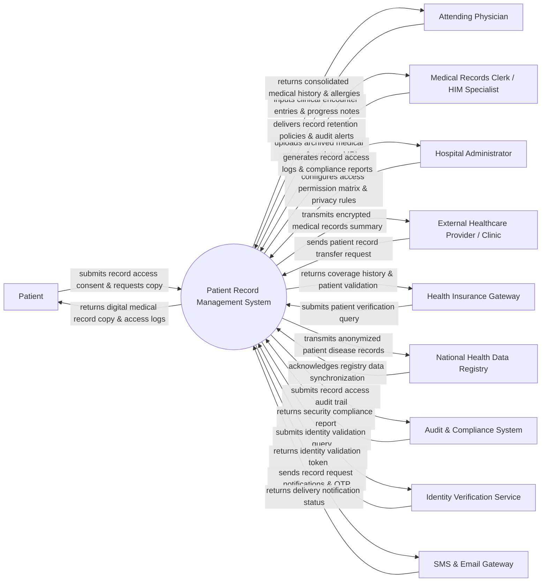

# Context Diagram — Patient Record Management System

## Mermaid Code

## Actor & Interaction Table | Bảng Actor & Tương tác

| # | Actor | Actor Type | Data Sent TO System | Data Received FROM System | Notes |
|---|-------|------------|---------------------|---------------------------|-------|
| 1 | Patient | Primary | Digital consent authorizations, record access requests, personal demographic updates, access PINs. | Personal health record timeline, medical summary PDFs, consent audit trails, access alerts. | Individual whose health data is stored, managing personal access permissions and record copies. |
| 2 | Attending Physician | Primary | Clinical encounter notes, diagnostic entries, allergy alerts, medical record update requests. | Comprehensive patient health history, past lab/radiology scans, active problem lists, allergy warnings. | Healthcare practitioner creating, reviewing, and updating patient medical records during care. |
| 3 | Medical Records Clerk / HIM Specialist | Primary | Archived medical document scans, duplicate merge requests, record retention flags, MPI corrections. | Master Patient Index (MPI) search results, unmerged record flags, record retrieval logs. | Health Information Management (HIM) staff managing document archiving, MPI accuracy, and compliance. |
| 4 | Hospital Administrator | Primary | Role-based access control (RBAC) rules, data privacy policies, encryption settings, audit schedules. | HIPAA/GDPR compliance reports, system access audit summaries, record export usage metrics. | Executive role governing security compliance, system policies, and administrative oversight. |
| 5 | External Healthcare Provider / Clinic | Supporting | Inter-facility record transfer requests, digital authorization tokens, receiving facility credentials. | Encrypted HL7/FHIR medical summary packages, continuity of care documents (CCD). | External medical institution requesting patient health history for transfer or specialized care. |
| 6 | Health Insurance Gateway | Supporting | Patient verification requests, claim audit inquiries, insurance policy policy number queries. | Validated patient identity status, treatment date verifications, official medical bill summaries. | Third-party insurance system validating patient identity and encounter history for claims processing. |
| 7 | National Health Data Registry | Regulatory | Disease surveillance reporting guidelines, mandatory data export schemas, registry ACK codes. | Anonymized patient epidemiological records, communicable disease encounter data. | Governmental health authority receiving standardized epidemiological and public health data. |
| 8 | Audit & Compliance System | Supporting | Regulatory compliance rules, automated audit triggers, security vulnerability warnings. | Real-time record access audit streams, data disclosure logs, unauthorized access attempt flags. | Automated security platform monitoring patient record privacy and legal compliance (HIPAA/GDPR). |
| 9 | Identity Verification Service | Supporting | National ID verification responses, biometric validation tokens, identity trust scores. | Citizen identification numbers, biometric verification queries, patient photo validation. | National electronic ID system validating patient legal identity during enrollment or record retrieval. |
| 10 | SMS & Email Gateway | Supporting | Message delivery status codes, OTP delivery timestamps, failure error alerts. | Multi-factor authentication OTP payloads, record access notification messages, privacy alerts. | Communication service delivering identity verification OTPs and access notifications to patients. |

## System Boundary Description | Mô tả Phạm vi Hệ thống

The **Patient Record Management System (PRMS)** is a specialized healthcare system designed to serve as the single source of truth for Master Patient Index (MPI) data, electronic health record (EHR) archiving, patient privacy consent management, and secure medical data exchange.

**Inside System Scope:**
- Master Patient Index (MPI) creation, search, demographic management, and profile deduplication/merging.
- Centralized medical record repository managing clinical encounters, diagnosis records, allergy lists, and document attachments.
- Granular patient privacy consent tracking (granting, revoking, and scoping third-party record access).
- Standardized medical record export (HL7 / FHIR / PDF) for inter-facility transfers and patient personal access.
- Role-based access control (RBAC), multi-factor authorization, and immutable audit logging for HIPAA/GDPR compliance.

**Outside System Scope:**
- Real-time physiological signal monitoring in ICUs (handled by specialized ICU patient monitoring systems).
- Billing payment gateway collection (handled by financial invoicing systems).
- Physical warehouse storage of paper medical charts.
- Direct national ID biometric database ownership (integrated via external Identity Verification APIs).
