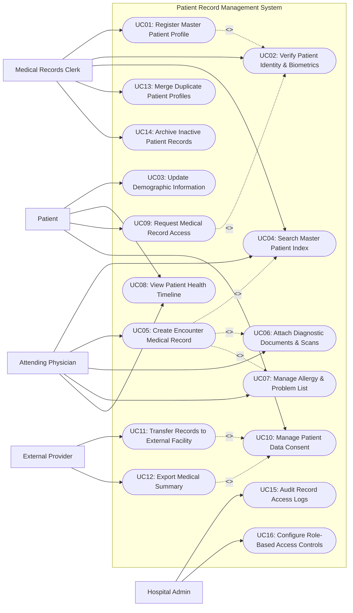

# Use Case Diagram — Patient Record Management System

## Mermaid Code

## Actor Table | Bảng Actor

| # | Actor | Actor Type | Role Description | Related Use Cases |
|---|-------|------------|------------------|-------------------|
| 1 | Patient | Primary | Subject of medical record managing personal consent, viewing history, and requesting copies. | UC03, UC08, UC09, UC10 |
| 2 | Attending Physician | Primary | Clinical provider searching patient history, creating encounter entries, and adding attachments. | UC04, UC05, UC06, UC07, UC08 |
| 3 | Medical Records Clerk | Primary | HIM specialist managing Master Patient Index (MPI), identity verification, record merging, and archiving. | UC01, UC02, UC04, UC13, UC14 |
| 4 | Hospital Admin | Primary | Security officer configuring access controls, monitoring compliance, and auditing record access logs. | UC15, UC16 |
| 5 | External Provider | Secondary | External healthcare clinic requesting official patient record transfer and summary exports. | UC11, UC12 |
| 6 | Identity Verification Service | System | Supporting API verifying national ID numbers and biometric tokens during patient registration. | UC02 |

## Use Case Table | Bảng Use Case

| # | UC ID | Use Case Name | Primary Actor | Secondary Actor | Description | Priority |
|---|-------|---------------|---------------|-----------------|-------------|----------|
| 1 | UC01 | Register Master Patient Profile | Medical Records Clerk | Identity Service | Create a new Master Patient Index (MPI) record with verified identity details. | High |
| 2 | UC02 | Verify Patient Identity & Biometrics | Medical Records Clerk | Identity Service | Validate national ID card, biometric fingerprint/photo, or insurance token against registry. | High |
| 3 | UC03 | Update Demographic Information | Patient | Medical Records Clerk | Modify non-clinical demographic data such as contact phone, address, and emergency contact. | Medium |
| 4 | UC04 | Search Master Patient Index | Attending Physician | Medical Records Clerk | Query patient records by MPI ID, national ID, full name, or birth date with fuzzy matching. | High |
| 5 | UC05 | Create Encounter Medical Record | Attending Physician | None | Log clinical encounter details including chief complaint, examination findings, and ICD-10 diagnosis. | High |
| 6 | UC06 | Attach Diagnostic Documents & Scans | Attending Physician | Medical Records Clerk | Upload scanned paper charts, lab report PDFs, and DICOM radiology images to encounter. | High |
| 7 | UC07 | Manage Allergy & Problem List | Attending Physician | None | Record and maintain active drug allergies, food sensitivities, and chronic disease conditions. | High |
| 8 | UC08 | View Patient Health Timeline | Attending Physician | Patient | Display chronological history of past encounters, hospital admissions, diagnoses, and treatments. | High |
| 9 | UC09 | Request Medical Record Access | Patient | Medical Records Clerk | Submit formal request for official digital copy or physical transcript of medical record. | Medium |
| 10 | UC10 | Manage Patient Data Consent | Patient | Hospital Admin | Grant, restrict, or revoke access permissions for external clinics or specific medical departments. | High |
| 11 | UC11 | Transfer Records to External Facility | External Provider | Medical Records Clerk | Transmit patient medical history to another hospital following verified patient consent. | High |
| 12 | UC12 | Export Medical Summary | External Provider | Patient | Generate standardized HL7 FHIR CCD or PDF medical summary report for continuity of care. | High |
| 13 | UC13 | Merge Duplicate Patient Profiles | Medical Records Clerk | Hospital Admin | Detect and consolidate duplicate MPI records belonging to the same individual. | Medium |
| 14 | UC14 | Archive Inactive Patient Records | Medical Records Clerk | None | Transition obsolete patient files to long-term encrypted cold storage according to retention laws. | Low |
| 15 | UC15 | Audit Record Access Logs | Hospital Admin | None | Review real-time access trails to inspect who accessed patient data, when, and for what purpose. | High |
| 16 | UC16 | Configure Role-Based Access Controls | Hospital Admin | None | Define granular security permissions (RBAC) governing read/write access to patient record fields. | High |

## Use Case Specification | Đặc tả Use Case

---

### UC01 — Register Master Patient Profile

| Field | Detail |
|-------|--------|
| **UC ID** | UC01 |
| **Use Case Name** | Register Master Patient Profile |
| **Actor(s)** | Primary: Medical Records Clerk   Secondary: Identity Verification Service |
| **Description** | Enrolls a new patient into the hospital Master Patient Index (MPI), capturing verified legal demographics, contact info, and generating a unique national MPI ID. |
| **Precondition** | 1. Medical Records Clerk is logged in with valid HIM registration privileges.   2. Connection to external Identity Verification Service is active. |
| **Main Flow** | 1. Clerk opens "New Patient Registration" module in PRMS.   2. Clerk inputs patient national ID card number, full legal name, date of birth, gender, and contact details.   3. System invokes identity verification service (UC02) to validate national identity details.   4. External identity service returns confirmation match token.   5. System checks existing database to ensure no duplicate MPI record exists for the national ID.   6. System generates unique 10-digit Master Patient Index (MPI) identifier.   7. Clerk reviews data summary and confirms registration.   8. System saves patient profile, logs creation audit entry, and displays registered profile. |
| **Alternative Flow** | **AF1** — Newborn / Unidentified Emergency Patient: Clerk selects "Temporary Emergency Profile", system generates temporary MPI ID with provisional identity tags to be updated later.   **AF2** — Foreign Patient without National ID: Clerk selects passport verification mode and enters passport number and country code. |
| **Exception Flow** | **EX1** — Duplicate Identity Found: System detects existing MPI profile linked to national ID; system blocks creation and displays link to existing profile (UC04/UC13).   **EX2** — Identity Service Timeout: External identity API fails to respond; system flags registration as "Provisional - Unverified" and queues background verification. |
| **Postcondition** | New patient profile is stored in database with active status, unique MPI ID, and timestamped audit log. |
| **Business Rule** | **BR1**: Every permanent patient profile must have a verified national ID or passport number before full record locking.   **BR2**: MPI IDs are immutable and cannot be modified once assigned. |

---

### UC05 — Create Encounter Medical Record

| Field | Detail |
|-------|--------|
| **UC ID** | UC05 |
| **Use Case Name** | Create Encounter Medical Record |
| **Actor(s)** | Primary: Attending Physician |
| **Description** | Logs clinical encounter details, chief complaints, physical exam findings, ICD-10 diagnostic codes, and care recommendations into patient health record archive. |
| **Precondition** | 1. Patient profile exists in Master Patient Index (MPI).   2. Attending physician is authenticated with clinical record creation permissions. |
| **Main Flow** | 1. Physician searches and selects patient profile using MPI lookup (UC04).   2. Physician clicks "New Encounter Record" and selects encounter type (Outpatient, Inpatient, Emergency).   3. System opens encounter creation template pre-loaded with active patient allergy and problem lists.   4. Physician inputs chief complaint, history of present illness (HPI), and physical examination notes.   5. Physician searches and attaches primary and secondary ICD-10 diagnostic codes.   6. Physician specifies treatment plan and optionally attaches diagnostic documents (UC06).   7. Physician clicks "Finalize & Sign Encounter Record".   8. System appends digital signature token, seals record against editing, and updates patient health timeline (UC08). |
| **Alternative Flow** | **AF1** — Draft Save: Physician saves encounter as "Draft" to complete later before end of shift; record remains editable only by creating physician.   **AF2** — Telehealth Encounter: Physician checks "Virtual Consultation" box, system automatically links video consultation metadata to encounter log. |
| **Exception Flow** | **EX1** — Patient Consent Violation: System detects patient restricted physician's department access (UC10); system prompts physician for "Emergency Break-Glass Override" password.   **EX2** — Session Interruption: Browser crashes mid-entry; system auto-saves draft every 60 seconds to local storage for recovery. |
| **Postcondition** | Signed encounter medical record is permanently archived in patient record, updating allergy/problem lists and patient timeline. |
| **Business Rule** | **BR1**: Finalized encounter records are read-only; subsequent changes must be logged as addendums with doctor timestamps.   **BR2**: Clinical notes created under "Break-Glass" emergency overrides trigger automatic alert notifications to Hospital Privacy Officer. |

---

### UC09 — Request Medical Record Access

| Field | Detail |
|-------|--------|
| **UC ID** | UC09 |
| **Use Case Name** | Request Medical Record Access |
| **Actor(s)** | Primary: Patient   Secondary: Medical Records Clerk, SMS Gateway |
| **Description** | Allows a patient to submit an official request to download their personal medical record history or obtain certified paper copies. |
| **Precondition** | 1. Patient is registered in system with verified phone/email contact.   2. Patient identity verification via 2FA/OTP is operational. |
| **Main Flow** | 1. Patient logs into patient portal or presents at HIM desk and selects "Request My Medical Record".   2. System initiates 2FA authentication sending OTP code to patient registered mobile number.   3. Patient enters OTP code to verify identity.   4. Patient selects record date range, specific encounter types, and desired output format (PDF summary, HL7 FHIR bundle, certified paper).   5. System checks patient consent policies and creates formal Record Request Ticket.   6. System processes request, compiles encrypted medical record package, and sends download link via secure portal.   7. Patient downloads encrypted package using personal decryption PIN. |
| **Alternative Flow** | **AF1** — Legal Guardian Request: Guardian submits request for minor child; system verifies legal guardianship documentation in MPI before unlocking record.   **AF2** — In-Person HIM Pick-up: Patient requests paper copy; clerk verifies original national ID card at desk before printing certified transcript. |
| **Exception Flow** | **EX1** — Invalid 2FA OTP: Patient enters wrong OTP three times; system locks record request feature for 30 minutes to prevent unauthorized access.   **EX2** — Sensitive Mental Health Record Restriction: Record contains confidential psychiatric notes flagged as restricted by doctor; system requires HIM supervisor manual authorization before release. |
| **Postcondition** | Record access request is logged in HIPAA audit trail with timestamp, requesting IP/location, and exported file hash. |
| **Business Rule** | **BR1**: Digital self-service record requests must be fulfilled within 15 minutes of 2FA verification.   **BR2**: All exported record PDFs must contain digital watermarks and anti-tamper cryptographic signatures. |

---

### UC10 — Manage Patient Data Consent

| Field | Detail |
|-------|--------|
| **UC ID** | UC10 |
| **Use Case Name** | Manage Patient Data Consent |
| **Actor(s)** | Primary: Patient   Secondary: Hospital Admin |
| **Description** | Enables patients to define granular privacy rules granting, restricting, or revoking access to their health records by external clinics, research groups, or specific departments. |
| **Precondition** | 1. Patient profile is active in Master Patient Index (MPI).   2. Patient identity is verified via multi-factor authentication. |
| **Main Flow** | 1. Patient opens "Privacy & Data Consent Preferences" in portal.   2. System displays current consent status matrix across external health networks, research programs, and internal departments.   3. Patient selects an external clinic or department and toggles permission status (Grant Access / Revoke Access).   4. Patient defines scope of access (Full History, Specific Encounters Only, Exclude Sensitive Data) and expiration date.   5. System displays confirmation summary outlining legal impact of privacy changes.   6. Patient approves change using digital signature PIN / OTP confirmation.   7. System updates access control matrix, logs consent transaction, and revokes active tokens for unauthorized entities. |
| **Alternative Flow** | **AF1** — Opt-In for Medical Research: Patient opts into anonymized clinical trial data sharing, system updates anonymization filter settings.   **AF2** — Revoke All External Permissions: Patient clicks "Emergency Privacy Lock", immediately revoking all third-party and external clinic data access. |
| **Exception Flow** | **EX1** — Mandatory Legal Subpoena Override: System prevents patient from revoking access for records under court order lock flagged by Hospital Admin.   **EX2** — OTP Timeout: Confirmation OTP expires before patient enters PIN; system cancels pending consent modification and restores prior state. |
| **Postcondition** | Patient privacy consent record is updated with timestamp, effective date range, consent scope, and digital signature token. |
| **Business Rule** | **BR1**: Patient consent revocations take immediate effect, invalidating all external API query tokens.   **BR2**: System must enforce default opt-out policy for non-essential third-party data sharing under privacy laws. |

---

### UC13 — Merge Duplicate Patient Profiles

| Field | Detail |
|-------|--------|
| **UC ID** | UC13 |
| **Use Case Name** | Merge Duplicate Patient Profiles |
| **Actor(s)** | Primary: Medical Records Clerk   Secondary: Hospital Admin |
| **Description** | Identifies, reviews, and consolidates multiple duplicate MPI profiles representing the same physical person into a single primary master patient profile. |
| **Precondition** | 1. Medical Records Clerk holds certified HIM Data Quality Analyst role.   2. Automated duplicate detection engine has flagged candidate matching profiles. |
| **Main Flow** | 1. Clerk opens "MPI Data Quality & Deduplication" dashboard.   2. System displays list of candidate duplicate pairs flagged by matching algorithms (based on national ID, full name, DOB, phone).   3. Clerk selects a candidate pair to open side-by-side demographic and encounter comparison view.   4. Clerk reviews demographic fields, historical encounters, allergies, and diagnostic records of both profiles.   5. Clerk designates the surviving "Primary MPI ID" and the retiring "Secondary MPI ID".   6. System verifies no conflicting active inpatient admissions exist for both profiles simultaneously.   7. Clerk clicks "Execute Profile Merge".   8. System re-links all encounters, medical notes, prescriptions, and lab results from secondary profile to primary profile, sets secondary profile to "Merged / Inactive", and logs audit trail. |
| **Alternative Flow** | **AF1** — Reject False Duplicate Flag: Clerk determines candidate profiles belong to different individuals (e.g., twins); clerk clicks "Mark as Not Duplicate" to prevent future automated flagging.   **AF2** — Multi-Profile Merge: Clerk selects three or more fragment profiles created during emergency visits and merges them sequentially into primary MPI ID. |
| **Exception Flow** | **EX1** — Conflicting Critical Data: System detects conflicting blood types or active contradictory allergy records between profiles; system halts merge and requires HIM Supervisor review.   **EX2** — Concurrent Edit Lock: Secondary profile is currently open by a physician in an active consultation; system defers merge execution until session terminates. |
| **Postcondition** | Secondary MPI profile is marked merged/inactive with forward pointer to Primary MPI ID, and all clinical encounter records are consolidated under primary MPI ID. |
| **Business Rule** | **BR1**: Merged secondary MPI IDs cannot be reused for new patients; all future queries redirect to the surviving Primary MPI ID.   **BR2**: Profile merges require dual-authorization by HIM Supervisor if encounter count exceeds 10 records. |
