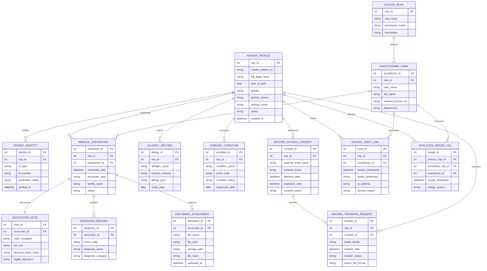

# Conceptual ERD — Patient Record Management System

## Mermaid Code

## Entity Description Table | Bảng mô tả Entity

| # | Entity Name | Vietnamese Name | Description | Key Attributes | Main Relationships |
|---|-------------|-----------------|-------------|----------------|-------------------|
| 1 | PATIENT_PROFILE | Hồ sơ Bệnh nhân Master | Core Master Patient Index (MPI) repository storing demographic and global identity data. | mpi_id (PK), master_patient_no, full_legal_name, date_of_birth, primary_phone | Has many PATIENT_IDENTITY, MEDICAL_ENCOUNTER, ALLERGY_RECORD, CONSENT |
| 2 | PATIENT_IDENTITY | Giấy tờ Định danh Bệnh nhân | Stores national ID, passport, or biometric verification credentials linked to MPI profile. | identity_id (PK), mpi_id (FK), id_type, id_number, verification_token | Belongs to PATIENT_PROFILE |
| 3 | MEDICAL_ENCOUNTER | Lượt khám / Đợt điều trị | Represents a specific medical visit, outpatient consultation, or inpatient hospitalization episode. | encounter_id (PK), mpi_id (FK), practitioner_id (FK), encounter_date, encounter_type | Belongs to PATIENT_PROFILE, PRACTITIONER_USER; Has one ENCOUNTER_NOTE; Has many DIAGNOSIS |
| 4 | ENCOUNTER_NOTE | Ghi chú Lâm sàng | Detailed textual evaluation written by attending physician during an encounter. | note_id (PK), encounter_id (FK), chief_complaint, hpi_text, digital_signature | Belongs to MEDICAL_ENCOUNTER |
| 5 | DIAGNOSIS_RECORD | Ghi nhận Chẩn đoán | Specific medical diagnosis entry mapped to ICD-10 standardized medical coding. | diagnosis_id (PK), encounter_id (FK), icd10_code, diagnosis_name | Belongs to MEDICAL_ENCOUNTER |
| 6 | ALLERGY_RECORD | Hồ sơ Dị ứng | Tracks patient allergies, allergen triggers, and reaction severity to prevent drug errors. | allergy_id (PK), mpi_id (FK), allergen_name, reaction_severity, allergy_type | Belongs to PATIENT_PROFILE |
| 7 | CHRONIC_CONDITION | Bệnh lý Mạn tính | Maintains active problem list of chronic medical conditions and historical diagnoses. | condition_id (PK), mpi_id (FK), condition_name, icd10_code, condition_status | Belongs to PATIENT_PROFILE |
| 8 | DOCUMENT_ATTACHMENT | Tài liệu & Đính kèm | Stores metadata and secure paths for scanned medical records, lab PDFs, and DICOM images. | document_id (PK), encounter_id (FK), file_name, file_type, storage_path, file_hash | Belongs to MEDICAL_ENCOUNTER |
| 9 | RECORD_ACCESS_CONSENT | Quyền Đồng ý Chia sẻ Dữ liệu | Defines privacy settings and third-party consent permissions granted by patient. | consent_id (PK), mpi_id (FK), external_entity_name, consent_scope, consent_status | Belongs to PATIENT_PROFILE; Has many RECORD_TRANSFER_REQUEST |
| 10 | RECORD_TRANSFER_REQUEST | Yêu cầu Chuyển Giao Hồ sơ | Log of official inter-facility medical record transfer and summary export events. | transfer_id (PK), mpi_id (FK), consent_id (FK), target_facility, transfer_status | Belongs to PATIENT_PROFILE, RECORD_ACCESS_CONSENT |
| 11 | ACCESS_AUDIT_LOG | Nhật ký Truy cập Bảo mật | Immutable HIPAA/GDPR security audit trail recording every access, view, or export action. | audit_id (PK), mpi_id (FK), practitioner_id (FK), access_timestamp, action_performed | Belongs to PATIENT_PROFILE, PRACTITIONER_USER |
| 12 | DUPLICATE_MERGE_LOG | Nhật ký Gộp Hồ sơ | Records historical deduplication events consolidating secondary MPI records into primary MPI. | merge_id (PK), primary_mpi_id (FK), secondary_mpi_id (FK), merge_timestamp | Belongs to PATIENT_PROFILE, PRACTITIONER_USER |
| 13 | PRACTITIONER_USER | Người dùng Hệ thống Y tế | Master account for physicians, HIM clerks, and administrators interacting with system. | practitioner_id (PK), role_id (FK), user_name, full_name, medical_license_no | Belongs to ACCESS_ROLE; Has many ENCOUNTER, AUDIT_LOG |
| 14 | ACCESS_ROLE | Vai trò & Phân quyền RBAC | Defines security roles (e.g., Physician, HIM Clerk, Auditor) and granular access permission matrices. | role_id (PK), role_name, permission_matrix, description | Has many PRACTITIONER_USER |

## Relationship Description | Mô tả Quan hệ

| # | From Entity | Cardinality | To Entity | Relationship Label | Business Explanation |
|---|-------------|-------------|-----------|-------------------|----------------------|
| 1 | PATIENT_PROFILE | one-to-many | PATIENT_IDENTITY | verifies | Một hồ sơ bệnh nhân có thể xác thực qua nhiều loại giấy tờ định danh (CCCD, Hộ chiếu). |
| 2 | PATIENT_PROFILE | one-to-many | MEDICAL_ENCOUNTER | undergoes | Một bệnh nhân trải qua nhiều đợt khám/điều trị tại các thời điểm khác nhau. |
| 3 | PRACTITIONER_USER | one-to-many | MEDICAL_ENCOUNTER | conducts | Một nhân viên y tế (bác sĩ) thực hiện và chủ trì nhiều lượt khám bệnh. |
| 4 | MEDICAL_ENCOUNTER | one-to-one | ENCOUNTER_NOTE | documents | Mỗi lượt khám có đúng một phiếu ghi chú diễn biến lâm sàng tổng hợp. |
| 5 | MEDICAL_ENCOUNTER | one-to-many | DIAGNOSIS_RECORD | assigns | Một lượt khám có thể ghi nhận một hoặc nhiều mã chẩn đoán ICD-10. |
| 6 | PATIENT_PROFILE | one-to-many | ALLERGY_RECORD | suffers | Một bệnh nhân có thể có danh sách nhiều tiền sử dị ứng thuốc/thực phẩm. |
| 7 | PATIENT_PROFILE | one-to-many | CHRONIC_CONDITION | maintains | Một bệnh nhân duy trì danh sách các bệnh lý mạn tính được theo dõi dài hạn. |
| 8 | MEDICAL_ENCOUNTER | one-to-many | DOCUMENT_ATTACHMENT | attaches | Một lượt khám có thể lưu trữ nhiều tệp đính kèm (ảnh chụp X-quang, PDF xét nghiệm). |
| 9 | PATIENT_PROFILE | one-to-many | RECORD_ACCESS_CONSENT | authorizes | Một bệnh nhân thiết lập nhiều chính sách đồng ý/từ chối chia sẻ dữ liệu y tế. |
| 10 | RECORD_ACCESS_CONSENT | one-to-many | RECORD_TRANSFER_REQUEST | permits | Một chính sách đồng ý cho phép thực hiện nhiều lượt chuyển giao hồ sơ tương ứng. |
| 11 | PATIENT_PROFILE | one-to-many | RECORD_TRANSFER_REQUEST | transfers | Một bệnh nhân phát sinh các đợt chuyển giao hồ sơ y tế sang cơ sở khác. |
| 12 | PATIENT_PROFILE | one-to-many | ACCESS_AUDIT_LOG | tracks | Mọi hành động xem/truy cập hồ sơ của bệnh nhân đều ghi lại trong nhật ký bảo mật. |
| 13 | PRACTITIONER_USER | one-to-many | ACCESS_AUDIT_LOG | generates | Mỗi người dùng hệ thống phát sinh các nhật ký thao tác khi làm việc với hồ sơ. |
| 14 | PATIENT_PROFILE | one-to-many | DUPLICATE_MERGE_LOG | absorbs | Một hồ sơ master có thể gộp và hấp thụ thông tin từ nhiều hồ sơ trùng lặp phụ. |
| 15 | ACCESS_ROLE | one-to-many | PRACTITIONER_USER | defines | Mỗi vai trò bảo mật (RBAC) quy định quyền hạn cho nhiều người dùng y tế. |
