# Swimlane Diagram — Patient Record Management System

## Mermaid Code

```mermaid
flowchart LR
    Start(["Start Record Access & Transfer Request"])

    subgraph Lane1["Patient"]
        P1["Log into Patient Portal & Select Request Copy"]
        P2["Enter 2FA Authentication OTP"]
        P3["Select Record Date Range & Export Format"]
        P4["Review Privacy Consent Authorization"]
        P5["Download Encrypted Record Package"]
    end

    subgraph Lane2["Medical Records Clerk"]
        R1["Review Pending Transfer Request Ticket"]
        R2{"Patient Consent Verified?"}
        R3["Verify Patient National ID & Legal Authority"]
        R4["Approve Transfer Request & Issue Token"]
    end

    subgraph Lane3["Attending Physician"]
        D1["Review Clinical Record Disclosure Scope"]
        D2{"Contains Restricted Notes?"}
        D3["Apply Confidentiality Mask to Sensitive Notes"]
        D4["Sign Record Export Authorization"]
    end

    subgraph Lane4["Patient Record Management System"]
        S1["Send 2FA OTP Code via SMS Gateway"]
        S2["Query Master Patient Index & Aggregate History"]
        S3["Compile HL7 FHIR Bundle & PDF Summary"]
        S4["Apply Digital Watermark & Cryptographic Hash"]
        S5["Log Access Audit Trail & Send Download Link"]
    end

    Finish(["End Record Package Fulfillment"])

    Start --> P1 --> S1 --> P2 --> P3 --> P4 --> R1 --> R2
    R2 -->|"No"| R3 --> R4
    R2 -->|"Yes"| R4
    R4 --> D1 --> D2
    D2 -->|"Yes"| D3 --> D4
    D2 -->|"No"| D4
    D4 --> S2 --> S3 --> S4 --> S5 --> P5 --> Finish
```

## Flow Description | Mô tả luồng

| Lane | Actor / System | Role in Flow |
|------|----------------|--------------|
| 1 | Patient | Initiates medical record transfer/copy request, authenticates via two-factor OTP, selects export parameters, approves privacy authorization, and retrieves the final encrypted package. |
| 2 | Medical Records Clerk | Reviews record transfer tickets, verifies patient consent validity, validates legal documentation or guardianship, and approves release authorizations. |
| 3 | Attending Physician | Inspects clinical record disclosure scope, identifies confidential psychiatric/sensitive notes, applies redactions/privacy masks if required, and signs the electronic disclosure. |
| 4 | Patient Record Management System | Generates security OTPs, aggregates historical encounter files from MPI, compiles standardized FHIR bundles and PDF reports, applies cryptographic hashes, updates audit trails, and delivers secure download links. |
