# Action Tree — Patient Record Management System

## Mermaid Code

```mermaid
graph TD
    Root["Patient Record Management System"]

    Root --> M1["1. Master Patient Index"]
    Root --> M2["2. Encounter Recording"]
    Root --> M3["3. Document & Media"]
    Root --> M4["4. Allergy & Problem List"]
    Root --> M5["5. Consent & Privacy"]
    Root --> M6["6. Transfer & Export"]
    Root --> M7["7. Deduplication & Archiving"]
    Root --> M8["8. Security & Compliance"]

    M1 --> A11["Register New Patient Profile"]
    M1 --> A12["Verify National ID & Biometrics"]
    M1 --> A13["Update Demographic Details"]
    M1 --> A14["Search MPI Patient Directory"]

    M2 --> A21["Create Clinical Encounter"]
    M2 --> A22["Record HPI & Exam Notes"]
    M2 --> A23["Assign ICD-10 Diagnoses"]
    M2 --> A24["Sign Encounter Entry"]

    M3 --> A31["Upload Diagnostic Scans"]
    M3 --> A32["Attach Lab PDF Reports"]
    M3 --> A33["View DICOM Image Viewer"]
    M3 --> A34["Manage File Hash Integrity"]

    M4 --> A41["Record Drug Allergies"]
    M4 --> A42["Update Active Problem List"]
    M4 --> A43["Flag High-Risk Sensitivities"]
    M4 --> A44["Reconcile Medication History"]

    M5 --> A51["Define Data Sharing Scope"]
    M5 --> A52["Grant Third-Party Access"]
    M5 --> A53["Revoke Clinic Permission"]
    M5 --> A54["Configure Emergency Break-Glass"]

    M6 --> A61["Request Inter-Facility Transfer"]
    M6 --> A62["Generate FHIR Medical Summary"]
    M6 --> A63["Export Encrypted PDF Record"]
    M6 --> A64["Validate Digital Signature Token"]

    M7 --> A71["Scan Duplicate MPI Candidates"]
    M7 --> A72["Compare Side-by-Side Profiles"]
    M7 --> A73["Execute Profile Merge"]
    M7 --> A74["Archive Inactive Records"]

    M8 --> A81["Configure RBAC Permission Matrix"]
    M8 --> A82["Monitor Real-time Audit Stream"]
    M8 --> A83["Generate HIPAA Compliance Report"]
    M8 --> A84["Detect Unauthorized Access Attempts"]
```

## Module Description | Mô tả Module

| # | Module | Description | Actions |
|---|--------|-------------|---------|
| 1 | Master Patient Index | Manages centralized master patient profiles, identity verification, demographic updates, and fuzzy record searches. | Register New Patient Profile, Verify National ID & Biometrics, Update Demographic Details, Search MPI Patient Directory |
| 2 | Encounter Recording | Captures clinical encounters, physician progress notes, chief complaints, ICD-10 diagnostic codes, and digital signing. | Create Clinical Encounter, Record HPI & Exam Notes, Assign ICD-10 Diagnoses, Sign Encounter Entry |
| 3 | Document & Media | Handles digital storage, attachment, cryptographic hashing, and viewer integration for scanned charts, PDFs, and DICOM images. | Upload Diagnostic Scans, Attach Lab PDF Reports, View DICOM Image Viewer, Manage File Hash Integrity |
| 4 | Allergy & Problem List | Maintains long-term patient safety lists detailing drug allergies, adverse sensitivities, and chronic problem lists. | Record Drug Allergies, Update Active Problem List, Flag High-Risk Sensitivities, Reconcile Medication History |
| 5 | Consent & Privacy | Manages granular patient privacy policies, opt-in/opt-out preferences, third-party consent, and emergency access overrides. | Define Data Sharing Scope, Grant Third-Party Access, Revoke Clinic Permission, Configure Emergency Break-Glass |
| 6 | Transfer & Export | Facilitates inter-facility health data exchange by exporting standardized HL7 FHIR bundles and encrypted PDF summaries. | Request Inter-Facility Transfer, Generate FHIR Medical Summary, Export Encrypted PDF Record, Validate Digital Signature Token |
| 7 | Deduplication & Archiving | Identifies matching candidate records, provides side-by-side profile merging, and archives inactive files for long-term storage. | Scan Duplicate MPI Candidates, Compare Side-by-Side Profiles, Execute Profile Merge, Archive Inactive Records |
| 8 | Security & Compliance | Controls role-based access permissions (RBAC), enforces immutable audit logging, and monitors HIPAA/GDPR regulatory compliance. | Configure RBAC Permission Matrix, Monitor Real-time Audit Stream, Generate HIPAA Compliance Report, Detect Unauthorized Access Attempts |
