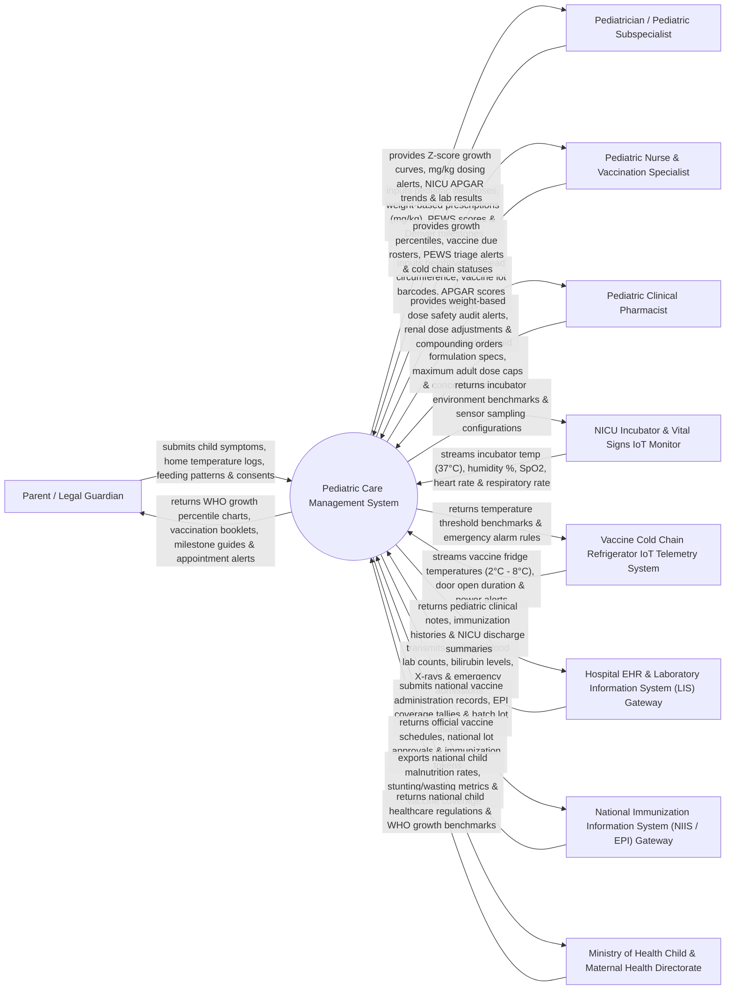

# Context Diagram — Pediatric Care Management System

## Mermaid Code

## Actor & Interaction Table | Bảng Actor & Tương tác

| # | Actor | Actor Type | Data Sent TO System | Data Received FROM System | Notes |
|---|-------|------------|---------------------|---------------------------|-------|
| 1 | Parent / Legal Guardian | Primary | Child symptoms, home fever logs, feeding schedules, signed vaccination consent forms. | WHO growth percentile charts, digital immunization booklet, developmental milestone guides, appointment alerts. | Parent or legal guardian managing child healthcare and tracking development. |
| 2 | Pediatrician / Pediatric Subspecialist | Primary | Clinical diagnoses, weight-based drug orders (mg/kg), Denver II milestones, PEWS triage assessments. | WHO Z-score growth curves, mg/kg dosing safety alerts, NICU APGAR trends, pediatric lab results. | Specialist physician providing medical care for infants, children, and adolescents. |
| 3 | Pediatric Nurse & Vaccination Specialist | Primary | Physical growth metrics (Height, Weight, Head Circumference), vaccine lot barcodes, APGAR scores. | Growth percentile calculations, vaccine due rosters, PEWS triage emergency alerts, cold chain statuses. | Nurse measuring child growth, administering immunizations, and assisting pediatric procedures. |
| 4 | Pediatric Clinical Pharmacist | Primary | Pediatric liquid compounding specs, maximum adult dose capping rules, concentration ratios (mg/mL). | Weight-based dose safety audit alerts, renal dose adjustments, liquid drug compounding orders. | Pharmacist verifying pediatric medication safety and liquid formulation concentrations. |
| 5 | NICU Incubator & Vital IoT Monitor | Supporting System | Real-time incubator environment temp (37°C), humidity %, neonate SpO2, heart rate, respiratory rate. | Incubator environment target benchmarks, alarm threshold rules, sensor sampling rates. | IoT sensors monitoring premature neonates inside Neonatal Intensive Care Unit (NICU) incubators. |
| 6 | Vaccine Cold Chain Telemetry System | Supporting System | Real-time vaccine refrigerator temperatures (2°C - 8°C), door open duration, power supply pings. | Temperature safety thresholds, low/high temp emergency alarm rules, sensor sampling intervals. | Industrial IoT sensors monitoring vaccine storage refrigerators to maintain cold chain integrity. |
| 7 | Hospital EHR & LIS Gateway | Supporting System | Pediatric blood counts (CBC), neonatal bilirubin levels, chest X-rays, emergency room intake logs. | Pediatric clinical notes, digital immunization histories, NICU discharge summaries, MRN tokens. | Enterprise hospital information system linking pediatric wards, labs, and imaging suites. |
| 8 | National Immunization Gateway (NIIS / EPI) | Supporting System | National vaccine administration records, EPI coverage tallies, vaccine lot usage batches. | Official national vaccine schedules, vaccine batch approvals, national immunization registry tokens. | National government system tracking the Expanded Program on Immunization (EPI / TCMR). |
| 9 | Ministry of Health Child Health Directorate | Regulatory | National child healthcare regulations, WHO child growth benchmarks, malnutrition intervention guidelines. | National child malnutrition statistics, stunting/wasting prevalence, vaccine coverage percentages. | Government health authority directing pediatric care policies and child health programs. |

## System Boundary Description | Mô tả Phạm vi Hệ thống

The **Pediatric Care Management System (PCMS)** is an enterprise child health, pediatric clinical, growth monitoring, and immunization management platform operating across children's hospitals, pediatric clinics, neonatal intensive care units (NICU), and vaccination centers. It manages parent/guardian relationship mapping, WHO 2006 / CDC growth percentile tracking (Weight-for-age, Height-for-age, Head circumference, BMI Z-scores), weight-based drug dosing (mg/kg) with adult dose caps, national vaccine cold chain tracking (2°C - 8°C IoT monitoring), Denver II developmental milestone screening, NICU incubator monitoring, and Pediatric Early Warning Score (PEWS) emergency triage.

**Inside System Scope:**
- Parent/guardian legal relationship mapping and family health record linkage.
- Pediatric growth percentile calculation (WHO 2006 0-5 yrs & CDC 2-20 yrs: Height, Weight, Head Circumference, BMI Z-scores, Stunting/Wasting alerts).
- Weight-based pediatric drug dosing calculator (mg/kg or mg/m²) with maximum adult dose capping and age-based contraindication alerts.
- Immunization schedule management (EPI / TCMR), 2D vaccine lot barcode scanning, cold chain IoT monitoring (2°C - 8°C), and SMS due reminders.
- Denver II developmental milestone screening (Gross Motor, Fine Motor, Language, Personal-Social milestone age grids).
- Neonatal Intensive Care Unit (NICU) workflow: APGAR scores (1 & 5 mins), gestational age tracking, kangaroo mother care, and incubator telemetry.
- Pediatric Early Warning Score (PEWS) 0-9 emergency triage calculation and automated rapid response team alerts.
- Infant nutrition tracking, milk protein allergy management, and school health physical clearance certificates.

**Outside System Scope:**
- Physical manufacturing of vaccine vials or cold chain refrigeration hardware (handled by pharma manufacturers).
- General adult medical care or adult surgical procedures (handled by General HIS).
- Commercial corporate financial general ledger accounting (handled by enterprise ERP).
