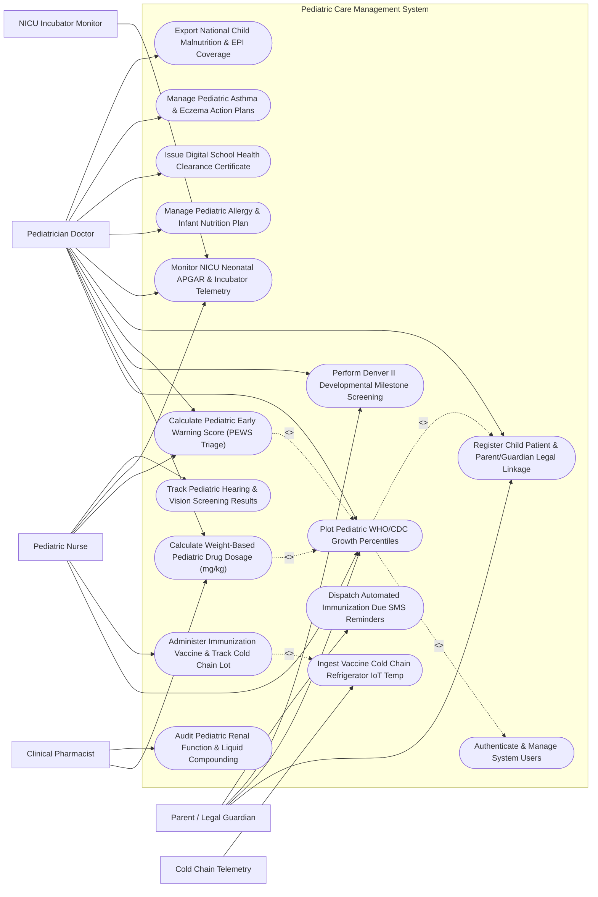

# Use Case Diagram — Pediatric Care Management System

## Mermaid Code

## Actor Table | Bảng Actor

| # | Actor | Actor Type | Role Description | Related Use Cases |
|---|-------|------------|------------------|-------------------|
| 1 | Parent / Legal Guardian | Primary | Parent or guardian registering child profile, viewing WHO growth charts, receiving milestone guides and SMS reminders. | UC01, UC04, UC06, UC11 |
| 2 | Pediatrician Doctor | Primary | Specialist physician diagnosing pediatric illnesses, prescribing mg/kg drug doses, evaluating Denver milestones, and conducting PEWS triage. | UC01, UC02, UC04, UC05, UC06, UC07, UC09, UC10, UC13, UC15 |
| 3 | Pediatric Nurse | Primary | Nurse measuring child physical growth, administering vaccines, scoring PEWS triage, and monitoring NICU neonates. | UC01, UC03, UC05, UC07, UC14 |
| 4 | Clinical Pharmacist | Primary | Pediatric pharmacist verifying weight-based dosing safety, adult dose caps, and liquid compounding concentrations. | UC02, UC12 |
| 5 | NICU Incubator Monitor | Secondary / System | IoT monitor streaming premature neonate incubator environment telemetry and vital sign pings. | UC07 |
| 6 | Cold Chain Telemetry | Secondary / System | Industrial IoT sensors monitoring vaccine storage refrigerator temperatures (2°C - 8°C). | UC08 |

## Use Case Table | Bảng Use Case

| # | UC ID | Use Case Name | Primary Actor | Secondary Actor | Description | Priority |
|---|-------|---------------|---------------|-----------------|-------------|----------|
| 1 | UC01 | Plot Pediatric WHO/CDC Growth Percentiles | Pediatrician Doctor | Pediatric Nurse | Record child physical measurements (Height, Weight, Head Circumference), calculating WHO 2006 / CDC percentiles and Z-scores. | High |
| 2 | UC02 | Calculate Weight-Based Pediatric Drug Dosage (mg/kg) | Pediatrician Doctor | Clinical Pharmacist | Calculate precise pediatric drug dosages based on body weight (mg/kg) or BSA (mg/m²), enforcing maximum adult dose capping rules. | High |
| 3 | UC03 | Administer Immunization Vaccine & Track Cold Chain Lot | Pediatric Nurse | Cold Chain Telemetry | Administer vaccines according to national schedule (EPI), scan 2D lot barcodes, verify 2°C-8°C cold chain clearance, and update registry. | High |
| 4 | UC04 | Perform Denver II Developmental Milestone Screening | Pediatrician Doctor | Parent / Legal Guardian | Screen child developmental progress across 4 domains (Gross Motor, Fine Motor, Language, Personal-Social) against age benchmarks. | High |
| 5 | UC05 | Calculate Pediatric Early Warning Score (PEWS Triage) | Pediatric Nurse | Pediatrician Doctor | Compute PEWS score (0-9) based on behavior, cardiovascular refill, and respiratory effort, triggering automated rapid response alerts. | High |
| 6 | UC06 | Register Child Patient & Parent/Guardian Legal Linkage | Parent / Legal Guardian | Pediatrician Doctor | Register child profile, verify birth certificate number, link mother/father national IDs, and record legal guardianship rights. | High |
| 7 | UC07 | Monitor NICU Neonatal APGAR & Incubator Telemetry | Pediatric Nurse | NICU Incubator Monitor | Record APGAR scores at 1 and 5 minutes, track gestational age (weeks), and ingest real-time incubator temperature and SpO2. | High |
| 8 | UC08 | Ingest Vaccine Cold Chain Refrigerator IoT Temp | Cold Chain Telemetry | Pediatric Nurse | Continuously log vaccine storage refrigerator temperatures (2°C - 8°C), alerting nurses if temp strays outside safety limits. | High |
| 9 | UC09 | Manage Pediatric Allergy & Infant Nutrition Plan | Pediatrician Doctor | None | Log food allergies (Cow Milk Protein, Peanut), calculate infant formula caloric requirements (kcal/kg/day), and prescribe nutrition plans. | Medium |
| 10 | UC10 | Issue Digital School Health Clearance Certificate | Pediatrician Doctor | None | Conduct comprehensive school physical examination, verifying vision, hearing, physical fitness, and issuing digital health clearance. | Medium |
| 11 | UC11 | Dispatch Automated Immunization Due SMS Reminders | Parent / Legal Guardian | None | Send automated SMS and app push reminders to parents 7 days prior to upcoming vaccination due dates based on national EPI schedule. | High |
| 12 | UC12 | Audit Pediatric Renal Function & Liquid Compounding | Clinical Pharmacist | None | Adjust drug dosing for pediatric renal impairment (Schwartz formula CrCl) and generate liquid oral suspension compounding recipes. | Medium |
| 13 | UC13 | Manage Pediatric Asthma & Eczema Action Plans | Pediatrician Doctor | None | Formulate pediatric asthma action plans (Green/Yellow/Red zones with inhaler doses) and atopic eczema skin barrier care plans. | Medium |
| 14 | UC14 | Track Pediatric Hearing & Vision Screening Results | Pediatric Nurse | None | Document Otoacoustic Emissions (OAE) newborn hearing screening and LEA symbol vision test results for toddlers. | Medium |
| 15 | UC15 | Export National Child Malnutrition & EPI Coverage | Pediatrician Doctor | None | Render child health epidemiology analytics: stunting %, wasting %, underweight prevalence, and national EPI vaccination coverage. | Medium |
| 16 | UC16 | Authenticate & Manage System Users | All Users | None | Enforce secure multi-factor authentication, role-based access control (Pediatrician, Nurse, Pharmacist), and child data protection rules. | High |

## Use Case Specification | Đặc tả Use Case

---

### UC01 — Plot Pediatric WHO/CDC Growth Percentiles

| Field | Detail |
|-------|--------|
| **UC ID** | UC01 |
| **Use Case Name** | Plot Pediatric WHO/CDC Growth Percentiles |
| **Actor(s)** | Primary: Pediatrician Doctor   Secondary: Pediatric Nurse, Parent / Legal Guardian |
| **Description** | Records a child's physical growth measurements (Height/Length, Body Weight, Head Circumference), calculates exact age in months, computes WHO 2006 (0-5 years) or CDC (2-20 years) growth percentiles and Z-scores, plots interactive growth curves, and flags nutritional anomalies (Stunting, Wasting, Failure to Thrive, Obesity). |
| **Precondition** | 1. Child patient profile (UC06) is registered.   2. Calibrated digital pediatric scale and stadiometer are available. |
| **Main Flow** | 1. The Pediatric Nurse opens "Pediatric Growth & Physical Examination" for Child `CHD-2026-08192` (Name: Tran Van B, DOB: Oct 14, 2024 -> **Exact Age: 24 Months**).   2. The Nurse inputs **Physical Measurements**:   &nbsp;&nbsp;&nbsp;&nbsp;- Body Weight: **12.2 kg**   &nbsp;&nbsp;&nbsp;&nbsp;- Standing Height: **86.5 cm**   &nbsp;&nbsp;&nbsp;&nbsp;- Head Circumference: **48.2 cm**.   3. The System evaluates measurements against **WHO 2006 Child Growth Standards (Boys 24 Months)**:   &nbsp;&nbsp;&nbsp;&nbsp;- **Weight-for-Age**: $12.2\text{ kg} \to \mathbf{52\text{nd Percentile}}\ (\text{Z-score: } +0.06)$ -> **Normal**   &nbsp;&nbsp;&nbsp;&nbsp;- **Height-for-Age**: $86.5\text{ cm} \to \mathbf{50\text{th Percentile}}\ (\text{Z-score: } -0.01)$ -> **Normal**   &nbsp;&nbsp;&nbsp;&nbsp;- **Weight-for-Height (Wasting Index)**: $12.2\text{ kg / } 86.5\text{ cm} \to \mathbf{58\text{th Percentile}}$ -> **Normal**   &nbsp;&nbsp;&nbsp;&nbsp;- **Head Circumference**: $48.2\text{ cm} \to \mathbf{55\text{th Percentile}}$ -> **Normal**.   4. The System renders the interactive 4-line **WHO Growth Curve Chart** overlaying current measurements against previous 6-month historical data.   5. The Pediatrician reviews the trajectory, confirms normal growth velocity, and exports the growth chart to the Parent Mobile Portal. |
| **Alternative Flow** | **AF1** — Acute Malnutrition / Wasting Alert (Weight-for-Height Z-score < -2SD): Child weight drops to 9.1 kg (Wasting Z-score: -2.4SD); System flags "MODERATE ACUTE MALNUTRITION (MAM)", triggering automated nutrition consultation (UC09).   **AF2** — Microcephaly Head Circumference Alert: Head circumference Z-score is -3.1SD (< 3rd percentile); System flags "SEVERE MICROCEPHALY ALERT — Schedule Pediatric Neurology Ultrasound". |
| **Exception Flow** | **EX1** — Transposed Height/Weight Measurement Entry Error: Nurse accidentally inputs Weight = 86.5 kg and Height = 12.2 cm; System blocks entry with error "Physical Measurement Out of Anatomical Range".   **EX2** — Premature Infant Gestational Age Correction: For an infant born at 32 weeks gestation, System auto-applies Corrected Gestational Age (CGA) until 24 months of age. |
| **Postcondition** | Growth measurements (Weight 12.2kg, Height 86.5cm) are saved, WHO percentiles (52nd wt, 50th ht) and Z-scores are computed, and growth curves are plotted. |
| **Business Rule** | **BR1**: Pediatric growth percentile calculations for children aged 0 to 5 years MUST strictly utilize WHO 2006 Child Growth Standards standards.   **BR2**: Premature infants (gestational age < 37 weeks) MUST use Corrected Gestational Age (CGA) for growth Z-score calculations until 24 months of age. |

---

### UC02 — Calculate Weight-Based Pediatric Drug Dosage (mg/kg)

| Field | Detail |
|-------|--------|
| **UC ID** | UC02 |
| **Use Case Name** | Calculate Weight-Based Pediatric Drug Dosage (mg/kg) |
| **Actor(s)** | Primary: Pediatrician Doctor   Secondary: Clinical Pharmacist |
| **Description** | Calculates accurate individual pediatric drug dosages based on the child's actual body weight (mg/kg/dose or mg/kg/day) or Body Surface Area (mg/m²), verifying concentration ratios for oral liquid suspensions (mg/mL), enforcing maximum adult dose capping rules, and alerting for age-based contraindications. |
| **Precondition** | 1. Child's current body weight (UC01) is updated in PCMS within the last 7 days.   2. Pediatric drug formulary database with mg/kg dosing rules is active. |
| **Main Flow** | 1. The Pediatrician opens "Pediatric Prescription & Dosing Calculator" for Child `CHD-2026-08192` (Weight = 12.2 kg, Age = 24 Months, Diagnosis: Acute Otitis Media).   2. The Pediatrician selects Medication: **Amoxicillin-Clavulanate (Augmentin 7:1) Oral Suspension**.   3. The System retrieves Dosing Guidelines for High-Dose Otitis Media:   &nbsp;&nbsp;&nbsp;&nbsp;- Dosing Standard: $90\text{ mg/kg/day}$ of Amoxicillin divided in 2 daily doses   &nbsp;&nbsp;&nbsp;&nbsp;- Formulary Strength: *Augmentin 228mg / 5mL Oral Suspension* (200mg Amox / 28.5mg Clav per 5mL).   4. The System calculates **Pediatric Dose**:   &nbsp;&nbsp;&nbsp;&nbsp;- Daily Amoxicillin Dose: $90\text{ mg/kg/day} \times 12.2\text{ kg} = \mathbf{1098.0\text{ mg/day}}$   &nbsp;&nbsp;&nbsp;&nbsp;- **Per-Dose Amount (BD - 2x Daily)**: $1098.0 / 2 = \mathbf{549.0\text{ mg per dose}}$   &nbsp;&nbsp;&nbsp;&nbsp;- **Liquid Volume per Dose**: $\frac{549.0\text{ mg}}{200\text{ mg}} \times 5\text{ mL} = \mathbf{13.7\text{ mL PO Twice Daily for 7 Days}}$.   5. The System verifies **Safety Limits**:   &nbsp;&nbsp;&nbsp;&nbsp;- Maximum Adult Dose Cap: 1,000 mg/dose -> Calculated dose 549.0 mg < Max Cap -> **Passed**   &nbsp;&nbsp;&nbsp;&nbsp;- Age Contraindications: Safe for 24-month-old -> **Passed**.   6. The Clinical Pharmacist reviews the calculated dosing recipe and approves dispensation. |
| **Alternative Flow** | **AF1** — Pediatric Paracetamol (Acetaminophen) Antipyretic Dosing: For fever (38.8°C), System calculates Paracetamol $15\text{ mg/kg/dose} \times 12.2\text{ kg} = \mathbf{183.0\text{ mg per dose}}$ ($7.6\text{ mL}$ of $120\text{mg}/5\text{mL}$ syrup) every 4-6 hours PRN.   **AF2** — Pediatric Chemotherapy BSA (mg/m²) Dosing: For pediatric oncology, System calculates dose based on BSA ($0.54\text{ m}^2$) with double-pharmacist verification. |
| **Exception Flow** | **EX1** — Over-Dose Capping Alert (> Max Adult Dose): Pediatrician attempts to prescribe Amoxicillin 150 mg/kg for a 45 kg teenager (calculating 6,750 mg/day); System caps dose at Max Adult Limit (3,000 mg/day) and flags "ADULT DOSE CAP EXCEEDED".   **EX2** — Age-Based Contraindication (Aspirin Reye Syndrome / Tetracycline): Pediatrician orders Aspirin for a 4-year-old with viral fever; System blocks order with "CRITICAL CONTRAINDICATION — Risk of Reye Syndrome in Children". |
| **Postcondition** | Weight-based dose (Amoxicillin 549mg = 13.7mL BD x 7 days) is calculated, safety caps pass, pharmacist verifies, and e-prescription is sent to pharmacy. |
| **Business Rule** | **BR1**: All pediatric drug orders MUST be calculated using current body weight (kg) or BSA (m²) and checked against maximum adult single and daily dose limits.   **BR2**: Pediatric liquid suspension prescriptions MUST explicitly state both the milligram dose (mg) and the corresponding liquid volume (mL) based on the specified product strength. |

---

### UC03 — Administer Immunization Vaccine & Track Cold Chain Lot

| Field | Detail |
|-------|--------|
| **UC ID** | UC03 |
| **Use Case Name** | Administer Immunization Vaccine & Track Cold Chain Lot |
| **Actor(s)** | Primary: Pediatric Nurse   Secondary: Cold Chain Telemetry |
| **Description** | Administers pediatric vaccines according to the National Expanded Program on Immunization (EPI / TCMR) schedule, scans 2D matrix barcodes on vaccine vials (GTIN, Lot Number, Expiration Date), verifies cold chain storage safety clearance (2°C - 8°C), records administration anatomical site, and updates the National Immunization Registry. |
| **Precondition** | 1. Child patient is due for scheduled vaccinations based on age.   2. Vaccine refrigerator cold chain temperature (UC08) is verified safe (2°C - 8°C). |
| **Main Flow** | 1. The Pediatric Nurse opens "Immunization Administration" for Child `CHD-2026-08192` (Age 24 Months).   2. The System queries **National EPI Vaccine Schedule**:   &nbsp;&nbsp;&nbsp;&nbsp;- **Due Vaccine**: **Japanese Encephalitis (JE) Dose 2** + **Measles-Mumps-Rubella (MMR) Dose 2**.   3. The Nurse retrieves vaccine vials from Refrigerator #01 (Current Temp = 4.2°C -> **Cold Chain Verified**).   4. The Nurse scans **2D Vial Barcodes**:   &nbsp;&nbsp;&nbsp;&nbsp;- **Vial 1 (MMR)**: `GTIN-0893001-LOT-MMR2026-041-EXP-DEC2027`   &nbsp;&nbsp;&nbsp;&nbsp;- **Vial 2 (JE)**: `GTIN-0893002-LOT-JE2026-092-EXP-NOV2027`.   5. The System verifies **Lot Traceability & Expiration**:   &nbsp;&nbsp;&nbsp;&nbsp;- Lot Expiration: Valid   &nbsp;&nbsp;&nbsp;&nbsp;- National Lot Recall Status: Clean -> **Vaccine Approved for Injection**.   6. The Nurse performs pre-vaccination health screening (No fever 36.6°C, no active anaphylaxis history).   7. The Nurse administers injections and logs **Administration Details**:   &nbsp;&nbsp;&nbsp;&nbsp;- *MMR Dose 2*: 0.5 mL SC, Right Anterolateral Thigh   &nbsp;&nbsp;&nbsp;&nbsp;- *JE Dose 2*: 0.5 mL IM, Left Anterolateral Thigh   &nbsp;&nbsp;&nbsp;&nbsp;- Timestamp: Oct 14, 2026 at 09:30 AM.   8. The System updates the Digital Immunization Booklet, syncs data to the National Immunization Information System (NIIS), and sets 15-minute post-vaccination observation timer. |
| **Alternative Flow** | **AF1** — Combined Hexavalent (6-in-1) Vaccine Administration: For a 2-month-old infant, Nurse administers Infanrix Hexa (DTaP-IPV-HepB-Hib Dose 1), scanning 1 barcode for 6 antigens.   **AF2** — Catch-Up Immunization Schedule Auto-Generation: For a child who missed 6 months of vaccines, System algorithm generates an accelerated Catch-Up Schedule maintaining minimum dosing intervals. |
| **Exception Flow** | **EX1** — Cold Chain Temperature Breach Alert (Fridge Temp > 8°C): Refrigerator temperature reached 11.5°C overnight; System flags "COLD CHAIN BREACH — Vaccine Lot Quarantine; Administration Blocked".   **EX2** — Expired Vaccine Vial Barcode Alert: Scanned vial expired 3 days ago; System flashes RED Alert "EXPIRED VACCINE VIAL — Do Not Administer". |
| **Postcondition** | Vaccines (MMR & JE Dose 2) are administered, 2D barcodes (LOT-MMR2026-041) logged, national registry updated, and 15-min safety observation timer started. |
| **Business Rule** | **BR1**: Vaccine vials MUST be verified via 2D matrix barcode scanning (verifying GTIN, lot number, and expiration date) and cold chain storage temperature clearance (2°C - 8°C) before administration.   **BR2**: Administered immunizations MUST be transmitted to the National Immunization Information System (NIIS) within 24 hours of administration. |

---

### UC04 — Perform Denver II Developmental Milestone Screening

| Field | Detail |
|-------|--------|
| **UC ID** | UC04 |
| **Use Case Name** | Perform Denver II Developmental Milestone Screening |
| **Actor(s)** | Primary: Pediatrician Doctor   Secondary: Parent / Legal Guardian |
| **Description** | Evaluates a child's developmental progress using the standardized Denver II Developmental Screening Test across 4 core domains (Gross Motor, Fine Motor Adaptive, Language, Personal-Social), comparing performance against age-calibrated 25%-90% population benchmarks, identifying developmental delays, and generating early intervention referrals. |
| **Precondition** | 1. Child patient age (UC01) is calculated.   2. Standardized Denver II test kit (blocks, ball, rattle, cup) is available. |
| **Main Flow** | 1. The Pediatrician opens "Denver II Developmental Screening Workspace" for Child `CHD-2026-08192` (Age: 24 Months).   2. The System calculates the **Age Line (24 Months)** across all 4 Denver II test item grids.   3. The Pediatrician tests items in **Domain 1: Personal-Social**:   &nbsp;&nbsp;&nbsp;&nbsp;- *Item 1*: Washes and dries hands -> **Pass (P)**   &nbsp;&nbsp;&nbsp;&nbsp;- *Item 2*: Puts on clothing -> **Pass (P)**   &nbsp;&nbsp;&nbsp;&nbsp;- *Item 3*: Brushes teeth with help -> **Pass (P)**.   4. The Pediatrician tests items in **Domain 2: Fine Motor Adaptive**:   &nbsp;&nbsp;&nbsp;&nbsp;- *Item 1*: Builds tower of 6 cubes -> **Pass (P)**   &nbsp;&nbsp;&nbsp;&nbsp;- *Item 2*: Imitates vertical line -> **Pass (P)**.   5. The Pediatrician tests items in **Domain 3: Language**:   &nbsp;&nbsp;&nbsp;&nbsp;- *Item 1*: Points to 4 named pictures -> **Pass (P)**   &nbsp;&nbsp;&nbsp;&nbsp;- *Item 2*: Combines 2 words -> **Pass (P)** (Speaks 20+ words).   6. The Pediatrician tests items in **Domain 4: Gross Motor**:   &nbsp;&nbsp;&nbsp;&nbsp;- *Item 1*: Kicks ball forward -> **Pass (P)**   &nbsp;&nbsp;&nbsp;&nbsp;- *Item 2*: Jumps off bottom step -> **Pass (P)**.   7. The System evaluates overall test performance: **0 Delays, 0 Cautions -> Screening Result: NORMAL DEVELOPMENTAL PROGRESS**.   8. The Pediatrician exports the Denver II Milestone Summary to the Parent Mobile App with age-appropriate 24-36 month stimulation activities. |
| **Alternative Flow** | **AF1** — M-CHAT-R/F Autism Spectrum Screening (18-24 Months): For a child with language delay, Pediatrician conducts M-CHAT-R/F autism screening (20 yes/no questions), scoring Low Risk (Score 1).   **AF2** — Suspected Developmental Delay Identification: Child fails 2 items completely to the left of age line in Language; System classifies "QUESTIONABLE / SUSPECTED DELAY", scheduling re-evaluation in 3 months. |
| **Exception Flow** | **EX1** — Uncooperative / Sick Child Test Refusal: Child is crying with high fever and refuses test items; Pediatrician marks "Test Untestable — Refusal Due to Illness", rescheduling visit in 2 weeks.   **EX2** — Severe Multidomain Delay Alert: Child fails 3 items across Gross Motor and Language; System flags "HIGH-RISK DELAY — Generate Early Intervention & Speech Therapy Referral". |
| **Postcondition** | Denver II screening for 24 months is completed, all 4 domains (Gross Motor, Fine Motor, Language, Social) pass, result is classified NORMAL, and parent guide is sent. |
| **Business Rule** | **BR1**: Developmental screening tests (Denver II, ASQ-3) MUST adjust for prematurity if the child is under 24 months of age and born prior to 37 weeks gestation.   **BR2**: Identification of >= 2 developmental delays on Denver II screening MUST mandate an automated referral order for specialized pediatric neurodevelopmental evaluation. |

---

### UC05 — Calculate Pediatric Early Warning Score (PEWS Triage)

| Field | Detail |
|-------|--------|
| **UC ID** | UC05 |
| **Use Case Name** | Calculate Pediatric Early Warning Score (PEWS Triage) |
| **Actor(s)** | Primary: Pediatric Nurse   Secondary: Pediatrician Doctor |
| **Description** | Calculates the Pediatric Early Warning Score (PEWS) on a 0 to 9 scale by evaluating 3 clinical domains (Behavior / Consciousness, Cardiovascular capillary refill & skin color, Respiratory rate & effort), categorizing risk levels (Green Low, Yellow Moderate, Red High Risk), and triggering automated rapid response medical team escalations. |
| **Precondition** | 1. Pediatric inpatient or emergency department vital signs are measured.   2. The Pediatric Nurse opens the PEWS Triage Calculator. |
| **Main Flow** | 1. The Pediatric Nurse inputs current vital signs for Inpatient Child `CHD-2026-0412` (3-year-old with Acute Bronchiolitis).   2. The System prompts **PEWS 3-Domain Clinical Scoring**:   &nbsp;&nbsp;&nbsp;&nbsp;- **Behavior Domain**: Irritable, consolable -> **Score 1**   &nbsp;&nbsp;&nbsp;&nbsp;- **Cardiovascular Domain**: Capillary refill 3 seconds (Normal 1-2s), Pale skin -> **Score 1**   &nbsp;&nbsp;&nbsp;&nbsp;- **Respiratory Domain**: Respiratory rate = 48 RPM (Tachypnea for 3yo), Moderate intercostal retractions, FiO2 30% Oxygen -> **Score 2**.   3. The System computes **Total PEWS Score**: $1 + 1 + 2 = \mathbf{4\text{ Points}}$.   4. The System classifies **PEWS Risk Category**: **YELLOW MODERATE RISK (Score 4-5)**.   5. The System executes **Mandatory Escalation Protocol**:   &nbsp;&nbsp;&nbsp;&nbsp;- Increases Vital Sign Monitoring Frequency: Every 1 Hour (from 4 Hours)   &nbsp;&nbsp;&nbsp;&nbsp;- Dispatches urgent alert to the On-Duty Resident Pediatrician   &nbsp;&nbsp;&nbsp;&nbsp;- Prompts High-Flow Nasal Cannula (HFNC) Oxygen setup.   6. The Resident Pediatrician arrives within 15 minutes, evaluates the child, and orders Nebulized Hypertonic Saline. |
| **Alternative Flow** | **AF1** — High Risk PEWS Emergency Escalation (Score >= 6): Child has PEWS Score = 7 (Lethargic, CRT 4s, severe grunting retractions); System triggers "CRITICAL PEWS RED ALARM — Immediate Pediatric ICU (PICU) Rapid Response Team Activation".   **AF2** — Low Risk PEWS Normal Routine (Score 0-1): Child has PEWS Score = 0; System confirms routine 4-hour vital monitoring. |
| **Exception Flow** | **EX1** — Sudden Respiratory Arrest Single-Parameter Red Flag: Even with total PEWS = 3, child develops apnoeic spells; System overrides score with "SINGLE CRITICAL RED FLAG — Activate PICU Resuscitation Team".   **EX2** — Age-Specific Vital Range Mismatch: Nurse inputs Heart Rate = 140 BPM for a 10-year-old (Normal for infant, Tachycardic for 10yo); System applies age-adjusted scoring tables automatically. |
| **Postcondition** | PEWS score (4 Points - Yellow Moderate Risk) is logged, vital monitoring frequency increased to 1 hour, and resident pediatrician alert is dispatched. |
| **Business Rule** | **BR1**: PEWS scoring MUST utilize age-specific physiological vital sign reference ranges (0-3 months, 4-11 months, 1-4 years, 5-11 years, 12+ years).   **BR2**: A PEWS score >= 6 or any single critical red flag (unresponsive GCS, severe apnea) MUST automatically activate the Pediatric ICU (PICU) Rapid Response Team. |
