# Conceptual ERD — Pediatric Care Management System

## Mermaid Code

```mermaid
erDiagram
    CHILD_PATIENT {
        int child_id PK
        string child_code
        string national_id
        string full_name
        date date_of_birth
        string gender
        string blood_type
        string child_status
    }

    PARENT_GUARDIAN_LINK {
        int link_id PK
        int child_id FK
        string parent_national_id
        string parent_full_name
        string relationship_type
        string contact_phone
        boolean is_legal_guardian_flag
    }

    PEDIATRIC_GROWTH_LOG {
        int growth_id PK
        int child_id FK
        int age_months
        decimal weight_kg
        decimal height_cm
        decimal head_circumference_cm
        decimal weight_for_age_percentile
        decimal height_for_age_percentile
        datetime logged_at
    }

    WEIGHT_BASED_MEDICATION_ORDER {
        int order_id PK
        int child_id FK
        int pediatrician_id FK
        string drug_name
        decimal dose_per_kg_mg
        decimal calculated_total_dose_mg
        decimal max_adult_cap_mg
        string order_status
    }

    VACCINE_IMMUNIZATION_RECORD {
        int vaccination_id PK
        int child_id FK
        string vaccine_code
        int dose_number
        string vaccine_lot_number
        date expiration_date
        int administered_by_user_id FK
        datetime administered_at
    }

    VACCINE_COLD_CHAIN_TELEMETRY {
        int telemetry_id PK
        string fridge_unit_code
        decimal measured_temp_c
        datetime logged_at
        boolean alarm_flag
    }

    DENVER_MILESTONE_ASSESSMENT {
        int assessment_id PK
        int child_id FK
        int age_months
        string gross_motor_status
        string fine_motor_status
        string language_status
        string social_status
        int assessed_by_user_id FK
    }

    NICU_NEONATAL_RECORD {
        int nicu_id PK
        int child_id FK
        int birth_weight_g
        int gestational_age_weeks
        int apgar_score_1min
        int apgar_score_5min
        string nicu_status
    }

    PEWS_EMERGENCY_SCORE {
        int pews_id PK
        int child_id FK
        int heart_rate_bpm
        int respiratory_rate_rpm
        int capillary_refill_sec
        int pews_total_score
        string pews_category
    }

    PEDIATRIC_ALLERGY_NUTRITION {
        int allergy_id PK
        int child_id FK
        string allergen_name
        string reaction_severity
        string formula_diet_type
        datetime logged_at
    }

    SCHOOL_HEALTH_CERTIFICATE {
        int cert_id PK
        int child_id FK
        date issue_date
        string vision_status
        string hearing_status
        string physical_fitness_clearance
        string cert_status
    }

    IMMUNIZATION_RECALL_ALERT {
        int alert_id PK
        int child_id FK
        string vaccine_code
        date due_date
        string notification_channel
        string alert_status
    }

    CHILD_PATIENT ||--o{ PARENT_GUARDIAN_LINK : "linked_to"
    CHILD_PATIENT ||--o{ PEDIATRIC_GROWTH_LOG : "tracks_growth"
    CHILD_PATIENT ||--o{ WEIGHT_BASED_MEDICATION_ORDER : "prescribes_dose"
    CHILD_PATIENT ||--o{ VACCINE_IMMUNIZATION_RECORD : "receives_vaccine"
    CHILD_PATIENT ||--o{ DENVER_MILESTONE_ASSESSMENT : "screened_in"
    CHILD_PATIENT ||--o{ NICU_NEONATAL_RECORD : "monitored_in"
    CHILD_PATIENT ||--o{ PEWS_EMERGENCY_SCORE : "triaged_via"
    CHILD_PATIENT ||--o{ PEDIATRIC_ALLERGY_NUTRITION : "has_allergy"
    CHILD_PATIENT ||--o{ SCHOOL_HEALTH_CERTIFICATE : "issued_cert"
    CHILD_PATIENT ||--o{ IMMUNIZATION_RECALL_ALERT : "notified_for"
```

## Entity Description Table | Bảng mô tả Entity

| # | Entity Name | Vietnamese Name | Description | Key Attributes | Main Relationships |
|---|-------------|-----------------|-------------|----------------|-------------------|
| 1 | CHILD_PATIENT | Bệnh nhân Trẻ em Master | Master child patient profile record storing child code, national ID, full name, DOB, gender, blood type, and status. | child_id, child_code, national_id, full_name, dob, gender, blood_type, child_status | Has PARENT_LINK, GROWTH_LOG, MEDICATION_ORDER, VACCINE, DENVER, NICU, PEWS, ALLERGY, SCHOOL_CERT, RECALL_ALERT. |
| 2 | PARENT_GUARDIAN_LINK | Liên kết Cha mẹ / Giám hộ | Legal parent/guardian link record storing child ID, parent national ID, parent full name, relationship type, phone, and legal guardian flag. | link_id, child_id, parent_national_id, parent_full_name, relationship_type, contact_phone, is_legal_guardian_flag | Belongs to CHILD_PATIENT. |
| 3 | PEDIATRIC_GROWTH_LOG | Nhật ký Tăng trưởng Nhi khoa | Child physical growth log tracking age in months, weight kg, height cm, head circumference cm, WHO percentiles, and Z-scores. | growth_id, child_id, age_months, weight_kg, height_cm, head_circumference_cm, weight_for_age_percentile, height_for_age_percentile | Belongs to CHILD_PATIENT. |
| 4 | WEIGHT_BASED_MEDICATION_ORDER | Chỉ định Thuốc Theo Cân nặng | Pediatric weight-based medication order tracking drug name, mg/kg dose, calculated total mg, maximum adult cap mg, and order status. | order_id, child_id, pediatrician_id, drug_name, dose_per_kg_mg, calculated_total_dose_mg, max_adult_cap_mg, order_status | Belongs to CHILD_PATIENT. |
| 5 | VACCINE_IMMUNIZATION_RECORD | Hồ sơ Tiêm chủng Vắc-xin | Immunization administration record tracking vaccine code, dose number (1/2/3), vaccine lot barcode, expiration date, nurse user ID, and timestamp. | vaccination_id, child_id, vaccine_code, dose_number, vaccine_lot_number, expiration_date, administered_by_user_id, administered_at | Belongs to CHILD_PATIENT. |
| 6 | VACCINE_COLD_CHAIN_TELEMETRY | Nhật ký Nhiệt độ Dây chuyền Lạnh | Vaccine cold chain refrigerator IoT telemetry log recording fridge unit code, measured temp °C (2°C - 8°C), timestamp, and alarm flag. | telemetry_id, fridge_unit_code, measured_temp_c, logged_at, alarm_flag | Standalone cold chain IoT telemetry record. |
| 7 | DENVER_MILESTONE_ASSESSMENT | Đánh giá Phát triển Denver II | Denver II developmental milestone assessment record tracking age in months, gross motor, fine motor, language, social statuses, and assessor ID. | assessment_id, child_id, age_months, gross_motor_status, fine_motor_status, language_status, social_status, assessed_by_user_id | Belongs to CHILD_PATIENT. |
| 8 | NICU_NEONATAL_RECORD | Hồ sơ Sơ sinh Cấp cứu (NICU) | Neonatal Intensive Care Unit (NICU) record tracking birth weight g, gestational age weeks, APGAR scores (1 & 5 mins), and status. | nicu_id, child_id, birth_weight_g, gestational_age_weeks, apgar_score_1min, apgar_score_5min, nicu_status | Belongs to CHILD_PATIENT. |
| 9 | PEWS_EMERGENCY_SCORE | Điểm Cảnh báo Sớm PEWS | Pediatric Early Warning Score (PEWS) triage record tracking heart rate BPM, respiratory rate RPM, capillary refill sec, total score (0-9), and category. | pews_id, child_id, heart_rate_bpm, respiratory_rate_rpm, capillary_refill_sec, pews_total_score, pews_category | Belongs to CHILD_PATIENT. |
| 10 | PEDIATRIC_ALLERGY_NUTRITION | Dị ứng & Dinh dưỡng Trẻ em | Pediatric allergen and nutrition record tracking allergen name (Milk, Peanut), reaction severity, formula diet type, and logged timestamp. | allergy_id, child_id, allergen_name, reaction_severity, formula_diet_type, logged_at | Belongs to CHILD_PATIENT. |
| 11 | SCHOOL_HEALTH_CERTIFICATE | Giấy Khám Sức khỏe Đi học | School health examination certificate record tracking issue date, vision status, hearing status, physical fitness clearance, and cert status. | cert_id, child_id, issue_date, vision_status, hearing_status, physical_fitness_clearance, cert_status | Belongs to CHILD_PATIENT. |
| 12 | IMMUNIZATION_RECALL_ALERT | Cảnh báo Lịch tiêm Nhắc | Automated vaccination recall alert record tracking vaccine code, due date, notification channel (SMS, App), and alert status. | alert_id, child_id, vaccine_code, due_date, notification_channel, alert_status | Belongs to CHILD_PATIENT. |

## Relationship Description | Mô tả Quan hệ

| # | From Entity | Cardinality | To Entity | Relationship Label | Business Explanation |
|---|-------------|-------------|-----------|-------------------|----------------------|
| 1 | CHILD_PATIENT | one-to-many | PARENT_GUARDIAN_LINK | linked_to | One child patient is linked to parents or legal guardians. |
| 2 | CHILD_PATIENT | one-to-many | PEDIATRIC_GROWTH_LOG | tracks_growth | One child patient has periodic physical growth log entries (Height, Weight, Head). |
| 3 | CHILD_PATIENT | one-to-many | WEIGHT_BASED_MEDICATION_ORDER | prescribes_dose | One child patient is prescribed weight-based medication orders (mg/kg). |
| 4 | CHILD_PATIENT | one-to-many | VACCINE_IMMUNIZATION_RECORD | receives_vaccine | One child patient receives scheduled immunization vaccine doses over time. |
| 5 | CHILD_PATIENT | one-to-many | DENVER_MILESTONE_ASSESSMENT | screened_in | One child patient is screened in Denver II developmental milestone assessments. |
| 6 | CHILD_PATIENT | one-to-one | NICU_NEONATAL_RECORD | monitored_in | One child patient (neonate) is monitored in NICU neonatal medical records. |
| 7 | CHILD_PATIENT | one-to-many | PEWS_EMERGENCY_SCORE | triaged_via | One child patient is triaged via Pediatric Early Warning Score (PEWS) entries. |
| 8 | CHILD_PATIENT | one-to-many | PEDIATRIC_ALLERGY_NUTRITION | has_allergy | One child patient has logged food allergies and infant nutrition formula plans. |
| 9 | CHILD_PATIENT | one-to-many | SCHOOL_HEALTH_CERTIFICATE | issued_cert | One child patient is issued school health physical clearance certificates. |
| 10 | CHILD_PATIENT | one-to-many | IMMUNIZATION_RECALL_ALERT | notified_for | One child patient receives automated immunization recall SMS alerts for due vaccines. |
