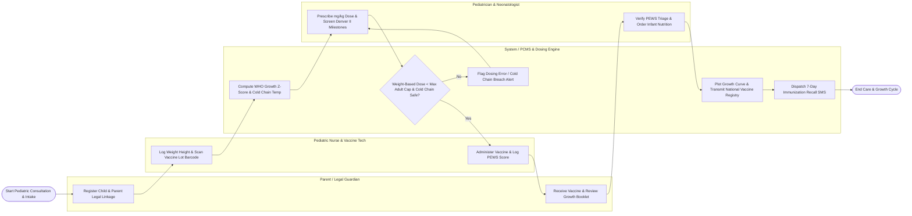

# Swimlane Diagram — Pediatric Care Management System

## Mermaid Code

## Flow Description | Mô tả luồng

| Lane | Actor / Subsystem | Role in Flow |
|------|-------------------|--------------|
| 1 | Parent / Legal Guardian | Registers child profile, links parent national IDs, presents child for growth checks and vaccinations, receives milestone guides, and receives SMS reminders. |
| 2 | Pediatric Nurse & Vaccine Tech | Measures child weight/height/head circumference, scans 2D vaccine lot barcodes, checks 2°C-8°C fridge temperatures, administers vaccines, and scores PEWS. |
| 3 | System / PCMS & Dosing Engine | Calculates WHO growth Z-scores, computes weight-based mg/kg drug dosing, checks maximum adult caps, validates cold chain safety, plots curves, and syncs NIIS. |
| 4 | Pediatrician & Neonatologist | Evaluates WHO growth percentiles, prescribes mg/kg medications, performs Denver II developmental screenings, assesses NICU neonates, and clears school health certs. |
