# Action Tree — Pediatric Care Management System

## Mermaid Code

```mermaid
graph TD
    Root["Pediatric Care Management System"]

    Root --> M1["Child Intake & Parent Linkage"]
    Root --> M2["WHO Growth Percentiles & Z-Scores"]
    Root --> M3["Weight-Based Dosing & Compounding"]
    Root --> M4["Immunization EPI & Cold Chain"]
    Root --> M5["Denver II Milestone Screening"]
    Root --> M6["NICU Neonatal & Incubator IoT"]
    Root --> M7["PEWS Emergency Triage & Safety"]
    Root --> M8["School Health & National Analytics"]

    M1 --> A11["Register Child Birth Certificate & Profile"]
    M1 --> A12["Link Father & Mother National IDs VNeID"]
    M1 --> A13["Verify Legal Guardianship & Consent Rights"]
    M1 --> A14["Log Family Medical History & Genetic Factors"]

    M2 --> A21["Record Weight Height Head Circumference"]
    M2 --> A22["Calculate WHO 2006 & CDC Growth Percentiles"]
    M2 --> A23["Plot Interactive Z-Score Growth Curve Charts"]
    M2 --> A24["Flag Stunting Wasting & Malnutrition Alerts"]

    M3 --> A31["Calculate Pediatric Drug Doses by mg per kg"]
    M3 --> A32["Enforce Maximum Adult Single Daily Dose Caps"]
    M3 --> A33["Generate Liquid Suspension Concentration Recipes"]
    M3 --> A34["Audit Pediatric Renal Function Schwartz CrCl"]

    M4 --> A41["Manage National EPI Immunization Schedule"]
    M4 --> A42["Scan 2D Matrix Barcodes on Vaccine Vials"]
    M4 --> A43["Monitor 2C to 8C Refrigerator Cold Chain IoT"]
    M4 --> A44["Dispatch Automated Vaccine Recall SMS Alerts"]

    M5 --> A51["Assess Gross Motor & Fine Motor Domains"]
    M5 --> A52["Assess Language & Personal Social Domains"]
    M5 --> A53["Calculate Denver II Age-Calibrated Milestones"]
    M5 --> A54["Issue Early Intervention Speech Therapy Orders"]

    M6 --> A61["Record APGAR Scores at 1 and 5 Minutes"]
    M6 --> A62["Track Gestational Age & Birth Weight Grams"]
    M6 --> A63["Stream NICU Incubator Temperature & SpO2"]
    M6 --> A64["Manage Kangaroo Mother Care Therapy Logs"]

    M7 --> A71["Calculate PEWS Score 0 to 9 Triage Scale"]
    M7 --> A72["Evaluate Respiratory Effort & Capillary Refill"]
    M7 --> A73["Trigger Automated PICU Rapid Response Alerts"]
    M7 --> A74["Track Pediatric Asthma & Eczema Action Plans"]

    M8 --> A81["Issue Digital School Health Clearance Certificates"]
    M8 --> A82["Record Pediatric Vision & Hearing Screening"]
    M8 --> A83["Render National Child Malnutrition Epidemiology"]
    M8 --> A84["Export EPI Vaccination Coverage Rate Bulletins"]
```

## Module Description | Mô tả Module

| # | Module | Description | Actions |
|---|--------|-------------|---------|
| 1 | Child Intake & Parent Linkage | Registers child profiles, links mother/father national IDs, verifies legal guardianship rights, and logs family medical histories. | Register Child Birth Certificate & Profile, Link Father & Mother National IDs VNeID, Verify Legal Guardianship & Consent Rights, Log Family Medical History & Genetic Factors |
| 2 | WHO Growth Percentiles & Z-Scores | Records physical growth measurements, calculates WHO 2006 / CDC percentiles and Z-scores, plots growth charts, and flags stunting/wasting. | Record Weight Height Head Circumference, Calculate WHO 2006 & CDC Growth Percentiles, Plot Interactive Z-Score Growth Curve Charts, Flag Stunting Wasting & Malnutrition Alerts |
| 3 | Weight-Based Dosing & Compounding | Calculates mg/kg pediatric doses, enforces maximum adult dose caps, generates oral liquid compounding recipes, and audits Schwartz CrCl. | Calculate Pediatric Drug Doses by mg per kg, Enforce Maximum Adult Single Daily Dose Caps, Generate Liquid Suspension Concentration Recipes, Audit Pediatric Renal Function Schwartz CrCl |
| 4 | Immunization EPI & Cold Chain | Manages national EPI vaccine schedules, scans 2D vial barcodes, monitors 2°C-8°C cold chain IoT telemetry, and sends SMS recall alerts. | Manage National EPI Immunization Schedule, Scan 2D Matrix Barcodes on Vaccine Vials, Monitor 2C to 8C Refrigerator Cold Chain IoT, Dispatch Automated Vaccine Recall SMS Alerts |
| 5 | Denver II Milestone Screening | Assesses Gross Motor, Fine Motor, Language, and Social domains, calculates age-calibrated milestones, and issues early intervention referrals. | Assess Gross Motor & Fine Motor Domains, Assess Language & Personal Social Domains, Calculate Denver II Age-Calibrated Milestones, Issue Early Intervention Speech Therapy Orders |
| 6 | NICU Neonatal & Incubator IoT | Records 1 & 5 min APGAR scores, tracks gestational age, streams NICU incubator environment telemetry (temp, SpO2), and logs Kangaroo Mother Care. | Record APGAR Scores at 1 and 5 Minutes, Track Gestational Age & Birth Weight Grams, Stream NICU Incubator Temperature & SpO2, Manage Kangaroo Mother Care Therapy Logs |
| 7 | PEWS Emergency Triage & Safety | Computes PEWS score (0-9), evaluates respiratory effort and capillary refill, triggers PICU rapid response alerts, and manages asthma action plans. | Calculate PEWS Score 0 to 9 Triage Scale, Evaluate Respiratory Effort & Capillary Refill, Trigger Automated PICU Rapid Response Alerts, Track Pediatric Asthma & Eczema Action Plans |
| 8 | School Health & National Analytics | Issues digital school health physical clearance certs, records hearing/vision screenings, renders malnutrition prevalence, and exports EPI reports. | Issue Digital School Health Clearance Certificates, Record Pediatric Vision & Hearing Screening, Render National Child Malnutrition Epidemiology, Export EPI Vaccination Coverage Rate Bulletins |
