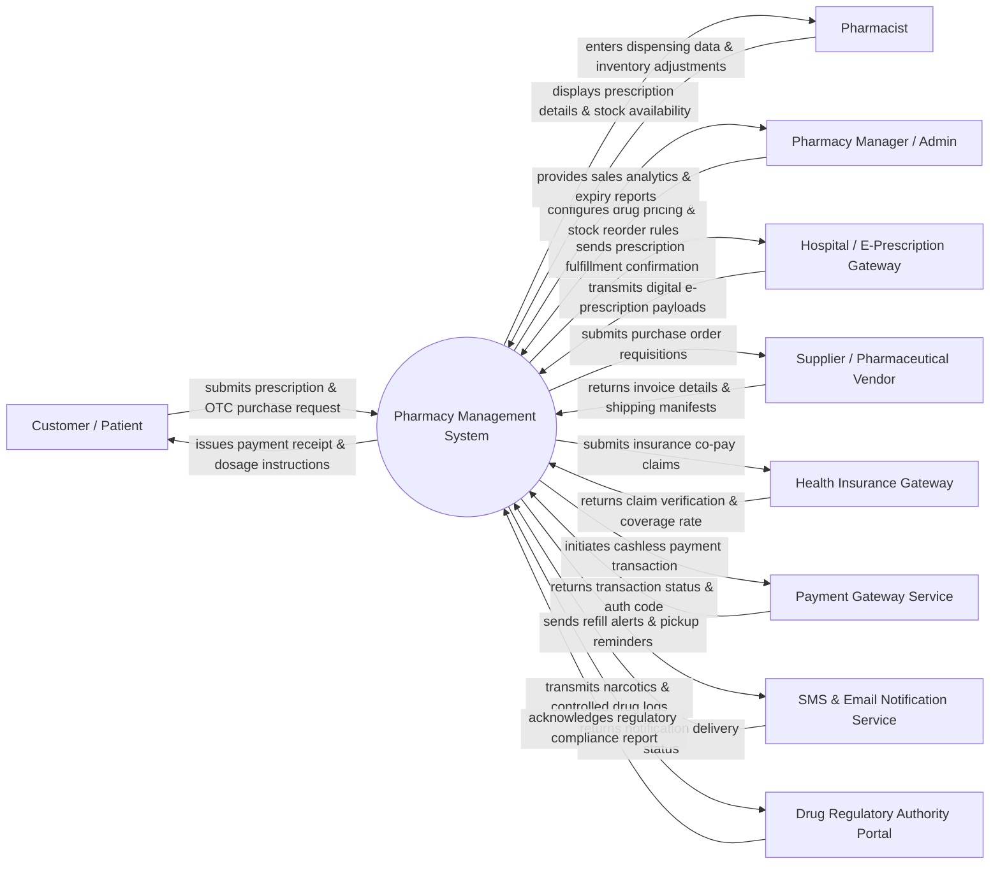

# Context Diagram — Pharmacy Management System

## Mermaid Code

## Actor & Interaction Table | Bảng Actor & Tương tác

| # | Actor | Actor Type | Data Sent TO System | Data Received FROM System | Notes |
|---|-------|------------|---------------------|---------------------------|-------|
| 1 | Customer / Patient | Primary | Prescription scans, OTC drug selections, customer contact info, payment tenders. | Dispensed medication receipts, itemized bills, drug dosage guides, refill notifications. | End-user buying over-the-counter (OTC) medicines or filling medical prescriptions. |
| 2 | Pharmacist | Primary | Dispensing confirmation, drug batch selection, allergy check overrides, stock counts. | E-prescription details, patient medication history, drug interaction alerts, dosage warnings. | Licensed clinical staff verifying prescriptions, preparing drugs, and counseling patients. |
| 3 | Pharmacy Manager / Admin | Primary | Master drug catalog updates, retail pricing schedules, reorder thresholds, user accounts. | Sales performance analytics, inventory turnover reports, stock expiry alerts, audit logs. | Manager overseeing daily retail operations, stock procurement, pricing, and system security. |
| 4 | Hospital / E-Prescription Gateway | Supporting | Electronic prescriptions (e-Rx), doctor credentials, patient diagnostic codes (ICD-10). | Prescription status updates (Filled, Cancelled, Partially Filled), dispensing timestamp. | External hospital or clinical electronic prescription system communicating via HL7/FHIR APIs. |
| 5 | Supplier / Pharmaceutical Vendor | Supporting | Product availability, wholesale drug price lists, shipping manifests, tax invoices. | Automated purchase orders, stock replenishment requisitions, payment advice notices. | Wholesale distributors and pharmaceutical manufacturers supplying medicines and medical supplies. |
| 6 | Health Insurance Gateway | Supporting | Co-pay authorization rules, covered drug formularies, claim approval/rejection tokens. | Itemized prescription claim requests, patient policy numbers, pharmacy provider IDs. | National health insurance or private medical insurance verification & claim processor API. |
| 7 | Payment Gateway Service | Supporting | Bank card tokens, e-wallet authorization status, payment reference numbers. | Payment authorization requests, order bill totals, merchant account credentials. | Third-party payment gateway processing credit cards, debit cards, and QR code payments. |
| 8 | SMS & Email Notification Service | Supporting | Transmission delivery receipts, message status codes, bounce alerts. | Outbound notification payloads (prescription ready alerts, refill reminders, OTPs). | External messaging engine handling automated customer reminders and operational alerts. |
| 9 | Drug Regulatory Authority Portal | Regulatory | Regulatory compliance guidelines, controlled drug quotas, audit verification receipts. | Mandatory narcotics usage logs, expired drug disposal reports, serialized track-and-trace data. | Ministry of Health or National Drug Administration enforcing pharmaceutical compliance laws. |

## System Boundary Description | Mô tả Phạm vi Hệ thống

The **Pharmacy Management System (PMS)** is an integrated software platform designed to manage complete retail and hospital pharmacy operations, including electronic prescription fulfillment, OTC point-of-sale (POS) operations, multi-batch inventory management, pharmaceutical purchasing, insurance co-pay processing, and regulatory reporting.

**Inside System Scope:**
- Validation and fulfillment of e-prescriptions and manual prescriptions with drug interaction safety checks.
- Over-the-counter (OTC) sales, barcode scanning, cash/cashless checkout, and digital receipt generation.
- Batch-level inventory control, expiration date tracking, FEFO (First-Expired, First-Out) stock allocation, and reorder point alerts.
- Supplier purchase order workflow, goods receipt note (GRN) matching, and inventory cost auditing.
- Maintenance of controlled substance logs (narcotics, psychotropics) in compliance with Ministry of Health regulations.
- Customer profile management, drug allergy history tracking, and automated refill reminder alerts.

**Outside System Scope:**
- Clinical diagnosis and physician prescription creation (handled within Hospital/Clinic E-Prescription systems).
- Physical drug manufacturing, quality control lab testing, and physical logistics shipping.
- Direct banking ledger processing (delegated to external Payment Gateways).
- Direct national insurance policy determination (delegated to external Health Insurance Portals).
