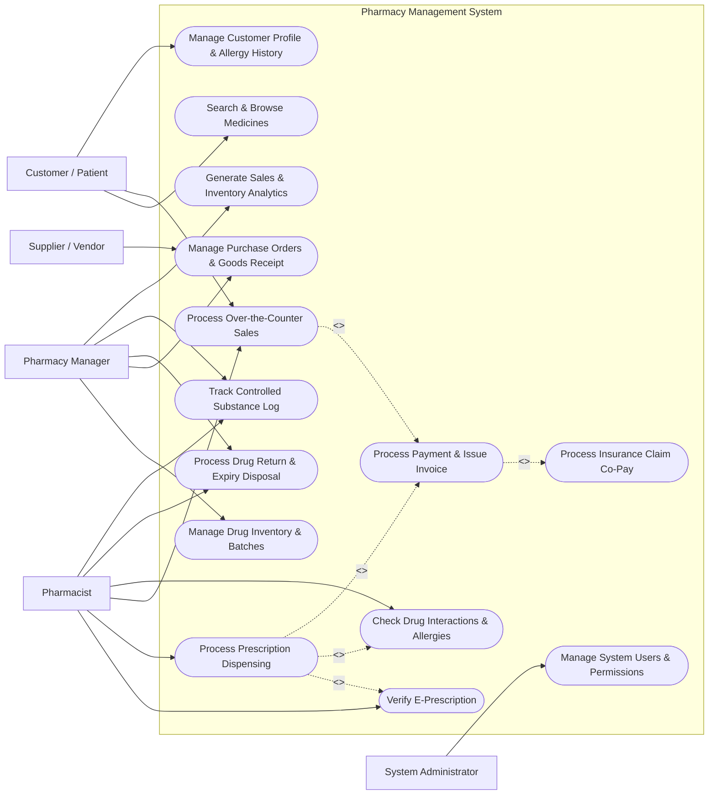

# Use Case Diagram — Pharmacy Management System

## Mermaid Code

## Actor Table | Bảng Actor

| # | Actor | Actor Type | Role Description | Related Use Cases |
|---|-------|------------|------------------|-------------------|
| 1 | Customer / Patient | Primary | End-user searching for medication, presenting prescriptions, making payments, and receiving dosage instructions. | UC01, UC04, UC12 |
| 2 | Pharmacist | Primary | Licensed healthcare professional validating prescriptions, checking drug interaction safety, dispensing drugs, and maintaining narcotics records. | UC02, UC03, UC04, UC06, UC10, UC11 |
| 3 | Pharmacy Manager | Primary | Operational manager responsible for stock reordering, supplier contracts, inventory auditing, drug pricing, and sales performance analysis. | UC08, UC09, UC10, UC11, UC13 |
| 4 | Supplier / Vendor | Secondary | Third-party distributor responding to purchase requisitions and providing order delivery invoices and manifests. | UC09 |
| 5 | System Administrator | Primary | Technical administrator responsible for role-based access control, security policies, system logs, and configuration setups. | UC14 |

## Use Case Table | Bảng Use Case

| # | UC ID | Use Case Name | Primary Actor | Secondary Actor | Description | Priority |
|---|-------|---------------|---------------|-----------------|-------------|----------|
| 1 | UC01 | Search & Browse Medicines | Customer / Patient | Pharmacist | Allows users to search the pharmacy database for available drugs, view active ingredients, dosage forms, and pricing. | Medium |
| 2 | UC02 | Verify E-Prescription | Pharmacist | Hospital E-Rx Gateway | Fetches and validates electronic prescriptions submitted by doctors, checking prescription authenticity, doctor license, and expiry date. | High |
| 3 | UC03 | Process Prescription Dispensing | Pharmacist | Customer / Patient | Manages the clinical workflow of picking prescribed drug batches, applying dosage instructions, printing labels, and reducing stock. | High |
| 4 | UC04 | Process Over-the-Counter Sales | Customer / Patient | Pharmacist | Handles direct retail counter sales of non-prescription medicines and general health products via barcode scanning. | High |
| 5 | UC05 | Process Payment & Issue Invoice | Pharmacist | Payment Gateway | Processes cash, credit card, or QR payments, calculates applicable taxes/discounts, and issues official sales invoices. | High |
| 6 | UC06 | Check Drug Interactions & Allergies | Pharmacist | System Engine | Automated safety check evaluating co-prescribed drugs against patient allergy history, duplicate therapies, and toxic drug interactions. | High |
| 7 | UC07 | Process Insurance Claim Co-Pay | Pharmacist | Health Insurance Gateway | Verifies patient insurance coverage status, calculates co-pay amounts, and submits electronic claim requests. | Medium |
| 8 | UC08 | Manage Drug Inventory & Batches | Pharmacy Manager | Pharmacist | Tracks inventory levels across warehouse and retail shelves, managing drug lots, manufacturing dates, and FEFO stock picking rules. | High |
| 9 | UC09 | Manage Purchase Orders & Goods Receipt | Pharmacy Manager | Supplier / Vendor | Creates procurement orders, receives shipped drug shipments, performs GRN matching, and updates inventory stock. | High |
| 10 | UC10 | Process Drug Return & Expiry Disposal | Pharmacy Manager | Pharmacist | Manages customer returns of damaged goods and segregates expired medications for regulated pharmaceutical disposal. | Medium |
| 11 | UC11 | Track Controlled Substance Log | Pharmacist | Pharmacy Manager | Records incoming, dispensing, and inventory balances of narcotics and psychotropic drugs for regulatory compliance auditing. | High |
| 12 | UC12 | Manage Customer Profile & Allergy History | Customer / Patient | Pharmacist | Creates and updates customer profiles, including contact numbers, insurance policy details, chronic conditions, and known drug allergies. | Medium |
| 13 | UC13 | Generate Sales & Inventory Analytics | Pharmacy Manager | System Engine | Generates operational dashboards detailing gross profit margins, fast-moving items, stockout risks, and inventory turnover ratios. | Medium |
| 14 | UC14 | Manage System Users & Permissions | System Administrator | System Engine | Manages user accounts, assigns security roles (Pharmacist, Manager, Cashier), and audits system access logs. | High |

## Use Case Specification | Đặc tả Use Case

---

### UC02 — Verify E-Prescription

| Field | Detail |
|-------|--------|
| **UC ID** | UC02 |
| **Use Case Name** | Verify E-Prescription |
| **Actor(s)** | Primary: Pharmacist   Secondary: Hospital / E-Prescription Gateway |
| **Description** | Pharmacist retrieves and verifies an electronic prescription from the central healthcare gateway to ensure authenticity, prescription validity, doctor licensing, and patient eligibility before drug dispensing. |
| **Precondition** | 1. Pharmacist is logged into the Pharmacy Management System with valid credentials.   2. The system has active API connectivity to the central E-Prescription Gateway. |
| **Main Flow** | 1. Pharmacist inputs the Prescription Code, Patient National ID, or scans the e-Rx QR code.   2. System transmits a lookup request payload to the E-Prescription Gateway.   3. System retrieves the prescription details (Doctor name, Clinic license, Patient name, ICD-10 diagnosis, prescribed drug list, dosage, duration).   4. System verifies that the prescription status is "Active / Unfilled" and has not expired.   5. System checks doctor credential status against the registered medical practitioner registry.   6. Pharmacist reviews the clinical appropriateness of the prescribed medications and confirms verification.   7. System updates the internal prescription status to "Verified - Ready for Dispensing". |
| **Alternative Flow** | **AF1** — Paper Prescription Entry: If the patient presents a physical paper prescription, Pharmacist manually inputs doctor license number, patient info, and prescribed medication list, attaching a digital image scan of the physical document.   **AF2** — Partial Filling Request: If the patient requests only a partial quantity of prescribed medicines, Pharmacist marks items for partial fulfillment, and System calculates remaining balance on the prescription. |
| **Exception Flow** | **EX1** — Prescription Expired or Already Filled: If the gateway returns status "Expired" or "Already Dispensed", System displays a red warning banner and blocks dispensing. Pharmacist notifies the patient.   **EX2** — Invalid Doctor License: If doctor credentials fail verification, System flags the prescription for suspicion of fraud and prevents checkout until manager authorization. |
| **Postcondition** | Electronic prescription details are locked in the local database and reserved for processing in dispensing workflow. |
| **Business Rule** | **BR1**: E-prescriptions for standard medications expire 30 days from issuance date.   **BR2**: E-prescriptions containing controlled substances (narcotics/psychotropics) require 2-factor doctor digital signature and expire within 5 days of issuance. |

---

### UC03 — Process Prescription Dispensing

| Field | Detail |
|-------|--------|
| **UC ID** | UC03 |
| **Use Case Name** | Process Prescription Dispensing |
| **Actor(s)** | Primary: Pharmacist   Secondary: Customer / Patient |
| **Description** | Pharmacist selects specific drug batches matching the verified prescription, verifies clinical safety alerts, prints dosage instruction labels, and prepares the physical medication package. |
| **Precondition** | 1. E-Prescription is in "Verified" status (UC02).   2. Patient is present at the pharmacy fulfillment counter. |
| **Main Flow** | 1. Pharmacist opens the verified prescription ticket.   2. System performs automated clinical check (UC06) for drug interactions, patient allergies, and age-specific dosage warnings.   3. Pharmacist selects the target medicine inventory batches using FEFO (First-Expired, First-Out) recommendation.   4. Pharmacist scans the barcode of each physical medicine package to verify correct drug item and lot number.   5. System matches scanned barcodes against prescribed items and confirms item validation.   6. System generates and prints custom drug dosage instruction labels (e.g., "Take 1 tablet twice daily after meals").   7. Pharmacist attaches labels to packages, updates fulfillment status, and routes order to POS payment (UC05). |
| **Alternative Flow** | **AF1** — Generic Drug Substitution: If prescribed brand-name drug is out of stock or patient requests a lower-cost alternative, Pharmacist selects an equivalent bio-generic drug with identical active ingredient and strength, recording substitution reason.   **AF2** — Stock Shortage Allocation: If available stock is less than prescribed quantity, Pharmacist adjusts dispensing quantity to available stock and issues a partial dispensing note for the remainder. |
| **Exception Flow** | **EX1** — Barcode Mismatch: If Pharmacist scans an incorrect medicine package, System emits an audible alert, displays "Item Mismatch Warning", and prevents label printing.   **EX2** — Severe Drug Interaction Detected: If System triggers a Class 1 severe interaction alert (UC06), dispensing is blocked until Pharmacist inputs clinical justification or contacts prescribing physician. |
| **Postcondition** | Selected inventory batch quantities are deducted, drug dosage labels are generated, and sales order ticket is forwarded to billing. |
| **Business Rule** | **BR1**: System must strictly enforce FEFO picking order; override requires manager pin authorization.   **BR2**: Generic drug substitution must be authorized by patient and permitted by regional health authority laws. |

---

### UC04 — Process Over-the-Counter Sales

| Field | Detail |
|-------|--------|
| **UC ID** | UC04 |
| **Use Case Name** | Process Over-the-Counter Sales |
| **Actor(s)** | Primary: Customer / Patient   Secondary: Pharmacist |
| **Description** | Pharmacist or cashier scans over-the-counter (OTC) healthcare items, dietary supplements, and non-prescription goods at the point-of-sale terminal to complete a direct retail sale. |
| **Precondition** | 1. POS terminal is active and barcode scanner is connected.   2. Customer presents items for purchase at the counter. |
| **Main Flow** | 1. Cashier initiates a new OTC Sales transaction on the POS interface.   2. Cashier scans item barcodes on each product package.   3. System identifies products, retrieves unit prices, verifies stock availability, and adds items to the cart line.   4. Cashier adjusts item quantities if necessary.   5. System computes subtotal, item discounts, applicable VAT tax rates, and total payable amount.   6. Cashier initiates payment collection step (UC05).   7. Upon successful payment confirmation, System updates stock balances and prints itemized receipt. |
| **Alternative Flow** | **AF1** — Customer Loyalty Application: Cashier inputs customer phone number; System checks active loyalty points, applies membership tier discount, and awards earned points upon order completion.   **AF2** — Manual Product Search: If product barcode is damaged or unreadable, Cashier manually searches item by product name or active ingredient code on the POS screen. |
| **Exception Flow** | **EX1** — Out of Stock Item: If scanned item quantity exceeds available batch stock, System displays "Insufficient Shelf Stock" warning and prompts inventory recount.   **EX2** — OTC Quantity Limit Exceeded: If customer attempts to purchase restricted pseudoephedrine/OTC medicines above statutory purchase limits, System flags restriction and limits cart quantity. |
| **Postcondition** | Retail sale is recorded, inventory stock is immediately deducted, and sales revenue is posted to cash register session. |
| **Business Rule** | **BR1**: OTC sales containing restricted precursor chemicals (e.g., Ephedrine, Pseudoephedrine) must not exceed statutory daily limits per customer ID. |

---

### UC06 — Check Drug Interactions & Allergies

| Field | Detail |
|-------|--------|
| **UC ID** | UC06 |
| **Use Case Name** | Check Drug Interactions & Allergies |
| **Actor(s)** | Primary: Pharmacist   Secondary: System Engine |
| **Description** | Automated system verification analyzing prescribed and OTC medications against patient active drug profile, allergy records, age, pregnancy status, and duplicate therapeutic classes to prevent adverse drug events. |
| **Precondition** | 1. Patient profile with recorded drug allergies and history is loaded.   2. Medication items are added to dispensing or checkout cart. |
| **Main Flow** | 1. System automatically executes clinical check rules engine when drugs are added to prescription order.   2. System queries clinical knowledge database for Drug-Drug Interactions (DDI), Drug-Allergy conflicts, Drug-Food interactions, and Duplicate Therapies.   3. System checks patient allergy profile against active pharmaceutical ingredients (API) of prescribed medicines.   4. If no severe conflicts are detected, System displays a green "Clinical Safety Check Passed" status.   5. Pharmacist proceeds with dispensing workflow (UC03). |
| **Alternative Flow** | **AF1** — Mild Interaction Warning: If a Level 3 (Mild) interaction is detected, System presents an informational clinical note (e.g., "Administer 2 hours apart from calcium supplements"). Pharmacist acknowledges note and continues dispensing. |
| **Exception Flow** | **EX1** — Severe Allergy Match: If prescribed medicine contains an ingredient matching patient documented allergy (e.g., Penicillin allergy), System raises a critical Red Alert popup, blocks dispensing, and requires Pharmacist to consult physician.   **EX2** — Contraindicated Interaction (Level 1): System flags fatal drug interaction (e.g., Sildenafil + Nitrates), locks order, and logs mandatory override reason if overridden by authorized Senior Pharmacist. |
| **Postcondition** | Safety analysis results and any override justifications are recorded in the dispensing audit log. |
| **Business Rule** | **BR1**: Level 1 (Contraindicated) drug interaction alerts cannot be bypassed without written physician consent and Senior Pharmacist digital signature. |

---

### UC08 — Manage Drug Inventory & Batches

| Field | Detail |
|-------|--------|
| **UC ID** | UC08 |
| **Use Case Name** | Manage Drug Inventory & Batches |
| **Actor(s)** | Primary: Pharmacy Manager   Secondary: Pharmacist |
| **Description** | Pharmacy Manager manages drug master catalog, batch numbers, expiration dates, stock reorder levels, shelf locations, and performs physical inventory stock counts. |
| **Precondition** | 1. Pharmacy Manager is logged in with inventory management privileges. |
| **Main Flow** | 1. Manager opens Inventory Management module.   2. System displays master list of medicines, active stock levels, batch breakdown, expiration timelines, and reorder alerts.   3. Manager filters items by category, manufacturer, or expiring batch range (e.g., expiring within 90 days).   4. Manager updates product details, minimum/maximum reorder stock thresholds, or retail pricing rules.   5. Manager schedules or conducts stock audit count, recording physical shelf quantities.   6. System calculates stock variance (Discrepancy = Physical Count - System Count) and posts adjustment logs.   7. System updates master inventory ledger. |
| **Alternative Flow** | **AF1** — Batch Transfer: Manager transfers specific drug batches from main warehouse storage location to front retail dispensing shelves.   **AF2** — Automatic Reorder Generation: System evaluates current stock against minimum threshold rules and automatically drafts purchase order requisitions (UC09). |
| **Exception Flow** | **EX1** — Negative Stock Discrepancy: If physical stock count is significantly lower than system count, System flags potential shrinkage/theft and requires manager explanation before adjusting balance. |
| **Postcondition** | Drug inventory levels, batch status records, and stock adjustment audit trails are updated. |
| **Business Rule** | **BR1**: System must enforce FEFO (First-Expired, First-Out) batch allocation during picking.   **BR2**: Stock adjustment exceeding $100 value requires dual sign-off by Pharmacy Manager and Store Director. |
