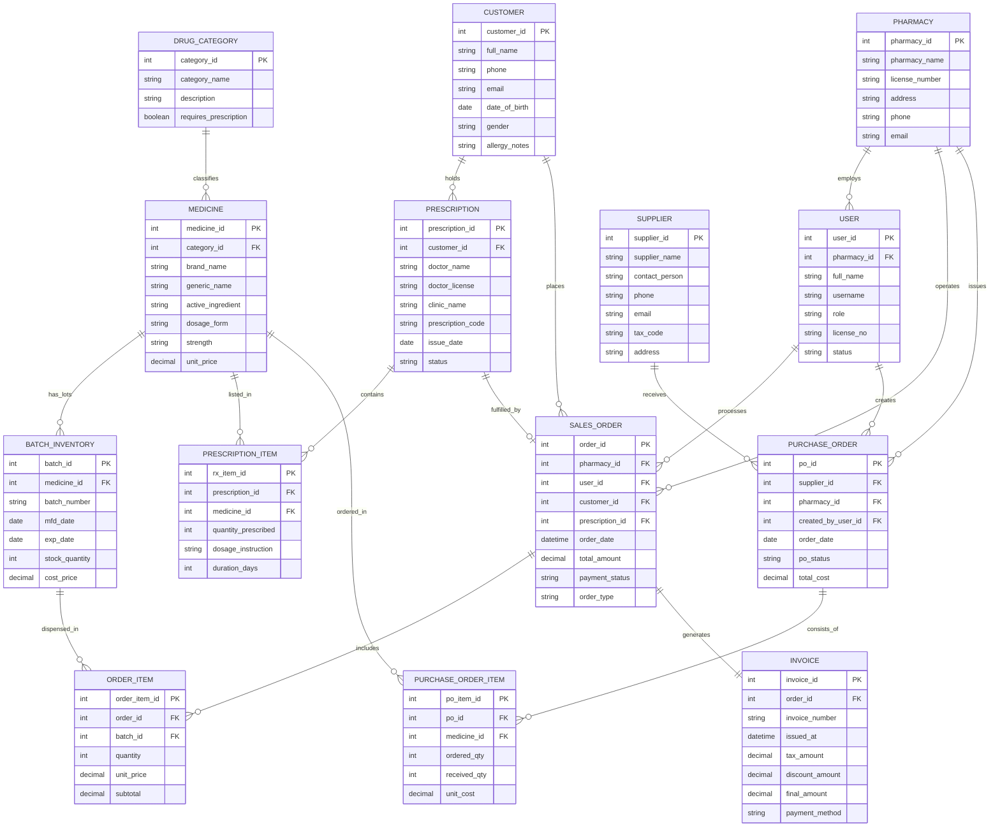

# Conceptual ERD — Pharmacy Management System

## Mermaid Code

## Entity Description Table | Bảng mô tả Entity

| # | Entity Name | Vietnamese Name | Description | Key Attributes | Main Relationships |
|---|-------------|-----------------|-------------|----------------|-------------------|
| 1 | PHARMACY | Nhà thuốc | Represents the pharmacy retail store entity, holding operating license, location address, and store settings. | pharmacy_id, pharmacy_name, license_number | Employs Users, operates Sales Orders, issues Purchase Orders. |
| 2 | USER | Nguời dùng / Nhân viên | System staff accounts including Pharmacists, Pharmacy Managers, Cashiers, and Admins. | user_id, username, role, license_no | Belongs to Pharmacy, processes Sales Orders, creates Purchase Orders. |
| 3 | CUSTOMER | Khách hàng / Bệnh nhân | Individual customers purchasing medicines, storing demographic data, chronic condition history, and drug allergies. | customer_id, full_name, phone, allergy_notes | Holds Prescriptions, places Sales Orders. |
| 4 | DRUG_CATEGORY | Danh mục Thuốc | Pharmacological category classification (e.g., Antibiotics, Analgesic, Cardiovascular, OTC vs Prescription-only). | category_id, category_name, requires_prescription | Classifies Medicines. |
| 5 | MEDICINE | Thuốc / Dược phẩm | Master drug item catalog detailing brand name, generic active ingredient, dosage form (tablet, syrup), and unit price. | medicine_id, brand_name, generic_name, active_ingredient | Belongs to Category, has Batch Inventories, listed in Prescription Items. |
| 6 | BATCH_INVENTORY | Lô hàng / Tồn kho theo lô | Specific manufactured drug lots detailing batch code, manufacturing date, expiration date, cost price, and shelf stock quantity. | batch_id, batch_number, exp_date, stock_quantity | Belongs to Medicine, dispensed in Order Items. |
| 7 | PRESCRIPTION | Đơn thuốc | Electronic or scanned paper prescription issued by a licensed physician for a customer. | prescription_id, doctor_name, doctor_license, issue_date | Belongs to Customer, contains Prescription Items, fulfilled by Sales Order. |
| 8 | PRESCRIPTION_ITEM | Chi tiết Đơn thuốc | Line items in a prescription specifying prescribed drug, dosage instructions, frequency, and treatment duration. | rx_item_id, quantity_prescribed, dosage_instruction | Belongs to Prescription, references Medicine. |
| 9 | SALES_ORDER | Đơn hàng Bán | Transaction header for retail OTC sales or prescription dispensing orders. | order_id, order_date, total_amount, payment_status | Placed by Customer, processed by User, includes Order Items, generates Invoice. |
| 10 | ORDER_ITEM | Chi tiết Đơn hàng Bán | Specific drug items and inventory batch lots dispensed within a sales order. | order_item_id, quantity, unit_price, subtotal | Belongs to Sales Order, links to Batch Inventory. |
| 11 | SUPPLIER | Nhà cung cấp | Pharmaceutical wholesale vendor supplying medicines and medical supplies. | supplier_id, supplier_name, tax_code, contact_person | Receives Purchase Orders. |
| 12 | PURCHASE_ORDER | Đơn đặt hàng Cung ứng | Requisition order submitted to suppliers for restocking inventory. | po_id, order_date, po_status, total_cost | Issued by Pharmacy, sent to Supplier, consists of PO Items. |
| 13 | PURCHASE_ORDER_ITEM | Chi tiết Đơn đặt hàng Cung ứng | Line items in a procurement purchase order detailing requested drug quantities and unit costs. | po_item_id, ordered_qty, received_qty, unit_cost | Belongs to Purchase Order, references Medicine. |
| 14 | INVOICE | Hóa đơn Bán hàng | Financial sales invoice generated for a completed sales transaction, detailing taxes, discounts, and payment method. | invoice_id, invoice_number, tax_amount, final_amount | Belongs to Sales Order. |

## Relationship Description | Mô tả Quan hệ

| # | From Entity | Cardinality | To Entity | Relationship Label | Business Explanation |
|---|-------------|-------------|-----------|-------------------|----------------------|
| 1 | PHARMACY | one-to-many | USER | employs | A pharmacy store employs one or more staff members (pharmacists, cashiers, managers). |
| 2 | PHARMACY | one-to-many | SALES_ORDER | operates | A pharmacy operates many retail sales orders and prescription dispensing transactions. |
| 3 | PHARMACY | one-to-many | PURCHASE_ORDER | issues | A pharmacy issues purchase orders to stock procurement suppliers. |
| 4 | USER | one-to-many | SALES_ORDER | processes | A staff user (pharmacist/cashier) processes multiple sales orders. |
| 5 | USER | one-to-many | PURCHASE_ORDER | creates | A pharmacy manager user creates inventory purchase requisitions. |
| 6 | CUSTOMER | one-to-many | PRESCRIPTION | holds | A customer may present multiple medical prescriptions over time. |
| 7 | CUSTOMER | one-to-many | SALES_ORDER | places | A customer can place multiple OTC or prescription sales orders. |
| 8 | DRUG_CATEGORY | one-to-many | MEDICINE | classifies | A drug category classifies multiple individual medicine products. |
| 9 | MEDICINE | one-to-many | BATCH_INVENTORY | has_lots | A medicine product master can have multiple inventory batches with different expiration dates. |
| 10 | MEDICINE | one-to-many | PRESCRIPTION_ITEM | listed_in | A medicine product can appear as a line item across multiple prescriptions. |
| 11 | MEDICINE | one-to-many | PURCHASE_ORDER_ITEM | ordered_in | A medicine product can be ordered across multiple procurement purchase orders. |
| 12 | PRESCRIPTION | one-to-many | PRESCRIPTION_ITEM | contains | A prescription contains one or more prescribed medication line items. |
| 13 | PRESCRIPTION | one-to-one | SALES_ORDER | fulfilled_by | A verified prescription is fulfilled by exactly one sales order transaction. |
| 14 | BATCH_INVENTORY | one-to-many | ORDER_ITEM | dispensed_in | A specific drug inventory batch lot is dispensed across multiple sales order line items. |
| 15 | SALES_ORDER | one-to-many | ORDER_ITEM | includes | A sales order includes one or more itemized sales lines. |
| 16 | SALES_ORDER | one-to-one | INVOICE | generates | Each completed sales order generates exactly one financial tax invoice. |
| 17 | SUPPLIER | one-to-many | PURCHASE_ORDER | receives | A pharmaceutical supplier receives purchase orders from the pharmacy. |
| 18 | PURCHASE_ORDER | one-to-many | PURCHASE_ORDER_ITEM | consists_of | A purchase order consists of one or more requested drug items. |
